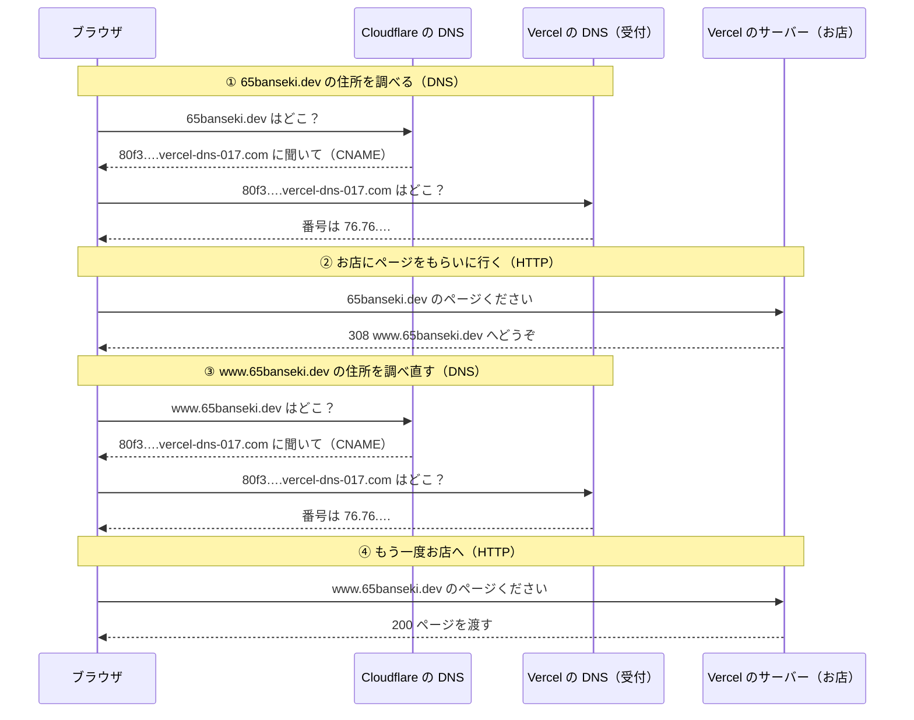

このブログはvercelで公開されています。

65banseki.devというドメインを別途購入して、vercelで公開したサイトに紐づけています。

ユーザのアクセスの経路を辿ってDNSを理解しましょう。

一言でいえばDNSは住所データベースのようなものです。

ブラウザは65banseki.devにアクセスする際にDNSに問い合わせします。

65banseki.devってどこのサーバーなの？

これでDNSは登録されているサーバーのアドレスを返却します。

ブラウザは受け取ったアドレスでアクセスしにいきます。このアクセス先がvercelになります。

ところでなぜDNSはアドレスを返せたのでしょうか？

実は私がDNSに「65banseki.devが来たらvercelのあのサーバーだから聞かれたら返しておいて」とあらかじめ設定しておいたからです。

この設定の詳細を説明します。

まずvercelでアプリを公開したらvercelのプロジェクト設定からドメインを追加します。
これを追加することでcloudflare側のDNSに登録する名前（`80f3….vercel-dns-017.com`）が発行されます。この名前は、vercelのDNSに聞けばvercelのサーバーのIPアドレスが分かる名前です。（ちなみにドメインを追加することで、vercelのサーバーに「65banseki.devへのアクセスは公開したアプリへ振り分けて」と登録しています。）
cloudflare側のDNSにvercelが発行した名前を登録することで、ブラウザ→cloudflareのDNS→vercelのDNS→vercelのサーバーのようにたどることができます。

私はこのとき65banseki.devを設定しました。

すると自動的にwww.65banseki.devも設定され、よく見ると65banseki.devがwww側へリダイレクトされていました。
このとき308 Permanent Redirectになっていました。これは恒久的なリダイレクトでページが完全に移動したことを意味します。formの内容などもそのまま送信されます。301よりも新しいステータス。
つまり65banseki.devに来た人には、wwwが本物なのでそっちを見に行ってねと案内するようになったわけです。私は初めて公開するのになぜこんな事が起きるのでしょうか？
理由としては、DNSの本来の決まりではwwwがついていないドメインにCNAMEという種類の行を書けないからです。CNAMEを書けるwwwを本物にしておくほうが扱いやすいので、Vercelが気を使ってwwwを作り、本物にしてくれたわけです。
どうせwebサイト公開するならCNAMEで設定できるほうが楽だから、wwwを本物にしておいたぜ。って感じです。

ところでCNAMEってなんでしょうか？これはDNSで必要になるものです。

DNSはドメインからアドレスを引くマッパーです。レコードでマッピング状態を管理します。
実際に設定するDNSは次のようになります。
| Name | Type | Value |
|------|-------|--------------|
| @ | CNAME | `80f3….vercel-dns-017.com.` |
| www | CNAME | `80f3….vercel-dns-017.com.` |

Nameの@はドメインそのものである65banseki.devを指す略記になります。wwwと書いた場合は、www.@となります。
CNAME(Canonical Name)はドメイン名からドメイン名への紐付けに使います。
ちなみにDNSの決まりではドメインそのものにはCNAMEがかけないらしいです。「このドメインの管理者は誰か」といった必須の行がすでに@にあります。これをSOAレコードやNSレコードといいます。
それでも表の@にCNAMEを書けるのは、CloudflareのCNAME flatteningという機能のおかげです。Cloudflareが裏でVercelのDNSに聞いてIPアドレスに引き直し、ブラウザにはAの行のふりをしてIPアドレスだけを返すので、決まりを守ったまま書けます。
Valueにはvercelが発行した名前を登録します。IPアドレスを直接書くのはAという種類の行です。
またCloudflareの設定としてProxy statusはDNSオンリーという設定にします。
アプリへのアクセス時にCloudflareを経由させるか？の設定でDNSオンリーにすることで経由しないようにします。
なぜ無効にするのか？有効にした場合、DNSはVercelではなくCloudflareの中継所のアドレスを返すので、リクエストは中継所を経由してアプリに届きます。キャッシュや攻撃の防御といった Cloudflare の機能が使えるようになります。
無効にするのは、Vercel 自身がキャッシュも防御も持っており、中継所が二重になるからです。古いページが中継所に残る、Vercel のボット対策が効かなくなる、といった問題が出るので、Vercel は DNS only を勧めています。

これでブラウザがリクエストを飛ばすと

