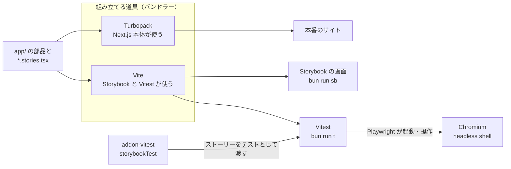
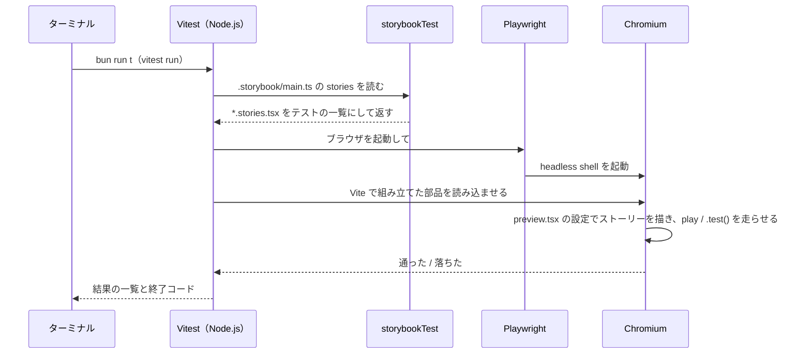

# 2-7: addon-vitest でストーリーをそのままテストにし、タグを押したときの動きと計測の呼び出しを確かめる

- 起票日: 2026-11-15
- 学習計画: 設計の全体像は `docs/design/20260925-blog-design-proposal.md` の「デザインシステムの作り方」。2-6 以降の順番は ADR `20261111-0041-storybook-detour.md`
- ADR: `docs/adr/20261115-2106-component-tests-with-addon-vitest.md`（この回で決めたこと。状態は「提案」）
- ステータス: 保留（2026-11-15。公開できる見た目の段 3-1〜3-7 のあとに戻る。ADR `20261115-2117-publishable-home-before-storybook.md`）

## 全体のどこか

「見た目を作る」段の8回目で、Storybook の寄り道（2-6〜2-9）の2回目。2-6 で作ったカタログの上に、**テストを走らせる層**を足す。2-8 では、この回で作ったテストの仕組みに a11y の検査を載せ、違反があれば落ちる形にする。

| Step | 内容                                                                              | 進捗           |
| ---- | --------------------------------------------------------------------------------- | -------------- |
| 2-0  | デザインシステムとは何かを知り、今のサイトを棚卸しする                            | ■□□ 進行中     |
| 2-1  | Panda CSS v2 を入れ、Tailwind CSS を外す                                          | ■■■ 完了       |
| 2-2  | 基本トークン（色・文字の大きさ・余白）を作る                                      | ■■■ 完了       |
| 2-3  | 意味トークンとダークモードを作る                                                  | ■■■ 完了       |
| 2-4  | 記事ページの文字組みを整える（最初の実戦）                                        | ■■■ 完了       |
| 2-5  | 状態を持たない部品（タグ・カード）を作り、`/design-system` に並べる               | ■■■ 完了       |
| 2-6  | Storybook 11 を CSF Next で入れ、タグとカードをスマートフォン幅のカタログに並べる | ■■■ 完了       |
| 2-7  | addon-vitest で部品のテストを書く                                                 | □□□ ← いまここ |
| 2-8  | a11y の自動検査を、違反があれば落ちる形にする                                     | □□□            |
| 2-9  | 自動検査で拾えない a11y を確かめる                                                | □□□            |
| 2-10 | 2-5 の残りの部品（リンク・コードブロック）を、ストーリーとテストつきで作る        | □□□            |
| 2-11 | React Aria で状態を持つ部品（テーマ切り替え・メニュー）を作る                     | □□□            |
| 2-12 | React Aria で目次を作る。PC では記事の右に固定し、スマートフォンでは開閉する      | □□□            |
| 2-13 | React Aria のフックに置き換え、さらに自作に置き換える                             | □□□            |

作業ブランチは作らず、`dev` に直接コミットする。

この回で扱わないもの: a11y の違反でテストを落とす設定（2-8）、カバレッジ（テストがコードのどこを通ったかの割合）、Storybook の外に置く普通のテストファイル（`*.test.ts`）、Playwright でページ全体を操作するテスト、GitHub Actions でテストを走らせること。

## なぜこれをやるか

2-6 で、部品を1つずつ取り出して眺める場所ができた。ただ、眺めるのは人の目なので、部品を直したときに「前と同じように動くか」を毎回目で確かめることになる。

addon-vitest を入れると、**2-6 で書いたストーリーがそのままテストになる**。新しくテスト用のファイルを作らなくても、「このストーリーは描けるか」が自動で確かめられる。そこに「押したらどうなるか」を書き足せば、操作の結果も確かめられる。

2-11 から作る React Aria の部品は、開く・閉じる・選ぶといった状態を持つ。状態を持つ部品は、目で確かめる組み合わせが一気に増える。その前に、ストーリーにテストを書き足す流れをタグで一度通しておく。2-8 の a11y の自動検査もこの回で作るテストの仕組みの上で走る。

## 周辺知識

### 全体の地図（どの道具が、どこで、何を組み立てるか）



図から分かること:

- 同じ部品を、Next.js 本体は Turbopack で、Storybook と Vitest は Vite で、別々に組み立てている。Storybook の中で `app/layout.tsx` が通らないのも、テストの中で `next/link` が代役に差し替わるのも、この分かれ方から来ている
- Vitest 自身はストーリーの読み方を知らない。ストーリーをテストに変えて渡すのは addon-vitest の `storybookTest` プラグインの仕事
- テストの実行は Node.js の上の Vitest と、ブラウザ（Chromium）の中の2か所にまたがる。その間をつなぐのが Playwright

`bun run t` を打ってから結果が返るまでは、次の順に進む。



図から分かること:

- 「ブラウザが見つからない」は Playwright の段で、「`experimentalTestSyntax` を有効に」は Chromium の中でストーリーを走らせる段で出るエラー。どこで止まったかが分かれば、直す場所の見当が付く
- 画面は出ないが、ストーリーは本物のブラウザで描かれている。CSS もフォントも効いた状態で確かめている

### 用語

| 用語           | たとえ                                                            | 正確な意味                                                                                             | この回での出番                                    |
| -------------- | ----------------------------------------------------------------- | ------------------------------------------------------------------------------------------------------ | ------------------------------------------------- |
| バンドラー     | 引っ越しの荷造り係。散らばった荷物を、運べる箱にまとめる          | 多数のソースファイルと依存を、ブラウザが読める少数のファイルにまとめる道具                             | Next.js は Turbopack、Storybook と Vitest は Vite |
| Vite           | 荷造り係の1人。開発中は箱詰めを後回しにして、頼まれた荷物から渡す | 開発サーバーとビルドを受け持つバンドラー。Storybook の `@storybook/nextjs-vite` と Vitest が土台にする | 2-6 で入れた。この回は Vitest が使う              |
| Vitest         | 検品係。品物を集めて確かめ、合否の一覧を返す                      | Vite の設定で動くテストランナー（テストを集めて走らせ、結果をまとめる道具）                            | 手順 1 で入れ、`bun run t` で動かす               |
| ブラウザモード | 模型ではなく本物の店舗で検品する                                  | Vitest のテストを、Node.js の中ではなく本物のブラウザの中で走らせる動かし方                            | `vitest.config.ts` の `browser.enabled: true`     |
| headless       | 照明を消した店舗。見る人がいないので画面を出さない                | 画面を描かずに動くブラウザ。Playwright では headless shell という専用の Chromium を使う                | 手順 2 で `--only-shell` で入れる                 |
| Playwright     | 店舗の鍵を開け、検品係の指示どおりに棚を操作する係                | ブラウザを起動し、プログラムから操作する道具。Vitest とは `@vitest/browser-playwright` でつなぐ        | 手順 1・2                                         |
| smoke test     | 電源を入れて煙が出ないかだけ見る                                  | 動かしてエラーにならないかだけを確かめる、最低限のテスト                                               | 手順 4 の「描けるか」                             |
| play 関数      | ストーリーに添えた台本                                            | ストーリーを描いたあとに走る関数。操作と確かめを書く。ストーリーを開くたびに走る                       | 手順 5                                            |
| `.test()`      | 1枚の写真に貼る複数のチェック表                                   | ストーリーに名前つきのテストをぶら下げる書き方。Storybook 11 でも実験的な機能                          | 手順 8                                            |
| `fn()`         | 記録係つきの小道具                                                | 中身は何もしないが、何回・どんな引数で呼ばれたかを覚えている偽物の関数（モック）                       | 手順 5 の `onClick`、手順 9 の `track`            |
| `beforeEach`   | 撮影前の舞台の準備と、終わったあとの片付け                        | ストーリーを描く前に走る関数。戻り値の関数は片付けのときに呼ばれる                                     | 手順 9 で `window.umami` に偽物を置く             |
| `getByRole`    | 「〜という名前のボタン」と、役目と名札で探す                      | Testing Library の問い合わせ。読み上げソフトが使う役割（role）と名前で要素を探す                       | 手順 5・8・9 で `link` を探す                     |

### 設計の考え方

**ストーリーをテストの単位にする。** 部品の「見せたい状態」はストーリーとしてすでに書いてある。テストのために同じ状態をもう一度組み立てるのは二度手間で、片方だけ直し忘れるとずれる。addon-vitest は、ストーリーを書いた時点で「描けるか」のテストが1つ増える形にして、この二度手間をなくしている。確かめたいことがあれば、そのストーリーに書き足す。

**本物のブラウザで動かす。** jsdom のような「ブラウザの真似」は速いが、CSS のレイアウトや色、フォーカスの動きは本物どおりには動かない。ブラウザモードは、起動に時間がかかり、ブラウザのダウンロードも要る。その代わり、画面で見たものと同じ状態を確かめられる。2-8 の a11y の検査は色のコントラストやフォーカスを見るので、この形が前提になる。

**`play` は見せるため、`.test()` は確かめるため。** `play` はストーリーそのものの一部で、ストーリーを開くたびに走る。「メニューを開いた状態」のように、操作したあとの見た目をストーリーとして見せたいときに向く。`.test()` はストーリーの外にぶら下がる確かめで、1つのストーリーにいくつでも付けられ、`extend` で派生させたストーリーには引き継がれない（実測）。確かめごとが増えても、ストーリーの見た目には影響しない。

### ベストプラクティス

- **要素は役割と名前で探す。** Testing Library は問い合わせの優先順位の1番目に `getByRole` を挙げ、`getByTestId` は最後の手段としている（出典: https://testing-library.com/docs/queries/about/#priority ）。役割と名前は、人や読み上げソフトが部品を見分ける手がかりと同じなので、見た目のクラス名を変えてもテストが壊れにくい。このリポジトリでも `getByRole` を使う
- **CI では Playwright を使う。** Vitest のブラウザモードは、CI で動かすには Playwright か WebdriverIO が要り、並列で動かせる Playwright から始めることを勧めている（出典: https://vitest.dev/guide/browser/ ）。このリポジトリも Playwright にする。CI での実行はこの回では扱わない
- **既存の Vitest のテストとは組（project）を分ける。** Storybook の公式は addon-vitest のテストを別の組にすることを勧めている（出典: https://storybook.js.org/docs/11/writing-tests/integrations/vitest-addon ）。今は普通のテストがないので組は1つだが、`vitest.config.ts` は最初から `projects` で書き、あとで組を足せるようにしておく
- **外に送る処理は偽物に差し替える。** テストのたびに本物の Umami へ記録を送ると、本番の数字が汚れる。部品が「正しく頼んだか」だけを `fn()` で確かめる

### 比較（テストをどこで動かすか）

| 案                                         | 得意なこと                                                             | 引き換えにするもの                                                    | この回で採るか                                   |
| ------------------------------------------ | ---------------------------------------------------------------------- | --------------------------------------------------------------------- | ------------------------------------------------ |
| jsdom（Node.js の中でブラウザを真似る）    | 起動が速い。ブラウザのダウンロードが要らない                           | CSS のレイアウトや色が本物どおりに動かない。a11y の色の検査に向かない | 採らない                                         |
| happy-dom（jsdom より軽い真似）            | jsdom よりさらに速い                                                   | 真似の範囲が jsdom より狭く、本物との差が出やすい                     | 採らない                                         |
| Vitest のブラウザモード（本物の Chromium） | 部品を本番と同じ描画で確かめられる。ストーリーをそのままテストにできる | 起動が遅い。ブラウザ（約 205 MB）のダウンロードが要る                 | 採る                                             |
| Playwright の E2E（ページ全体を操作）      | 本物のサイトを、人と同じ順に操作して確かめられる                       | 部品1つを確かめるには大きすぎる。サーバーの起動も要る                 | この回では採らない。画面全体の操作を試す回で扱う |

テストランナーとしては、長く Jest が使われてきた。Vitest は Jest とほぼ同じ書き方のまま、Vite の設定と組み立てをそのまま使えるように作られた。Storybook と同じ Vite の上で動くので、ストーリーを組み立てる設定を共有できる。

### 比較（`play` と `.test()`）

出典: https://storybook.js.org/docs/11/writing-stories/csf/api 、2026-11-15 確認。

|                         | `play`                      | `.test()`                                                                 |
| ----------------------- | --------------------------- | ------------------------------------------------------------------------- |
| 書く場所                | `meta.story({ play })` の中 | `Story.test("名前", 関数)` とストーリーの外に書く                         |
| 1つのストーリーに       | 1つだけ                     | いくつでも                                                                |
| 画面で開いたとき        | ストーリーを開くたびに走る  | サイドバーで、ストーリーの下に子として並ぶ                                |
| `extend` で派生させると | 引き継がれる（実測）        | 引き継がれない（実測）                                                    |
| 状態                    | 正式な機能                  | 実験的な機能。`main.ts` の `features.experimentalTestSyntax` で有効にする |

- どちらも関数は `{ canvas, userEvent, args }` を受け取る。`canvas` はストーリーの中だけを探す問い合わせ、`userEvent` は人の操作の真似
- `expect` と `fn` は `storybook/test` から import する。資料の一部には `@storybook/test` とあるが、10 以降は `storybook/test`
- `storybook/test` の `expect` には、Vitest にある `toHaveBeenCalledExactlyOnceWith` の型がない。実行すると通るが、型検査が止める（実測）

### 現時点のバージョン（2026-11-15 確認）

| パッケージ                   | バージョン    | この回での扱い                                                                    |
| ---------------------------- | ------------- | --------------------------------------------------------------------------------- |
| `@storybook/addon-vitest`    | 11.0.0-beta.1 | 新しく入れる。ほかの `@storybook/` とそろえる。beta.2 以降はまだ入らない          |
| `vitest`                     | 5.1.0         | 新しく入れる（11-03 公開）                                                        |
| `@vitest/browser-playwright` | 5.1.0         | 新しく入れる。`vitest` と同じ版にしないと動かない                                 |
| `playwright`                 | 1.65.0        | 新しく入れる。1.65.1 は 11-17 6:15（日本時間）まで `minimumReleaseAge` で入らない |
| `@types/node`                | 24.19.2       | 20.19.43 から上げる。Vitest 5 は 22 以上を求める。mise の Node 24.22.1 に合わせる |
| `storybook` ほか             | 11.0.0-beta.1 | そのまま                                                                          |
| `vite`                       | 8.3.7         | そのまま                                                                          |

この表の版で、手順どおりにテスト8件・型検査・lint が通る（実測。macOS / Node 24.22.1 / bun 1.4.4）。新しく止められたインストール時スクリプトはない（実測）。

## 作業手順（全体の地図）

1. addon-vitest・Vitest・Playwright を入れ、`@types/node` を上げる
2. テストに使うブラウザ（headless shell）をダウンロードする
3. `vitest.config.ts` を書き、`t` スクリプトを足す
4. 何も書き足さずにテストを走らせ、ストーリーがテストになるのを見る（**この回の本題その1**）
5. タグのストーリーに `play` を書き、リンク先と `onClick` を確かめる
6. わざとリンク先を壊し、テストが落ちるのを見る
7. addon-vitest を Storybook に登録する
8. `play` を `.test()` に書き換え、1つのストーリーに名前つきのテストを並べる（**この回の本題その2**）
9. `TagLink` のストーリーを作り、Umami の代わりに偽物を置いて記録を確かめる
10. わざと偽物を置き忘れ、テストが落ちるのを見る
11. Storybook の画面から「Run tests」でテストを走らせる
12. `CLAUDE.md` を直す

## 確認事項

- [ ] **テストの道具。** 推奨案「addon-vitest と Vitest のブラウザモード（Playwright の Chromium）」で作成。理由は ADR `20261111-0041-storybook-detour.md` で決めた流れで、ストーリーをそのままテストにでき、2-8 の a11y の検査もこの上で走るから。本物のブラウザで動くので、CSS やフォーカスも本番に近い形で確かめられる。ただし、ブラウザのダウンロード（約 205 MB）が要り、jsdom（Node.js の中でブラウザを真似る道具）で走らせるより1回の起動が遅い
- [ ] **ブラウザの入れ方。** 推奨案「`bun run playwright install --only-shell chromium` で headless shell だけ入れる」で作成。理由はテストは画面を出さずに走らせる設定（`headless: true`）で、使うのは headless shell だけだから（実測）。容量も 205 MB で済む。ただし、テストの様子を画面つきのブラウザで見たくなったら、`--only-shell` を外して入れ直す（376 MB 増える）。ブラウザは `~/Library/Caches/ms-playwright/` に入り、リポジトリの外に置かれる
- [ ] **`@types/node` を 24 に上げる。** 推奨案「24.19.2」で作成。理由は Vitest 5 が 22 以上を求め、mise で使っている Node が 24 だから。ADR `20261111-0041-storybook-detour.md` の「気をつけること」にも書いてある。ただし、Node 24 にしかない API を書いても型検査が通るようになる。Node を 22 に下げることがあれば、型も戻す
- [ ] **テストの書き方。** 推奨案「最初に `play` で書き、本題で `.test()` に書き換える。最終的な形は `.test()`」で作成。理由は `.test()` なら1つのストーリーに名前つきのテストをいくつも並べられ、失敗したときにどの確かめが落ちたかが名前で分かるから。`extend` で派生させたストーリーに引き継がれないので、同じ確かめが何度も走ることもない。ただし、`.test()` は Storybook 11 でもまだ実験的な機能で、正式版までに書き方が変わるかもしれない。変わったら `play` に戻すか、新しい書き方に直す
- [ ] **スクリプトの名前。** 推奨案「`"t": "vitest run"`」で作成。理由は既存のスクリプトが `d`・`b`・`l`・`tc` と短い名前でそろっているから。`run` を付けるのは、付けないと Vitest が監視モード（ファイルを保存するたびに走り直す）で起動し、終わらなくなるから。ただし、監視モードで走らせたいときは `bun run vitest` と直接打つか、Storybook の画面の「Watch mode」を使う
- [ ] **`TagLink` のストーリーの置き場所。** 推奨案「部品の隣（`app/tags/_components/tag-link.stories.tsx`）に置き、`main.ts` の `stories` に `titlePrefix: "Tags"` で足す」で作成。理由は 2-6 で決めた「ストーリーは部品の隣」に合わせるため。`TagLink` はタグ一覧のページでしか使わないので、`app/_components/` には動かさない。ただし、`stories` に書く行が1つ増え、ストーリーを置くフォルダが増えるたびに足すことになる。`app/**` とまとめて書く案もあるが、そうすると題名の頭が `Components` か `Tags` かを自動では分けられない
- [ ] **計測の差し替え方。** 推奨案「`beforeEach` で `window.umami` に `fn()` の偽物を置き、片付けで消す」で作成。理由は `TagLink` が `window.umami?.track(...)` と呼んでいるだけなので、部品のコードを変えずに差し替えられるから。本物の Umami のスクリプトも読み込まないので、テストで外に何も送らない。ただし、`TagLink` が Umami の呼び方を変えたら（たとえば別のファイルの関数を経由するようにしたら）、この差し替えは効かなくなる。そのときは Storybook のモジュールの差し替え（`sb.mock`）を検討する
- [ ] **コミット前のフック（lefthook）にテストを足すか。** 推奨案「足さない。`bun run t` は手で走らせる」で作成。理由はテストのたびにブラウザが起動して数秒かかり、テストに関係ないファイル（記事の原稿など）のコミットでも待つことになるから。どこで落とすかは a11y の違反を落とす形にする 2-8 でまとめて決める。ただし、テストを走らせ忘れたまま、壊れた部品をコミットできてしまう
- [ ] **【標準ルールからの逸脱】TDD を適用しない。** 本人の判断（2026-11-03）による。この回はテストを書くが、先に失敗するテストを書く順番にはしていない

## ハンズオン

コマンドの出力は `11fe717` と同じ内容を一時ディレクトリに複製して実際に動かし、写したもの（2026-11-15、Node 24.22.1 / bun 1.4.4 / Storybook 11.0.0-beta.1 / Vitest 5.1.0 / Playwright 1.65.0）。テストの順番は実行のたびに入れ替わることがある。かかった時間（`232ms` など）も毎回変わる。

---

### 準備：この回で何をするのか

2-6 で建てた撮影スタジオに、**検品係**を雇う。これまでは、撮った写真（ストーリー）を人が1枚ずつ見て「ちゃんと写っているか」を確かめていた。検品係は全部の写真を自動で撮り直し、「写っているか」「指示どおりに動くか」を確かめて、結果を一覧で返してくれる。

検品係の名前が **Vitest** で、Storybook のストーリーを Vitest に渡す仲介役が **addon-vitest** だ。

#### テストはどこで走るのか

Vitest は部品を**本物のブラウザ（Chromium）の中で**描いて確かめる。これをブラウザモードと呼ぶ。

`bun run t` を打ってから結果が返るまでの流れは、周辺知識の「全体の地図」の2枚目（sequenceDiagram）のとおり。

- Vitest 自身は Node.js の上で動き、ブラウザの起動と操作は Playwright に任せる
- ブラウザの中は 2-6 の展示ケース（iframe）とほぼ同じで、`preview.tsx` の CSS やフォントも効いている。`next/link` も同じく代役に差し替わる
- 画面は出ない（headless）。人が見る必要はなく、結果だけ分かればよいからだ

#### 用意するもの

- 2-6 までが終わった `dev`（`11fe717` 以降）
- ブラウザのダウンロードのために、ネットワークにつながっていること（約 205 MB）

---

### 手順 1：addon-vitest・Vitest・Playwright を入れ、`@types/node` を上げる

```bash
cd ~/ghq/github.com/hi-lee-mon/65-blog-app
bun add -d @storybook/addon-vitest@11.0.0-beta.1 vitest@5.1.0 @vitest/browser-playwright@5.1.0 playwright@1.65.0 @types/node@24.19.2
```

期待される出力（最後の数行）:

```
installed @storybook/addon-vitest@11.0.0-beta.1
installed vitest@5.1.0 with binaries:
 - vitest
installed @vitest/browser-playwright@5.1.0
installed playwright@1.65.0 with binaries:
 - playwright
installed @types/node@24.19.2

36 packages installed [1274.00ms]
```

`package.json` の `devDependencies` で、次の5つが `^` の付かない版で書かれていればよい。`@types/node` は `20.19.43` から書き換わる。

```json
    "@storybook/addon-vitest": "11.0.0-beta.1",
    "@types/node": "24.19.2",
    "@vitest/browser-playwright": "5.1.0",
    "playwright": "1.65.0",
    "vitest": "5.1.0"
```

止められたスクリプトも見ておく。

```bash
bun pm untrusted
```

`lefthook`・`esbuild`・`@parcel/watcher` の3つが並べばよい。どれも前からあるもので、この回で増えたものはない。

**なぜ** — `@storybook/addon-vitest` はほかの `@storybook/` のパッケージと同じ `11.0.0-beta.1` にそろえる。1つでも版がずれると Storybook が起動しないのは 2-6 と同じだ。

`vitest` と `@vitest/browser-playwright` も同じ `5.1.0` にそろえる。`@vitest/browser-playwright` は「`vitest` は 5.1.0 ちょうど」と相手の版を指定している。

`playwright` は 1.65.1 が出ているが、公開から3日たっていないので `bunfig.toml` の `minimumReleaseAge` で入らない。検証した 1.65.0 を書いて固定する。

`@types/node` は Node.js の API の型の定義だ。Vitest 5 は「22 以上」と求めているので、20 のままだと型の食い違いが起きうる。mise で使っている Node が 24 なので、24 に合わせる。

---

### 手順 2：テストに使うブラウザ（headless shell）をダウンロードする

```bash
bun run playwright install --only-shell chromium
```

期待される出力（最後の数行。途中に進み具合の棒が並ぶ）:

```
Chrome Headless Shell 158.0.8127.18 (playwright chromium-headless-shell v1254) downloaded to /Users/<あなたのユーザー名>/Library/Caches/ms-playwright/chromium_headless_shell-1254
FFmpeg (playwright ffmpeg v1013) downloaded to /Users/<あなたのユーザー名>/Library/Caches/ms-playwright/ffmpeg-1013
```

**なぜ** — `playwright` のパッケージに入っているのは、ブラウザを操作するプログラムだけだ。ブラウザ本体は大きいので、別にダウンロードする。

置き場所は `~/Library/Caches/ms-playwright/` で、リポジトリの外になる。リポジトリにはブラウザの版の情報だけが残り、本体は git に入らない。

`--only-shell` は「画面を出さない版（headless shell）だけを入れる」という指定だ。この回のテストは画面を出さずに走らせるので、画面つきの Chromium は使わない。付けないと、使わない 376 MB も一緒に入る。

`bunx playwright` ではなく `bun run playwright` と打つのは、手順 1 で `devDependencies` に入れた版（1.65.0）を確実に使うためだ（ADR `20261103-1657-supply-chain-hardening.md`）。版が変わるとダウンロードするブラウザの版も変わり、テストが「ブラウザが見つからない」と止まる。

---

### 手順 3：`vitest.config.ts` を書き、`t` スクリプトを足す

設定ファイルなので、まとめて書く。リポジトリの直下（`package.json` と同じ場所）に `vitest.config.ts` を作る。

```ts
import path from "node:path";
import { defineConfig } from "vitest/config";
import { storybookTest } from "@storybook/addon-vitest/vitest-plugin";
import { playwright } from "@vitest/browser-playwright";

export default defineConfig({
  test: {
    projects: [
      {
        extends: true,
        plugins: [storybookTest({ configDir: path.join(import.meta.dirname, ".storybook") })],
        test: {
          name: "storybook",
          browser: {
            enabled: true,
            headless: true,
            provider: playwright({}),
            instances: [{ browser: "chromium" }],
          },
        },
      },
    ],
  },
});
```

`package.json` の `scripts` に1行足す。

```json
    "t": "vitest run"
```

**読み方**

| 行                                     | 意味                                                                                                         |
| -------------------------------------- | ------------------------------------------------------------------------------------------------------------ |
| `projects: [...]`                      | テストの組を並べる場所。今は Storybook の組が1つだけ。あとで普通のテストファイルを足すときは、ここに組を足す |
| `extends: true`                        | この組は、外側（ファイル全体）の設定を引き継ぐ                                                               |
| `storybookTest({ configDir })`         | `.storybook/main.ts` の `stories` を読み、そこにあるストーリーをテストとして集める                           |
| `name: "storybook"`                    | 組の名前。結果の行の頭に `                                                                                   | storybook (chromium) | ` と出る |
| `browser.enabled: true`                | Node.js の中ではなく、ブラウザの中で走らせる                                                                 |
| `headless: true`                       | 画面を出さない                                                                                               |
| `provider: playwright({})`             | ブラウザの操作を Playwright に任せる                                                                         |
| `instances: [{ browser: "chromium" }]` | 使うブラウザは Chromium だけ                                                                                 |

**なぜ** — この形は addon-vitest に入っている雛形（`templates/vitest.config.4.template.ts`）とほぼ同じだ。雛形にある `CONFIG_DIR` を `.storybook` に書き換えてある。

スクリプトに `run` を付けるのは、Vitest が何も付けないと監視モード（ファイルを保存するたびに走り直し、自分では終わらない）で起動するからだ。`bun run t` は「1回走らせて、結果を出して終わる」にしておく。

---

### 手順 4：この回の本題その1。何も書き足さずに、ストーリーがテストになるのを見る

まだストーリーには何も書き足していない。この状態で走らせる。

```bash
bun run t --reporter=verbose
```

`--reporter=verbose` は、テストを1行ずつ表示させる指定だ。

期待される出力:

```
 RUN  v5.1.0 /Users/<あなたのユーザー名>/ghq/github.com/hi-lee-mon/65-blog-app

 ✓ |storybook (chromium)| app/_components/post-card.stories.tsx > Default 284ms
 ✓ |storybook (chromium)| app/_components/post-card.stories.tsx > Long Title 25ms
 ✓ |storybook (chromium)| app/_components/tag.stories.tsx > Medium 296ms
 ✓ |storybook (chromium)| app/_components/tag.stories.tsx > Small 20ms

 Test Files  2 passed (2)
      Tests  4 passed (4)
   Start at  20:35:30
   Duration  2.19s (setup 52%, worker 30%, tests 18%, import 1%)
```

2-6 で書いた4つのストーリーが、そのまま4つのテストになった。テストのファイルは1つも書いていない。

**ここで何を確かめたのか** — 今のテストは「そのストーリーを、エラーを出さずに描けるか」だけを見ている。煙が出ないかを見る程度の確認なので、smoke test と呼ぶ。

これだけでも価値がある。たとえば部品の props の名前を変えたのにストーリーを直し忘れると、描くときに落ちる。ストーリーを書いたぶんだけ、何もしなくても見張りが増える。

この一点が分かると、この先の話がつながる。

- 2-8 の a11y の自動検査もこのテストと一緒に、ストーリーごとに走る
- 2-10 でリンクとコードブロックを作るときは、ストーリーを書いた時点でテストが1つ増える
- 2-11 の React Aria の部品は、「開いた状態」「選んだ状態」をストーリーにすれば、それぞれが描けるかを自動で確かめられる

**なぜセットアップ用のファイルが要らないのか** — Storybook の古い書き方（CSF 3）では、`preview.tsx` の設定をテストにも効かせるために、`setProjectAnnotations` を呼ぶファイルを別に用意していた。CSF Next ではストーリーのファイルが `import preview from "../../.storybook/preview"` と自分で設定を読み込む。だから、別のファイルで渡し直さなくても設定が届く。

---

### 手順 5：タグのストーリーに `play` を書き、リンク先と `onClick` を確かめる

ここから「押したらどうなるか」を書き足す。`play` は、ストーリーを描いたあとに走る台本だ。人がやる操作（押す、打つ）と、その結果の確認を書く。

一度に書かず、2段階に分ける。

#### 5-a：リンク先を確かめる

`app/_components/tag.stories.tsx` を次の全文に書き換える。

```tsx
import { expect } from "storybook/test";
import preview from "../../.storybook/preview";
import { Tag } from "./tag";

const meta = preview.meta({
  component: Tag,
  args: { tag: "react" },
});

export const Medium = meta.story({
  play: async ({ canvas }) => {
    const link = canvas.getByRole("link", { name: "react" });
    await expect(link).toHaveAttribute("href", "/tags/react");
  },
});

export const Small = Medium.extend({
  args: { size: "sm" },
});
```

```bash
bun run t
```

```
 Test Files  2 passed (2)
      Tests  4 passed (4)
```

数は4つのまま変わらない。`Medium` のテストの中身が「描けるか」から「描けて、リンク先が `/tags/react` か」に増えた。

**読み方**

- `canvas.getByRole("link", { name: "react" })` は「ストーリーの中から、読み上げで『react というリンク』と読まれるものを1つ探す」という意味。見た目のクラス名ではなく、役割（role）と名前で探す。人や読み上げソフトと同じものを手がかりにするので、見た目を変えてもテストが壊れにくい
- `expect(link).toHaveAttribute("href", "/tags/react")` は「そのリンクの `href` が `/tags/react` であること」
- `await` を付けるのは、Storybook の画面の Interactions パネルに、確認の1つ1つを記録させるため

#### 5-b：押したときに `onClick` が呼ばれるかを確かめる

`app/_components/tag.stories.tsx` を次の全文に書き換える。

```tsx
import { expect, fn } from "storybook/test";
import preview from "../../.storybook/preview";
import { Tag } from "./tag";

const meta = preview.meta({
  component: Tag,
  args: { tag: "react", onClick: fn() },
});

export const Medium = meta.story({
  play: async ({ canvas, userEvent, args }) => {
    const link = canvas.getByRole("link", { name: "react" });
    await expect(link).toHaveAttribute("href", "/tags/react");

    await userEvent.click(link);
    await expect(args.onClick).toHaveBeenCalledOnce();
  },
});

export const Small = Medium.extend({
  args: { size: "sm" },
});
```

```bash
bun run t
```

```
 Test Files  2 passed (2)
      Tests  4 passed (4)
```

**なぜこれを足すのか** — タグの `onClick` は、1-12 でタグ一覧の計測のために足したものだ。「押したら呼ばれる」が崩れると、計測の数がこっそり0になる。

`fn()` は**記録係つきの偽物の関数**だ。中身は何もしないが、「何回、どんな引数で呼ばれたか」を全部覚えている。`args` に渡しておくと、`play` の中で `args.onClick` として取り出せて、`toHaveBeenCalledOnce()`（1回だけ呼ばれた）と確かめられる。

`userEvent.click(link)` は人がリンクを押す真似だ。`next/link` は Storybook の中では代役に差し替わっているので、押してもページは移動しない。だから押したあとも、同じストーリーの中で確かめを続けられる。

---

### 手順 6：わざとリンク先を壊し、テストが落ちるのを見る

`app/_components/tag.tsx` の `href` を、`/tags/` から `/tag/` に書き換える（`s` を1文字消す）。

```tsx
    <Link href={`/tag/${tag}`} className={tagStyle({ size })} onClick={onClick}>
```

```bash
bun run t
```

期待される出力（色の付いた部分は省いた）:

```
 ❯ |storybook (chromium)| app/_components/tag.stories.tsx (2 tests | 2 failed) 171ms
   × Medium 101ms
   × Small 68ms

⎯⎯⎯⎯⎯⎯⎯ Failed Tests 2 ⎯⎯⎯⎯⎯⎯⎯

 FAIL  |storybook (chromium)| app/_components/tag.stories.tsx > Medium
 FAIL  |storybook (chromium)| app/_components/tag.stories.tsx > Small
Error:
Click to debug the error directly in Storybook: http://localhost:6006/?path=/story/components-tag--medium&addonPanel=storybook/interactions/panel

expect(element).toHaveAttribute("href", "/tags/react") // element.getAttribute("href") === "/tags/react"

Expected the element to have attribute:
  href="/tags/react"
Received:
  href="/tag/react"
 ❯ play app/_components/tag.stories.tsx:13:24
     11|   play: async ({ canvas, userEvent, args }) => {
     12|     const link = canvas.getByRole("link", { name: "react" });
     13|     await expect(link).toHaveAttribute("href", "/tags/react");
       |                        ^
     14|
     15|     await userEvent.click(link);

 Test Files  1 failed | 1 passed (2)
      Tests  2 failed | 2 passed (4)
error: script "t" exited with code 1
```

**ここで見ること**

- `Expected`（期待した値）と `Received`（実際の値）が並び、どこが違うかが1文字の単位で分かる
- `❯ play app/_components/tag.stories.tsx:13:24` で、落ちた確かめの行が示される
- `Click to debug ...` の URL は Storybook の開発サーバー（`bun run sb`）を起動していれば、そのストーリーの Interactions パネルを開く
- **`Small` も落ちている。** `Small` は `Medium.extend(...)` で作ったので、`play` も引き継いでいる。1か所の間違いで2つ落ちるのは、手順 8 で `.test()` に書き換える理由の1つになる

確かめたら、`href` を `/tags/` に戻す。

```tsx
    <Link href={`/tags/${tag}`} className={tagStyle({ size })} onClick={onClick}>
```

```bash
bun run t
```

`Tests  4 passed (4)` に戻ればよい。

---

### 手順 7：addon-vitest を Storybook に登録する

`.storybook/main.ts` の `addons` に `"@storybook/addon-vitest"` を足す。全文は次のとおり。

```ts
import { defineMain } from "@storybook/nextjs-vite/node";

export default defineMain({
  framework: "@storybook/nextjs-vite",
  stories: [
    { directory: "../app/_components", files: "**/*.stories.tsx", titlePrefix: "Components" },
  ],
  addons: ["@storybook/addon-docs", "@storybook/addon-a11y", "@storybook/addon-vitest"],
  core: { disableTelemetry: true },
});
```

**なぜ** — ここまでのテストはターミナルから Vitest を直接動かしていた。`main.ts` に登録すると、Storybook の画面のサイドバーの下に「Run tests」のボタンが出て、画面からも同じテストを走らせられるようになる（手順 11）。

---

### 手順 8：この回の本題その2。`play` を `.test()` に書き換え、名前つきのテストを並べる

`play` は1つのストーリーに1つしか書けない。手順 5 では、リンク先と `onClick` という別々のことを1つの `play` に詰め込んだ。そのため、落ちたときの表示は「`Medium` が落ちた」だけで、どちらの確かめが落ちたのかは、エラー文を読むまで分からない。

`.test()` を使うと、1つのストーリーに、名前の付いたテストをいくつでもぶら下げられる。

#### 8-a：まず `.test()` で書いてみる

`app/_components/tag.stories.tsx` を次の全文に書き換える。`play` はなくなり、ストーリーの外に `Medium.test(...)` が2つ並ぶ。

```tsx
import { expect, fn } from "storybook/test";
import preview from "../../.storybook/preview";
import { Tag } from "./tag";

const meta = preview.meta({
  component: Tag,
  args: { tag: "react", onClick: fn() },
});

export const Medium = meta.story({});

Medium.test("タグのページへのリンクになる", async ({ canvas }) => {
  const link = canvas.getByRole("link", { name: "react" });
  await expect(link).toHaveAttribute("href", "/tags/react");
});

Medium.test("押すと onClick が1回呼ばれる", async ({ canvas, userEvent, args }) => {
  await userEvent.click(canvas.getByRole("link", { name: "react" }));
  await expect(args.onClick).toHaveBeenCalledOnce();
});

export const Small = Medium.extend({
  args: { size: "sm" },
});
```

```bash
bun run t --reporter=verbose
```

期待される出力（抜粋）:

```
 ✓ |storybook (chromium)| app/_components/tag.stories.tsx > Medium   > base story 161ms
 × |storybook (chromium)| app/_components/tag.stories.tsx > Medium   > タグのページへのリンクになる 34ms
   →
Click to debug the error directly in Storybook: http://localhost:6006/?path=/story/components-tag--medium:タグのページへのリンクになる&addonPanel=storybook/interactions/panel

To use the experimental test function, you must enable the experimentalTestSyntax feature flag. See https://storybook.js.org/docs/api/main-config/main-config-features#experimentaltestsyntax
 × |storybook (chromium)| app/_components/tag.stories.tsx > Medium   > 押すと onClick が1回呼ばれる 9ms
 ...
 ✓ |storybook (chromium)| app/_components/tag.stories.tsx > Small 19ms

 Test Files  1 failed | 1 passed (2)
      Tests  2 failed | 4 passed (6)
```

落ちた。理由はエラー文に書いてある。「実験的な test 関数を使うには、`experimentalTestSyntax` を有効にする必要がある」。

**なぜわざとここで落とすのか** — `.test()` は Storybook 11 でもまだ**実験的な機能**だ。実験的な機能とは、「使ってよいが、正式版までに形が変わるかもしれない」と作り手が断っている機能を指す。Storybook はそれを承知のうえで使うと設定に書かせる。何も書かずに使うと、このエラーで止まる。

#### 8-b：`experimentalTestSyntax` を有効にする

`.storybook/main.ts` に `features` の1行を足す。全文は次のとおり。

```ts
import { defineMain } from "@storybook/nextjs-vite/node";

export default defineMain({
  framework: "@storybook/nextjs-vite",
  stories: [
    { directory: "../app/_components", files: "**/*.stories.tsx", titlePrefix: "Components" },
  ],
  addons: ["@storybook/addon-docs", "@storybook/addon-a11y", "@storybook/addon-vitest"],
  features: { experimentalTestSyntax: true },
  core: { disableTelemetry: true },
});
```

```bash
bun run t --reporter=verbose
```

期待される出力:

```
 ✓ |storybook (chromium)| app/_components/post-card.stories.tsx > Default 193ms
 ✓ |storybook (chromium)| app/_components/post-card.stories.tsx > Long Title 18ms
 ✓ |storybook (chromium)| app/_components/tag.stories.tsx > Medium   > base story 195ms
 ✓ |storybook (chromium)| app/_components/tag.stories.tsx > Medium   > タグのページへのリンクになる 15ms
 ✓ |storybook (chromium)| app/_components/tag.stories.tsx > Medium   > 押すと onClick が1回呼ばれる 21ms
 ✓ |storybook (chromium)| app/_components/tag.stories.tsx > Small 26ms

 Test Files  2 passed (2)
      Tests  6 passed (6)
```

**ここで見ること**

- `Medium` の下に3つの行がぶら下がった。`base story` は手順 4 と同じ「描けるか」、残りの2つが `.test()` で書いたテストだ。テストの名前がそのまま結果に出るので、落ちたときにどちらの確かめかがすぐ分かる
- **`Small` は1行のまま。** `.test()` は `extend` で派生させたストーリーには引き継がれない。手順 6 のように1か所の間違いで `Small` まで落ちることはなくなる。`Small` で確かめたいことがあれば、`Small.test(...)` と書き足す
- `play` と `.test()` はテストの名前を除けば同じ形の関数を受け取る。中身は書き写すだけで移せた

**`play` はいらなくなるのか** — いらなくはない。`play` は「ストーリーを開くたびに走る台本」なので、たとえば「メニューを開いた状態」のように、操作したあとの見た目をストーリーとして見せたいときに使う。2-11 の React Aria の部品で出番がある。確かめごと（テスト）は `.test()`、見せるための操作は `play`、と使い分ける。

---

### 手順 9：`TagLink` のストーリーを作り、Umami の代わりに偽物を置いて記録を確かめる

1-12 で、タグ一覧のタグが押された回数を Umami で数えるようにした。その部品が `app/tags/_components/tag-link.tsx` だ。

```tsx
export function TagLink({ tag }: { tag: string }) {
  return <Tag tag={tag} onClick={() => window.umami?.track("tag-click", { tag })} />;
}
```

`window.umami` は、本番では Umami のスクリプトが読み込まれたときに作られる。Storybook やテストの中では読み込まないので、`window.umami` はない。そこで、テストのあいだだけ**偽物の `window.umami` を置く**。

#### 9-a：`main.ts` に `app/tags/_components/` を足す

`.storybook/main.ts` の `stories` に1行足す。全文は次のとおり。

```ts
import { defineMain } from "@storybook/nextjs-vite/node";

export default defineMain({
  framework: "@storybook/nextjs-vite",
  stories: [
    { directory: "../app/_components", files: "**/*.stories.tsx", titlePrefix: "Components" },
    { directory: "../app/tags/_components", files: "**/*.stories.tsx", titlePrefix: "Tags" },
  ],
  addons: ["@storybook/addon-docs", "@storybook/addon-a11y", "@storybook/addon-vitest"],
  features: { experimentalTestSyntax: true },
  core: { disableTelemetry: true },
});
```

**なぜ** — 2-6 で、ストーリーを読む場所を `app/_components/` に絞った。`TagLink` はタグ一覧のページでしか使わない部品なので、`app/_components/` には動かさず、読む場所のほうを足す。サイドバーでは「Tags」の下に「tag-link」と並ぶ。

#### 9-b：ストーリーとテストを書く

`app/tags/_components/tag-link.stories.tsx` を新しく作る。

```tsx
import { expect, fn } from "storybook/test";
import preview from "../../../.storybook/preview";
import { TagLink } from "./tag-link";

const track = fn();

const meta = preview.meta({
  component: TagLink,
  args: { tag: "react" },
  beforeEach: () => {
    window.umami = { track };
    return () => {
      delete window.umami;
    };
  },
});

export const Default = meta.story({});

Default.test("押すと tag-click をタグの名前つきで記録する", async ({ canvas, userEvent }) => {
  await userEvent.click(canvas.getByRole("link", { name: "react" }));
  await expect(track).toHaveBeenCalledOnce();
  await expect(track).toHaveBeenCalledWith("tag-click", { tag: "react" });
});
```

```bash
bun run t --reporter=verbose
```

期待される出力:

```
 ✓ |storybook (chromium)| app/_components/post-card.stories.tsx > Default 232ms
 ✓ |storybook (chromium)| app/_components/post-card.stories.tsx > Long Title 20ms
 ✓ |storybook (chromium)| app/tags/_components/tag-link.stories.tsx > Default   > base story 244ms
 ✓ |storybook (chromium)| app/tags/_components/tag-link.stories.tsx > Default   > 押すと tag-click をタグの名前つきで記録する 25ms
 ✓ |storybook (chromium)| app/_components/tag.stories.tsx > Medium   > base story 229ms
 ✓ |storybook (chromium)| app/_components/tag.stories.tsx > Medium   > タグのページへのリンクになる 19ms
 ✓ |storybook (chromium)| app/_components/tag.stories.tsx > Medium   > 押すと onClick が1回呼ばれる 37ms
 ✓ |storybook (chromium)| app/_components/tag.stories.tsx > Small 28ms

 Test Files  3 passed (3)
      Tests  8 passed (8)
```

**読み方**

| 部分                                                  | 意味                                                                                              |
| ----------------------------------------------------- | ------------------------------------------------------------------------------------------------- |
| `const track = fn();`                                 | 記録係つきの偽物の関数を1つ作る。テストの中で「呼ばれたか」を確かめるために、名前を付けて外に置く |
| `beforeEach: () => { ... }`                           | ストーリーを描く前に毎回走る。ここで `window.umami` に偽物を置く                                  |
| `window.umami = { track };`                           | 本物の Umami と同じ形（`track` という関数を持つ）の偽物。`app/_types/umami.d.ts` の型にも合う     |
| `return () => { delete window.umami; }`               | 片付け。ストーリーを閉じるときに呼ばれ、偽物を消す                                                |
| `toHaveBeenCalledWith("tag-click", { tag: "react" })` | 偽物が、イベントの名前とタグの名前つきで呼ばれたこと                                              |

**なぜ偽物を置くのか** — 撮影所で、本物の郵便ポストの代わりに小道具のポストを置くのに似ている。小道具のポストは手紙を届けないが、「何通、誰宛てに投函されたか」を数えられる。

テストで本物の Umami を読み込むと、テストのたびに本番の集計へ「押された」が1回送られてしまう。偽物なら外には何も送らず、部品が**正しい名前と中身で記録を頼んだか**だけを確かめられる。確かめたいのは Umami が数えてくれるかではなく、こちらの部品が正しく頼んでいるかなので、それで足りる。

**なぜ片付けるのか** — `window` はページ全体で1つだけの共有の場所だ。偽物を置きっぱなしにすると、あとから描いた別のストーリーにも偽物が残る。`beforeEach` で置いたものは戻り値の関数で消しておく。

なお、`track` が呼ばれた回数はテストごとに0に戻る。`fn()` で作った偽物は、Storybook がストーリーを描くたびに記録を消すからだ（実測。同じ `track` を2つのテストで使い、どちらも「1回」で通った）。

---

### 手順 10：わざと偽物を置き忘れ、テストが落ちるのを見る

`app/tags/_components/tag-link.stories.tsx` の `window.umami = { track };` の行を、行の頭に `// ` を付けてコメントにする。

```tsx
  beforeEach: () => {
    // window.umami = { track };
    return () => {
      delete window.umami;
    };
  },
```

```bash
bun run t
```

期待される出力（抜粋）:

```
 ❯ |storybook (chromium)| app/tags/_components/tag-link.stories.tsx (2 tests | 1 failed)
     × 押すと tag-click をタグの名前つきで記録する 36ms

 FAIL  |storybook (chromium)| app/tags/_components/tag-link.stories.tsx > Default   > 押すと tag-click をタグの名前つきで記録する
AssertionError:
Click to debug the error directly in Storybook: http://localhost:6006/?path=/story/tags-tag-link--default:押すと-tag-click-をタグの名前つきで記録する&addonPanel=storybook/interactions/panel

expected "vi.fn()" to be called once, but got 0 times
 ❯ app/tags/_components/tag-link.stories.tsx:22:23
     20| Default.test("押すと tag-click をタグの名前つきで記録する", async ({ canvas, userEvent…
     21|   await userEvent.click(canvas.getByRole("link", { name: "react" }));
     22|   await expect(track).toHaveBeenCalledOnce();
       |                       ^
     23|   await expect(track).toHaveBeenCalledWith("tag-click", { tag: "react"…
     24| });

 Test Files  1 failed | 2 passed (3)
      Tests  1 failed | 7 passed (8)
```

**ここで見ること**

- `expected "vi.fn()" to be called once, but got 0 times`（1回呼ばれるはずが0回だった）。偽物を置いていないので、部品は `window.umami?.track(...)` の `?.` で何もせずに通り過ぎた
- **`base story`（描けるか）は通っている。** `window.umami` がなくても、タグは描けるし押せる。本番で Umami のスクリプトが広告ブロッカーに止められても、タグ一覧は壊れない。1-12 で `?.` を付けた理由を、テストが裏づけている

確かめたら、`// ` を消して元に戻す。

```tsx
window.umami = { track };
```

```bash
bun run t
```

`Tests  8 passed (8)` に戻ればよい。

---

### 手順 11：Storybook の画面から「Run tests」でテストを走らせる

```bash
bun run sb
```

出力の `Local:` の行の URL（`http://localhost:6006/`）をブラウザで開く。

1. サイドバーを見る。「Components」の「tag」の「Medium」を開くと、その下に「Story」「タグのページへのリンクになる」「押すと onClick が1回呼ばれる」が並ぶ。「Tags」の下には「tag-link」が増えている
2. サイドバーの下にある「Component tests」の「Run tests」を押す
3. 数秒で「Ran 8 tests just now」と出る。ストーリーの横に、通ったことを表す印が付く
4. 「押すと onClick が1回呼ばれる」を開き、下のパネルの「Interactions」タブを見る。`userEvent.click` と `expect` が1行ずつ記録されている

**なぜ** — ターミナルの `bun run t` と同じテストを、画面からも走らせられる。落ちたときは、手順 6 の `Click to debug ...` の URL と同じく、そのストーリーを開いて Interactions パネルで「どの操作のあとに何が違ったか」を順に追える。

「Component tests」の中にある「Accessibility」のチェックは、この回では入れない。a11y の検査をテストとして走らせるのは 2-8 で扱う。

見終わったら、ターミナルで `Ctrl + C` を押して止める。

---

### 手順 12：`CLAUDE.md` を直す

`CLAUDE.md` の「コマンド」の一覧の、`bun run sb` の行の下に1行足す。

```markdown
- `bun run t`: Vitest で部品のテストを1回走らせる。`app/` のストーリーが、そのまま Chromium（headless shell）の中で描けるかのテストになり、`.test()` で書き足した確かめも走る。初めて走らせる前に `bun run playwright install --only-shell chromium` でブラウザを入れる
```

同じ「コマンド」の節の下のほうにある、次の段落を書き換える。

書き換える前:

```markdown
部品のカタログは Storybook 11（beta）で、ストーリーは `app/_components/*.stories.tsx` に置く（ADR `20261111-0041-storybook-detour.md`）。テストランナーはまだ入っていない。Vitest（コンポーネント）と Playwright（画面操作）を試す予定。
```

書き換えたあと:

```markdown
部品のカタログは Storybook 11（beta）で、ストーリーは部品の隣に `*.stories.tsx` として置く（ADR `20261111-0041-storybook-detour.md`）。部品のテストは addon-vitest で、ストーリーに `.test()` を書き足す（ADR `20261115-2106-component-tests-with-addon-vitest.md`）。Playwright で画面全体を操作するテストは、まだ入っていない。
```

**なぜ** — `CLAUDE.md` には今「テストランナーはまだ入っていない」と書いてある。この回でそれが事実でなくなる。古いまま残すと、次に読んだ人（Claude を含む）がテストの存在に気づかない。

---

実装は以上です。静的検証、テストがオールグリーンならcommitしてpushしてください。

---

### うまくいかないとき

| 症状                                                                                                     | 原因と対処                                                                                                                                                           |
| -------------------------------------------------------------------------------------------------------- | -------------------------------------------------------------------------------------------------------------------------------------------------------------------- |
| `browserType.launch: Executable doesn't exist at .../chromium_headless_shell-1254/...`                   | ブラウザを入れていない。手順 2 の `bun run playwright install --only-shell chromium` を走らせる。`playwright` の版を上げたあとにも出る                               |
| `To use the experimental test function, you must enable the experimentalTestSyntax feature flag.`        | `.test()` を使っているのに、`main.ts` に `features: { experimentalTestSyntax: true }` がない。手順 8-b の形にする                                                    |
| `bun run t` が結果を出したあとも終わらず、ファイルの変更を待ち続ける                                     | スクリプトが `vitest` だけになっていて、監視モードで起動している。`"t": "vitest run"` にする。止めるには `Ctrl + C`（この表示の文面は未確認）                        |
| `expected "vi.fn()" to be called once, but got 0 times`                                                  | 偽物の関数が呼ばれていない。`Tag` なら `meta` の `args` に `onClick: fn()` があるか、`TagLink` なら `beforeEach` で `window.umami = { track };` を書いているかを見る |
| `Property 'toHaveBeenCalledExactlyOnceWith' does not exist on type 'Assertion<Mock<Procedure>>'.`        | `storybook/test` の `expect` にはこの型がない。`toHaveBeenCalledOnce()` と `toHaveBeenCalledWith(...)` の2行に分ける                                                 |
| `TestingLibraryElementError: Unable to find an accessible element with the role "link" and name "react"` | `getByRole` の名前と、`args` の `tag` が食い違っている。`args: { tag: "react" }` と `{ name: "react" }` をそろえる                                                   |
| `tag-link` がサイドバーにもテストの結果にも出ない                                                        | `main.ts` の `stories` に `app/tags/_components` の行がない。手順 9-a の形にする                                                                                     |
| 「Run tests」のボタンが画面に出ない                                                                      | `main.ts` の `addons` に `"@storybook/addon-vitest"` がない。手順 7 の形にして、開発サーバーを起動し直す                                                             |

ここに載っていないエラーが出たら、そのまま貼って聞いてほしい。

---

## 受け入れ条件

- [ ] `package.json` の devDependencies に `@storybook/addon-vitest`（`11.0.0-beta.1`）・`vitest`（`5.1.0`）・`@vitest/browser-playwright`（`5.1.0`）・`playwright`（`1.65.0`）があり、`@types/node` が `24.19.2` になっている。どれも `^` が付いていない
- [ ] `package.json` の `scripts` に `"t": "vitest run"` がある
- [ ] `vitest.config.ts` があり、`storybookTest` と `browser.enabled: true` が書かれている
- [ ] `.storybook/main.ts` の `addons` に `@storybook/addon-vitest` があり、`features: { experimentalTestSyntax: true }` と、`app/tags/_components` を読む `stories` の行がある
- [ ] `app/_components/tag.stories.tsx` に `play` がなく、`Medium.test(...)` が2つある
- [ ] `app/tags/_components/tag-link.stories.tsx` があり、`beforeEach` で `window.umami` に偽物を置き、片付けで消している
- [ ] `bun run t` が `Tests  8 passed (8)` で通る
- [ ] 手順 6 で、`href` を壊したときに `Medium` と `Small` の2つが落ちたのを見た（画面で確かめる条件）
- [ ] 手順 10 で、偽物を置き忘れたときに `base story` は通り、記録のテストだけが落ちたのを見た（画面で確かめる条件）
- [ ] 手順 11 で、Storybook の画面の「Run tests」から8つのテストが通ったのを見た（画面で確かめる条件）
- [ ] `CLAUDE.md` に `bun run t` の説明があり、「テストランナーはまだ入っていない」が消えている
- [ ] 静的検証とテストが通り、`dev` に push している

## この回で理解したこと

着手後に埋める。受け入れ条件とは別に、何が分かったかを残す。

- [ ] 手順 4 で、テストを1つも書いていないのに4つのテストが通った理由を説明できる
- [ ] テストが Node.js ではなくブラウザの中で走ることの利点と、引き換えにしたもの（ダウンロード・速さ）を説明できる
- [ ] `getByRole` で、クラス名ではなく役割と名前で探す理由を説明できる
- [ ] `fn()` の偽物が何をしているかを、「中身は何もしないが、呼ばれ方を覚えている」で説明できる
- [ ] 手順 6 で `Small` まで落ちた理由と、`.test()` にしたら落ちなくなる理由を、`extend` で引き継がれるものの違いで説明できる
- [ ] `TagLink` のテストで本物の Umami を使わない理由と、`beforeEach` の片付けが要る理由を説明できる
- [ ] 手順 10 で `base story` が通ったことが、本番のどんな状況を保証しているかを説明できる
- [ ] `.test()` が実験的な機能であることを承知で使うとき、何を引き受けているのかを説明できる

## 参考

- Vitest addon（Storybook 11）: https://storybook.js.org/docs/11/writing-tests/integrations/vitest-addon
- CSF 4 の API（Storybook 11）: https://storybook.js.org/docs/11/writing-stories/csf/api
- `experimentalTestSyntax`: https://storybook.js.org/docs/api/main-config/main-config-features#experimentaltestsyntax
- Interaction tests（Storybook 11）: https://storybook.js.org/docs/11/writing-tests/interaction-testing
- Vitest のブラウザモード: https://vitest.dev/guide/browser/
- Testing Library の `ByRole`: https://testing-library.com/docs/queries/byrole
- Playwright のブラウザのインストール: https://playwright.dev/docs/browsers
