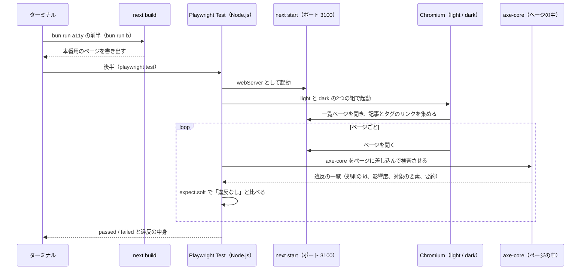
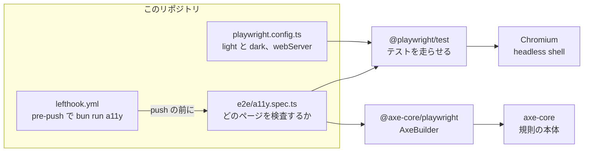
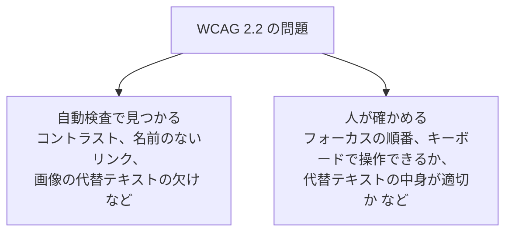

# 3-0: 公開しているページを axe で自動検査し、WCAG 2.2 AA の違反があれば push の前に止まるようにする

- 起票日: 2026-11-15
- 学習計画: ADR `20261115-2117-publishable-home-before-storybook.md`（公開できる見た目の段。3-0 を足した理由もここにある）
- ADR: `docs/adr/20261115-2200-page-a11y-check-with-axe.md`（この回で決めたこと。状態は「提案」）
- ステータス: 未着手

## 全体のどこか

「公開できる見た目」の段の最初の回。この段でヘッダー、付箋ページ、トップ画面を作っていく前に、できたページを自動で検査する仕組みを先に置く。

| Step      | 内容                                                                   | 進捗                     |
| --------- | ---------------------------------------------------------------------- | ------------------------ |
| 2-0〜2-6  | デザインシステムの土台と Storybook のカタログ                          | ■■■ 完了（2-0 は進行中） |
| 2-7〜2-13 | Storybook の寄り道の続きと React Aria                                  | 保留                     |
| 3-0       | 公開しているページを axe で自動検査し、違反があれば落ちる仕組みを作る  | □□□ ← いまここ           |
| 3-1       | ヘッダー（グローバルナビゲーション）とフッターを作り、全ページに置く   | □□□                      |
| 3-1b      | リンクを押してから移動が終わるまで、待っていることが分かる動きを付ける | □□□                      |
| 3-2       | パンくずリストを作る                                                   | □□□                      |
| 3-3       | 付箋の原稿の置き場所を決め、弁当レイアウトで一覧にする                 | □□□                      |
| 3-4       | 付箋を日付とタグで並べ替える                                           | □□□                      |
| 3-5       | トップ画面を作る（自己紹介、最新の記事と付箋）                         | □□□                      |
| 3-5b      | OGP 画像をデザインし、X のアイコン画像とサイト名・記事の題を載せる     | □□□                      |
| 3-6       | トップ画面に X のツイートを出す                                        | □□□                      |
| 3-7       | 記事一覧・タグ一覧・about を整える                                     | □□□                      |

作業ブランチは作らず、`dev` に直接コミットする。

この回で扱わないもの: GitHub Actions で走らせること（まだ CI がない）、キーボード操作の自動テスト、部品ごとの検査（Storybook の 2-8）、axe の best-practice の規則（WCAG の達成基準ではない推奨。3-1 のあとで見直す）。

## なぜこれをやるか

このサイトは a11y にいちばん注意して作ると決めた。ただ、注意するつもりでいても、人の目だけでは見落とす。色のコントラストのように、数字で決まるものは特にそうだ。

axe はページを読み込んで WCAG の違反を自動で探す道具だ。この回で、サイトの全ページを明るい表示と暗い表示の両方で axe にかけ、違反があれば push の前に止まるようにする。仕組みを先に置けば、3-1 のヘッダーも 3-3 の付箋ページも、作った時点から検査される。後から入れると、それまでに作ったページの違反をまとめて直すことになる。

実際に、今のサイトにも違反が見つかる。記事のコードの色の一部が背景に対して薄すぎる。この回の本題はそれを見つけて直すところにある。

## 周辺知識

### 全体の地図（`bun run a11y` を打ってから結果が出るまで）



図から分かること:

- 検査するのは、開発サーバーではなく本番用にビルドしたページ。読者に届くのと同じ HTML と CSS を見ている
- axe-core はブラウザの中で、描かれたあとのページを調べる。CSS が効いたあとの文字色と背景色でコントラストを測れるのは、このためだ
- 明るい表示と暗い表示は、別々のブラウザの組として同じ手順をたどる。色が変わる以上、片方だけ通っても安心できない



図から分かること:

- 規則の本体は axe-core で、`@axe-core/playwright` は Playwright のページに axe-core を差し込むための橋渡しにすぎない
- Playwright はここでは「ブラウザを動かしてページを開く係」で、2-7 の Vitest のブラウザモードと同じ Chromium の headless shell を使う
- 検査を走らせる時機は lefthook が決める。検査そのものの中身とは切り離されている



図から分かること:

- 自動検査は問題の一部を確実に拾う網で、全部を拾う網ではない。Deque の調査では、件数にして 57% だった（下の「設計の考え方」）
- この回で入れるのは左の網。右の網は 3-1 以降の各チケットの受け入れ条件で、キーボードと読み上げソフトを使って自分で確かめる

### 用語

| 用語               | たとえ                                           | 正確な意味                                                                                                                              | この回での出番             |
| ------------------ | ------------------------------------------------ | --------------------------------------------------------------------------------------------------------------------------------------- | -------------------------- |
| axe-core           | 建物の検査官が持つチェックリスト                 | Deque が作る、Web ページの a11y の問題を自動で探す JavaScript のライブラリ。ページの中で動き、規則ごとに違反を返す                      | `AxeBuilder` の中で動く    |
| WCAG               | 建築基準法のような、誰でも使えるための共通の基準 | W3C が定める Web コンテンツのアクセシビリティの指針。今の版は 2.2                                                                       | 検査する規則の物差し       |
| 達成基準とレベル   | 基準法の条文と、その厳しさの段階                 | WCAG の個々の要件（1.4.3 など）。A・AA・AAA の3段階で、AA は A を含む                                                                   | `wcag2aa` などのタグで選ぶ |
| タグ（axe の）     | チェックリストの章の見出し                       | axe の規則に付いた分類。`wcag2a`・`wcag2aa`・`wcag21a`・`wcag21aa`・`wcag22aa` は、それぞれの版とレベルの達成基準に対応する規則の集まり | `withTags(WCAG_TAGS)`      |
| コントラスト比     | 黒板の字の読みやすさを数で表したもの             | 文字色と背景色の明るさ（相対輝度）の比。1:1（同じ色）から 21:1（白と黒）まで。WCAG 1.4.3 は通常の文字に 4.5:1 以上を求める              | color-contrast の違反      |
| 相対輝度           | 色を白黒写真にしたときの明るさ                   | 赤・緑・青の明るさに目の感じ方の重みを掛けて足した値。緑の重みがいちばん大きい                                                          | コントラスト比の計算のもと |
| アクセシブルな名前 | 読み上げソフトが読む「その部品の名札」           | 支援技術に渡る要素の名前。リンクなら中の文字、`aria-label` などから決まる                                                               | link-name の違反           |
| E2E テスト         | 客になりきって店の入口から会計まで通してみること | 本物のブラウザで、ページを開くところから利用者と同じ道筋をたどるテスト                                                                  | Playwright Test の役目     |
| webServer          | テストの前に店を開ける係                         | Playwright の設定。テストの前にサーバーを起動し、終わったら止める                                                                       | `bun run s -p 3100`        |
| test.step          | 点検表の1行                                      | 1つのテストの中を名前つきの区切りに分ける。結果にどの区切りで落ちたかが出る                                                             | ページごとの区切り         |
| expect.soft        | 赤ペンで印を付けて、最後まで読み進める採点       | 失敗してもテストを止めず、最後まで確かめてからまとめて失敗にする                                                                        | 全ページを一度に検査する   |
| pre-push           | 家を出る前の戸締まりの確認                       | git が push の直前に走らせるフック。lefthook が設定する                                                                                 | `bun run a11y` を走らせる  |

### 設計の考え方

**自動検査は「最低限の網」で、手で確かめることとは役割が違う。** Deque が 2,000 件を超える監査（13,000 ページ超、問題は約 30 万件）を調べたところ、axe の自動検査で完全に見つかった問題は、件数にして平均 57% だった。一般に言われてきた「自動検査は 20〜30%」より多いが、残りの 4 割強は人の目と手で確かめるしかない。axe-core は誤検出を出さないことを重視して作られていて、「違反あり」と言われたら、ほぼ確実に直すべき問題だと考えてよい。逆に「違反なし」は「a11y に問題がない」という意味ではない。Playwright の公式のガイドも、自動検査、人による確認、利用者を交えたテストを組み合わせるよう勧めている。

**ページ単位で検査するのは、組み合わせの問題を拾うため。** Storybook の 2-8 で予定している検査は、部品を1つずつ取り出して調べる。部品単体では問題がなくても、ヘッダーと本文を並べたときにランドマークが重なったり、暗い表示の背景の上で記事の中の色が沈んだりする。今回見つかった記事のコードの色の違反は、まさに「Shiki が書き出した色」と「記事ページの背景」の組み合わせで起きていて、部品の検査では見つからない種類だった（実測）。

**本番用のビルドを検査する。** 開発サーバーは開発用の表示や警告を差し込むことがある。読者に届くものを検査したいので、`next build` のあと `next start` で配ったページを開く。そのぶん検査の前にビルドが要るが、このサイトではビルドと検査を合わせて 12 秒ほどで終わる（実測）。

**検査する対象を手で列挙しない。** 記事やタグは増えていく。一覧ページのリンクをたどって対象を集めておけば、記事を足した時点で自動的に検査に入る。入口に書くのは、一覧からたどれないページだけにする。

### ベストプラクティス

| 作法                                                                                                | 出典                                              | このリポジトリ                                            |
| --------------------------------------------------------------------------------------------------- | ------------------------------------------------- | --------------------------------------------------------- |
| `AxeBuilder` でページを検査し、`violations` が空であることを確かめる                                | Playwright「Accessibility testing」               | 採る                                                      |
| `withTags` で WCAG の A と AA の規則に絞る。ガイドの例は `wcag2a`・`wcag2aa`・`wcag21a`・`wcag21aa` | Playwright「Accessibility testing」               | 採る。WCAG 2.2 で増えた規則も入れるため `wcag22aa` を足す |
| 共通の設定は fixture にまとめて、テストごとに使い回す                                               | Playwright「Accessibility testing」               | 今は1ファイルなので採らない。spec が増えたら検討する      |
| 既知の違反は `exclude()` や `disableRules()` で外し、外したことを記録する                           | Playwright「Accessibility testing」               | 今は外すものがない。外すときは ADR に書く                 |
| 自動検査に、人による確認と利用者のテストを組み合わせる                                              | Playwright「Accessibility testing」、Deque の調査 | 各チケットの受け入れ条件で手の確認をする                  |
| 通常の文字のコントラスト比は 4.5:1 以上                                                             | WCAG 2.2 達成基準 1.4.3（AA）                     | 採る。記事のコードの色も含める                            |

### 比較（ページを自動で検査する道具）

| 案                                        | 得意なこと                                                                                                     | 引き換えにするもの                                                                                   | この回で採るか |
| ----------------------------------------- | -------------------------------------------------------------------------------------------------------------- | ---------------------------------------------------------------------------------------------------- | -------------- |
| Playwright Test ＋ `@axe-core/playwright` | 本物のブラウザで、明るい表示・暗い表示を切り替えて検査できる。あとでキーボード操作のテストも同じ仕組みで足せる | ブラウザのダウンロード（headless shell で約 205 MB）が要る。2-7 の Vitest とは別の実行の仕組みになる | 採る           |
| `@axe-core/cli`                           | コマンド1つで URL を検査でき、設定が少ない                                                                     | chromedriver と Selenium を使う。暗い表示への切り替えなど、ページの条件を細かく変えにくい            | 採らない       |
| pa11y-ci                                  | URL の一覧やサイトマップを渡すだけで検査でき、axe と HTML_CodeSniffer の2つの規則から選べる                    | puppeteer が Chromium をダウンロードする。インストール時スクリプトの扱いを決め直す必要がある         | 採らない       |
| Lighthouse CI                             | 性能や SEO と一緒に点数で見られる                                                                              | a11y は点数で、どの違反で落とすかを細かく決めにくい。重い                                            | 採らない       |

### 比較（検査を走らせる時機）

| 時機                          | 得意なこと                                                                         | 引き換えにするもの                                                  | この回で採るか     |
| ----------------------------- | ---------------------------------------------------------------------------------- | ------------------------------------------------------------------- | ------------------ |
| pre-commit（コミットの直前）  | いちばん早く気づける                                                               | コミットのたびにビルドが走り、記事の原稿だけのコミットでも待つ      | 採らない           |
| pre-push（push の直前）       | 違反を履歴に残す前に止められる。ページに関わるファイルを push するときだけに絞れる | コミットよりは気づくのが遅い。push が 12〜27 秒ほど遅くなる（実測） | 採る               |
| GitHub Actions（push のあと） | 手元の環境によらず、毎回同じ条件で検査できる                                       | push したあとに気づく。このリポジトリにはまだ CI がない             | この回では扱わない |

### 比較（記事のコードの色のテーマ）

文字色として使う色のうち、いちばんコントラストの低い色と背景との比（テーマの定義から計算。背景色を持つ特殊な色は除いた）。

| テーマ（明るい / 暗い）                                | 最小のコントラスト比 | 4.5 未満の色                       | 今の記事での axe の結果 |
| ------------------------------------------------------ | -------------------- | ---------------------------------- | ----------------------- |
| github-light / github-dark（今）                       | 3.49 / 3.05          | 明るい: `#E36209`、暗い: `#6A737D` | 違反あり（実測）        |
| github-light-default / github-dark-default             | 4.55 / 6.15          | なし                               | 違反なし（実測）        |
| github-light-high-contrast / github-dark-high-contrast | 5.04 / 9.23          | なし                               | 違反なし（実測）        |

default の組も今の記事では通るが、明るい表示の余裕は 0.05 しかない。high-contrast の組は、明るい表示でも 0.5 以上の余裕がある。

### a11y の解説

#### この回で見つかる違反と、使う人に起きること

| 実装（規則）                                               | 守ったとき                                                                      | 守らないと                                                                                                           | 誰が困るか                                                                                                               | 根拠                            |
| ---------------------------------------------------------- | ------------------------------------------------------------------------------- | -------------------------------------------------------------------------------------------------------------------- | ------------------------------------------------------------------------------------------------------------------------ | ------------------------------- |
| 文字のコントラスト比 4.5:1 以上（axe の `color-contrast`） | 背景から文字がはっきり浮いて見え、拡大しなくても読める                          | 薄い文字が背景に溶けて、読めないか、読むのに目を凝らす。記事のコードなら、変数名だけ読めずに意味が追えない           | ロービジョン（視力が弱い、視野が狭いなど）の人、年を重ねて見え方が変わった人、強い日差しの下でスマートフォンを見ている人 | WCAG 2.2 1.4.3（AA）            |
| リンクに名前がある（axe の `link-name`）                   | 読み上げソフトが「react、リンク」のように行き先を読む。リンクの一覧からも選べる | 「リンク」とだけ読まれ、どこへ行くリンクかが分からない。押してみるまで行き先が分からない                             | 読み上げソフトを使う人、音声で操作する人                                                                                 | WCAG 2.2 2.4.4（A）、4.1.2（A） |
| 暗い表示も検査する                                         | OS をダークモードにしている人にも、同じ読みやすさが届く                         | 明るい表示だけで確かめると、暗い表示でだけ沈む色に気づかない（今回、github-dark のコメントの灰色がそうだった。実測） | まぶしさを避けて暗い表示にしている人。光に敏感な人や、目の疲れを減らしたい人も含む                                       | WCAG 2.2 1.4.3                  |

#### コントラストが足りないと、何が起きるか

W3C WAI の「How People with Disabilities Use the Web」は、視覚に障害のある人がぶつかる壁の最初の例に「前景と背景の色の組み合わせのコントラストが足りない文字や画像」を挙げている。同じ資料に出てくる Elias は、視力が弱く、手の震えと短期記憶の低下もある退職者で、文字の大きさを変えられることと、いつも同じ配置であることに助けられている。

Elias のような人が、このブログの記事でコードを読む場面を考える。`const` や関数名は読めるのに、オレンジ色の変数名だけが白い背景に溶けている。拡大すれば文字は大きくなるが、色の薄さは変わらない。コントラストは拡大では取り戻せない。1.4.3 が「4.5:1」という数で線を引いているのは、見え方が人によって違っても、この比があれば多くの人が読めるという目安を作るためだ。

この壁は障害のある人だけのものでもない。晴れた日に屋外でスマートフォンを開けば、画面の薄い色は誰にとっても読みにくくなる。

#### 名前のないリンクは、どう聞こえるか

同じ資料の Lakshmi は、目の見えない上級会計士で、パソコンでもスマートフォンでも読み上げソフトを使って Web を操作している。読み上げソフトの利用者はページを頭から全部聞くとは限らない。見出しやリンクの一覧を呼び出して、目当ての場所へ飛ぶ。W3C の資料も、読み上げソフトは見出し、リスト、リンクが正しく書かれていることを頼りにする、と説明している。

リンクの一覧を開いたとき、名前のないリンクは「リンク」とだけ並ぶ。いくつも並べば、どれがどこへ行くのかを区別する手がかりがない。目で見ている人にとっては、アイコンや配置で行き先が分かるかもしれない。音だけで使う人には、その手がかりが届かない。

この回の手順でわざと作る「名前の空のタグ」は、見た目では枠の付いた小さな丸にしか見えないが、読み上げではこの「行き先の分からないリンク」になる。axe はそれを `link-name` の違反として知らせる（実測。"Links must have discernible text"）。

#### 自動検査が「違反なし」と言ったあとに残るもの

自動検査が確かめるのは、名前があるか、比が 4.5 を超えているか、といった形のことだ。名前が付いていても、その名前が行き先を正しく表しているかは分からない。キーボードで Tab を押したときにフォーカスが自然な順に動くか、フォーカスの輪が見えるかも、axe では確かめきれない。3-1 以降のチケットでは自動検査を通したうえで、キーボードと読み上げソフトで自分で確かめる項目を受け入れ条件に入れる。

（VoiceOver が実際にどう読むかの文言は、この回では確かめていない。未確認）

### 現時点のバージョン（2026-11-15 確認）

| パッケージ             | バージョン | この回での扱い                                                                    |
| ---------------------- | ---------- | --------------------------------------------------------------------------------- |
| `@playwright/test`     | 1.65.0     | 新しく入れる。1.65.1 は 11-17 6:12（日本時間）まで `minimumReleaseAge` で入らない |
| `@axe-core/playwright` | 4.14.0     | 新しく入れる                                                                      |
| `axe-core`             | 4.14.0     | `@axe-core/playwright` が一緒に入れる                                             |
| `next`                 | 16.4.1     | そのまま                                                                          |
| `@shikijs/rehype`      | 4.5.0      | そのまま。テーマの名前だけ変える                                                  |

出典:

- Playwright「Accessibility testing」: https://playwright.dev/docs/accessibility-testing
- Deque「Automated Testing Study Identifies 57 Percent of Digital Accessibility Issues」（2021-03）: https://www.deque.com/blog/automated-testing-study-identifies-57-percent-of-digital-accessibility-issues/
- W3C WAI「Stories of Web Users」: https://www.w3.org/WAI/people-use-web/user-stories/
- W3C WAI「Diverse Abilities and Barriers: Visual」: https://www.w3.org/WAI/people-use-web/abilities-barriers/visual/
- WCAG 2.2 1.4.3 Contrast (Minimum): https://www.w3.org/TR/WCAG22/#contrast-minimum
- WCAG 2.2 2.4.4 Link Purpose (In Context): https://www.w3.org/TR/WCAG22/#link-purpose-in-context
- WCAG 2.2 4.1.2 Name, Role, Value: https://www.w3.org/TR/WCAG22/#name-role-value
- axe-core: https://github.com/dequelabs/axe-core

## 作業手順（全体の地図）

1. Playwright と axe の部品を入れ、検査に使うブラウザを入れる
2. Playwright の設定と、トップと記事一覧だけを検査する最小のテストを書き、通るのを見る
3. 全ページをたどって検査する形に広げ、今のサイトの違反を見つける（**この回の本題**）
4. 記事のコードの色のテーマを変えて、違反を直す
5. わざと名前のないリンクを置いて、違反の出方を見る
6. push の前に検査が走るよう、lefthook に足す

## 確認事項

- [ ] **検査の道具。** 推奨案「Playwright Test と `@axe-core/playwright`」で作成。理由は axe の作り手（Deque）が用意している Playwright 用の部品で、Playwright の公式ガイドもこの組み合わせを使っているから。暗い表示も `colorScheme` で切り替えて検査でき、インストール時スクリプトもない（実測）。ただし、検査用のブラウザ（約 205 MB）が要り、2-7 の Vitest とは別のテストの仕組みが1つ増える
- [ ] **検査する規則。** 推奨案「WCAG 2.2 の A と AA に当たる規則だけ（`wcag2a`・`wcag2aa`・`wcag21a`・`wcag21aa`・`wcag22aa`）」で作成。理由はデジタル庁デザインシステムをはじめ、多くの基準が AA を求めているから。ただし、WCAG の達成基準ではない axe の推奨（best-practice。「`<main>` が1つある」など）は入らない。入れると、`<main>` のないページがある今は落ちる。3-1 で `<main>` をそろえたあとで、足すかを見直す
- [ ] **検査するページ。** 推奨案「入口の4ページ（`/`・`/posts`・`/tags`・`/design-system`）と、記事一覧とタグ一覧からたどれるページすべて」で作成。理由は記事やタグを足したときに、テストを書き足さなくても検査の対象に入るから。ただし、一覧からリンクしていないページは入らない。3-3 の付箋ページのように新しい入口ができたら、`ENTRY_PATHS` に足す
- [ ] **明るい表示と暗い表示。** 推奨案「両方を検査する」で作成。理由はこのサイトのダークモードが OS の設定で切り替わり、色のコントラストは表示ごとに違うから。実際に、暗い表示だけの違反があった（実測）。ただし、検査の時間が2倍になる
- [ ] **記事のコードの色。** 推奨案「Shiki のテーマを `github-light-high-contrast` と `github-dark-high-contrast` に変える」で作成。理由は文字色の最小コントラストが 5.04:1 と 9.23:1 で、AA の 4.5:1 に余裕があるから（テーマの色から計算）。ただし、GitHub でふだん見る色より濃く、硬い印象になる。`github-light-default` と `github-dark-default` の組（4.55:1・6.15:1）も今の記事では通るが、明るい表示の余裕が 0.05 しかない
- [ ] **いつ検査を走らせるか。** 推奨案「lefthook の pre-push（push の直前）で、ページに関わるファイルを push するときだけ」で作成。理由は a11y を最優先にする方針で、違反を履歴に残さないため。ビルドを含めて 12〜27 秒で終わる（実測）。ただし、push が遅くなり、コミットの時点では気づけない。GitHub Actions はまだないので、この回では扱わない
- [ ] **違反の出し方。** 推奨案「ページごとに `test.step` を切り、`expect.soft` で全ページを最後まで検査して、違反の id・影響度・場所・要約を出す」で作成。理由は1ページ目で止まらず、違反を一度に全部見られるから。ただし、違反が多いと出力が長くなる
- [ ] **【標準ルールからの逸脱】TDD を適用しない。** 本人の判断（2026-11-03）による

## ハンズオン

コマンドの出力は `11fe717` と同じ内容を一時ディレクトリに複製して実際に動かし、写したもの（2026-11-15、Node 24.22.1 / bun 1.4.4 / Next.js 16.4.1 / Playwright 1.65.0 / axe-core 4.14.0）。かかった時間は毎回変わる。

---

### 準備：この回で何をするのか

建物にたとえると、axe は**検査員**だ。段差やスロープの角度、案内板の文字の大きさを、決まった基準（WCAG）に照らして1つずつ測り、基準を下回るところを書き出す。この回では、検査員がサイトの全部の部屋（ページ）を、昼（明るい表示）と夜（暗い表示）の両方で見回る仕組みを作る。

検査の流れは周辺知識の「全体の地図」のとおり。本番と同じようにビルドしたサイトを手元で起動し、Playwright が動かすブラウザでページを開いて、axe にそのページを測らせる。

検査員が測れるのは、数字や有無で決まることだけだ。「キーボードで迷わず操作できるか」「読み上げを聞いて意味が通るか」は、これからも各チケットで自分の手と耳で確かめる。

#### 用意するもの

- 2-6 までが終わった `dev`（`11fe717` 以降）
- ブラウザのダウンロードのために、ネットワークにつながっていること（約 205 MB）

---

### 手順 1：Playwright と axe の部品を入れ、検査に使うブラウザを入れる

```bash
cd ~/ghq/github.com/hi-lee-mon/65-blog-app
bun add -d @playwright/test@1.65.0 @axe-core/playwright@4.14.0
```

期待される出力（最後の数行）:

```
installed @playwright/test@1.65.0 with binaries:
installed @axe-core/playwright@4.14.0
4 packages installed
```

続けて、検査に使うブラウザを入れる。

```bash
bun run playwright install --only-shell chromium
```

期待される出力（最後の数行。途中に進み具合の棒が並ぶ）:

```
Chrome Headless Shell 158.0.8127.18 (playwright chromium-headless-shell v1254) downloaded to /Users/<あなたのユーザー名>/Library/Caches/ms-playwright/chromium_headless_shell-1254
FFmpeg (playwright ffmpeg v1013) downloaded to /Users/<あなたのユーザー名>/Library/Caches/ms-playwright/ffmpeg-1013
```

**なぜ** — `@playwright/test` はブラウザを動かしてページを確かめるテストの道具だ。`@axe-core/playwright` は、Playwright で開いたページに axe（検査の本体 `axe-core`）を送り込み、結果を受け取るつなぎ役になる。

`@playwright/test` は 1.65.1 が出ているが、公開から3日たっていないので `bunfig.toml` の `minimumReleaseAge` で入らない。1.65.0 を書いて固定する。新しく止められたインストール時スクリプトはない（`bun pm untrusted` で確かめた。実測）。

`--only-shell` は、画面を出さない Chromium（headless shell）だけを入れる指定だ。検査は画面を出さずに走らせるので、画面つきの Chromium は使わない。ブラウザは `~/Library/Caches/ms-playwright/` に入り、リポジトリには入らない。

---

### 手順 2：Playwright の設定と最小のテストを書き、通るのを見る

#### 2-a：設定ファイルとスクリプト

設定ファイルなので、まとめて書く。リポジトリの直下に `playwright.config.ts` を作る。

```ts
import { defineConfig, devices } from "@playwright/test";

export default defineConfig({
  testDir: "./e2e",
  fullyParallel: true,
  reporter: "list",
  use: {
    baseURL: "http://localhost:3100",
  },
  projects: [
    { name: "light", use: { ...devices["Desktop Chrome"], colorScheme: "light" } },
    { name: "dark", use: { ...devices["Desktop Chrome"], colorScheme: "dark" } },
  ],
  webServer: {
    command: "bun run s -p 3100",
    url: "http://localhost:3100",
    reuseExistingServer: false,
  },
});
```

`package.json` の `scripts` に1行足す。

```json
    "a11y": "bun run b && playwright test"
```

`.gitignore` の末尾に足す。

```gitignore
# Playwright のテスト結果とレポート
test-results/
playwright-report/
```

**読み方**

| 行                                       | 意味                                                                                                                   |
| ---------------------------------------- | ---------------------------------------------------------------------------------------------------------------------- |
| `testDir: "./e2e"`                       | テストは `e2e/` に置く。E2E は End to End の略で、本物のブラウザでページを端から端まで動かすテストのこと               |
| `baseURL`                                | `page.goto("/posts")` と書いたときに、頭に付く住所                                                                     |
| `projects` の `light` と `dark`          | 同じテストを、OS が明るい表示のときと暗い表示のときの2回走らせる。`colorScheme` は `prefers-color-scheme` を切り替える |
| `webServer`                              | テストの前に `next start` でサイトを起動し、終わったら止める。ポートは開発サーバー（3000）とぶつからない 3100 にした   |
| `"a11y": "bun run b && playwright test"` | 本番と同じ形にビルドしてから検査する。`next start` はビルドの結果を配るだけなので、先にビルドが要る                    |

`test-results/` は、テストが落ちたときに Playwright が手がかりを書き出す場所だ。git に入れず、oxlint と oxfmt の対象からも外れる（2-6 と同じく `.gitignore` に従う）。

#### 2-b：トップと記事一覧だけを検査する

`e2e/a11y.spec.ts` を新しく作る。

```ts
import AxeBuilder from "@axe-core/playwright";
import { expect, test, type Page } from "@playwright/test";

const WCAG_TAGS = ["wcag2a", "wcag2aa", "wcag21a", "wcag21aa", "wcag22aa"];

async function expectNoViolations(page: Page) {
  const results = await new AxeBuilder({ page }).withTags(WCAG_TAGS).analyze();
  const violations = results.violations.map((v) => ({
    id: v.id,
    impact: v.impact,
    help: v.help,
    targets: v.nodes.map((n) => n.target.join(" ")),
  }));
  expect(violations).toEqual([]);
}

test("トップ", async ({ page }) => {
  await page.goto("/");
  await expectNoViolations(page);
});

test("記事一覧", async ({ page }) => {
  await page.goto("/posts");
  await expectNoViolations(page);
});
```

```bash
bun run a11y
```

ビルドの出力のあとに、次が出る（実測）。

```
Running 4 tests using 4 workers

  ✓  1 [light] › e2e/a11y.spec.ts:17:1 › トップ (603ms)
  ✓  2 [dark] › e2e/a11y.spec.ts:17:1 › トップ (579ms)
  ✓  4 [light] › e2e/a11y.spec.ts:22:1 › 記事一覧 (631ms)
  ✓  3 [dark] › e2e/a11y.spec.ts:22:1 › 記事一覧 (632ms)

  4 passed (1.9s)
```

**なぜ** — テストは2つ、表示は2通りなので、4回走る。`withTags(WCAG_TAGS)` は、axe が持っている規則のうち、WCAG 2.0・2.1・2.2 の A と AA に当たるものだけを使う指定だ。`analyze()` が返す `violations` が違反の一覧で、空（`[]`）なら合格になる。

---

### 手順 3：この回の本題。全ページをたどって、今のサイトの違反を見つける

テストを1ページずつ書き足していくと、記事を足すたびにテストも直すことになる。そこで、記事一覧とタグ一覧のリンクをたどって、検査するページを集める形にする。

`e2e/a11y.spec.ts` を次の全文に書き換える。

```ts
import AxeBuilder from "@axe-core/playwright";
import { expect, test, type Page } from "@playwright/test";

// axe の規則のうち、WCAG 2.2 の A と AA に当たるものだけを使う
const WCAG_TAGS = ["wcag2a", "wcag2aa", "wcag21a", "wcag21aa", "wcag22aa"];

// 一覧ページから記事とタグのページをたどるので、ここには入口だけを書く
const ENTRY_PATHS = ["/", "/posts", "/tags", "/design-system"];
const LIST_PATHS = ["/posts", "/tags"];

async function collectPaths(page: Page) {
  const paths = new Set(ENTRY_PATHS);
  for (const listPath of LIST_PATHS) {
    await page.goto(listPath);
    const hrefs = await page
      .locator("main a[href^='/']")
      .evaluateAll((links) => links.map((link) => link.getAttribute("href") ?? ""));
    for (const href of hrefs) paths.add(href);
  }
  return [...paths].sort();
}

async function findViolations(page: Page) {
  const results = await new AxeBuilder({ page }).withTags(WCAG_TAGS).analyze();
  return results.violations.map((violation) => ({
    id: violation.id,
    impact: violation.impact,
    help: violation.help,
    nodes: violation.nodes.map((node) => ({
      target: node.target.join(" "),
      summary: node.failureSummary,
    })),
  }));
}

test("サイト内のページに WCAG 2.2 AA の違反がない", async ({ page }) => {
  const paths = await collectPaths(page);
  for (const path of paths) {
    await test.step(path, async () => {
      await page.goto(path);
      expect.soft(await findViolations(page), path).toEqual([]);
    });
  }
});
```

```bash
bun run a11y
```

今度は落ちる（実測。抜粋）。

```
  ✘  1 [dark] › e2e/a11y.spec.ts:36:1 › サイト内のページに WCAG 2.2 AA の違反がない (5.0s)
  ✘  2 [light] › e2e/a11y.spec.ts:36:1 › サイト内のページに WCAG 2.2 AA の違反がない (5.0s)

  1) [light] › e2e/a11y.spec.ts:36:1 › サイト内のページに WCAG 2.2 AA の違反がない ────────

    Error: /posts/blog

    + Array [
    +   Object {
    +     "help": "Elements must meet minimum color contrast ratio thresholds",
    +     "id": "color-contrast",
    +     "impact": "serious",
    +     "nodes": Array [
    +       Object {
    +         "summary": "Fix any of the following:
    +   Element has insufficient color contrast of 3.48 (foreground color: #e36209, background color: #ffffff, font size: 12.0pt (16px), font weight: normal). Expected contrast ratio of 4.5:1",
    +         "target": "pre:nth-child(13) > code > .line:nth-child(2) > span:nth-child(1)",
    +       },
    ...

  2 failed
```

違反が出たページは、次のとおりだった（実測）。

| 表示   | ページ                                      | 違反             | 色の組み合わせ                              |
| ------ | ------------------------------------------- | ---------------- | ------------------------------------------- |
| 明るい | `/posts/blog`・`/posts/dns`・`/posts/umami` | `color-contrast` | オレンジ `#e36209` と白 `#ffffff` で 3.48:1 |
| 暗い   | `/posts/blog`・`/posts/umami`               | `color-contrast` | 灰色 `#6a737d` と `#24292e` で 3.04:1       |

**出力の読み方**

- `id` は axe の規則の名前、`help` はその説明。`color-contrast` は「文字と背景の明るさの差が、基準に足りない」という違反だ
- `impact` は、使う人への影響の大きさ。`serious` は4段階（minor・moderate・serious・critical）の上から2番目
- `target` は、違反した要素の CSS セレクター。`pre … > span` なので、記事のコードブロックの中の文字だと分かる
- `summary` に、実際の比（3.48）と基準（4.5:1）が書いてある

**何が起きていたのか** — 記事のコードは、1-3 から Shiki（ビルドのときにコードに色を付ける道具）の `github-light` と `github-dark` で色を付けている。明るい表示では変数名などのオレンジが、暗い表示ではコメントの灰色が、背景に対して薄すぎた。本文の大きさの文字には 4.5:1 以上の差が要る（WCAG 1.4.3）。この差が足りないと、何が起きるのかは周辺知識の「a11y の解説」に書いた。

2-3 で色のトークンを決めたときは、自分で選んだ色のコントラストを確かめた。けれど、Shiki のテーマの色は外から入ってきたもので、誰も測っていなかった。この「自分で決めていない色」を拾えたのが、全ページを機械で見回る価値だ。

`expect.soft` にしたので、1ページ目で止まらず、全ページの違反が一度に出た。`test.step(path, …)` で切ってあるので、どのページの違反かが `Error: /posts/blog` のように見出しで分かる。

---

### 手順 4：記事のコードの色のテーマを変えて、違反を直す

`lib/createPostReader.ts` の `themes` の行を、次のように書き換える。

```ts
              themes: { light: "github-light-high-contrast", dark: "github-dark-high-contrast" },
```

```bash
bun run a11y
```

次が出れば合格（実測）。

```
  ✓  2 [light] › e2e/a11y.spec.ts:36:1 › サイト内のページに WCAG 2.2 AA の違反がない (5.0s)
  ✓  1 [dark] › e2e/a11y.spec.ts:36:1 › サイト内のページに WCAG 2.2 AA の違反がない (5.0s)

  2 passed (5.9s)
```

開発サーバー（`bun run d`）で `/posts/blog` を開き、コードの色が前より濃くなったのを見ておく。

**なぜ high-contrast のテーマにしたのか** — Shiki に入っている GitHub 系のテーマで、文字色ごとに背景とのコントラストを計算すると、周辺知識の比較の表のとおりになる。今の `github-light` と `github-dark` は 4.5:1 を下回る色をそれぞれ1つ持っている。`-default` の組も今の記事では通るが、明るい表示のいちばん薄い色が 4.55:1 で、余裕がほとんどない。記事が増えて、まだ使っていない色の部分が出てきても通るよう、余裕のある high-contrast の組にした。

---

### 手順 5：わざと名前のないリンクを置いて、違反の出方を見る

`app/design-system/page.tsx` の `<Tag tag="ラベル(md)" size="md" />` の次の行に、名前が空のタグを足す。

```tsx
          <Tag tag="ラベル(md)" size="md" />
          <Tag tag="" />
```

```bash
bun run a11y
```

`/design-system` で違反が出る（実測。抜粋）。

```
    Error: /design-system

    + Array [
    +   Object {
    +     "help": "Links must have discernible text",
    +     "id": "link-name",
    +     "impact": "serious",
    +     "nodes": Array [
    +       Object {
    +         "summary": "Fix all of the following:
    +   Element is in tab order and does not have accessible text
    +
    + Fix any of the following:
    +   Element does not have text that is visible to screen readers
    +   aria-label attribute does not exist or is empty
    +   aria-labelledby attribute does not exist, references elements that do not exist or references elements that are empty
    +   Element has no title attribute",
    +         "target": "a[href$=\"tags\"]",
    +       },
```

**ここで見ること** — `link-name` は「リンクに名前がない」という違反だ。`summary` には、直し方の候補が並んでいる。リンクの中に読み上げられる文字を入れるか、`aria-label` などで名前を付ける。2-6 で Storybook の a11y パネルに出した違反と同じものが、今度はページ全体の検査で、しかも明るい表示と暗い表示の両方で落ちる形になった。

確かめたら、足した `<Tag tag="" />` の行を消し、もう一度 `bun run a11y` で `2 passed` に戻るのを見る。

---

### 手順 6：push の前に検査が走るよう、lefthook に足す

`lefthook.yml` の末尾に足す。

```yaml
pre-push:
  jobs:
    # ページの見た目に関わるファイルを push するときだけ、ビルドして axe で検査する
    - name: a11y
      glob:
        - "app/*"
        - "lib/*"
        - "theme/*"
        - "content/*"
        - "panda.config.ts"
      run: bun run a11y
```

フックを入れ直してから、試しに走らせる。

```bash
bun run lefthook install
bun run lefthook run pre-push --force
```

期待される出力（最後の数行。実測）:

```
  2 passed (12.7s)
summary: (done in 27.00 seconds)
✔️ a11y (27.00 seconds)
```

**なぜ** — コミットの前（pre-commit）は、すでに format・oxlint・markuplint・型検査が走っていて、そこにビルドと検査を足すと、コミットのたびに30秒近く待つことになる。push の前（pre-push）なら回数が少なく、それでも違反を `dev` に送る前に止められる。

`glob` は、ページに関わるファイルを含む push のときだけ検査を走らせるための指定だ。`*` が `/` をまたぐ書き方は `lefthook.yml` の pre-commit の注記と同じ。`--force` は、`glob` に関係なく走らせる指定で、ここでは動作の確かめにだけ使う。チケットだけを直した push で本当に飛ばされるかは、確かめていない（未確認）。

---

実装は以上です。静的検証、テストがオールグリーンならcommitしてpushしてください。

---

### うまくいかないとき

| 症状                                                                                   | 原因と対処                                                                                                                                   |
| -------------------------------------------------------------------------------------- | -------------------------------------------------------------------------------------------------------------------------------------------- |
| `browserType.launch: Executable doesn't exist at .../chromium_headless_shell-1254/...` | 検査用のブラウザがない。手順 1 の `bun run playwright install --only-shell chromium` を走らせる。`@playwright/test` の版を上げたあとにも出る |
| `"id": "color-contrast"` で、`pre … > span` の違反が残る                               | `lib/createPostReader.ts` のテーマが変わっていないか、ビルドし直していない。`bun run a11y` はビルドから始まるので、テーマの行を見直す        |
| `"id": "link-name"` が `/design-system` に出る                                         | 手順 5 で足した `<Tag tag="" />` が残っている                                                                                                |
| 違反が1ページ分しか出ない                                                              | `expect.soft` ではなく `expect` になっている。手順 3 の形にする                                                                              |
| `bun run a11y` がポート 3100 の使用中で止まる                                          | 前の検査の `next start` が残っている。ターミナルで動いているものを止めてから走らせ直す                                                       |

ここに載っていないエラーが出たら、そのまま貼って聞いてほしい。

---

## 受け入れ条件

- [ ] `package.json` の devDependencies に `@playwright/test`（`1.65.0`）と `@axe-core/playwright`（`4.14.0`）があり、`^` が付いていない。`scripts` に `"a11y": "bun run b && playwright test"` がある
- [ ] `playwright.config.ts` に `light` と `dark` の2つの projects があり、`webServer` で `next start` を起動している
- [ ] `e2e/a11y.spec.ts` が、入口と一覧からページを集め、ページごとに `test.step` と `expect.soft` で検査している
- [ ] 手順 3 で、記事のコードの `color-contrast` の違反が明るい表示と暗い表示の両方で出たのを見た
- [ ] `lib/createPostReader.ts` の Shiki のテーマが `github-light-high-contrast` と `github-dark-high-contrast` になっている
- [ ] `bun run a11y` が `2 passed` で通る
- [ ] 手順 5 で、名前のないリンクが `link-name` の違反になるのを見て、元に戻した
- [ ] `.gitignore` に `test-results/` と `playwright-report/` がある
- [ ] `lefthook.yml` に pre-push の `a11y` があり、`bun run lefthook run pre-push --force` が通る
- [ ] 静的検証とテストが通り、`dev` に push している

## この回で理解したこと

着手後に埋める。受け入れ条件とは別に、何が分かったかを残す。

- [ ] axe が見つけられることと、見つけられないこと（自分の手と耳で確かめること）の違いを説明できる
- [ ] 明るい表示と暗い表示の両方を検査する理由を、実際に出た違反で説明できる
- [ ] コントラスト比 4.5:1 が足りないと、どんな人がどんな場面で困るのかを説明できる
- [ ] 名前のないリンクが読み上げソフトを使う人にどう聞こえるのかを説明できる
- [ ] 2-3 で色を確かめたのに、記事のコードで違反が出た理由を説明できる
- [ ] 検査を pre-commit ではなく pre-push に置いた理由と、その引き換えを説明できる

## 参考

- Playwright の Accessibility testing: https://playwright.dev/docs/accessibility-testing
- `@axe-core/playwright`: https://github.com/dequelabs/axe-core-npm/tree/develop/packages/playwright
- axe-core のタグと規則: https://github.com/dequelabs/axe-core/blob/develop/doc/API.md#axe-core-tags
- WCAG 2.2 の 1.4.3 コントラスト（最低限）: https://www.w3.org/TR/WCAG22/#contrast-minimum
- WCAG 2.2 の 2.4.4 リンクの目的: https://www.w3.org/TR/WCAG22/#link-purpose-in-context
- Shiki のテーマ一覧: https://shiki.style/themes
- lefthook の設定（glob）: https://lefthook.dev/configuration/glob.html
