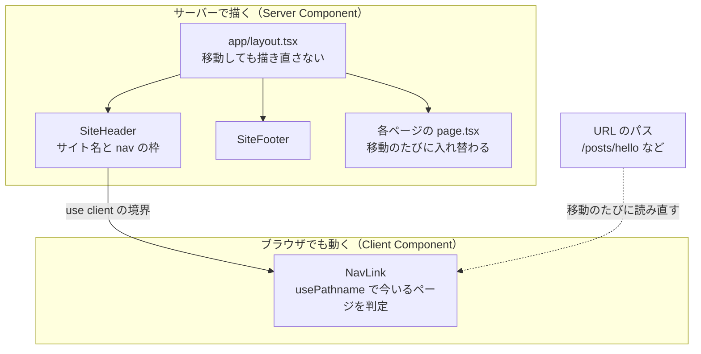
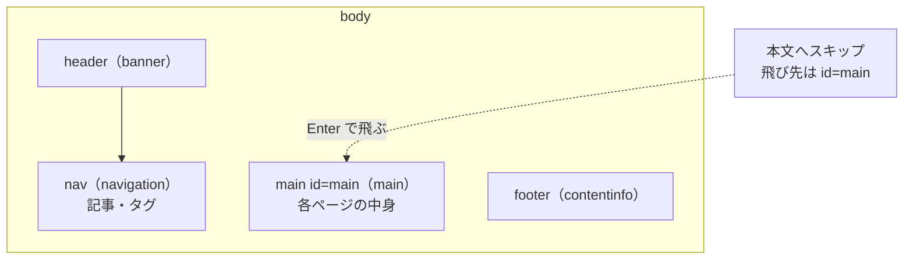

# 3-1: ヘッダーとフッターを全ページに置き、今いるページがナビゲーションで分かるようにする

- 起票日: 2026-11-15
- 学習計画: ADR `20261115-2117-publishable-home-before-storybook.md`（公開できる見た目の段）。設計の全体像は `docs/design/20260925-blog-design-proposal.md`
- ADR: `docs/adr/20261115-2130-site-header-footer.md`（この回で決めたこと。状態は「提案」）
- ステータス: 未着手

## 全体のどこか

「公開できる見た目」の段の2回目。Storybook の寄り道を保留にして、サイトを人に見せられる形に整える8回のうち、3-0 で入れる a11y の自動検査の上で、最初に作るページの外枠にあたる。全ページに共通の外枠（ヘッダー・本文・フッター）を、この回で作る。

| Step      | 内容                                                                   | 進捗                     |
| --------- | ---------------------------------------------------------------------- | ------------------------ |
| 2-0〜2-6  | デザインシステムの土台と Storybook のカタログ                          | ■■■ 完了（2-0 は進行中） |
| 2-7〜2-13 | Storybook の寄り道の続きと React Aria                                  | 保留                     |
| 3-0       | 公開しているページを axe で自動検査し、違反があれば落ちる仕組みを作る  | □□□                      |
| 3-1       | ヘッダー（グローバルナビゲーション）とフッターを作り、全ページに置く   | □□□ ← いまここ           |
| 3-1b      | リンクを押してから移動が終わるまで、待っていることが分かる動きを付ける | □□□                      |
| 3-2       | パンくずリストを作る                                                   | □□□                      |
| 3-3       | 付箋の原稿の置き場所を決め、弁当レイアウトで一覧にする                 | □□□                      |
| 3-4       | 付箋を日付とタグで並べ替える                                           | □□□                      |
| 3-5       | トップ画面を作る（自己紹介、最新の記事と付箋）                         | □□□                      |
| 3-5b      | OGP 画像をデザインし、X のアイコン画像とサイト名・記事の題を載せる     | □□□                      |
| 3-6       | トップ画面に X のツイートを出す                                        | □□□                      |
| 3-7       | 記事一覧・タグ一覧・about を整える                                     | □□□                      |

作業ブランチは作らず、`dev` に直接コミットする。

この回で扱わないもの: パンくずリスト（3-2）、付箋と about へのリンク（ページができる 3-3・3-7 で足す）、開閉するメニュー（ハンバーガー。React Aria の回）、ダークモードの切り替えボタン、トップ画面の中身（3-5）、各ページの余白や幅をそろえること（3-7）。

## なぜこれをやるか

今のサイトには、全ページの左上に「ホーム」というリンクが1つあるだけだ。記事を読み終えた人がほかの記事やタグに移るには、トップ画面に戻るしかない。どのページにいるのかも画面からは分からない。

ヘッダーとフッターは、すべてのページが共有する外枠になる。3-2 のパンくずリストはヘッダーの下に置き、3-3 の付箋ページと 3-7 の about はナビゲーションに1行足すだけで行き来できるようにする。外枠を先に決めておくと、このあとの回はページの中身だけに集中できる。

あわせて、ページの骨組みを読み上げソフトにも伝わる形にそろえる。今は `<main>` があるページとないページが混ざっていて、記事ページにはない。この回で `<main>` を layout の1か所にまとめ、キーボードで本文へ飛べるスキップリンクも付ける。

## 周辺知識

### 全体の地図（どの部品がどこで描かれ、移動したときにどこが描き直されるか）



図から分かること:

- `layout.tsx` と、その中に置いた `SiteHeader`・`SiteFooter` は、ページを移動しても描き直されない。入れ替わるのは `page.tsx` の部分と、URL を読んでいる `NavLink` だけ
- 今いるパスを読めるのは Client Component の中だけ。そのため、判定に要るリンクの部分だけを `NavLink` に切り出し、ヘッダーの残りはサーバーで描いたままにする
- `"use client"` の線より下にある部品は JavaScript としてブラウザに送られる。境界を部品の木の端（葉）に寄せるほど、送る量が減る



図から分かること:

- 括弧の中がランドマークの名前。読み上げソフトの利用者はランドマークの一覧から `main` へ直接飛べる。スキップリンクは同じ近道を Tab キーで操作する人に用意するもの
- `main` はページに1つだけ置く。layout に1つ置けば、どのページでもスキップリンクの飛び先が同じになる
- `header` が banner、`footer` が contentinfo として扱われるのは、`body` の直下にあるときだけ。`article` の中に置いた `header` はランドマークにならない

### 用語

| 用語                     | たとえ                                                                                               | 正確な意味                                                                                                                                               | この回での出番                           |
| ------------------------ | ---------------------------------------------------------------------------------------------------- | -------------------------------------------------------------------------------------------------------------------------------------------------------- | ---------------------------------------- |
| ランドマーク             | 館内図にある「受付」「展示室」「出口」の札。読み上げソフトの利用者は、札の一覧から目的の場所へ跳べる | ページの大きな区画に付ける役割。`header`（banner）、`nav`（navigation）、`main`、`footer`（contentinfo）などの要素が自動で役割を持つ                     | ヘッダー、ナビ、本文、フッターの4区画    |
| グローバルナビゲーション | どの階にも同じ形で掛かっている案内板                                                                 | サイトの主要なページへのリンクを、全ページの同じ場所に同じ並びで置いたもの                                                                               | ヘッダーの「記事」「タグ」               |
| `aria-current="page"`    | 館内図の「現在地」の印を、目で見ない人にも伝える札                                                   | リンクの集まりの中で、今いるページを指すリンクに付ける属性。読み上げソフトが「現在のページ」と伝える                                                     | `NavLink` が今いるページのリンクに付ける |
| スキップリンク           | 入口にある「展示室へ直行」の扉。毎回受付を通らずに済む                                               | ページの先頭に置き、繰り返し出るヘッダーやナビを飛ばして本文へ移るリンク。ふだんは隠し、キーボードでフォーカスしたときだけ見せることが多い               | 「本文へスキップ」                       |
| `"use client"` の境界    | 「ここから先はブラウザにも配る」と書いた荷札                                                         | ファイルの先頭に書くと、そのファイルと、そこから import した部品がブラウザでも動く部品（Client Component）になる                                         | `nav-link.tsx` の1行目                   |
| `usePathname`            | 今の住所（URL のパスの部分）を読む道具                                                               | 今の URL のパスを返す、Client Component 専用のフック。`/posts?x=1` なら `/posts` を返す                                                                  | 今いるページかどうかの判定               |
| App Shell                | ルートごとに1つ作り、どのリンクから来ても使い回す外枠                                                | Partial Prefetching で `<Link>` が先読みする、URL によらず共通の部分。`params`・`searchParams` のような URL ごとに違うデータ（URL データ）は入れられない | ヘッダーは全ページの外枠に入る           |
| WCAG 2.4.1               | —                                                                                                    | ブロックスキップ（レベル A）。繰り返し出るブロックを飛ばす手段を用意する、という基準                                                                     | スキップリンクとランドマーク             |
| WCAG 1.4.1               | —                                                                                                    | 色の使用（レベル A）。色の違いだけで情報を伝えない、という基準                                                                                           | 今いるリンクを太字と下線で示す           |

### 設計の考え方

**layout は移動しても描き直さない。** Next.js の layout はページを移動しても描き直さない。ヘッダーの中に入力欄や開いたメニューがあっても、移動で作り直さずにそのまま残すためだ。代わりに、layout は今のパスを受け取れない。受け取れたとしても、描き直さないので古いパスのまま残ってしまう。公式の資料も「今のパスを読むなら、移動のたびに描き直される Client Component の中で `usePathname` を使う」と案内している（`node_modules/next/dist/docs/01-app/03-api-reference/03-file-conventions/layout.md` の「Pathname」）。

**Client Component は葉に寄せる。** ヘッダー全体を `"use client"` にしても動く。ただ、そうするとサイト名やリンクの並びまで JavaScript としてブラウザに送られる。今いるページかどうかで変わるのは、各リンクの `aria-current` と見た目だけなので、その部分だけを `NavLink` にする。ヘッダーの枠はサーバーで描いた HTML のまま届く。

**現在地は見た目と属性の両方で示す。** 太字や下線は目で見る人に、`aria-current` は読み上げソフトの利用者に伝わる。片方だけでは、もう片方の人には今いる場所が伝わらない。見た目のほうも色の違いだけにしない。色の見分けにくい人には、色が変わっただけでは区別がつかないからだ（WCAG 1.4.1）。

**main は layout で1つにそろえる。** 今のコードでは、`main` がページごとにばらばらになっている。記事一覧とタグのページは自分で `main` を持ち、記事のページには `main` がなく `article` だけがある。トップ画面には `nav` しかない。これでは、読み上げソフトで「main へ移動」したときの行き先がページで変わる。layout に `<main id="main">` を1つ置けば、どのページでも同じになり、スキップリンクの飛び先も `#main` の1つで済む。

**ヘッダーは全ページの App Shell に入る。** このリポジトリは `partialPrefetching` を有効にしている。`<Link>` は、リンク先のルートの App Shell（URL によらず共通の外枠）を先読みする。layout に置いたヘッダーはこの外枠の一部になる。`usePathname` の資料によると、静的なルートと、`generateStaticParams` で全パスを作ってあるルートでは、パスがビルドの時点で決まるので、`usePathname` は `<Suspense>` なしで使える（`use-pathname.md` の「Cache Components」）。このリポジトリのルートはどちらかに当たる。開発時に App Shell を検査する仕組み（ADR `20261115-0059-instant-false-for-dynamic-routes.md` で出会った警告）も、ヘッダーの `usePathname` には警告を出さなかった。初回の読み込みでも、ヘッダーと記事カードのリンクで移動したときも同じだった（実測）。

### ベストプラクティス

| 作法                                                                                                                                                                                           | 出典                                                                                                                   | このリポジトリでは                                                                                                             |
| ---------------------------------------------------------------------------------------------------------------------------------------------------------------------------------------------- | ---------------------------------------------------------------------------------------------------------------------- | ------------------------------------------------------------------------------------------------------------------------------ |
| ページの中身はすべてランドマークの中に置く。数は7つ以下が目安                                                                                                                                  | [WAI-ARIA APG: Landmarks](https://www.w3.org/WAI/ARIA/apg/patterns/landmarks/)                                         | 採る。ヘッダー・ナビ・本文・フッターの4つ                                                                                      |
| `main` は1ページに1つ。`header`・`footer` が banner・contentinfo になるのは `body` の直下にあるときだけ                                                                                        | [WAI-ARIA APG: Landmark Regions](https://www.w3.org/WAI/ARIA/apg/practices/landmark-regions/)                          | 採る。layout に `main` を1つ置き、各ページからは外す                                                                           |
| `nav` が2つ以上あるときは、それぞれに違う名前（`aria-label`）を付ける。名前に「ナビゲーション」を入れない。読み上げソフトが役割の名前を続けて読み、「ナビゲーション ナビゲーション」になるため | 同上                                                                                                                   | 採る。今のトップ画面にも `nav` があるので、2つになる                                                                           |
| `aria-current` は、集まりの中で1つだけに付ける。見た目の印は残し、属性はそれを読み上げに伝えるために足す                                                                                       | [MDN: aria-current](https://developer.mozilla.org/en-US/docs/Web/Accessibility/ARIA/Reference/Attributes/aria-current) | 採る                                                                                                                           |
| ページの先頭に本文へのリンクを置く（G1）。ランドマーク（ARIA11）だけでも基準は満たせる                                                                                                         | [Understanding WCAG 2.4.1](https://www.w3.org/WAI/WCAG22/Understanding/bypass-blocks.html)                             | ランドマークに加えて、スキップリンクも入れる。キーボードだけで操作する人の多くは、ランドマークで移動する機能を持っていないため |
| グローバルナビゲーションには水平メニューを使い、全ページで同じ形に出す。画面の狭い端末では、ハンバーガーメニューとモバイルメニューで出すことを検討する                                         | [デジタル庁デザインシステム: 水平メニュー](https://design.digital.go.jp/dads/components/horizontal-menu/)              | 水平に並べるところは採る。ハンバーガーはこの回では採らない（下の比較を参照）                                                   |

デジタル庁デザインシステムのサイト自体も、ページの先頭に「本文へ移動」のリンクを置いている。ただし、スキップリンクやフッターはコンポーネントとしては載っていない（[コンポーネント一覧](https://design.digital.go.jp/dads/components/)、2026-11-15 確認）。

### 比較（狭い画面でのナビの形）

| 案                                               | 得意なこと                                                                             | 引き換えにするもの                                                                                                 | この回で採るか                                   |
| ------------------------------------------------ | -------------------------------------------------------------------------------------- | ------------------------------------------------------------------------------------------------------------------ | ------------------------------------------------ |
| 横に並べ、入りきらなければ折り返す（`flexWrap`） | 開閉の状態も JavaScript もいらない。全部のリンクが常に見える                           | リンクが増えると2段、3段になり、画面の上を広く取る                                                                 | 採る。リンクは2〜4個なので収まる                 |
| ハンバーガーボタンとドロワー                     | リンクが多くても画面を取らない。デジタル庁デザインシステムも狭い画面で検討を勧めている | 開閉の状態と、開いたときのフォーカスの移動を作る必要がある。中身が隠れるので、リンクがあること自体に気づかれにくい | 採らない。状態を持つ部品は React Aria の回で作る |
| 画面の下に固定するタブバー                       | 親指が届きやすい。スマートフォンのアプリでおなじみ                                     | 画面の下を常に占める。ブログでは見慣れない                                                                         | 採らない                                         |
| 1行のまま横にスクロール                          | 高さが1行で済む                                                                        | はみ出したリンクに気づきにくい                                                                                     | 採らない                                         |

### 比較（今いるページの判定）

| 案                                                          | 得意なこと                                                                                     | 引き換えにするもの                                                                                   | この回で採るか |
| ----------------------------------------------------------- | ---------------------------------------------------------------------------------------------- | ---------------------------------------------------------------------------------------------------- | -------------- |
| `usePathname` でパスを読み、リンクの `href` と比べる        | 公式の資料の例と同じ形。`/posts/hello` を「記事」に含める、のような規則を自分で決められる      | Client Component が要る                                                                              | 採る           |
| `useSelectedLayoutSegment` で、layout の1段下の区切りを読む | ルートの layout から呼ぶと、`/posts/hello` で `"posts"` が返る。区切りの名前と比べるだけで済む | こちらも Client Component が要る。リンクの `href` とは別に、区切りの名前を持つことになる             | 採らない       |
| ページから「今いる場所」を props で渡す                     | JavaScript がいらない                                                                          | layout は描き直さないので、layout に置いたヘッダーには渡せない。ページごとにヘッダーを置くことになる | 採らない       |

### a11y の解説

この回の実装は、ほとんどが a11y のためのものだ。画面の見た目はあまり変わらないが、読み上げソフトやキーボードで使う人にとっては、使えるかどうかが変わる。

先に、この回で思い浮かべておく人を3人挙げる。W3C の WAI（Web のアクセシビリティを進める部門）が、支援技術を使う人の具体的な場面を集めた資料「How People with Disabilities Use the Web」に出てくる人たちだ。

- **Lakshmi**（目が見えない会計士）: パソコンでもスマートフォンでも読み上げソフトを使う。見出しがきちんと付いたページなら「ホットキーで見出しから見出しへすばやく移動できる」。サイトの形を頭の中に描いて使うので、その形が「ページごとに変わると、とても遅くなる」と話している（[Lakshmi のページ](https://www.w3.org/WAI/people-use-web/user-stories/story-three/)）
- **Ade**（腕を自由に動かせない記者）: マウスを使わず、キーボードだけで操作することが多い。「Tab でリンクや入力欄を移っても、今どこにいるかを示す見た目がない」サイトで困っている。ナビゲーションをすべて飛ばして本文へ移るスキップリンクは「大きな助けになる」と言い、それがないサイトは避けている（[Ade のページ](https://www.w3.org/WAI/people-use-web/user-stories/story-one/)）
- **Lexie**（色覚に特性のある買い物客）: 赤・緑・オレンジ・茶の見分けがつきにくい（[Lexie のページ](https://www.w3.org/WAI/people-use-web/user-stories/story-four/)）

3人とも、困っている理由は本人の側ではなく、ページの作り方の側にある。同じ道具を使っていても、作り方しだいで使えるサイトと使えないサイトに分かれる。

| 実装                                              | 入れたとき、どう伝わるか                                                                                                               | 入れないと、どうなるか                                                                                                                                                                                       | 誰が困るか                                                | 根拠                          |
| ------------------------------------------------- | -------------------------------------------------------------------------------------------------------------------------------------- | ------------------------------------------------------------------------------------------------------------------------------------------------------------------------------------------------------------ | --------------------------------------------------------- | ----------------------------- |
| `aria-current="page"`                             | 読み上げソフトが、リンクの名前に「現在のページ」にあたる言葉を添えて読む（MDN。VoiceOver の日本語の文言は未確認）                      | 「記事 リンク」「タグ リンク」が同じ調子で読まれ、今どこにいるかが分からない。目で見る人には太字で分かることが、音だけの人には届かない                                                                       | 読み上げソフトを使う人（Lakshmi）                         | WAI-ARIA 1.2、WCAG 1.3.1      |
| `<nav aria-label="メインメニュー">`               | ランドマークの一覧に「メインメニュー」と名前つきで並ぶ。目次の `nav` と区別できる                                                      | 名前がないと、記事ページでは「ナビゲーション」が2つ並び、どちらがサイトのメニューかを開いて確かめるしかない。名前に「ナビゲーション」を入れると「メインナビゲーション ナビゲーション」のように二重に読まれる | 読み上げソフトでランドマークを使って移動する人            | WAI-ARIA APG Landmark Regions |
| ランドマーク（`header`・`nav`・`main`・`footer`） | ローター（読み上げソフトの、種類別の一覧）で「バナー」「ナビゲーション」「メイン」「コンテンツ情報」に跳べる（日本語の呼び名は未確認） | 区画の区別がなく、ページの頭から順に聞いていくことになる。どのページでも同じ4区画にそろっていれば、頭の中の地図をページごとに描き直さずに済む                                                                | 読み上げソフトを使う人（Lakshmi）                         | WCAG 1.3.1、2.4.1             |
| `<main>` が1ページに1つ                           | 「メインへ移動」で、どのページでも本文の頭に着く                                                                                       | 2つあると、どちらが本題か分からない。記事ページのように1つもないと、「メインへ移動」で行き先がない                                                                                                           | 読み上げソフトを使う人                                    | WAI-ARIA APG Landmark Regions |
| スキップリンク                                    | Tab を1回押して Enter で、ヘッダーを飛ばして本文へ移れる                                                                               | ページを移るたびに、サイト名と「記事」「タグ」を Tab で通り抜けることになる。リンクが増えるほど手間が増える                                                                                                  | キーボードだけで操作する人（Ade）、読み上げソフトを使う人 | WCAG 2.4.1                    |
| `srOnly`（見た目だけ隠す）                        | 画面には出ないが、読み上げソフトには読まれ、キーボードで止まる                                                                         | `display: none` で隠すと、読み上げにもキーボードにも存在しないことになり、スキップリンクの役目を果たせない                                                                                                   | キーボードだけで操作する人、読み上げソフトを使う人        | —                             |
| 太字と下線で今いる場所を示す                      | 色が分からなくても、形の違いで今いるリンクが分かる                                                                                     | 色だけを変えると、色の見分けがつきにくい人には区別がつかない                                                                                                                                                 | 色覚に特性のある人（Lexie）、画面が見づらい環境の人       | WCAG 1.4.1                    |
| フォーカスの輪                                    | Tab で移るたびに、今どこを選んでいるかがはっきりした枠で見える                                                                         | 今どこにいるかが分からず、Enter を押すと何が起きるか予想できない                                                                                                                                             | キーボードだけで操作する人（Ade）、拡大して見ている人     | WCAG 2.4.7、2.4.13、1.4.11    |

**`aria-current` がない世界を想像する。** 目を閉じて `/posts/blog` を開いたつもりになる。読み上げソフトがヘッダーを読む。「65banseki の技術ブログ、リンク。メインメニュー、ナビゲーション。記事、リンク。タグ、リンク」。どれも同じ調子なので、今いるのが記事の側なのかタグの側なのかは、この時点では分からない。本文まで聞き進めて、初めて記事のページだと分かる。`aria-current="page"` があれば、「記事」のところで「現在のページ」と添えられ、ヘッダーを聞いた時点で現在地が分かる。目で見る人が太字に一瞬で気づくのと同じことを、音で伝えている（読み上げの文言はたとえで、実際の文言は VoiceOver の版で変わる）。

**フォーカスの輪がない世界を想像する。** マウスから手を離し、Tab キーだけでこのページを操作してみる。Tab を押すたびに選択が1つ進むが、輪がなければ、画面のどこが選ばれているのかが見えない。何回押したかを数えて当たりを付け、Enter を押して、違うページに飛んだら戻る。Ade が「今どこにいるかを示す見た目がない」と言っているのは、この状態のことだ。ブラウザは標準で輪を描くが、色や太さはブラウザ任せで、背景によっては見えにくい。この回では、ライトでもダークでも背景と 3:1 以上の差がつく輪を、サイト全体に当てる（手順 3-b）。

**ARIA より先に、意味を持つ要素を使う。** この回で書いた ARIA 属性は `aria-current` と `aria-label` の2つだけだ。ランドマークは `header`・`nav`・`main`・`footer` を使うだけで付く。`<div role="navigation">` のように ARIA で役割を書き足すより、意味を持つ要素を正しく使うほうが先、というのが ARIA の使い方の第一の規則（[Using ARIA](https://www.w3.org/TR/using-aria/#rule1)）になる。

フォーカスの輪の基準は次の3つ。

| 基準                                 | レベル | 中身                                                                          |
| ------------------------------------ | ------ | ----------------------------------------------------------------------------- |
| WCAG 2.4.7 フォーカスの可視化        | AA     | キーボードで操作できる部品は、フォーカスが当たっていることが見える            |
| WCAG 1.4.11 非テキストのコントラスト | AA     | 部品の状態を示す見た目（フォーカスの輪など）は、隣の色と 3:1 以上の差をつける |
| WCAG 2.4.13 フォーカスの見た目       | AAA    | 輪は 2px 以上の太さで部品を囲み、フォーカスの前後で 3:1 以上の差がある        |

輪の色に使う `fg.default` と背景 `bg.default` のコントラストは、ライトで 17.4:1（`#1a1a1a` と `#ffffff`）、ダークで 18.76:1（`#f2f2f2` と `#000000`）になる。色の値は `panda cssgen` で書き出した CSS から読み、WCAG の相対輝度の式で計算した（実測）。どちらも 1.4.11 の 3:1 を大きく超える。

### 現時点のバージョン（2026-11-15 確認）

| パッケージ      | バージョン | この回での扱い |
| --------------- | ---------- | -------------- |
| `next`          | 16.4.1     | そのまま       |
| `react`         | 19.2.9     | そのまま       |
| `@pandacss/dev` | 2.5.0      | そのまま       |

新しく入れるパッケージはない。

## 作業手順（全体の地図）

1. ヘッダーの最小の形を作り、layout の「ホーム」リンクと差し替える
2. 今いるページのリンクに `aria-current` を付ける NavLink を作る（**この回の本題**）
3. ヘッダーに見た目を付け、フォーカスの輪をサイト全体で決める
4. layout に `<main>` を置き、わざとページ側の `<main>` を残して、入れ子になるのを見る
5. 各ページの `<main>` を外す
6. 本文へ飛ぶスキップリンクを足す
7. フッターを作り、本文が短いページでも画面の下に来るようにする

## 確認事項

- [ ] **ナビゲーションに並べるページ。** 推奨案「今あるページだけ（記事・タグ）。付箋は 3-3、about は 3-7 で足す」で作成。理由は押すと 404 になるリンクを置かないため。ただし、リンクが2つだけでは寂しく、ページが増えるたびに `site-header.tsx` を直すことになる
- [ ] **今いるページの判定の置き場所。** 推奨案「`usePathname` を使う小さな Client Component（NavLink）を作り、ヘッダー本体は Server Component のままにする」で作成。理由は layout はページを移動しても描き直されず、URL を受け取れないから。ブラウザに送る JavaScript も、リンク1本ぶんの小さな部品だけで済む。ただし、NavLink の部分はブラウザで動くので、そのぶんの JavaScript は送られる
- [ ] **今いるページとみなす規則。** 推奨案「`href` と完全に一致するか、`href + "/"` で始まる」で作成。理由は記事を読んでいるとき（`/posts/blog`）も「記事」を今いる場所として示すため。`/` を足して比べるので、`/posts-old` のような似た URL を取り違えることもない。トップ（`/`）は `"//"` で始まるパスがないので、自然に完全一致だけになる。ただし、記事ページ（`/posts/blog`）で「記事」に `aria-current="page"` を付けるのは、厳密には正しくない。リンク先は一覧で、今のページそのものではないからだ。厳密にするなら、完全一致のときは `"page"`、配下のページでは `"true"` と分ける案がある（その場合、`_currentPage` は `"page"` にしか当たらないので、見た目の条件も分ける）
- [ ] **今いることの見せ方。** 推奨案「`aria-current="page"` を付け、太字と下線で示す」で作成。理由は読み上げソフトにも「現在のページ」と伝わり、色だけに頼らない（WCAG 1.4.1）から。ただし、背景色を変える見せ方よりは目立たない
- [ ] **`<main>` の置き場所。** 推奨案「layout に `<main id="main">` を1つ置き、各ページから外す」で作成。理由は今はページごとにばらばら（記事ページにはない）なのを1か所にそろえ、スキップリンクの飛び先を1つにできるから。ただし、ページの側で `<main>` に固有のスタイルを当てられなくなる。`/design-system` の `<main>` のスタイルは `<div>` に移す
- [ ] **スキップリンクを入れるか。** 推奨案「入れる。キーボードで最初に止まり、フォーカスしたときだけ見える」で作成。理由は WCAG 2.4.1（ブロックスキップ）を満たす定番の方法だから。ただし、マウスで使う人には見えない部品が1つ増える。見た目は最小限で、フォーカスしたときに普通の文字として出るだけにしている
- [ ] **markuplint の `no-hardcoded-id` の警告。** 推奨案「`.markuplintrc.json` の `nodeRules` で `main#main` だけ外す」で作成。理由は layout は1回しか描かれず、id が重複しないから。スキップリンクの飛び先は、固定の id のほうが読みやすい。ただし、設定に例外が1つ増える。`useId` で id を作る案もあるが、飛び先が `#_R_...` のような読めない値になる
- [ ] **狭い画面でのナビゲーション。** 推奨案「ハンバーガーにせず、`flexWrap` で回り込ませる」で作成。理由はリンクが2〜4個なら横に並べて足り、開閉の状態を持たずに済むから。状態を持つ部品は React Aria の回まで作らない方針にも合う。ただし、リンクが5個以上になったら見直す
- [ ] **フッターの外部リンク。** 推奨案「X（@65banseki）と GitHub（hi-lee-mon）、デザインシステム（`/design-system`）」で作成。理由は X は layout の `metadata` にあるアカウント、GitHub はこのリポジトリの持ち主で、デザインシステムは展示室としてヘッダーには置かないから。ただし、アカウント名が変わったら直す。Zenn と Qiita は記事を配り始めたら足す
- [ ] **フォーカスの輪の置き場所。** 推奨案「`panda.config.ts` の `globalCss` で `*:focus-visible` に一括で当てる」で作成。理由はヘッダーのリンクだけでなく、記事の本文のリンク、タグ、カード、スキップリンクなど、キーボードで止まるものすべてに同じ輪が付くから。部品ごとに書くと、MDX の本文のように部品を通らないリンクで書き忘れる。ただし、`globalCss` は `strictTokens` の型検査の外にある。トークンにない値を書いても型検査は止めない（実測。`outlineWidth: "2"` と書くと、CSS に無効な `outline-width: 2` が出た）。部品ごとに輪を変えたいときは、その部品で上書きする
- [ ] **フォーカスの輪の形と色。** 推奨案「太さ `2px`・実線・色 `fg.default`・すき間 `4`（0.25rem）」で作成。理由は2px は WCAG 2.4.13 の太さの目安を満たし、`fg.default` は背景とのコントラストがライトで 17.4:1、ダークで 18.76:1 と、1.4.11 の 3:1 を大きく超えるから。すき間を空けると、輪が文字や枠線と重ならない。ただし、太さの `2px` はトークンにない値で、今の `borderWidths` は `1`（1px）だけ（生成された CSS で確認）。デザインシステムとして値をそろえるなら、あとで `borderWidths` に `2` を足す。濃い背景の部品を作ったときは、輪が背景に溶けるので、その部品で色を変える
- [ ] **【標準ルールからの逸脱】TDD を適用しない。** 本人の判断（2026-11-03）による

## ハンズオン

コマンドの出力と HTML の中身は`11fe717` と同じ内容を一時ディレクトリに複製して実際に動かし、写したもの（2026-11-15、Node 24.22.1 / bun 1.4.4 / Next.js 16.4.1 / Panda CSS 2.5.0）。

---

### 準備：この回で何をするのか

家にたとえると、今のサイトは部屋（ページ）だけがあって、玄関と廊下がない状態だ。この回では、どの部屋にもつながる廊下（ヘッダーのナビゲーション）と、部屋の外の表札や連絡先（フッター）を作る。廊下には「いまはこの部屋にいます」という札（`aria-current`）も下げる。

作るものの関係は周辺知識の「全体の地図」の1枚目のとおり。layout と ヘッダーとフッターは Server Component のまま、今いるページを調べる NavLink だけを Client Component にする。

#### 用意するもの

- 2-6 までが終わった `dev`（`11fe717` 以降）
- Chrome（DevTools の Elements と Console を使う）

開発サーバーを起動しておく。

```bash
cd ~/ghq/github.com/hi-lee-mon/65-blog-app
bun run d
```

---

### 手順 1：ヘッダーの最小の形を作り、layout の「ホーム」リンクと差し替える

`app/_components/site-header.tsx` を新しく作る。見た目はまだ付けない。

```tsx
import Link from "next/link";
import { SITE_NAME } from "../../lib/siteMetadata";

const navItems = [
  { href: "/posts", label: "記事" },
  { href: "/tags", label: "タグ" },
];

export function SiteHeader() {
  return (
    <header>
      <Link href="/">{SITE_NAME}</Link>
      <nav aria-label="メインメニュー">
        <ul>
          {navItems.map((item) => (
            <li key={item.href}>
              <Link href={item.href}>{item.label}</Link>
            </li>
          ))}
        </ul>
      </nav>
    </header>
  );
}
```

`app/layout.tsx` を次の全文に書き換える。変えたのは3か所で、`import Link` を消し、`SiteHeader` を import し、`<Link href="/">ホーム</Link>` を `<SiteHeader />` にした。

```tsx
import type { Metadata } from "next";
import { Geist, Geist_Mono } from "next/font/google";
import "./globals.css";
import { SITE_NAME, siteOpenGraph } from "../lib/siteMetadata";
import Script from "next/script";
import { css } from "../styled-system/css";
import { SiteHeader } from "./_components/site-header";

const geistSans = Geist({
  variable: "--font-geist-sans",
  subsets: ["latin"],
});

const geistMono = Geist_Mono({
  variable: "--font-geist-mono",
  subsets: ["latin"],
});

export const metadata: Metadata = {
  metadataBase: new URL("https://www.65banseki.dev"), // 全ページのメタデータで継承される以降相対パスで書くことができる（/postsはhttps://www.65banseki.dev/postsになる）
  title: {
    default: SITE_NAME,
    template: `%s | ${SITE_NAME}`,
  },
  description: "65banseki の技術ブログ。自分の手で試した記録を残しています。",
  openGraph: {
    ...siteOpenGraph,
    type: "website",
  },
  twitter: {
    card: "summary_large_image",
    site: "@65banseki",
    creator: "@65banseki",
  },
};

export default function RootLayout({ children }: LayoutProps<"/">) {
  return (
    <html
      lang="ja"
      className={`${geistSans.variable} ${geistMono.variable} ${css({ height: "full", fontSmoothing: "antialiased" })}`}
    >
      <body
        className={css({
          minHeight: "full",
          display: "flex",
          flexDirection: "column",
        })}
      >
        <SiteHeader />
        {children}
        {process.env.CF_WEB_ANALYTICS_TOKEN && (
          <Script
            src="https://static.cloudflareinsights.com/beacon.min.js"
            data-cf-beacon={JSON.stringify({
              token: process.env.CF_WEB_ANALYTICS_TOKEN,
            })}
          />
        )}
        {process.env.UMAMI_WEBSITE_ID && (
          <Script
            src="https://cloud.umami.is/script.js"
            data-website-id={process.env.UMAMI_WEBSITE_ID}
            data-domains="www.65banseki.dev" // このホスト名のときだけ動く
          />
        )}
      </body>
    </html>
  );
}
```

`http://localhost:3000/posts` を開く。いちばん上に「65banseki の技術ブログ」と、「記事」「タグ」が縦に並ぶ。

**なぜ** — layout に書いたものは、すべてのページで共有される。ヘッダーを部品として `app/_components/` に切り出しておくと、layout は「どの順に何を置くか」だけを書く場所になる。サイト名は 1-9 で決めた `SITE_NAME` を使う。名札（`<title>`）とヘッダーの表記が、1か所の定数から出るようになる。

`<nav>` に `aria-label` を付けたのは、記事ページにはすでに目次の `<nav aria-label="目次">` があるからだ。ナビゲーションが2つあるページでは、読み上げソフトがどちらのナビゲーションかを名前で区別する。名前に「ナビゲーション」という語を入れないのは、読み上げソフトが「メインメニュー ナビゲーション」と、種類を自分で読み足すからだ。

---

### 手順 2：この回の本題。今いるページのリンクに `aria-current` を付ける

#### 2-a：NavLink を作る

`app/_components/nav-link.tsx` を新しく作る。

```tsx
"use client";

import Link from "next/link";
import { usePathname } from "next/navigation";
import type { ReactNode } from "react";

type NavLinkProps = { href: string; children: ReactNode };

export function NavLink({ href, children }: NavLinkProps) {
  const pathname = usePathname();
  const isCurrent = pathname === href || pathname.startsWith(`${href}/`);

  return (
    <Link href={href} aria-current={isCurrent ? "page" : undefined}>
      {children}
    </Link>
  );
}
```

`app/_components/site-header.tsx` を次の全文に書き換える。`NavLink` を import し、ナビゲーションの `Link` を `NavLink` に替えた。サイト名のリンクは `Link` のままにする。

```tsx
import Link from "next/link";
import { SITE_NAME } from "../../lib/siteMetadata";
import { NavLink } from "./nav-link";

const navItems = [
  { href: "/posts", label: "記事" },
  { href: "/tags", label: "タグ" },
];

export function SiteHeader() {
  return (
    <header>
      <Link href="/">{SITE_NAME}</Link>
      <nav aria-label="メインメニュー">
        <ul>
          {navItems.map((item) => (
            <li key={item.href}>
              <NavLink href={item.href}>{item.label}</NavLink>
            </li>
          ))}
        </ul>
      </nav>
    </header>
  );
}
```

#### 2-b：DevTools で `aria-current` を見る

Chrome で次のページを開き、DevTools の Elements でヘッダーのリンクを見る。

| 開いたページ     | `aria-current="page"` が付くリンク |
| ---------------- | ---------------------------------- |
| `/posts`         | 記事                               |
| `/posts/blog`    | 記事                               |
| `/tags`          | タグ                               |
| `/tags/pandacss` | タグ                               |
| `/`              | どちらにも付かない                 |

`/posts` では、HTML に次のように出る（実測）。

```html
<a aria-current="page" href="/posts">記事</a>
```

ヘッダーの「記事」を押してから、一覧の記事カードを押し、ヘッダーの「タグ」を押す、と移動してみる。ページを読み込み直さなくても、札が移っていく。開発サーバーのターミナルには、警告は出ない（実測）。

**なぜ NavLink だけを Client Component にするのか** — Next.js の layout は、ページを移動しても描き直されない。描き直さないから、入力欄の文字やスクロールの位置が移動のあとも残る。そのかわり、layout とその中の Server Component は「今どの URL か」を受け取れない。公式の手引きも、URL を知りたいときは Client Component で `usePathname` を使うよう書いている。

ここで、ヘッダー全体に `"use client"` を付けることもできる。そうしないのは、ブラウザに送る JavaScript を、URL を知る必要がある部分（リンク1本）だけに絞るためだ。Client Component は木の葉の側に寄せる、というのが境界の置き方の基本になる。

**なぜ警告が出なかったのか** — このリポジトリは Partial Prefetching を有効にしていて、開発サーバーは「全 URL で共通の外枠（App Shell）に、URL ごとに違うデータが混ざっていないか」を移動のたびに検査する（周辺知識を参照）。`usePathname` は URL によって値が変わるので、検査に引っかかりそうに見える。

公式の手引き（`use-pathname.md`）によれば、警告が要るかどうかは、URL がビルドのときに分かるかで決まる。静的なページと、`generateStaticParams` で全パスを列挙したページなら、`usePathname` はビルドのときに値が決まり、`<Suspense>` は要らない。このサイトはどのルートもこのどちらかなので、警告が出なかった。この先、`generateStaticParams` にないパスを受け付ける動的なルートを作ったら、NavLink を `<Suspense>` で囲む必要が出てくる。

#### 2-c：わざと `"use client"` を消して、境界を体験する

`app/_components/nav-link.tsx` の1行目の `"use client";` と、その下の空行を消して保存し、ブラウザを読み込み直す。画面がエラーになり、ターミナルに次の文が出る（実測。色の部分は省いた）。

```
⨯ ./app/_components/nav-link.tsx:2:10
Error: You're importing a module that depends on `usePathname` into a React Server Component module. This API is only available in Client Components. To fix, mark the file (or its parent) with the `"use client"` directive.
    Learn more: https://nextjs.org/docs/app/api-reference/directives/use-client
...
Import trace:
  Server Component:
    ./app/_components/nav-link.tsx
    ./app/_components/site-header.tsx
    ./app/layout.tsx
```

`Import trace` の3行が layout → ヘッダー → NavLink と、Server Component のままたどってきた道筋を示している。`"use client"` は「ここから先はブラウザで動く」という境界の印で、印がないと NavLink も Server Component として扱われる。Server Component の中では `usePathname` を使えない。

確かめたら、1行目に `"use client";` と空行を戻す。

#### 2-d：読み上げソフトで聞き比べる

DevTools で属性を見ただけでは、何が良くなったのかは実感しにくい。読み上げソフトで聞いてみる。

macOS の VoiceOver を使う。操作は次の5つだけ覚えておけばよい。

| 操作                                                 | キー                                                         |
| ---------------------------------------------------- | ------------------------------------------------------------ |
| VoiceOver の起動と終了                               | ⌘ + F5                                                       |
| VO キー（VoiceOver の操作の頭に押すキー）            | Control + Option                                             |
| 次の項目へ進む                                       | VO + →（Control + Option + →）                               |
| ローター（見出し・リンク・ランドマークの一覧）を開く | VO + U。← → で一覧の種類を切り替え、↑ ↓ で選び、Enter で跳ぶ |
| 読み上げを止める                                     | Control                                                      |

1. Chrome で `/posts/blog` を開き、⌘ + F5 で VoiceOver を起動する
2. VO + U でローターを開き、← → で「リンク」の一覧にする。「記事」のところで、現在のページであることが添えて読まれるのを聞く
3. ← → で「ランドマーク」の一覧にする。「メインメニュー」と「目次」の2つのナビゲーションが、名前で区別されて並ぶのを聞く
4. ⌘ + F5 で VoiceOver を終了する

次に、DevTools の Elements でヘッダーの「記事」のリンクを選び、右側の Accessibility タブを開く。読み上げソフトに渡る名前（Name）が「記事」、役割（Role）が `link` で、ARIA の属性として `aria-current` が `page` になっているのが見える（タブの中の見出しの名前は Chrome の版で変わることがある）。

読み上げの文言は VoiceOver の版や設定で変わる（このチケットでは確かめていない）。聞いた文言は受け入れ条件の欄に自分で書き残しておく。

**なぜ聞くのか** — 太字と下線は、目で見る人のための印だ。`aria-current` は、同じ情報を読み上げソフトの利用者に届けるための印になる。自分の耳で一度聞いておくと、属性を書き忘れたときに何が失われるかを、仕様の言葉ではなく体験として思い出せる。

---

### 手順 3：ヘッダーに見た目を付け、フォーカスの輪をサイト全体で決める

#### 3-a：ヘッダーに見た目を付ける

`app/_components/nav-link.tsx` を次の全文に書き換える。

```tsx
"use client";

import Link from "next/link";
import { usePathname } from "next/navigation";
import type { ReactNode } from "react";
import { css } from "../../styled-system/css";

type NavLinkProps = { href: string; children: ReactNode };

export function NavLink({ href, children }: NavLinkProps) {
  const pathname = usePathname();
  const isCurrent = pathname === href || pathname.startsWith(`${href}/`);

  return (
    <Link
      href={href}
      aria-current={isCurrent ? "page" : undefined}
      className={css({
        _hover: { textDecoration: "underline" },
        _currentPage: { fontWeight: "bold", textDecoration: "underline" },
      })}
    >
      {children}
    </Link>
  );
}
```

`app/_components/site-header.tsx` を次の全文に書き換える。

```tsx
import Link from "next/link";
import { SITE_NAME } from "../../lib/siteMetadata";
import { css } from "../../styled-system/css";
import { NavLink } from "./nav-link";

const navItems = [
  { href: "/posts", label: "記事" },
  { href: "/tags", label: "タグ" },
];

export function SiteHeader() {
  return (
    <header className={css({ borderBottomWidth: "1", borderColor: "border.default" })}>
      <div
        className={css({
          display: "flex",
          flexWrap: "wrap",
          alignItems: "baseline",
          justifyContent: "space-between",
          gap: "8",
          maxWidth: "640",
          marginX: "auto",
          paddingX: "16",
          paddingY: "16",
        })}
      >
        <Link href="/" className={css({ fontWeight: "bold" })}>
          {SITE_NAME}
        </Link>
        <nav aria-label="メインメニュー">
          <ul className={css({ display: "flex", gap: "16" })}>
            {navItems.map((item) => (
              <li key={item.href}>
                <NavLink href={item.href}>{item.label}</NavLink>
              </li>
            ))}
          </ul>
        </nav>
      </div>
    </header>
  );
}
```

`/posts` を開くと、サイト名が左、「記事」「タグ」が右に並び、「記事」だけが太字で下線付きになる。DevTools のデバイスツールバー（⌘ + Shift + M）で幅を 320px にすると、ナビゲーションがサイト名の下の段に回り込む。

**なぜ** — `_currentPage` は Panda の条件で、`[aria-current=page]` の付いた要素にだけスタイルを当てる（生成されるクラスは `currentPage:fw_bold`。実測）。見た目の切り替えを `aria-current` に結びつけておくと、「読み上げソフトに伝わる情報」と「目に見える印」が必ず一致する。`isCurrent` を見て `className` を出し分ける書き方もできるが、そうすると片方だけ直して食い違うことがある。

太字と下線の両方にしたのは、色だけに頼らないためだ（WCAG 1.4.1）。色の違いは色覚の特性によっては見分けられない。

狭い画面でナビゲーションを2段目に回したのは `flexWrap: "wrap"` で、ブレークポイント（画面の幅で切り替える境目）を使っていない。中身が入りきらなくなったら折り返す、という書き方なので、スマートフォンから先に考える方針にそのまま合う。中身の幅（`maxWidth: "640"`）は、2-4 で決めた記事の本文の幅にそろえた。

#### 3-b：フォーカスの輪をサイト全体で決める

`panda.config.ts` の `globalCss` に、`*:focus-visible` を足す。全文は次のとおり。

```ts
import { defineConfig } from "@pandacss/dev";
import { tokens } from "./theme/tokens";
import { semanticTokens } from "./theme/semantic";
import { textStyles } from "./theme/text-styles";

export default defineConfig({
  presets: ["@pandacss/preset-base"],
  preflight: true,
  strictTokens: true, // themeにない値の指定を禁止する
  include: ["./app/**/*.{ts,tsx}"],
  exclude: [],
  conditions: {
    extend: {
      dark: "@media (prefers-color-scheme: dark)",
    },
  },
  globalCss: {
    ":root": {
      colorScheme: "light dark",
      "--global-font-body": "{fonts.sans}",
      "--global-font-mono": "{fonts.mono}",
    },
    "*:focus-visible": {
      outlineWidth: "2px",
      outlineStyle: "solid",
      outlineColor: "fg.default",
      outlineOffset: "4",
    },
    body: {
      background: "bg.default",
      color: "fg.default",
      fontSize: "16",
      lineHeight: "170",
    },
  },
  theme: {
    // カスタムテーマ
    tokens,
    semanticTokens,
    textStyles,
  },
  outdir: "styled-system",
});
```

`/posts` を開き、アドレスバーをクリックしてから Tab を押していく。サイト名、「記事」「タグ」、記事カードのリンクに、黒い 2px の輪が少し離れて付く。DevTools の Rendering（⌘ + Shift + P で「Show Rendering」）で `prefers-color-scheme: dark` にすると、輪は明るい色に変わる。

生成される CSS は次のとおり（`panda cssgen` の出力から抜き出した。実測）。

```css
*:focus-visible {
  outline-width: 2px;
  outline-style: solid;
  outline-color: var(--colors-fg-default);
  outline-offset: var(--spacing-4);
}
```

**なぜ `:focus` ではなく `:focus-visible` なのか** — `:focus` はマウスでクリックしたときにも輪を出す。`:focus-visible` は、キーボードで操作したときのように「輪が要る」とブラウザが判断したときだけ当たる。マウスで使う人には余計な輪を見せず、キーボードで使う人には必ず見せられる。

**なぜ `globalCss` に書くのか** — 輪が要るのは、ヘッダーのリンクだけではない。記事の本文（MDX）のリンクは部品を通らずに描かれるので、部品ごとにスタイルを書く方式では輪を付け忘れる。`*:focus-visible` にしておけば、キーボードで止まるものすべてに同じ輪が付く。

**`outlineWidth` だけ `2px` と単位つきで書く理由** — このリポジトリの太さのトークン（`borderWidths`）には `1`（1px）しかない。`globalCss` は `strictTokens` の型検査の外にあるので、`outlineWidth: "2"` と書いても型検査は通る。そのとき CSS には `outline-width: 2` という単位のない無効な値が出て、指定が効かない（実測）。色（`fg.default`）とすき間（`4`）はトークンにあるので、トークン名で書いている。

---

### 手順 4：layout に `<main>` を置き、わざと入れ子にする

`app/layout.tsx` の `<body>` の中の `{children}` を、`<main>` で囲む。`<body>` の中は次のようになる。

```tsx
        <SiteHeader />
        <main id="main" className={css({ flex: "1" })}>
          {children}
        </main>
```

ページの側の `<main>` はまだ消さない。`/posts` を開き、DevTools の Console に次を打つ。

```js
document.querySelectorAll("main").length;
```

`2` と出る（実測）。layout の `<main>` の中に、記事一覧のページ（`app/posts/page.tsx`）の `<main>` が入っている。`/design-system` でも `2`、記事ページ（`/posts/blog`）では `1` になる。記事ページはもともと `<main>` を持たず、`<article>` だけだからだ。

**なぜわざと入れ子にするのか** — `<main>` は「このページの本題はここ」と示す目印で、1ページに1つしか置けない。読み上げソフトの利用者はこの目印へ一気に飛んで本文を読み始める。目印が2つ、しかも入れ子だと、どちらが本題かが伝わらない。

この誤りは型検査にも markuplint にも見つけられない。markuplint はファイルを1つずつ検査するので、layout とページが別のファイルに分かれていると、組み合わせたときの入れ子は見えない。画面に出た HTML を見て初めて分かる誤りだ、ということを覚えておく。

---

### 手順 5：各ページの `<main>` を外す

4つのファイルで、ページの側の `<main>` を外す。

`app/posts/page.tsx`・`app/tags/page.tsx`・`app/tags/[tag]/page.tsx` は、`return` の中の `<main>` を `<>`、`</main>` を `</>` にする。`app/posts/page.tsx` の `return` は次のようになる。

```tsx
return (
  <>
    <h1>記事一覧</h1>
    <ul className={css({ display: "flex", flexDirection: "column", gap: "16" })}>
      {posts.map(({ slug, frontmatter }) => (
        <li key={slug}>
          <PostCard slug={slug} title={frontmatter.title} date={frontmatter.date} />
        </li>
      ))}
    </ul>
  </>
);
```

`app/design-system/page.tsx` は、スタイルを付けた `<main` を `<div`、`</main>` を `</div>` にする。`className` はそのまま残す。

```tsx
  return (
    <div
      className={css({
        width: "full",
        maxWidth: "640",
        marginX: "auto",
        paddingX: "16",
        paddingY: "48",
      })}
    >
```

（ファイルの最後の `</main>` も `</div>` にする）

Console でもう一度 `document.querySelectorAll("main").length` を打つ。`/posts`・`/tags`・`/tags/pandacss`・`/design-system`・`/posts/blog`・`/` のどれでも `1` になる（実測）。

**なぜ** — `<main>` を layout の1か所に置くと、どのページにも必ず1つだけ本題の目印がある状態になる。ページを足すときに `<main>` を書き忘れることも、二重に書くこともなくなる。`<>`（Fragment）は要素を増やさずに複数の要素をまとめて返すための書き方だ。

---

### 手順 6：本文へ飛ぶスキップリンクを足す

#### 6-a：markuplint の警告を見る

```bash
bun run l:markup
```

期待される出力（最後の数行）:

```
<markuplint> warning: It is hard-coded (react/no-hard-code-id) /Users/<あなたのユーザー名>/ghq/github.com/hi-lee-mon/65-blog-app/app/layout.tsx:51:15
  50: ••••••••<SiteHeader•/>
  51: ••••••••<main•id="main"•className={css({•flex:•"1"•})}>
  52: ••••••••••{children}

✖ 1 problem (0 errors, 1 warning) in 26 files
```

手順 4 で書いた `id="main"` に、警告が出ている。React の部品は同じページで何度も使われることがあり、id を固定で書くと同じ id が2つできてしまう。markuplint はそれを心配している。警告なので、終了コードは 0 のままで、コミットは止まらない。

#### 6-b：`main#main` だけ警告を外す

`.markuplintrc.json` の `nodeRules` の先頭に、1つ足す。全文は次のとおり。

```json
{
  "extends": ["markuplint:recommended-react"],
  "parser": {
    "\\.[jt]sx$": "@markuplint/jsx-parser",
    "\\.mdx$": "@markuplint/mdx-parser"
  },
  "specs": {
    "\\.[jt]sx$": "@markuplint/react-spec",
    "\\.mdx$": "@markuplint/react-spec"
  },
  "excludeFiles": ["./.next/**/*"],
  "nodeRules": [
    {
      "selector": "main#main",
      "rules": { "no-hardcoded-id": false }
    },
    {
      "selector": "code[class^='language-']",
      "rules": { "no-unknown-attr": false }
    }
  ]
}
```

もう一度 `bun run l:markup` を走らせると、`✔ 26 files checked, 0 problems` になる。

**なぜ全体ではなく `main#main` だけなのか** — layout は1ページに1回しか描かれないので、この id は重複しない。ほかの部品で id を固定で書いたときには、引き続き警告してほしい。例外は理由のある1か所に絞る。

#### 6-c：スキップリンクを足す

`app/layout.tsx` の `<body>` の中を、次のようにする。`<SiteHeader />` の前に `<a>` が1つ増えた。

```tsx
        <a href="#main" className={css({ srOnly: true, _focusVisible: { srOnly: false } })}>
          本文へスキップ
        </a>
        <SiteHeader />
        <main id="main" className={css({ flex: "1" })}>
          {children}
        </main>
```

`/posts` を開き、アドレスバーをクリックしてから Tab キーを押す。いちばん上に「本文へスキップ」が現れる。Enter を押すと URL の末尾に `#main` が付き、次に Tab を押したときのフォーカスが、ヘッダーを飛ばして本文のリンクに移る。

**なぜ** — キーボードで操作する人は、ページを移るたびにヘッダーのリンクを Tab で1つずつ通り過ぎることになる。スキップリンクはその近道で、WCAG 2.4.1（ブロックスキップ）を満たす定番の方法だ。キーボードで最初に止まる位置に置くので、`<body>` の先頭に書く。

`srOnly: true` は「画面には出さず、読み上げソフトとキーボードには見える」ようにする Panda のユーティリティだ。`_focusVisible: { srOnly: false }` で、キーボードでフォーカスしたときだけ普通の文字に戻す。

`srOnly: false` は、隠すために付けた指定を戻す。そのとき `padding` も `0` に戻す（`@pandacss/preset-base` 2.5.0 のソースで確認）。同じ `_focusVisible` に `padding` を足すと、どちらが勝つかは CSS の並び順しだいになるので、この回では余白を付けていない。

#### 6-d：キーボードと読み上げソフトでスキップリンクを使う

1. `/posts/blog` を開き、アドレスバーをクリックしてから Tab を押す。「本文へスキップ」が 3-b で付けた輪と一緒に現れる
2. Enter を押してから、もう一度 Tab を押す。フォーカスがサイト名や「記事」「タグ」を飛ばして、本文の最初のリンク（タグ）に移る
3. ⌘ + F5 で VoiceOver を起動し、同じ操作をする。Tab で「本文へスキップ」が読まれ、Enter のあとは本文から読み進められるのを聞く
4. VO + U でローターを開き、「ランドマーク」の一覧に、ヘッダー（バナー）、2つのナビゲーション、本文（メイン）が並ぶのを確かめる（日本語の呼び名は未確認。フッターは手順 7 で足す）
5. ⌘ + F5 で VoiceOver を終了する

**なぜ体験するのか** — スキップリンクは、マウスで使っていると一度も目に入らない。Tab キーだけで何ページか移動してみると、毎回ヘッダーを通り抜ける手間と、それを1回の Enter で飛ばせることの差が分かる。

---

### 手順 7：フッターを作り、本文が短いページでも画面の下に来るようにする

`app/_components/site-footer.tsx` を新しく作る。

```tsx
import Link from "next/link";
import { css } from "../../styled-system/css";

export function SiteFooter() {
  return (
    <footer className={css({ borderTopWidth: "1", borderColor: "border.default" })}>
      <div
        className={css({
          display: "flex",
          flexDirection: "column",
          gap: "8",
          maxWidth: "640",
          marginX: "auto",
          paddingX: "16",
          paddingY: "16",
          fontSize: "14",
          color: "fg.muted",
        })}
      >
        <ul className={css({ display: "flex", flexWrap: "wrap", gap: "16" })}>
          <li>
            <a href="https://x.com/65banseki">X</a>
          </li>
          <li>
            <a href="https://github.com/hi-lee-mon">GitHub</a>
          </li>
          <li>
            <Link href="/design-system">デザインシステム</Link>
          </li>
        </ul>
        <p>
          <small>© 2026 65banseki</small>
        </p>
      </div>
    </footer>
  );
}
```

`app/layout.tsx` を次の全文に書き換える。これがこの回の layout の完成形になる。

```tsx
import type { Metadata } from "next";
import { Geist, Geist_Mono } from "next/font/google";
import "./globals.css";
import { SITE_NAME, siteOpenGraph } from "../lib/siteMetadata";
import Script from "next/script";
import { css } from "../styled-system/css";
import { SiteHeader } from "./_components/site-header";
import { SiteFooter } from "./_components/site-footer";

const geistSans = Geist({
  variable: "--font-geist-sans",
  subsets: ["latin"],
});

const geistMono = Geist_Mono({
  variable: "--font-geist-mono",
  subsets: ["latin"],
});

export const metadata: Metadata = {
  metadataBase: new URL("https://www.65banseki.dev"), // 全ページのメタデータで継承される以降相対パスで書くことができる（/postsはhttps://www.65banseki.dev/postsになる）
  title: {
    default: SITE_NAME,
    template: `%s | ${SITE_NAME}`,
  },
  description: "65banseki の技術ブログ。自分の手で試した記録を残しています。",
  openGraph: {
    ...siteOpenGraph,
    type: "website",
  },
  twitter: {
    card: "summary_large_image",
    site: "@65banseki",
    creator: "@65banseki",
  },
};

export default function RootLayout({ children }: LayoutProps<"/">) {
  return (
    <html
      lang="ja"
      className={`${geistSans.variable} ${geistMono.variable} ${css({ height: "full", fontSmoothing: "antialiased" })}`}
    >
      <body
        className={css({
          minHeight: "full",
          display: "flex",
          flexDirection: "column",
        })}
      >
        <a href="#main" className={css({ srOnly: true, _focusVisible: { srOnly: false } })}>
          本文へスキップ
        </a>
        <SiteHeader />
        <main id="main" className={css({ flex: "1" })}>
          {children}
        </main>
        <SiteFooter />
        {process.env.CF_WEB_ANALYTICS_TOKEN && (
          <Script
            src="https://static.cloudflareinsights.com/beacon.min.js"
            data-cf-beacon={JSON.stringify({
              token: process.env.CF_WEB_ANALYTICS_TOKEN,
            })}
          />
        )}
        {process.env.UMAMI_WEBSITE_ID && (
          <Script
            src="https://cloud.umami.is/script.js"
            data-website-id={process.env.UMAMI_WEBSITE_ID}
            data-domains="www.65banseki.dev" // このホスト名のときだけ動く
          />
        )}
      </body>
    </html>
  );
}
```

`/tags` のように本文の短いページを開く。フッターは本文のすぐ下ではなく、画面のいちばん下に出る。

**なぜフッターが下に来るのか** — `<body>` は 1-1 のころから `display: flex`・`flexDirection: column`・`minHeight: full`（画面の高さいっぱい）になっている。その中で `<main>` に `flex: "1"` を付けたので、ヘッダーとフッターが使った残りの高さを `<main>` がすべて受け持つ。本文が短くても `<main>` が伸びるので、フッターは画面の下に押し出される。

フッターの © 表記は `<small>` で囲んだ。`<small>` は「小さい字にする」ためのタグではなく、著作権表示や注意書きのような添え書きを表すタグだ。

---

実装は以上です。静的検証、テストがオールグリーンならcommitしてpushしてください。

---

### うまくいかないとき

| 症状                                                                                                     | 原因と対処                                                                                                                                                             |
| -------------------------------------------------------------------------------------------------------- | ---------------------------------------------------------------------------------------------------------------------------------------------------------------------- |
| `Error: You're importing a module that depends on \`usePathname\` into a React Server Component module.` | `nav-link.tsx` の1行目に `"use client";` がない。手順 2-c で消したまま戻し忘れていないかを見る                                                                         |
| どのページでも `aria-current` が付かない                                                                 | ナビゲーションで `NavLink` ではなく `Link` を使っている。`site-header.tsx` を手順 2-a の形にする                                                                       |
| `/posts/blog` で「記事」に `aria-current` が付かない                                                     | 判定が完全一致だけになっている。`pathname.startsWith(\`${href}/\`)` の側が抜けていないかを見る                                                                         |
| `document.querySelectorAll("main").length` が `2` のまま                                                 | ページの側の `<main>` が残っている。手順 5 の4ファイルを見直す                                                                                                         |
| `warning: It is hard-coded (react/no-hard-code-id)`                                                      | `.markuplintrc.json` に `main#main` の `nodeRules` がない。手順 6-b の形にする                                                                                         |
| Tab を押しても「本文へスキップ」が出ない                                                                 | アドレスバーにフォーカスがない状態で始めている。アドレスバーをクリックしてから Tab を押す。それでも出ないときは `<a>` が `<body>` の先頭にあるかを見る                 |
| 本文の短いページで、フッターが画面の途中に出る                                                           | `<main>` に `flex: "1"` がない                                                                                                                                         |
| Tab を押しても輪が出ない、または細い                                                                     | `panda.config.ts` の `globalCss` に `*:focus-visible` がない。足したあとは開発サーバーを起動し直す。`outlineWidth` を `"2"` のように単位なしで書いていないかも見る     |
| VoiceOver で「現在のページ」にあたる言葉が読まれない                                                     | DevTools の Accessibility タブで `aria-current` が `page` になっているかを見る。属性があるのに読まれないときは、VoiceOver ユーティリティの読み上げの詳細度の設定を見る |

ここに載っていないエラーが出たら、そのまま貼って聞いてほしい。

---

## 受け入れ条件

- [ ] `app/_components/site-header.tsx`・`nav-link.tsx`・`site-footer.tsx` があり、`app/layout.tsx` が3つを使っている。「ホーム」のリンクは消えている
- [ ] `nav-link.tsx` の1行目が `"use client";` で、`site-header.tsx` と `site-footer.tsx` には `"use client"` がない
- [ ] `/posts` と `/posts/blog` で「記事」に、`/tags` と `/tags/pandacss` で「タグ」に `aria-current="page"` が付き、`/` ではどちらにも付かないのを DevTools で見た
- [ ] 今いるページのリンクが太字と下線で示されている
- [ ] 幅 320px で、ナビゲーションがサイト名の下の段に回り込むのを見た
- [ ] どのページでも `document.querySelectorAll("main").length` が `1` になる
- [ ] Tab キーで「本文へスキップ」が現れ、Enter で本文へ飛ぶのを見た
- [ ] 本文の短いページで、フッターが画面のいちばん下に出る
- [ ] `.markuplintrc.json` に `main#main` の `nodeRules` があり、`bun run l:markup` が `0 problems` で終わる
- [ ] Tab で移るたびに、2px の輪が少し離れて付くのを見た。ダーク表示（DevTools の Rendering）でも輪が見えた
- [ ] VoiceOver で、`/posts/blog` の「記事」のリンクが現在のページとして読まれるのを聞いた（聞いた文言: ＿＿＿＿）
- [ ] VoiceOver のローターで、ランドマークの一覧にヘッダー・ナビゲーション（2つ）・本文・フッターが並ぶのを聞いた
- [ ] DevTools の Accessibility タブで、「記事」のリンクの Name・Role・`aria-current` を見た
- [ ] `bun run a11y`（3-0 で入れた axe の検査）が、明るい表示と暗い表示の両方で通る
- [ ] 静的検証とテストが通り、`dev` に push している

## この回で理解したこと

着手後に埋める。受け入れ条件とは別に、何が分かったかを残す。

- [ ] layout が Server Component のままでは今の URL を受け取れない理由を、「layout は移動しても描き直されない」で説明できる
- [ ] ヘッダー全体ではなく NavLink だけを Client Component にした理由を説明できる
- [ ] `usePathname` を使っても App Shell の警告が出なかった理由と、`<Suspense>` が要るのはどんなときかを説明できる
- [ ] 見た目の切り替えを `aria-current` に結びつける（`_currentPage`）と、何が食い違わなくなるのかを説明できる
- [ ] `<main>` の入れ子を markuplint が見つけられない理由を説明できる
- [ ] スキップリンクが誰の何を楽にするのかを説明できる
- [ ] フッターが画面の下に来る仕組みを、`flex: 1` で説明できる
- [ ] `aria-current` がないと、読み上げソフトで使う人はヘッダーを聞いた時点で何が分からないのかを説明できる
- [ ] フォーカスの輪が見えないと、キーボードで使う人がどう困るかを、Tab と Enter の操作で説明できる
- [ ] `srOnly` で隠すのと `display: none` で隠すのとで、読み上げとキーボードにとって何が違うかを説明できる
- [ ] `:focus` ではなく `:focus-visible` に輪を付ける理由を説明できる

## 参考

- Next.js `layout.js`（同梱ドキュメント `node_modules/next/dist/docs/01-app/03-api-reference/03-file-conventions/layout.md`）
- Next.js `usePathname`（同梱ドキュメント `node_modules/next/dist/docs/01-app/03-api-reference/04-functions/use-pathname.md`）
- Next.js Adopting Partial Prefetching（同梱ドキュメント `node_modules/next/dist/docs/01-app/02-guides/adopting-partial-prefetching.md`）
- Panda CSS の条件（`_currentPage` など）: https://panda-css.com/docs/concepts/conditional-styles
- WAI-ARIA APG Landmark Regions: https://www.w3.org/WAI/ARIA/apg/practices/landmark-regions/
- `aria-current`（WAI-ARIA 1.2）: https://www.w3.org/TR/wai-aria-1.2/#aria-current
- WCAG 2.2 の 2.4.1 ブロックスキップ: https://www.w3.org/TR/WCAG22/#bypass-blocks
- WCAG 2.2 の 1.4.1 色の使用: https://www.w3.org/TR/WCAG22/#use-of-color
- markuplint `no-hardcoded-id`: https://markuplint.dev/docs/rules/no-hardcoded-id
- W3C WAI, How People with Disabilities Use the Web（Lakshmi・Ade・Lexie）: https://www.w3.org/WAI/people-use-web/user-stories/
- WCAG 2.2 の 2.4.7 フォーカスの可視化: https://www.w3.org/TR/WCAG22/#focus-visible
- WCAG 2.2 の 2.4.13 フォーカスの見た目: https://www.w3.org/TR/WCAG22/#focus-appearance
- WCAG 2.2 の 1.4.11 非テキストのコントラスト: https://www.w3.org/TR/WCAG22/#non-text-contrast
- Using ARIA（第一の規則）: https://www.w3.org/TR/using-aria/#rule1
- VoiceOver ユーザガイド: https://support.apple.com/ja-jp/guide/voiceover/welcome/mac
