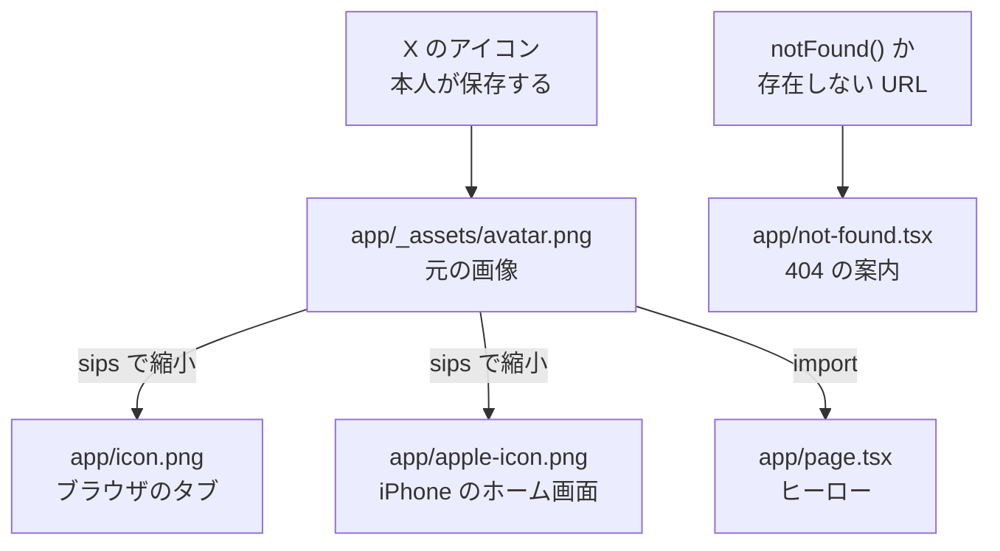

# 3-11: X のアイコンをサイトの顔にし、迷った人を 404 ページから案内する

- 起票日: 2026-11-23
- 学習計画: ADR `20261122-1821-publish-first-path.md`（公開までの4回）
- ADR: `docs/adr/20261123-1206-not-found-icons-hero.md`（この回で決めたこと。状態は「採用」）
- 前提: 3-5 が完了していること（トップ画面に自己紹介がある）
- ステータス: 完了

## 全体のどこか

3-3c のあと、最初の公開までの4回のうち2回目。

| Step     | 内容                                             | 進捗           |
| -------- | ------------------------------------------------ | -------------- |
| 3-5      | トップ画面を作る（自己紹介、最新の記事とふせん） | ■■■ 完了       |
| 3-11     | ファビコン、ヒーロー、404 ページを作る           | □□□ ← いまここ |
| 3-8・3-9 | RSS、sitemap、robots を作り、軽い CSP を入れる   | □□□            |
| 4-0      | 記事を仕分け、`main` に反映して公開する          | □□□            |

この回で扱わないもの: OGP 画像のデザイン（3-5b）、X のツイート表示（3-6）、存在しない記事の URL を HTTP 404 で返す仕組み。

## なぜこれをやるか

いまはブラウザのタブにサイトのアイコンがなく、トップ画面にも書き手の顔が見えない。X で知った人が来たときに、同じ人のサイトだと分かるよう、X のアイコンをファビコンとヒーローに使う。ファビコンはタブに出る小さなアイコン、ヒーローはページの最初に見える大きな紹介の部分を指す。

URL を間違えた人には、Next.js の英語の既定画面ではなく、日本語の案内と次に行ける場所を見せる。

## 周辺知識

### 全体の地図



図から分かること:

- 元の画像は1枚で、用途ごとに大きさを変えて使う
- `icon.png` と `apple-icon.png` は、`app/` に置くだけで Next.js が `<head>` にタグを足す
- 404 の案内はルートの `layout.tsx` の中に出るので、ヘッダーとフッターが残る

### 用語

| 用語                 | たとえ                                     | 正確な意味                                                             | この回での出番 |
| -------------------- | ------------------------------------------ | ---------------------------------------------------------------------- | -------------- |
| ファビコン           | お店の小さな看板                           | ブラウザのタブやブックマークに出るサイトのアイコン                     | 手順 2         |
| `apple-icon`         | スマホの棚に置くお店のカード               | iPhone でホーム画面に追加したときに使われるアイコン                    | 手順 2         |
| `sips`               | Mac に最初から入っている画像の加工機       | 画像の形式や大きさを変える macOS のコマンド                            | 手順 1・2      |
| `next/image`         | 客の席に合わせて料理を取り分ける係         | 画面に合う大きさと形式に画像を変えて配信する Next.js の部品            | 手順 3         |
| `placeholder="blur"` | 料理が届くまで置いておく見本               | 本物の画像が届くまで、ぼかした小さな画像を表示する `next/image` の指定 | 手順 3         |
| 404                  | 「その部屋はありません」という受付の返事   | ページが存在しないことを示す HTTP のステータスコード                   | 手順 4         |
| ソフト 404           | 受付は「はい」と答え、部屋で「ない」と言う | 画面は「見つかりません」なのに、HTTP のステータスが 200 になる状態     | 手順 6         |

### 設計の考え方

**元の画像は `public/` に置かない。** このリポジトリの `public/` は Qiita CLI 用に予約している（`CLAUDE.md`）。`app/_assets/` に置いて `import` すると、Next.js が画像の幅と高さを読み取るので、読み込み中のレイアウトのずれも防げる。`_` で始まるフォルダは URL にならない。

**ヒーローは画面幅の切り替えを使わない。** このリポジトリの Panda CSS には `md` のような画面幅の指定がない（実測で型エラーになる）。`flexWrap: "wrap"` にすると、広い画面では横に並び、狭くて入らないときだけ折り返す。

### ベストプラクティス

- ファビコンと `apple-icon` は `app/` に置く（出典: Next.js 同梱ガイド `01-metadata/app-icons.md`）
- `preload` は画像を先に読み込む指定で、LCP（最初の画面で一番大きな要素）の画像に使う（出典: 同梱ガイド `02-components/image.md`）。このサイトの LCP は見出しで（実測）、文字の表示を優先したいので使わない
- 隣の文字と同じ情報しか持たない飾りの画像は `alt=""` にする（出典: [WAI Decorative Images](https://www.w3.org/WAI/tutorials/images/decorative/)）

### 比較（ファビコンの形式）

| 案                    | 得意なこと                     | 引き換えにするもの                     | この回で採るか |
| --------------------- | ------------------------------ | -------------------------------------- | -------------- |
| `icon.png` を置く     | Mac の標準コマンドだけで作れる | とても古いブラウザでは出ないことがある | 採る           |
| `favicon.ico` も作る  | 古いブラウザにも対応しやすい   | ico を作る道具が別に要る               | 採らない       |
| `icon.tsx` で生成する | 文字や色をコードで変えられる   | X のアイコンをそのまま使う今回には過剰 | 採らない       |

### a11y の解説

| 実装                    | 入れたとき、どう伝わるか                                 | 入れないと、どうなるか                                 | 誰が困るか               | 根拠       |
| ----------------------- | -------------------------------------------------------- | ------------------------------------------------------ | ------------------------ | ---------- |
| ヒーロー画像の `alt=""` | 読み上げは画像を飛ばし、すぐサイト名の見出しを読む       | 画像のファイル名や同じ名前を重ねて聞くことがある       | 読み上げを使う人         | WCAG 1.1.1 |
| 404 の `<h1>`           | 開いた直後に、ページがないことが見出しで分かる           | 何が起きたかを本文から探すことになる                   | 読み上げを使う人         | WCAG 2.4.6 |
| 行き先が分かるリンク    | 「記事一覧を見る」のように、リンクだけで次の行動を選べる | 「こちら」が並ぶと、どこへ行くのかが分からない         | リンクの一覧で移動する人 | WCAG 2.4.4 |
| 赤や警告の色を使わない  | 色の見え方にかかわらず、文字で状況が伝わる               | 色だけで「エラー」を伝えると、見分けにくい人に届かない | 色の見え方が違う人       | WCAG 1.4.1 |

VoiceOver の読み上げは未確認なので、手順 7 で自分の耳で確かめる。

### 現時点のバージョン（2026-11-23 確認）

| パッケージ | バージョン | この回での扱い |
| ---------- | ---------- | -------------- |
| next       | 16.4.6     | そのまま       |
| react      | 19.3.1     | そのまま       |

新しく入れるパッケージはない。

## 作業手順（全体の地図）

1. X のアイコンを保存し、`app/_assets/avatar.png` にする
2. ファビコンと `apple-icon` を作る
3. トップ画面にヒーローを作る
4. **本題:** 404 ページを作る
5. 404 ページを axe の検査に足す
6. 存在しない URL の返り方を確かめる
7. わざと壊し、スマートフォンの幅、キーボード、VoiceOver で確かめる

## 確認事項

- [ ] **1. 画像の出どころ。** 推奨「X のアイコンを本人が保存してリポジトリに置く」で作成。理由はビルドのたびに X へ取りに行かずに済むため。欠点は X のアイコンを変えても自動では変わらないこと。リポジトリは public なので、画像も公開される
- [ ] **2. 元画像の置き場所。** 推奨「`app/_assets/`」で作成。理由は `public/` を Qiita CLI 用に予約しているため。欠点は一般的な `public/` の置き方と違うこと
- [ ] **3. ファビコンの形式。** 推奨「`icon.png`（192px）と `apple-icon.png`（180px）」で作成。理由は標準コマンドで作れるため。欠点は `favicon.ico` がなく、とても古いブラウザでは出ないことがある
- [ ] **4. ヒーローの形。** 推奨「96px の丸いアイコンと、サイト名、自己紹介」で作成。理由は最初の画面を占領せず、記事まで近いため。欠点は全面の大きな画像ほどの印象は出ないこと。画像は本人の判断で `preload` を使わず、遅延読み込みと `placeholder="blur"` にする。欠点は画像の表示が少し遅れ、HTML が約1.1KB増えること
- [ ] **5. ヒーロー画像の `alt`。** 推奨「`alt=""`」で作成。理由は隣にサイト名があり、同じ情報を重ねないため。欠点は「書き手の写真」として説明したい画像に変えたら書き直しが要ること
- [ ] **6. 404 の文言と色。** 推奨「落ち着いた日本語の案内で、赤を使わない」で作成。理由は読者を責めず、色の見え方に左右されないため。欠点は設計書にある「遊び心」はまだ入らないこと
- [ ] **7. 404 からの行き先。** 推奨「トップ、記事一覧、タグ一覧」で作成。理由は読者の次の行動が多い場所のため。欠点はふせんへの導線がページ内にないこと（ヘッダーからは行ける）
- [ ] **8. 【一般的な推奨からの逸脱】存在しない記事とタグの HTTP ステータス。** 推奨「今回は直さない」で作成。`/posts/no-such-post` と `/tags/nosuchtag` は案内を表示するが、ステータスは 200 になる（実測）。正しくは 404 を返すほうがよい。それでも外す理由は `noindex` が付いて検索結果に載らず、直すには描画方式まで見直すため。欠点は監視ツールやクローラーが正常なページと誤解する場合があること

## ハンズオン

出力はリポジトリの複製で実際に動かして写した（2026-11-23、next 16.4.6、react 19.3.1、bun 1.4.4、Node.js 24.22.1）。画像はダミーで確かめたので、実際の X のアイコンでの見た目と VoiceOver の読み上げは未確認。

---

### 準備：この回で何をするのか

X のアイコンを1枚保存し、タブのアイコンとトップ画面に使う。そのあと、存在しないページに来た人への案内を作る。

#### 用意するもの

開発サーバーを起動しておく。

```bash
bun run d
```

---

### 手順 1：X のアイコンを保存し、`app/_assets/avatar.png` にする

1. ブラウザで `https://x.com/65banseki` を開く
2. プロフィールのアイコンを押して拡大する
3. 拡大した画像を右クリックし、「名前を付けて画像を保存」で `~/Downloads/avatar.jpg` に保存する

別のターミナルで、PNG にしてリポジトリに置く。

```bash
mkdir -p app/_assets
sips -s format png ~/Downloads/avatar.jpg --out app/_assets/avatar.png
```

大きさを確かめる。

```bash
sips -g pixelWidth -g pixelHeight app/_assets/avatar.png
```

期待される出力（実測。ダミー画像の場合）:

```
  pixelWidth: 400
  pixelHeight: 400
```

保存された形式が `.png` や `.webp` だったら、コマンドの `avatar.jpg` をその名前に変える。

**なぜ** — ビルドのたびに X から取得すると、X の障害や仕様変更でサイトのビルドが止まる。リポジトリに置けば、外部のサービスに左右されない。

---

### 手順 2：ファビコンと `apple-icon` を作る

```bash
sips -z 192 192 app/_assets/avatar.png --out app/icon.png
sips -z 180 180 app/_assets/avatar.png --out app/apple-icon.png
```

ブラウザを再読み込みする。タブにアイコンが出る。出ないときはタブを開き直す。

**なぜ** — `app/` 直下に決まった名前で置くと、Next.js が `<link rel="icon">` と `<link rel="apple-touch-icon">` を足す（実測で `192x192` と `180x180`）。`layout.tsx` に手で書かなくてよい。

---

### 手順 3：トップ画面にヒーローを作る

`app/page.tsx` の import に2行足す。

```tsx
import Image from "next/image";
import avatar from "./_assets/avatar.png";
```

`return` の中の最初の `<header>` を次の形に置き換える。`<p>` の文章は、いまの自己紹介のままでよい。

```tsx
<header
  className={css({
    display: "flex",
    flexWrap: "wrap",
    alignItems: "center",
    gap: "16",
    marginBlockEnd: "48",
  })}
>
  <Image
    src={avatar}
    alt=""
    width={96}
    height={96}
    placeholder="blur"
    className={css({ borderRadius: "full" })}
  />
  <div>
    <h1 className={css({ textStyle: "heading.1" })}>{SITE_NAME}</h1>
    <p>自分の手で試した記録を残しています。</p>
  </div>
</header>
```

`http://localhost:3000/` を開く。丸いアイコンの横にサイト名と自己紹介が並び、幅を狭めると文字がアイコンの下に回る。

**なぜ** — 画像を `import` すると、Next.js が元の大きさを知っているので読み込み中も場所を確保でき、ぼかし画像も自動で作られる。`preload` を付けないので画像は遅延読み込みになり、届くまではぼかしが出る。

---

### 手順 4：この回の本題。404 ページを作る

`app/not-found.tsx` を新しく作る。

```tsx
import type { Metadata } from "next";
import { css } from "../styled-system/css";
import { AppLink } from "./_components/app-link";
import { PageContainer } from "./_components/page-container";

export const metadata: Metadata = {
  title: "ページが見つかりません",
};

const linkStyle = css({ color: "fg.link", textDecoration: "underline" });

export default function NotFound() {
  return (
    <PageContainer>
      <h1 className={css({ textStyle: "heading.1", marginBlockEnd: "16" })}>
        ページが見つかりません
      </h1>
      <p className={css({ marginBlockEnd: "24" })}>
        URL が間違っているか、ページが移動または削除された可能性があります。
      </p>
      <ul className={css({ display: "flex", flexDirection: "column", gap: "8" })}>
        <li>
          <AppLink href="/" className={linkStyle}>
            トップページへ戻る
          </AppLink>
        </li>
        <li>
          <AppLink href="/posts" className={linkStyle}>
            記事一覧を見る
          </AppLink>
        </li>
        <li>
          <AppLink href="/tags" className={linkStyle}>
            タグ一覧を見る
          </AppLink>
        </li>
      </ul>
    </PageContainer>
  );
}
```

`http://localhost:3000/no-such-page` を開く。ヘッダーとフッターはそのままで、中身が案内に変わる。

**なぜ** — 迷った人に必要なのは、起きたことの説明と次に行ける場所である。ルートの `not-found.tsx` は `layout.tsx` の中に出るので、サイトのナビもそのまま使える。

---

### 手順 5：404 ページを axe の検査に足す

`e2e/a11y.spec.ts` の `ENTRY_PATHS` を次の形にする。

```ts
const ENTRY_PATHS = ["/", "/posts", "/notes", "/tags", "/design-system", "/no-such-page"];
```

**なぜ** — 404 ページはどこからもリンクされないので、一覧をたどる検査には入らない。入口に書くと、これからも自動で検査される。

---

### 手順 6：存在しない URL の返り方を確かめる

本番ビルドで動かす。

```bash
bun run b
bun run s -p 3100
```

別のターミナルで HTTP のステータスを見る。

```bash
curl -s -o /dev/null -w '%{http_code}\n' http://localhost:3100/no-such-page
curl -s -o /dev/null -w '%{http_code}\n' http://localhost:3100/posts/no-such-post
curl -s -o /dev/null -w '%{http_code}\n' http://localhost:3100/tags/nosuchtag
```

期待される出力（実測）:

```
404
200
200
```

確かめたら、サーバーを Control + C で止める。

**なぜ** — 2行目と3行目は、ページの描画を流し始めたあとで「ない」と分かるので、先に送った 200 を変えられない。画面には案内が出て、検索エンジン向けの `noindex` も付く（実測）。今回はこの動きを知ったうえで残す（確認事項 8）。

---

### 手順 7：わざと壊し、スマートフォンの幅、キーボード、VoiceOver で確かめる

わざと壊す: `app/page.tsx` の `alt=""` の行を消して、型検査を実行する。

```bash
bun run tc
```

期待される出力（抜粋。実測）:

```
app/page.tsx(46,10): error TS2741: Property 'alt' is missing in type
```

確かめたら `alt=""` を戻す。`alt` は空でも書く必要がある。書かないと、読み上げソフトがファイル名を読むことがある。

画面の幅:

1. Chrome の DevTools で Toggle device toolbar（⌘ + Shift + M）を押す
2. 幅を `320` にして `/` と `/no-such-page` を開く
3. 横スクロールが出ないことを見る

キーボード:

1. `/no-such-page` を開き、Tab で3つのリンクまで進む
2. Enter で移動できることを見る

VoiceOver（⌘ + F5 で起動。Control + Option + 右矢印で次へ）:

1. `/` で、アイコンの画像が読まれず、サイト名の見出しに進むことを聞く
2. `/no-such-page` で、レベル1の見出しが「ページが見つかりません」であることを聞く

読み上げの文言は未確認なので、自分の耳で確かめてほしい。

---

実装は以上です。静的検証、テストがオールグリーンならcommitしてpushしてください。

---

### うまくいかないとき

| 症状                                  | 原因と対処                                                        |
| ------------------------------------- | ----------------------------------------------------------------- |
| `Property 'alt' is missing`           | 手順 7 の `alt=""` を戻していない                                 |
| `'md' does not exist in type`         | このリポジトリには `md` の指定がない。手順 3 の `flexWrap` を使う |
| タブにアイコンが出ない                | ブラウザのキャッシュが残っている。タブを開き直す                  |
| `sips` が保存先のファイルを見つけない | 保存した名前や拡張子が違う。`ls ~/Downloads` で確かめる           |
| 404 の画面が英語のまま                | `not-found.tsx` の場所が違う。`app/` の直下に置く                 |

ここに載っていないエラーが出たら、そのまま貼って聞いてほしい。

---

## 受け入れ条件

- [ ] `app/_assets/avatar.png`、`app/icon.png`、`app/apple-icon.png` があり、X のアイコンが写っている（目視）（未確認のまま本人了承。3つのファイルはある）
- [ ] ブラウザのタブにアイコンが出る（目視）（未確認のまま本人了承）
- [ ] トップ画面に丸いアイコン、サイト名、自己紹介が出る（目視）（未確認のまま本人了承）
- [ ] 幅 320px で `/` と `/no-such-page` に横スクロールが出ない（目視）（未確認のまま本人了承）
- [ ] `/no-such-page` のステータスが 404 で、日本語の案内と3つのリンクが出る（未確認のまま本人了承）
- [ ] `/posts/no-such-post` と `/tags/nosuchtag` にも同じ案内が出る（目視）（未確認のまま本人了承）
- [ ] `alt` を消すと `bun run tc` が失敗し、戻すと通る（未確認のまま本人了承。戻した状態で通ることは確認済み）
- [ ] `/` で画像が読み上げられず、404 ではレベル1の見出しが案内になっている（VoiceOver）（未確認のまま本人了承）
- [x] `bun run l`、`bun run tc`、`bun run b`、`bun run ay` が通る

## この回で理解したこと

着手後に埋める。

- [ ] 画像を `public/` ではなく `app/_assets/` に置いた理由を説明できる
- [ ] 飾りの画像で `alt` を消さず `alt=""` と書く理由を説明できる
- [ ] 同じ「見つかりません」でも、HTTP ステータスが 404 と 200 に分かれる理由を説明できる
- [ ] `flexWrap` で画面幅の指定なしに並びが変わる理由を説明できる

## 参考

- Next.js 同梱ガイド: `node_modules/next/dist/docs/01-app/03-api-reference/03-file-conventions/not-found.md`
- Next.js 同梱ガイド: `node_modules/next/dist/docs/01-app/03-api-reference/03-file-conventions/01-metadata/app-icons.md`
- Next.js 同梱ガイド: `node_modules/next/dist/docs/01-app/03-api-reference/02-components/image.md`
- [WAI Decorative Images](https://www.w3.org/WAI/tutorials/images/decorative/)
- [WCAG 2.4.6 Headings and Labels](https://www.w3.org/WAI/WCAG22/Understanding/headings-and-labels.html)
