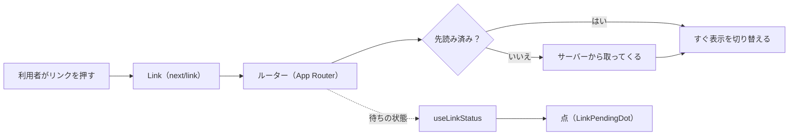

# 3-1b: リンクを押してから移動が終わるまで、待っていることが分かる動きを付ける

- 起票日: 2026-11-19
- 学習計画: ADR `20261115-2117-publishable-home-before-storybook.md`（3-1b を足した理由もここにある）。設計の全体像は `docs/design/20260925-blog-design-proposal.md`
- ADR: `docs/adr/20261119-0130-link-pending-indicator.md`（この回で決めたこと。状態は「提案」）
- 前提: 3-1 のヘッダーが入っていること（コミット `3c789ed`）
- ステータス: 完了

## 全体のどこか

「公開できる見た目」の段の3回目の枝番。3-1 で作ったナビゲーションのリンクに、移動の待ち状態を足す。

| Step | 内容                                                                   | 進捗           |
| ---- | ---------------------------------------------------------------------- | -------------- |
| 3-0  | 公開しているページを axe で自動検査する                                | ■■■ 完了       |
| 3-1  | ヘッダー（グローバルナビゲーション）とフッターを作り、全ページに置く   | ■■■ 完了       |
| 3-1b | リンクを押してから移動が終わるまで、待っていることが分かる動きを付ける | □□□ ← いまここ |
| 3-2  | パンくずリストを作る                                                   | □□□            |

この回で扱わないもの: ページ全体の読み込み表示（`loading.js`。動的なページを作るまで要らない）、パンくずリスト（3-2）、開閉するメニュー（React Aria の回）。

## なぜこれをやるか

ヘッダーのリンクを押しても、次のページが出るまで画面は変わらない。待っている間に「押せたのか」「壊れたのか」が分からず、もう一度押してしまう人がいる。本人も、この待ちが分からないことを指摘している（2026-11-15）。

この回で作るのは、リンクごとに「移動の待ち」を表す小さな点だ。点を見れば、押したリンクが反応していることが分かる。Next.js 16.4 には、この状態を返す `useLinkStatus` という関数が標準で入っているので、自分で状態を管理する必要はない。

## 周辺知識

### 全体の地図



図から分かること:

- `useLinkStatus` は、`Link` の**中に置いた部品**からだけ呼べる。ルーターの待ち状態を、その `Link` の分だけ読み取る
- 先読み（prefetch）が済んでいれば、待ちの段階そのものが飛ばされる。点は出ない。点が出るのは、先読みが間に合わないときだけ
- 点の見た目はあくまで表示の部品。移動の処理は、ルーターが全部やっている

### 用語

| 用語                     | たとえ                                       | 正確な意味                                                       | この回での出番           |
| ------------------------ | -------------------------------------------- | ---------------------------------------------------------------- | ------------------------ |
| Link                     | 駅の改札。通ると次の場所へ行ける             | `next/link` の部品。押すと、ページの切り替えをルーターに頼む     | ナビの各リンク           |
| 先読み（prefetch）       | 注文を出す前に、お茶を先に用意しておくこと   | リンク先のデータを、押す前に取っておく仕組み                     | 点が出るかどうかを決める |
| 待ちの状態（pending）    | 注文してから料理が出るまでの「調理中」の札   | 押してから、表示が切り替わるまでの間だけ `true` になる           | `useLinkStatus` が返す値 |
| `aria-hidden`            | 「この札は読まなくてよい」という目印         | 読み上げソフトから、その要素を隠す属性                           | 点を装飾として扱う       |
| `prefers-reduced-motion` | 「動きを減らしてほしい」というブラウザの設定 | 利用者が OS で動きを減らす設定をしているかを、CSS で見分ける条件 | 点の切り替えを止める     |

### 設計の考え方

`useLinkStatus` は、リンクごとの待ち状態だけを返す。画面全体の読み込み表示（`loading.js`）とは役割が違う。全体の表示は、ページが遅いときにページの場所へ出る。点は、押した場所の近くに出る。

点を `opacity` で出し入れするのは、部品の大きさを変えないため。大きさを変えると、待ちが始まるたびに文字が横にずれ、読むのをやめてしまう。

### ベストプラクティス

- Next.js の公式ガイドは、まず `loading.js` と先読みで待ちを減らすことを勧め、`useLinkStatus` はそれで足りないときの補助として位置づけている（出典: `node_modules/next/dist/docs/01-app/03-api-reference/04-functions/use-link-status.md`）
- 同じ文書は、点の大きさを固定し、表示と非表示を切り替えるだけにするよう勧めている（同じ出典）
- 装飾だけの要素には `aria-hidden` を付け、読み上げで名前に混ざらないようにする（WAI-ARIA 1.2 の `aria-hidden`）

このリポジトリでは、3-1 で作った `NavLink` の中に点を置く。`loading.js` は 3-1b では作らない（確認事項 5）。

### 比較（待ちをどう見せるか）

| 案                                             | 得意なこと                                                   | 引き換えにするもの                                                       | この回で採るか                     |
| ---------------------------------------------- | ------------------------------------------------------------ | ------------------------------------------------------------------------ | ---------------------------------- |
| `useLinkStatus` の点                           | リンクごとに、押した場所の近くで出せる。標準機能だけで作れる | 先読み済みのリンクでは出ない                                             | 採る                               |
| `usePathname` と `useState` で自分で状態を持つ | 仕組みを自分で理解できる                                     | 移動の開始と終わりを自分で捕まえる必要があり、ずれやすい                 | 採らない                           |
| `loading.js` の読み込み表示                    | ページ全体の待ちを一度に扱える                               | 動的なページが増えるまで効きにくい。この回のリンクには効かないことが多い | 採らない（後で必要になったら足す） |

### 版

| パッケージ                       | バージョン                                                                                          | この回での扱い                       |
| -------------------------------- | --------------------------------------------------------------------------------------------------- | ------------------------------------ |
| next                             | 16.4.6（`node_modules/next/package.json` で確認）                                                   | そのまま使う。新しく入れるものはない |
| `useLinkStatus`                  | Next.js 16.4 の `next/link` から                                                                    | 公式文書（上記）の例と同じ形で使う   |
| Panda CSS の条件 `_motionReduce` | `@pandacss/preset-base` に `@media (prefers-reduced-motion: reduce)` として入っていることを確認済み | そのまま使う                         |

### a11y の解説

この回は、画面の見た目と読み上げの両方に関わる。

- **点は装飾。** 点そのものには意味の文字がない。読み上げソフトに読ませると、「黒丸」のような意味のない声が出るだけになる。`aria-hidden` を付けると、読み上げの名前にも役割にも混ざらない
- **待っていることは、読み上げの利用者にも伝わる必要がある。** ただし、点を読み上げさせても待ちは伝わらない（一瞬しか出ない）。どう伝えるかは確認事項 2 で決める
- **点の色は、3:1 以上のコントラストが要る。** WCAG 2.2 の 1.4.11（非テキストのコントラスト）は、状態を示す図形に対して求められる。点は「待っている」という状態を伝えるので、対象になる。`fg.default` と `bg.default` の組み合わせは、コントラスト計算で確かめる（未確認。受け入れ条件で確かめる）
- **動きに弱い利用者。** 点が出たり消えたりする動きは、前庭機能障害のある人に負担になることがある。OS の「視差効果を減らす」設定を見て、動きを止める（WCAG 2.3.3 の考え方）

入れないと困る人: 押したあとに何も変わらないので、もう一度押してしまう人（視覚のある人全般）と、読み上げソフトの利用者（待っているかどうかを知る手がかりがない）。

## 作業手順（全体の地図）

1. 今の状態を見る。Slow 3G で、ナビのリンクを押して、待ちの表示がないことを確かめる
2. 一時的に先読みを切り、点が出ることを見る（この手順は元に戻す）
3. `LinkPendingDot` の部品を作る（`useLinkStatus` で待ちの状態を読む）
4. 点の見た目を作る（大きさは固定、`opacity` で出し入れ）
5. `NavLink` の中に点を置く
6. 動きを減らす設定で、切り替えのアニメーションが止まることを確かめる
7. 読み上げソフトで確かめる（点が読まれないこと、移動中に余計な声が出ないこと）
8. 先読みの一時変更が残っていないことを確かめて、締める

## 確認事項

<!-- 推奨案で書き切っている。変えたいところがあれば教えてください。了承されたらチェックを入れる。 -->

- [ ] **1. 先読みを切るか。** 推奨「切らない（Next.js の既定のまま）」で作成。理由は、ナビのリンクは 3〜4 個で、先読みしておけば押した瞬間に切り替わるため。ただし、先読みが済んでいる（本番の静的なページ）と、点はほとんど出ない。欠点は、点を見て確かめられるのが、先読みを切ったとき（手順 2）か、遅い回線のときだけになること
- [ ] **2. 移動中を読み上げに伝えるか。** 推奨「伝えない（点は `aria-hidden` で隠す）」で作成。理由は、点の名前を変えると、読み上げのたびに「移動中」の声が混ざってうるさくなるため。読み上げを消すと一瞬の状態は読まれないので、実機で確かめる（受け入れ条件）。欠点は、読み上げの利用者が「今、待っている」ことを知る手がかりがなくなること。ここは確かめた結果を ADR に書き足す
- [ ] **3. 待ちの見せ方。** 推奨「色のついた小さな点を `opacity` で出し入れする」で作成。理由は、大きさが変わらず、文字がずれないため。欠点は、点だけでは何の待ちか伝わりにくいこと。文字で「読み込み中」と書くと、リンクの横で文字が増えて読みづらくなる
- [ ] **4. 動きを減らす設定のとき。** 推奨「点の出し入れは残し、アニメーション（`transition`）だけ止める」で作成。理由は、待っていることは伝えたまま、動きだけ減らせるため。欠点は、設定が有効な人には点がぱっと出て消えること
- [ ] **5. ページ全体の読み込み表示（`loading.js`）も、この回で作るか。** 推奨「作らない」で作成。理由は、今のページはすべて静的で、遷移が一瞬で終わるため。欠点は、動的なページ（付箋の詳細など）を作るときに、改めて足す必要があること

## ハンズオン

<!-- 手順は、確認事項 1〜4 の推奨で書いている。段階は 1 つずつ足して、そのたびに見る。 -->

### 手順 1: 今の状態を見る

先に、何も足していない状態で確かめる。

1. 開発サーバーを起動する

```bash
# リポジトリのルートで実行する
bun run d
```

ターミナルに `Local: http://localhost:3000` のような行が出るまで待つ。

2. ブラウザで `http://localhost:3000` を開き、DevTools（⌥⌘I）を開く
3. Network タブで、回線を `Slow 3G` にする
4. ヘッダーの「記事」を押す（別の場所へ移動するリンクでよい）

**なぜ** — 押してから表示が変わるまでの空白を、この回で目で見る。ここが見えていないと、後で点を足しても効果が分からない。

**確かめる** — 押したあと、移動が終わるまで、ヘッダーに変化がない（期待される状態）。

> 手順 1 で「変化がある」と見えた場合は、先読みが済んでいるか、回線が速すぎるかのどちらか。次の手順 2 で切り替える。

### 手順 2: わざと先読みを切って、待ちを見る

この手順は元に戻す前提で行う。`app/_components/nav-link.tsx` の `Link` に `prefetch={false}` を足す。

```tsx
<Link
  href={href}
  prefetch={false}
  aria-current={isCurrent ? "page" : undefined}
  className={css({
    _hover: { textDecoration: "underline" },
    _currentPage: { fontWeight: "bold", textDecoration: "underline" },
  })}
>
  {children}
</Link>
```

**なぜ** — `prefetch={false}` にすると、押すまで中身を取りに行かない。押したあとに待ちが生まれるので、待ちを見るための道具になる。`useLinkStatus` の公式文書も、この設定と組み合わせる例を載せている。

Slow 3G のまま、もう一度「記事」を押す。

**確かめる** — 押したあと、移動が終わるまで、押したリンクの中で何かが変わっていること（この時点では点はまだないので、何も出ないのが期待される状態）。

手順 2 のあと、`prefetch={false}` の行は**消す**。先読みを切ったままにしない（確認事項 1）。

### 手順 3: `LinkPendingDot` の部品を作る

`app/_components/link-pending-dot.tsx` を作る。

```tsx
"use client";

import { useLinkStatus } from "next/link";
import { css } from "../../styled-system/css";

export function LinkPendingDot() {
  const { pending } = useLinkStatus();

  return (
    <span
      aria-hidden
      className={css({
        display: "inline-block",
        width: "2",
        height: "2",
        borderRadius: "full",
        bg: "fg.default",
        marginInlineStart: "1",
        opacity: pending ? "1" : "0",
      })}
    />
  );
}
```

**なぜ** — `"use client"` は、ブラウザで動く部品だという目印。待ちの状態はブラウザの中でしか分からないので、この部品はブラウザで動く。`aria-hidden` は、点を読み上げから隠す（a11y の解説を参照）。`width` と `height` を固定するのは、`opacity` で出し入れしても、文字の位置をずらさないため。

**確かめる** — まだ `NavLink` に入れていないので、画面は変わらない。`bun run tc` が通ることを確かめる。

```bash
bun run tc
```

期待される出力（未確認。実行して写し直す）:

```
✓ Types generated successfully
```

### 手順 4: 点を `NavLink` の中に置く

`app/_components/nav-link.tsx` を開き、`LinkPendingDot` を読み込んで、`Link` の中に置く。

```tsx
import { LinkPendingDot } from "./link-pending-dot";
```

```tsx
<Link
  href={href}
  aria-current={isCurrent ? "page" : undefined}
  className={css({
    _hover: { textDecoration: "underline" },
    _currentPage: { fontWeight: "bold", textDecoration: "underline" },
  })}
>
  {children}
  <LinkPendingDot />
</Link>
```

**なぜ** — `useLinkStatus` は `Link` の**子の部品**からしか呼べない。だから、`Link` の中に置く。`NavLink` の外に置くと、待ちの状態を読めない。

Slow 3G のまま、手順 2 と同じ設定（`prefetch={false}`）で「記事」を押す。

**確かめる** — 押した瞬間に点が出て、移動が終わると消える。文字の位置は動かない。

> 手順 2 で足した `prefetch={false}` は、ここで**消す**。

### 手順 5: この回の本題。先読みが済んでいると、点が出ないことを確かめる

手順 4 の `prefetch={false}` を消したまま、通常の回線に戻す。もう一度「記事」を押す。

**なぜ** — ここが、この回で一番大事な発見になる。先読みが済んでいると、待ちの段階そのものが飛ばされる。だから、点が出ないのが正しい動きになる。「点が出ない＝壊れている」ではない、と分かることが、後で「なぜ出ないのか」を悩まないための鍵になる。

**確かめる** — 通常の回線で押すと、点はほぼ出ない（期待される状態）。出ないことを、「壊れている」と取り違えないこと。

### 手順 6: 動きを減らす設定で、切り替えを止める

まだ点に `transition` は付けていない。動きを減らす設定の確かめ方を、先に見ておく。

1. `styled-system` の中で、条件名を確かめる

```bash
grep -o "_motionReduce" styled-system/types/*.d.ts | head -1
```

期待される出力（未確認。実行して写し直す）: `_motionReduce` の 1 行が出る。

2. `LinkPendingDot` の `css({...})` の中に、次の 2 行を足す

```tsx
        transition: "opacity 150ms",
        _motionReduce: { transition: "none" },
```

3. DevTools の Rendering タブで、`Emulate CSS media feature prefers-reduced-motion` を `reduce` にする
4. ナビのリンクを押して、点の切り替えが即座に起きることを見る

**なぜ** — `_motionReduce` は、OS の「視差効果を減らす」設定が有効なときだけ、中のスタイルを当てる条件。点の出し入れは残し、動きだけ止める（確認事項 4）。

### 手順 7: 読み上げソフトで確かめる

macOS の VoiceOver（⌘ + F5 で起動と終了）で確かめる。VO キーは Control + Option。

1. VoiceOver を起動し、VO + 右矢印で、ヘッダーのリンクを順に読ませる
2. 「記事」の読み上げに、点の声（「黒丸」など）が混ざらないことを確かめる
3. Chrome の DevTools の Accessibility タブで、点の要素に `ignored` や `aria-hidden` が付いていることを確かめる
4. 押したときに、移動中の声が余計に増えないことを確かめる

**なぜ** — 点を `aria-hidden` にしても、読み上げソフトで本当に隠れているかは、実際に聞かないと分からない。確認事項 2 の推奨が、実際の読まれ方と合っているかを確かめる手順。

**確かめる** — 読み上げの結果を、ADR `20261119-0130-link-pending-indicator.md` の「確かめた結果」に書き足す。読み上げの声は、確かめたものだけを書く。

### 手順 8: 締める

**なぜ** — 先読みの一時変更が残っていると、この回の目的（待ちの見せ方）と関係のない変更が混ざる。締める前に、一時変更がないことを確かめる。

```bash

git diff -- app/_components/nav-link.tsx | grep prefetch
```

**確かめる** — 何も出ないこと（`prefetch` の行が残っていない）。

最後に、受け入れ条件を上から順に確かめる。

> 実装は以上です。静的検証、テストがオールグリーンならcommitしてpushしてください。

### トラブルシュート

| 症状                             | 原因の見当                       | 確かめ方                                                    |
| -------------------------------- | -------------------------------- | ----------------------------------------------------------- |
| `useLinkStatus` で型エラーが出る | `next/link` からの読み込みが違う | `import { useLinkStatus } from "next/link";` と書けているか |
| 点が Link の外に出る             | 置いた位置が `Link` の外         | `</Link>` の直前に点があるか                                |
| 点を押すたびに文字がずれる       | 点の大きさが固定されていない     | `width` と `height` が `css` に入っているか                 |
| `_motionReduce` の型エラー       | Panda の型が古いまま             | `bun run p:gen` を実行してから、もう一度 `bun run tc`       |

## 受け入れ条件

- [x] `app/_components/link-pending-dot.tsx` があり、`"use client"` で始まり、`useLinkStatus` を使っている
- [x] `NavLink` の `Link` の中に `LinkPendingDot` がある（`Link` の外にはない）（共通の部品 `AppLink` を通して、サイト内の 6 か所すべてに入れた）
- [ ] Slow 3G で、先読みを切った状態（手順 2）で押すと、点が出て、移動が終わると消える（目視）（未確認のまま了承してコミット）
- [ ] 通常の回線で押すと、点はほぼ出ない。これを「壊れている」と取り違えていない（目視）（未確認のまま了承してコミット）
- [ ] 点を出し入れしても、ナビの文字の位置が動かない（目視）（未確認のまま了承してコミット）
- [ ] DevTools の `prefers-reduced-motion: reduce` で、点の切り替えにアニメーションがない（目視）（条件が古い。フェードと点滅は残す方針に改めた。ADR の確認事項 4 を参照）
- [ ] VoiceOver で「記事」を読んでも、点の声が混ざらない（聞く）（未確認のまま了承してコミット）
- [x] 手順 8 の確認で、`prefetch` の一時変更が残っていない
- [x] `bun run l`、`bun run tc`、`bun run b` が通る（ターミナルの終了コードが 0）
- [ ] 検査（`bun run a11y`）が通る。push の前に自動で走る（未実行）

## この回で理解したこと

<!-- 学習者が記入する。AI は埋めない -->

- [ ] 先読みが済んでいると、点が出ない理由を、自分の言葉で説明できる
- [ ] `useLinkStatus` を `Link` の中に置く理由を説明できる
- [ ] 点を `aria-hidden` にする理由を、読み上げの利用者の立場で説明できる
- [ ] 動きを減らす設定の意味を説明できる

## 参考

- Next.js 公式（同梱ドキュメント）: `node_modules/next/dist/docs/01-app/03-api-reference/04-functions/use-link-status.md`
- Next.js 公式（同梱ドキュメント）: `node_modules/next/dist/docs/01-app/01-getting-started/04-linking-and-navigating.md`
- WCAG 2.2 1.4.11 非テキストのコントラスト、2.3.3 動きによる発作（Animation from Interactions）
- WAI-ARIA 1.2 `aria-hidden`
