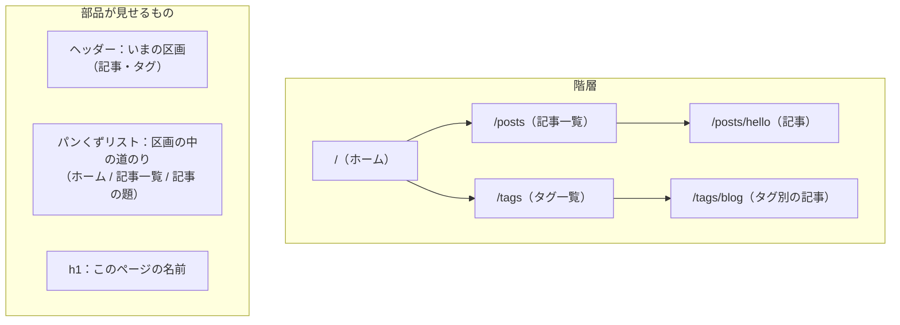
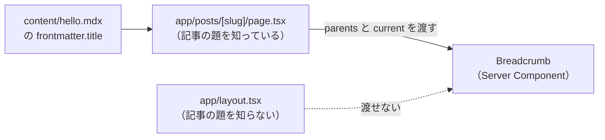

# 3-2: 記事やタグのページで、サイトの中のどこにいるかをパンくずリストで分かるようにする

- 起票日: 2026-11-19
- 学習計画: ADR `20261115-2117-publishable-home-before-storybook.md`。設計の全体像は `docs/design/20260925-blog-design-proposal.md`
- ADR: `docs/adr/20261119-2126-breadcrumb.md`（この回で決めたこと。状態は「採用」）
- 前提: 3-1 のヘッダーが入っていること（コミット `3c789ed`）
- ステータス: 完了

## 全体のどこか

「公開できる見た目」の段（3-0〜3-7）の4回目。3-1 のヘッダーが示すのは「記事」「タグ」という区画まで。この回では、区画の中のどの階層にいるかを示す。

| Step | 内容                                                                   | 進捗                   |
| ---- | ---------------------------------------------------------------------- | ---------------------- |
| 3-0  | 公開しているページを axe で自動検査する                                | ■■■ 完了               |
| 3-1  | ヘッダー（グローバルナビゲーション）とフッターを作り、全ページに置く   | ■■■ 完了               |
| 3-1b | リンクを押してから移動が終わるまで、待っていることが分かる動きを付ける | ■■□ 静的検証の直し待ち |
| 3-2  | パンくずリストを作る                                                   | ■■■ 完了               |
| 3-3  | 付箋の原稿の置き場所を決め、弁当レイアウトで一覧にする                 | □□□                    |

この回で扱わないもの: 検索エンジン向けの構造化データ（JSON-LD）、展示室（`/design-system`）のパンくず、付箋ページのパンくず（ページができる 3-3 で足す）、各ページの余白や幅をそろえること（3-7）。

## なぜこれをやるか

記事は、検索や X のリンクから直接開かれることが多い。直接来た人には、その記事がサイトのどこにあるかが分からない。ヘッダーの「記事」を見れば区画は分かるが、「記事一覧の中の1本」という関係までは伝わらない。

パンくずリストは、トップから今のページまでの道のりを1行で見せる。上の階層へ1回で戻れる道も、同時に用意できる。WCAG 2.2 の 2.4.8「現在位置」（Location）は、パンくずリストを満たし方の1つとして挙げている。この達成基準は AAA なので、自動検査（3-0）では見ていない。

3-3 の付箋ページも同じ部品を使う。部品の形を先に決めておけば、ページが増えたときは1行書き足すだけで済む。

## 周辺知識

### 全体の地図

このサイトのページの階層と、それぞれの部品が受け持つ情報を図にする。



図から分かること:

- 階層は2段しかない。パンくずの長さは、多くても「ホーム / 一覧 / 今のページ」の3つで済む
- ヘッダー、パンくず、`h1` は、受け持つ情報の細かさが違う。ヘッダーがいちばん粗く、`h1` がいちばん細かい
- ホームは階層のいちばん上なので、パンくずを出しても「ホーム」1つだけになる（確認事項 5）

次に、パンくずの中身がどこから来るかを図にする。



図から分かること:

- 記事の題を知っているのは、記事を読み込むページだけ。レイアウトは原稿を読まないので、題を知らない
- だからパンくずは、レイアウトではなく各ページに置き、ページから中身を渡す（確認事項 1）
- `Breadcrumb` はクリックも URL の読み取りもしないので、Server Component のままでよい。ブラウザに送る JavaScript は増えない

### 用語

| 用語                   | たとえ                                                | 正確な意味                                                                                           | この回での出番     |
| ---------------------- | ----------------------------------------------------- | ---------------------------------------------------------------------------------------------------- | ------------------ |
| パンくずリスト         | デパートの案内板の「本館 › 3階 › 婦人服」             | トップから今のページまでの階層を、上から順に並べたリンクの列                                         | この回で作る部品   |
| ランドマーク           | 建物の「受付」「非常口」の看板                        | `header`・`nav`・`main` などの、ページの大きな区画。読み上げソフトは区画の一覧から目的の場所へ飛べる | `nav` で区画を作る |
| `aria-label`           | 同じ「入口」が2つあるときに付ける「東口」「西口」の札 | 要素に、読み上げ用の名前を付ける属性                                                                 | 手順 3             |
| `aria-current="page"`  | 案内板の「現在地」の赤い丸                            | 並びの中で、どれが今のページかを支援技術に伝える属性                                                 | 手順 3             |
| `aria-hidden`          | 「この札は読まなくてよい」という目印                  | 読み上げソフトから、その要素を隠す属性。3-1b の点でも使った                                          | 手順 4             |
| `ol`（順序付きリスト） | 番号付きの手順書                                      | 並び順に意味があるリスト。読み上げソフトは「リスト 3 項目」のように数も伝える                        | 手順 2             |
| 区切り記号             | 案内板の「›」                                         | 階層の切れ目を目で見せる記号。意味は並び順が持っているので、記号そのものは飾り                       | 手順 4             |

### 設計の考え方

パンくずリストには種類がある。よく使われる分け方（Keith Instone による）では、次の3つになる。

| 種類                | 何を見せるか           | 例                                 |
| ------------------- | ---------------------- | ---------------------------------- |
| 場所型（location）  | サイトの階層の中の位置 | ホーム / 記事一覧 / はじめての記事 |
| 履歴型（path）      | その人がたどってきた道 | 前に見たページの列                 |
| 属性型（attribute） | 商品の絞り込み条件     | 靴 / 25cm / 黒                     |

このサイトでは場所型を作る。Nielsen Norman Group も、パンくずには閲覧の履歴ではなくサイトの階層を見せるよう勧めている。履歴型はブラウザの「戻る」ボタンと役割が重なる。それに、同じページでも人によって表示が変わるので、迷っている人の助けになりにくい。

部品の形にも、決めたことが1つある。`Breadcrumb` は、上の階層の列（`parents`）と、今のページの名前（`current`）を別々に受け取る。全部を1つの配列で受け取る形にすると、「最後の項目だけはリンクにしない」という決まりを、部品の中で毎回判定することになる。最初から分けて受け取れば、今のページにリンクを付け間違える書き方は、そもそもできない。

### ベストプラクティス

| 出典                                                                 | 書かれていること                                                                                                                                                                               | このリポジトリで採るか                                                            |
| -------------------------------------------------------------------- | ---------------------------------------------------------------------------------------------------------------------------------------------------------------------------------------------- | --------------------------------------------------------------------------------- |
| WAI-ARIA APG「Breadcrumb Pattern」                                   | `nav` で区画を作り、`aria-label` か `aria-labelledby` で名前を付ける。今のページへのリンクに `aria-current="page"` を付ける                                                                    | 採る。ただし今のページはリンクにしない（確認事項 2）                              |
| WAI-ARIA APG の実装例                                                | 区切り記号は CSS で描き、読み上げに入らないようにする。`nav` の名前は「Breadcrumb」                                                                                                            | 区切りを読み上げから外す考え方は採る。やり方は `aria-hidden` にする（確認事項 3） |
| デジタル庁デザインシステム「パンくずリスト」（v2.18.3）              | ヘッダーとページ見出しの間に置く。長いときは折り返す。React 版の実装では、今のページは `aria-current="page"` を付けた文字（リンクではない）、区切りは `aria-hidden` の SVG、名前は「現在位置」 | 採る                                                                              |
| Next.js 公式ガイド（`layout.md`、`use-selected-layout-segments.md`） | レイアウトに置いた Client Component で、URL（`usePathname` や `useSelectedLayoutSegments`）からパンくずを組み立てる例がある                                                                    | 採らない。URL からは記事の題が分からないため（下の比較）                          |

### a11y の解説

この回の a11y は、目で見ている人には変化が見えないところに集まっている。読み上げソフト（VoiceOver）を使う人の立場で、1つずつ見ていく。

**`nav` と `aria-label="現在位置"`**

- 何をするか: パンくずを、名前つきの区画（ランドマーク）にする
- 入れるとどう伝わるか: VoiceOver のローター（VO + U）でランドマークの一覧を開くと、「メインメニュー」「現在位置」「目次」のように区画が名前つきで並ぶ。名前を選べば、そこへ一度で飛べる
- 入れないと何に困るか: 記事ページには `nav` が3つある（ヘッダー、パンくず、目次）。名前がないと、一覧には「ナビゲーション」が並ぶだけで、どれがどれか分からない。1つずつ入って中身を聞くしかない
- 誰が困るか: 画面を見ずに、読み上げで区画を飛びながら読む人
- 根拠: WAI-ARIA APG「Landmark Regions」（同じ種類のランドマークが複数あるときは、名前で区別する）

**`ol`**

- 何をするか: 項目に順番があることと、項目の数を伝える
- 入れるとどう伝わるか: 「リスト 3 項目」のように、入る前に長さが分かる（読み上げの文言は未確認。手順 3 で自分の耳で確かめる）
- 入れないと何に困るか: `div` を並べただけだと、どこまでがパンくずか、いくつあるかが伝わらない

**`aria-current="page"`**

- 何をするか: 最後の項目が今のページだと伝える
- 入れるとどう伝わるか: 項目を読んだあとに「現在のページ」と添えられる（文言は未確認）
- 入れないと何に困るか: 最後の項目は「はじめての記事」という文字が読まれるだけ。それが今いるページなのか、別のページの名前なのかを、読み上げだけでは判断できない
- 根拠: WAI-ARIA APG「Breadcrumb Pattern」

**区切り記号に `aria-hidden`**

- 何をするか: 「/」を読み上げから外す
- 入れないと何に困るか: 「ホーム、スラッシュ、記事一覧、スラッシュ……」と、意味のない記号が毎回読まれる。階層の区切りは、リストの項目の切れ目がすでに伝えている
- 誰が困るか: 読み上げで聞く人。点字ディスプレイで読む人にも、余計な記号が出る

**今のページをリンクにしない**

- キーボードで Tab を押して進む人にとって、押しても何も起きないリンクは、止まる場所が1つ増えるだけになる（確認事項 2）

### 比較（パンくずをどこで組み立てるか）

| 案                                                                                    | 得意なこと                                              | 引き換えにするもの                                                                                                | この回で採るか |
| ------------------------------------------------------------------------------------- | ------------------------------------------------------- | ----------------------------------------------------------------------------------------------------------------- | -------------- |
| 各ページで `<Breadcrumb parents current />` を書く                                    | 記事の題をそのまま出せる。Server Component のままで済む | ページを増やすたびに書き足す。書き忘れても誰も気づかない                                                          | 採る           |
| レイアウトに置き、`usePathname` で URL を分けて組み立てる（Next.js 公式の例）         | 1か所に書けば全ページに出る                             | URL には `hello` のような slug しかなく、記事の題が出せない。Client Component になる。`main` の外に置けるのは利点 | 採らない       |
| レイアウトに並列ルート（Parallel Routes）の差し込み口を作り、ページごとに中身を入れる | `main` の外に置け、記事の題も出せる                     | ページごとに `@breadcrumb/...` のファイルが増え、今のサイトの大きさに対して仕組みが重い                           | 採らない       |

### 現時点のバージョン（2026-11-19 確認）

| パッケージ           | バージョン | この回での扱い |
| -------------------- | ---------- | -------------- |
| next                 | 16.4.6     | そのまま       |
| react                | 19.2.9     | そのまま       |
| @pandacss/dev        | 2.5.0      | そのまま       |
| markuplint           | 5.4.0      | そのまま       |
| @axe-core/playwright | 4.14.0     | そのまま       |

新しく入れるパッケージはない。

## 作業手順（全体の地図）

1. 記事ページを開き、今どこにいるかの手がかりがヘッダーしかないことを見る
2. いちばん小さなパンくずを作り、記事ページに置く
3. 区画の名前と「今のページ」の印を足し、読み上げで聞き比べる（本題）
4. 区切り記号と見た目を足す
5. わざと区切り記号を `ol` の直下に置き、markuplint に止められる
6. 記事一覧・タグ一覧・タグ別のページにも置く
7. スマホの幅とキーボードで確かめる

## 確認事項

<!-- 推奨案で書き切っている。変えたいところがあれば教えてください。了承されたらチェックを入れる。 -->

- [x] **1. パンくずをどこで組み立てるか。** 推奨「各ページから `parents` と `current` を渡す」で作成。理由は、記事の題を知っているのがページだけで、Server Component のままにできるため。欠点は、ページを増やすたびに書き足す必要があり、書き忘れても検査では見つからないこと
- [x] **2. 今のページをリンクにするか。** 推奨「リンクにせず、`aria-current="page"` を付けた文字にする」で作成。理由は、押しても同じページが開くだけのリンクは、Tab で止まる場所を増やすだけだから。デジタル庁デザインシステムの React 版もこの形にしている。欠点は、APG の実装例（今のページもリンクにする）とは違う形になること。もう1つの欠点として、フォーカスできない `span` に付けた `aria-current` は、読み上げソフトによっては読まれないおそれがある（VoiceOver では未確認。手順 3-c で確かめる）
- [x] **3. 区切り記号をどう作るか。** 推奨「`/` を `aria-hidden="true"` の `span` に入れ、`li` の中に置く」で作成。理由は、読み上げから外していることがコードを読めば分かるため。欠点は、飾りのための要素が HTML に増えること。APG の例のように CSS で描けば HTML は増えないが、CSS の `content` で入れた文字は読み上げられることがあり、外し方が見えにくい
- [x] **4. `nav` の名前。** 推奨「現在位置」で作成。理由は、参考にしているデジタル庁デザインシステムに合わせ、役割をそのまま表す言葉にするため。欠点は、「パンくずリスト」という呼び名に慣れた人には、すぐにはそれと分からないかもしれないこと
- [x] **5. どのページに出すか。** 推奨「記事一覧、記事、タグ一覧、タグ別の4種類。ホームには出さない」で作成。理由は、ホームは階層のいちばん上で、出しても「ホーム」1つだけになるため。欠点は、全ページの同じ位置に同じ部品がある、という一貫性は崩れること
- [x] **6. パンくずを `main` の中に置くか。** 推奨「`main` の中、ページの見出しの前に置く」で作成。理由は、ページから中身を渡すので、ページの描かれる `main` の中にしか置けないため。デジタル庁デザインシステムも「ヘッダーとページ見出しの間」としている。欠点は、スキップリンク（本文へスキップ）で `main` に飛んだあと、Tab で最初に止まるのがパンくずのリンクになること
- [x] **7. 記事ページの外枠。** 推奨「`article` の外に `div` を作って幅を持たせ、パンくずを `article` の外に出す」で作成。理由は、パンくずは記事の中身ではないため。`article` は、そこだけを取り出しても意味が通るまとまりに使う。欠点は、要素の入れ子が1段増えること
- [x] **8. 検索エンジン向けの構造化データ（JSON-LD の `BreadcrumbList`）も作るか。** 推奨「この回では作らない」で作成。理由は、この回を見た目と a11y に絞るため。検索向けの作業は、公開の準備の段（3-8〜3-11）でまとめて考える。欠点は、それまでの間、検索結果にパンくずが出る機会を逃すこと
- [x] **9. 展示室（`/design-system`）にも出すか。** 推奨「出さない」で作成。理由は、二層構造の ADR で、展示室はページごとに見た目を自由にすると決めているため。欠点は、展示室から母屋へ戻る道がヘッダーだけになること
- [x] **10. パンくずのリンクに、3-1b の待ちの点を付けるか。** 推奨「この回では `next/link` をそのまま使い、3-1b の共通の部品（仮の名前 `AppLink`）ができたら差し替える」で作成。3-1b の ADR は、サイト内のページ移動に使うリンクをすべて `AppLink` に通すと決めている。パンくずのリンクもこれに当たる。それでもこのチケットで `next/link` を使う理由は、起票した時点で `AppLink` が作りかけで、コミットされた形が決まっていなかったため。検証できない部品を前提に手順を書くと、手順が動かなくなる。欠点は、差し替えるまでの間、パンくずのリンクだけ待ちの点が出ないこと。3-1b をコミットしたあとなら、着手するときに `Link` を `AppLink` に置き換えてよい

## ハンズオン

出力は、リポジトリの複製で実際に動かして写した（2026-11-19、bun 1.4.4 / Next.js 16.4.6 / markuplint 5.4.0）。読み上げの文言は確かめていないので「未確認」と書いている。

---

### 準備：この回で何をするのか

`app/_components/breadcrumb.tsx` に、パンくずリストの部品を作る。最初は飾りも a11y の属性もない形で置き、属性と見た目を1つずつ足していく。足すたびに、ブラウザと読み上げで何が変わったかを確かめる。最後に、残りの3種類のページにも置く。

#### 用意するもの

- 3-1 のヘッダーが入ったリポジトリ
- Chrome（DevTools の Accessibility タブを使う）
- macOS の VoiceOver（⌘ + F5 で起動と終了）

---

### 手順 1：記事ページで、今いる場所の手がかりを探す

```bash
# リポジトリのルートで実行する
bun run d
```

ターミナルに `Local: http://localhost:3000` のような行が出るまで待つ。ブラウザで `http://localhost:3000/posts/hello` を開く。

**なぜ** — 足す前の状態を見ておく。今いる場所の手がかりは、ヘッダーの「記事」が太字になっていることだけ。「記事一覧」へ戻るには、ヘッダーの「記事」を押すしかない。

**確かめる** — ヘッダーの下に、すぐ記事の題（`h1`）が来ている。

---

### 手順 2：いちばん小さなパンくずを作る

#### 2-a：部品を作る

`app/_components/breadcrumb.tsx` を新しく作り、次の全文を貼る。

```tsx
import Link from "next/link";

type BreadcrumbParent = { href: string; label: string };

type BreadcrumbProps = {
  parents: BreadcrumbParent[];
  current: string;
};

export function Breadcrumb({ parents, current }: BreadcrumbProps) {
  return (
    <nav>
      <ol>
        {parents.map((parent) => (
          <li key={parent.href}>
            <Link href={parent.href}>{parent.label}</Link>
          </li>
        ))}
        <li>{current}</li>
      </ol>
    </nav>
  );
}
```

**なぜ `parents` と `current` に分けるのか** — 上の階層はリンク、今のページは文字、と扱いが違うから。1つの配列で受け取ると、「最後の項目かどうか」を部品の中で判定することになる。分けて受け取れば、今のページにリンクを付け間違える書き方が、そもそもできない（周辺知識の「設計の考え方」）。

**なぜ `"use client"` がないのか** — この部品は、クリックへの反応も URL の読み取りもしない。中身はページから渡されるので、サーバーで HTML にして送れば済む。

#### 2-b：記事ページに置く

`app/posts/[slug]/page.tsx` を、次の全文に置き換える。変わるのは、`import` が1行増えることと、`return` の中身。

```tsx
import path from "node:path";
import { createPostReader } from "../../../lib/createPostReader";
import { notFound } from "next/navigation";
import { Metadata } from "next";
import { siteOpenGraph } from "../../../lib/siteMetadata";
import { css } from "../../../styled-system/css";
import { prose } from "./prose";
import { Tag } from "../../_components/tag";
import { Breadcrumb } from "../../_components/breadcrumb";

const { getAllSlugs, getPost } = createPostReader(path.join(process.cwd(), "content"));

// 本体・generateMetadata・opengraph-image.tsx のすべてが params を読む。
// 本体は <Suspense> に移せるが、メタデータの2つは <head> に入るので移せず、警告が残る。
// ADR 20261115-0059-instant-false-for-dynamic-routes.md
export const instant = false;

export async function generateStaticParams() {
  const slugs = await getAllSlugs();
  return slugs.map((slug) => ({ slug }));
}

export async function generateMetadata({ params }: PageProps<"/posts/[slug]">): Promise<Metadata> {
  "use cache";

  const { slug } = await params;
  const post = await getPost(slug);
  if (!post) return {};

  return {
    title: post.frontmatter.title,
    alternates: { canonical: `/posts/${slug}` },
    openGraph: {
      ...siteOpenGraph,
      type: "article",
      publishedTime: post.frontmatter.date,
      url: `/posts/${slug}`,
    },
  };
}

export default async function Page({ params }: PageProps<"/posts/[slug]">) {
  "use cache";

  const { slug } = await params;
  const post = await getPost(slug);

  if (!post) {
    notFound();
  }

  const { frontmatter, Content, headings } = post;

  return (
    <div
      className={css({
        width: "full",
        maxWidth: "640",
        marginX: "auto",
        paddingX: "16",
        paddingY: "48",
      })}
    >
      <Breadcrumb
        parents={[
          { href: "/", label: "ホーム" },
          { href: "/posts", label: "記事一覧" },
        ]}
        current={frontmatter.title}
      />
      <article>
        <h1 className={css({ textStyle: "heading.1" })}>{frontmatter.title}</h1>
        <time className={css({ color: "fg.muted" })}>{frontmatter.date}</time>
        <ul className={css({ display: "flex", flexWrap: "wrap", gap: "8" })}>
          {frontmatter.tags.map((tag) => (
            <li key={tag}>
              <Tag tag={tag} size="sm" />
            </li>
          ))}
        </ul>
        {headings.length > 0 && (
          <nav aria-label="目次">
            <ol>
              {headings.map(({ id, text }) => (
                <li key={id}>
                  <a href={`#${id}`}>{text}</a>
                </li>
              ))}
            </ol>
          </nav>
        )}
        <hr />
        <div className={prose}>
          <Content />
        </div>
      </article>
    </div>
  );
}
```

**なぜ `article` の外に `div` を作るのか** — 幅と余白は、パンくずと記事の両方に効かせたい。一方で、パンくずは記事の中身ではない。`article` は、そこだけを取り出しても意味が通るまとまりに使う要素なので、パンくずは外に出す（確認事項 7）。

**確かめる** — ブラウザを再読み込みすると、ヘッダーの下に「ホーム」「記事一覧」「はじめての記事」が縦に並ぶ。Panda の preflight（ブラウザの既定の見た目を消す CSS）が効いているので、番号も点も付かない。

次に DevTools（⌥⌘I）の Elements タブで `<nav>` を選び、右側の Accessibility タブを開く。`Name` の欄が空になっている。この空欄を、次の手順で埋める。

---

### 手順 3：この回の本題。区画の名前と「今のページ」の印を、読み上げで聞き比べる

#### 3-a：足す前の読み上げを聞く

1. ⌘ + F5 で VoiceOver を起動する
2. VO キー（Control + Option）を押したまま U を押す。ローター（区画や見出しの一覧）が開く
3. 左右の矢印で「ランドマーク」の一覧に切り替える
4. 並んでいる項目を、上下の矢印で1つずつ聞く

**確かめる** — 「ナビゲーション」という名前のない項目が混ざっている。記事ページには `nav` が3つある（ヘッダー、パンくず、目次）。名前があるのは「メインメニュー」と「目次」だけなので、残りの1つが何なのかは、入ってみるまで分からない（読み上げの文言は未確認）。

Esc でローターを閉じる。VoiceOver は起動したままでよい。

#### 3-b：名前と印を足す

`app/_components/breadcrumb.tsx` を、次の全文に置き換える。

```tsx
import Link from "next/link";

type BreadcrumbParent = { href: string; label: string };

type BreadcrumbProps = {
  parents: BreadcrumbParent[];
  current: string;
};

export function Breadcrumb({ parents, current }: BreadcrumbProps) {
  return (
    <nav aria-label="現在位置">
      <ol>
        {parents.map((parent) => (
          <li key={parent.href}>
            <Link href={parent.href}>{parent.label}</Link>
          </li>
        ))}
        <li>
          <span aria-current="page">{current}</span>
        </li>
      </ol>
    </nav>
  );
}
```

変わったのは2か所。`nav` に `aria-label="現在位置"` を付けた。最後の項目を `span` で包み、`aria-current="page"` を付けた。

**なぜ `aria-label` を足すのか** — 同じ種類の区画が複数あるときは、名前で区別する（WAI-ARIA APG「Landmark Regions」）。名前があれば、ローターから「現在位置」を選ぶだけで、パンくずへ飛べる。

**なぜ `aria-current="page"` を足すのか** — 見た目では「最後の項目が今のページ」と察せても、読み上げでは記事の題が読まれるだけになる。この属性は、並びの中のどれが今かを支援技術に伝える。3-1 のヘッダーで使った `aria-current` と同じ属性になる。

ただし、ここでは属性をリンクではなく `span` に付けている。`span` はフォーカスできないので、Tab では止まらない。読み上げの利用者がこの項目を聞くのは、VO + 右矢印で読み上げ位置を1つずつ進めたときになる。`span` に付けた `aria-current` を VoiceOver が読むかどうかは、未確認。3-c で自分の耳で確かめる。読まれなかった場合は、確認事項 2 を見直す（今のページもリンクにする APG の形に変える）。

#### 3-c：足したあとの読み上げを聞く

ブラウザを再読み込みし、3-a と同じ操作でローターのランドマーク一覧を開く。

**確かめる** — 一覧に「現在位置」が出る。それを選ぶとパンくずへ飛ぶ。続けて VO + 右矢印で中を1つずつ進む。最後の項目で「現在のページ」のような言葉が添えられる。「リスト 3 項目」のように、項目の数も読まれる（どちらも文言は未確認。自分の耳で確かめて、受け入れ条件にチェックを入れる）。

DevTools の Accessibility タブでも、`<nav>` の `Name` が「現在位置」になっていることを見る。

⌘ + F5 で VoiceOver を終了する。

> ここで聞き比べたことは、このあと作る部品すべてに効く。ランドマークに名前を付けるのは、3-3 の付箋ページで `nav` や `section` が増えたときにも同じ考え方になる。`aria-current` は、ヘッダー、パンくず、そしてのちに作る目次で「今どこか」を伝える共通の印になる。

---

### 手順 4：区切り記号と見た目を足す

`app/_components/breadcrumb.tsx` を、次の全文に置き換える。

```tsx
import Link from "next/link";
import { css } from "../../styled-system/css";

type BreadcrumbParent = { href: string; label: string };

type BreadcrumbProps = {
  parents: BreadcrumbParent[];
  current: string;
};

export function Breadcrumb({ parents, current }: BreadcrumbProps) {
  return (
    <nav aria-label="現在位置" className={css({ marginBlockEnd: "16" })}>
      <ol
        className={css({
          display: "flex",
          flexWrap: "wrap",
          columnGap: "8",
          fontSize: "14",
        })}
      >
        {parents.map((parent) => (
          <li key={parent.href} className={css({ display: "flex", columnGap: "8" })}>
            <Link
              href={parent.href}
              className={css({ color: "fg.link", textDecoration: "underline" })}
            >
              {parent.label}
            </Link>
            <span aria-hidden="true" className={css({ color: "fg.muted" })}>
              /
            </span>
          </li>
        ))}
        <li>
          <span aria-current="page">{current}</span>
        </li>
      </ol>
    </nav>
  );
}
```

**なぜ区切りを `aria-hidden` にするのか** — 階層の切れ目は、リストの項目の切れ目がすでに伝えている。「/」まで読まれると、「ホーム、スラッシュ、記事一覧、スラッシュ……」と、意味のない記号が毎回挟まる（周辺知識の「a11y の解説」）。

**なぜ区切りを `li` の中に置くのか** — `ol` の直下に置けるのは `li` だけ。HTML の決まりでそうなっている。この決まりを破るとどうなるかは、次の手順 5 で体験する。

**なぜ `flexWrap: "wrap"` なのか** — 記事の題は長い。スマホの幅では1行に収まらないので、折り返して全部見せる。デジタル庁デザインシステムも、幅を超えたら改行する形を基本にしている。

**なぜリンクに下線を付けるのか** — 色だけでリンクを見分けさせると、色の違いが分かりにくい人には区別できない（WCAG 1.4.1 色の使用）。記事カード（`PostCard`）と同じ `fg.link` と下線にそろえる。

**確かめる** — 「ホーム / 記事一覧 / はじめての記事」が横1行に並ぶ。「ホーム」と「記事一覧」は下線つきの青い文字、「はじめての記事」は普通の文字になる。

---

### 手順 5：わざと区切りを `ol` の直下に置いて、markuplint に止められる

区切りを `li` の外に出したくなる場面がある。「最後の項目のあとには区切りを付けたくない」と考えると、`li` と `li` の間に挟みたくなるからだ。実際にやってみる。

`app/_components/breadcrumb.tsx` の `parents.map(...)` の部分を、次のように書き換える（元に戻すので、書き換える前の形はコピーしておく）。

```tsx
{
  parents.map((parent) => (
    <>
      <li key={parent.href}>
        <Link href={parent.href} className={css({ color: "fg.link", textDecoration: "underline" })}>
          {parent.label}
        </Link>
      </li>
      <span aria-hidden="true" className={css({ color: "fg.muted" })}>
        /
      </span>
    </>
  ));
}
```

markuplint を走らせる。

```bash
bun run l
```

期待される出力（関係する部分だけ抜き出した）:

```
<markuplint> error: The "span" element is not allowed in the "ol" element in this context [normative] (html-standard/permitted-contents) .../app/_components/breadcrumb.tsx:29:13
  28: ••••••••••••</li>
  29: ••••••••••••<span aria-hidden="true" className={css({ color: "fg.muted" })}>
  30: ••••••••••••••/
✖ 1 problem (1 error, 0 warnings) in 29 files
```

**なぜ止められるのか** — `ol` の子に置けるのは `li` だけ。`span` が混ざると、読み上げソフトによっては項目の数を数え間違えたり、リストとして扱わなかったりする。ブラウザの画面は崩れないので、目で見ているだけでは気づけない。markuplint は1ファイルの中の HTML の決まりを見ているので、こうした間違いは書いた時点で見つかる。

確かめたら、手順 4 の全文に戻す。もう一度 `bun run l` を走らせ、`✔ 29 files checked, 0 problems` が出ることを見る。

---

### 手順 6：残りの3種類のページにも置く

#### 6-a：記事一覧

`app/posts/page.tsx` の `import` に1行足す。

```tsx
import { Breadcrumb } from "../_components/breadcrumb";
```

`return` の中、`<h1>記事一覧</h1>` の上に1行足す。

```tsx
<Breadcrumb parents={[{ href: "/", label: "ホーム" }]} current="記事一覧" />
```

#### 6-b：タグ一覧

`app/tags/page.tsx` の `import` に1行足す。

```tsx
import { Breadcrumb } from "../_components/breadcrumb";
```

`<h1>タグ一覧</h1>` の上に1行足す。

```tsx
<Breadcrumb parents={[{ href: "/", label: "ホーム" }]} current="タグ一覧" />
```

#### 6-c：タグ別の記事

`app/tags/[tag]/page.tsx` の `import` に1行足す。階層が1段深いので、`../../` になる。

```tsx
import { Breadcrumb } from "../../_components/breadcrumb";
```

`<h1>タグ: {tag}</h1>` の上に足す。

```tsx
<Breadcrumb
  parents={[
    { href: "/", label: "ホーム" },
    { href: "/tags", label: "タグ一覧" },
  ]}
  current={tag}
/>
```

**なぜページごとに書くのか** — 中身がページごとに違い、記事の題やタグの名前を知っているのはページだけだから（周辺知識の2枚目の図、確認事項 1）。書き足す手間と引き換えに、部品は Server Component のままにできる。

**確かめる** — 3つのページを開き、それぞれ次のように出ることを見る。

| URL          | 表示                     |
| ------------ | ------------------------ |
| `/posts`     | ホーム / 記事一覧        |
| `/tags`      | ホーム / タグ一覧        |
| `/tags/blog` | ホーム / タグ一覧 / blog |

ビルドした HTML では、記事ページのパンくずは次の形になる（実測。`class` は省いた）。

```html
<nav aria-label="現在位置">
  <ol>
    <li><a href="/">ホーム</a><span aria-hidden="true">/</span></li>
    <li><a href="/posts">記事一覧</a><span aria-hidden="true">/</span></li>
    <li><span aria-current="page">はじめての記事</span></li>
  </ol>
</nav>
```

この回のパンくずを入れた状態で、`bun run a11y`（axe の検査）は light と dark の両方で通った（実測）。

---

### 手順 7：スマホの幅とキーボードで確かめる

#### 7-a：スマホの幅

1. 記事ページ（`/posts/hello` か、題の長い記事）を開く
2. DevTools のデバイスツールバー（⇧⌘M）で、幅を 375px にする

**確かめる** — 長い題が画面の右端ではみ出さず、折り返している。横スクロールが出ていない。

**なぜ** — このサイトはスマホで読まれることが多い前提で作っている。パンくずの長さは記事の題で決まり、書き手には制御できない。

#### 7-b：キーボード

1. 記事ページを開き、アドレスバーをクリックしてから Tab を押していく
2. 「本文へスキップ」が出たら Enter を押す
3. もう一度 Tab を押す

**確かめる** — 3 の Tab で、パンくずの「ホーム」にフォーカスの輪が出る。続けて Tab を押すと「記事一覧」へ進み、「はじめての記事」には止まらずに、その先へ進む。

**なぜ** — 今のページをリンクにしなかったので、Tab で止まる場所が1つ少ない（確認事項 2）。一方で、本文へスキップしたあとに最初に止まるのはパンくずになる。これは `main` の中に置いたことの引き換えで、確認事項 6 に書いた。

---

実装は以上です。静的検証、テストがオールグリーンならcommitしてpushしてください。

---

### うまくいかないとき

| 症状                                                                                                                   | 原因と対処                                                                                                                                                                                       |
| ---------------------------------------------------------------------------------------------------------------------- | ------------------------------------------------------------------------------------------------------------------------------------------------------------------------------------------------ |
| `The "span" element is not allowed in the "ol" element in this context [normative] (html-standard/permitted-contents)` | 区切りの `span` が `li` の外にある。手順 4 の全文のように `li` の中へ入れる                                                                                                                      |
| `Type '"1"' is not assignable to type 'ConditionalValue<SpacingValue>'.`                                               | Panda に登録されていない値を書いている。このリポジトリは `strictTokens: true` なので、トークンにない値は型エラーになる。余白は `"4"`・`"8"`・`"16"` のように、既存のコードで使っている値から選ぶ |
| `error: Script not found "l:mu"`                                                                                       | `package.json` で markuplint のスクリプト名を変えたのに、`l` スクリプトや `lefthook.yml` が古い名前を呼んでいる。名前をそろえる（3-1b の作業で起きている）                                       |
| パンくずが縦に並び、区切りが出ない                                                                                     | 手順 2・3 の形のままになっている。手順 4 の全文に置き換える                                                                                                                                      |
| ローターに「現在位置」が出ない                                                                                         | ブラウザを再読み込みしていない。または、ローターがランドマーク以外の一覧（見出しなど）になっている。左右の矢印で「ランドマーク」に切り替える                                                     |

ここに載っていないエラーが出たら、そのまま貼って聞いてほしい。

---

## 受け入れ条件

- [x] `app/_components/breadcrumb.tsx` があり、`"use client"` を書かずに（Server Component のまま）`parents` と `current` を受け取っている
- [x] `/posts`、`/posts/<slug>`、`/tags`、`/tags/<tag>` の4種類のページで、手順 6 の表のとおりにパンくずが出る（目視）
- [x] `/`（ホーム）と `/design-system` にはパンくずが出ない（目視）
- [x] 記事ページで、パンくずが `article` の外にある（Elements タブで見る）
- [x] 今のページの項目はリンクではなく、`aria-current="page"` が付いている（Elements タブで見る）
- [x] VoiceOver のローターのランドマーク一覧に「現在位置」が出て、選ぶとパンくずへ飛べる（聞く）
- [x] VoiceOver でパンくずを読んだとき、「スラッシュ」が読まれない（聞く）
- [x] 375px の幅で、長い題が折り返し、横スクロールが出ない（目視）
- [x] 「本文へスキップ」のあと Tab で進むと、「ホーム」「記事一覧」には止まり、今のページの項目には止まらない（キーボード）
- [x] 手順 5 で入れた `ol` 直下の `span` が残っていない
- [x] `bun run l`、`bun run tc`、`bun run b` が通る（終了コードが 0）
- [x] 検査（`bun run ay`）が通る。push の前に自動で走る

## この回で理解したこと

着手後に埋める。受け入れ条件とは別に、何が分かったかを残す。

- [x] パンくずをレイアウトではなく各ページに置いた理由を、「記事の題を誰が知っているか」で説明できる
- [x] `parents` と `current` を分けて受け取ると、何の間違いが書けなくなるのかを説明できる
- [x] `nav` が複数あるページで `aria-label` がないと、読み上げで使う人がどう困るかを、ローターの操作で説明できる
- [x] `aria-current="page"` がないと、最後の項目が読み上げでどう聞こえるかを説明できる
- [x] 区切り記号を `aria-hidden` にする理由と、`ol` の直下に置けない理由を説明できる
- [x] 今のページをリンクにしないと、キーボードで使う人にとって何が変わるかを説明できる
- [x] 場所型のパンくずと履歴型のパンくずの違いと、このサイトが場所型を選んだ理由を説明できる

## 参考

- WAI-ARIA APG「Breadcrumb Pattern」: https://www.w3.org/WAI/ARIA/apg/patterns/breadcrumb/
- WAI-ARIA APG「Breadcrumb Example」: https://www.w3.org/WAI/ARIA/apg/patterns/breadcrumb/examples/breadcrumb/
- WAI-ARIA APG「Landmark Regions」: https://www.w3.org/WAI/ARIA/apg/practices/landmark-regions/
- デジタル庁デザインシステム「パンくずリスト」: https://design.digital.go.jp/dads/components/breadcrumb/
- デジタル庁デザインシステム React 版の実装: https://github.com/digital-go-jp/design-system-example-components-react/tree/main/src/components/Breadcrumbs
- Nielsen Norman Group「Breadcrumbs: 11 Design Guidelines for Desktop and Mobile」: https://www.nngroup.com/articles/breadcrumbs/
- WCAG 2.2 2.4.8 現在位置（Location）、1.4.1 色の使用
- Next.js 公式（同梱ドキュメント）: `node_modules/next/dist/docs/01-app/03-api-reference/03-file-conventions/layout.md`（レイアウトでパンくずを組み立てる例）
- Next.js 公式（同梱ドキュメント）: `node_modules/next/dist/docs/01-app/03-api-reference/04-functions/use-selected-layout-segments.md`
