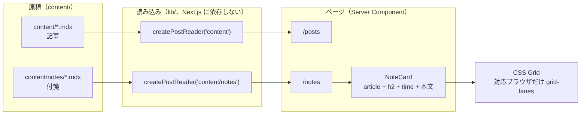
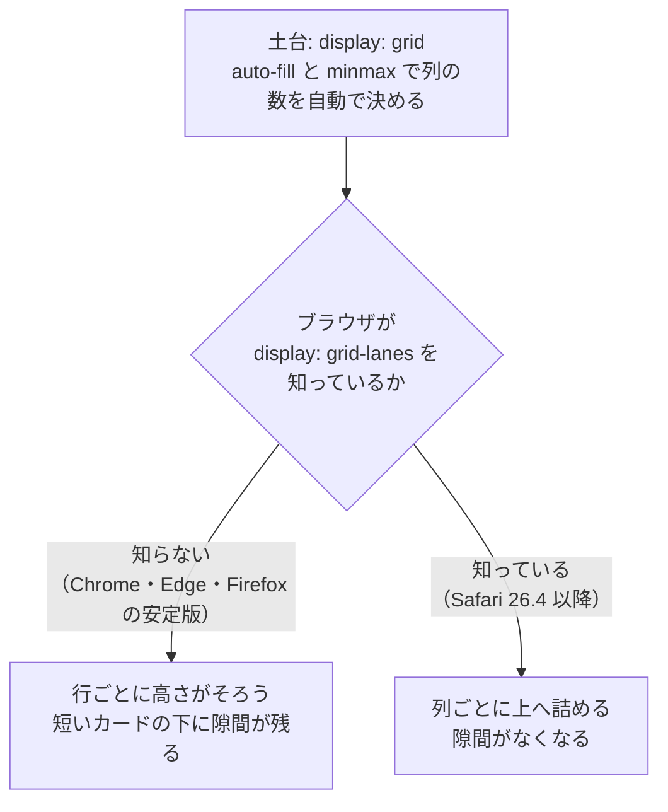
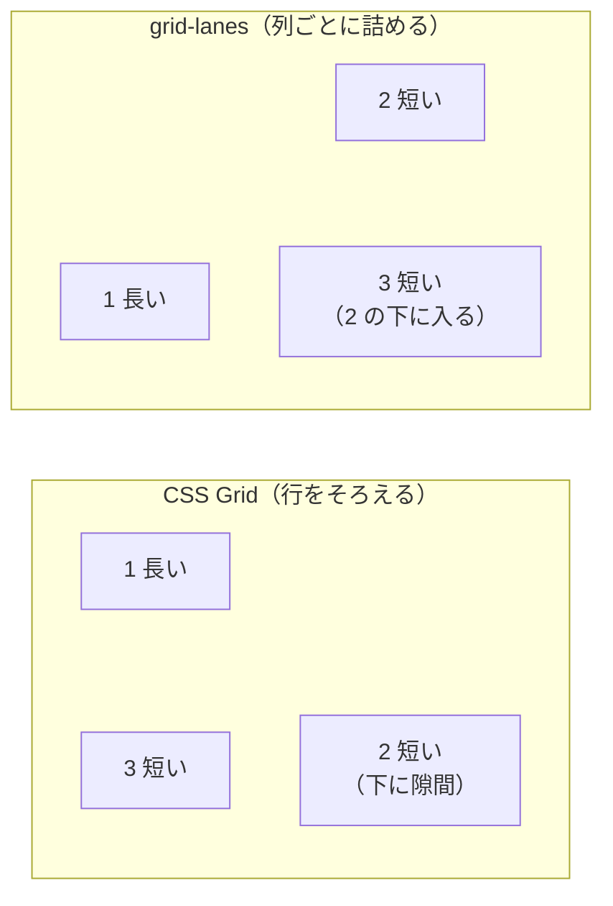

# 3-3: 書きかけのメモを付箋のカードにし、弁当レイアウトで `/notes` に並べる

- 起票日: 2026-11-20
- 学習計画: ADR `20261115-2117-publishable-home-before-storybook.md`。設計の全体像は `docs/design/20260925-blog-design-proposal.md`
- ADR: `docs/adr/20261120-0040-notes-bento.md`（この回で決めたこと。状態は「提案」）
- 前提: 3-2 のパンくずリストが入っていること（コミット `555ff5c`）
- ステータス: 完了

## 全体のどこか

「公開できる見た目」の段（3-0〜3-7）の5回目。3-2 までで、どのページにいても「サイトのどこにいるか」が分かるようになった。この回では記事とは別の新しい区画「付箋」を作る。

| Step | 内容                                                                         | 進捗           |
| ---- | ---------------------------------------------------------------------------- | -------------- |
| 3-0  | 公開しているページを axe で自動検査する                                      | ■■■ 完了       |
| 3-1  | ヘッダー（グローバルナビゲーション）とフッターを作り、全ページに置く         | ■■■ 完了       |
| 3-1b | リンクを押してから移動が終わるまで、待っていることが分かる動きを付ける       | ■■■ 完了       |
| 3-2  | パンくずリストを作る                                                         | ■■■ 完了       |
| 3-3  | 付箋の原稿の置き場所を決め、弁当レイアウトで一覧にする                       | □□□ ← いまここ |
| 3-3b | 付箋の高さを制限し、選ぶと全文がダイアログで開くようにする（ViewTransition） | □□□            |
| 3-4  | 付箋を日付とタグで並べ替える                                                 | □□□            |
| 3-5  | トップ画面を作る（自己紹介、最新の記事と付箋）                               | □□□            |

この回で扱わないもの: 付箋の高さの制限と、全文を開くダイアログ（3-3b）、並べ替えとタグの表示（3-4）、付箋の色、付箋ごとの個別ページ、トップ画面の「最新の付箋」（3-5）、ページの幅をそろえること（3-7）。

## なぜこれをやるか

`content/draft/memo.mdx` には aria-current、スキップリンク、動きを減らす設定、VoiceOver の操作といった短いメモがたまっている。記事にするには短すぎるが、捨てるには惜しい。今は公開されていないので、読む人もいない。

付箋ページはこうした「記事の種」を公開しておく場所になる。書きかけを公開して育てる考え方は「デジタルガーデン」として先行事例がある（ADR `20261115-2117`）。種が人目に触れていれば、どれを記事に育てるかを選びやすくなる。

3-4 の並べ替えと 3-5 のトップ画面は、この回で作る原稿の置き場所と読み込み処理を前提にしている。ここで置き場所を決めないと、どちらも始められない。

## 周辺知識

### 全体の地図

付箋の原稿が画面に並ぶまでの流れを図にする。記事と付箋は同じ読み込み処理を別のフォルダに向けて2つ作るだけで、仕組みは共通になる。



図から分かること:

- 付箋のために新しく作るのは、フォルダとページと部品だけ。原稿の読み込み（frontmatter の検証、MDX の変換、Shiki の色付け）は記事と同じものを使う
- 記事の読み込みは `content/` の直下にある `.mdx` しか見ない。`content/notes/` はフォルダなので、記事一覧に付箋が混ざらない。`content/draft/` が記事に出てこないのも同じ理由
- 見た目の並べ方（CSS）は最後の段だけにある。並べ方を変えても、原稿の読み込みとページの組み立てには触らない

弁当レイアウトの中で、何がどこを受け持つかを、もう1枚の図にする。



図から分かること:

- どのブラウザでも、まず普通の CSS Grid で並ぶ。`grid-lanes` は知っているブラウザでだけ上乗せする飾りにあたる
- 列の数（1列か2列か）を決めるのは CSS Grid の指定で、`grid-lanes` は縦の詰め方だけを変える
- 知らないブラウザでも、カードが重なったり消えたりはしない。隙間が残るだけになる

### 用語

| 用語                                    | たとえ                                                                   | 正確な意味                                                                                                                                                                                                                             | この回での出番                        |
| --------------------------------------- | ------------------------------------------------------------------------ | -------------------------------------------------------------------------------------------------------------------------------------------------------------------------------------------------------------------------------------- | ------------------------------------- |
| 弁当レイアウト（bento grid）            | 弁当箱。大きさの違う仕切りに、おかずを1品ずつ詰める                      | 大きさの違うカードを、格子の上に隙間を少なく並べる見た目。日本の弁当箱が名前の由来。Apple が製品紹介のページや発表のスライドで使い、2022〜2023 年ごろに広まった（出典: https://www.freecodecamp.org/news/bento-grids-in-web-design/ ） | `/notes` の並べ方                     |
| masonry（メイソンリー）                 | れんが積み。高さの違うれんがを、低いところから順に積む                   | 高さの違う要素を、列ごとに上へ詰めて並べる配置。Pinterest の画面で知られる                                                                                                                                                             | grid-lanes が実現する詰め方           |
| CSS Grid                                | 方眼紙。縦と横の線を先に引き、そのマスに要素を置く                       | 行と列を定義して、要素を格子に並べる CSS の仕組み（`display: grid`）                                                                                                                                                                   | 付箋を並べる土台                      |
| `auto-fill` と `minmax()`               | 「1人あたり最低これだけの幅が要る」と決めて、机に座れるだけ座らせる      | `repeat(auto-fill, minmax(16rem, 1fr))` は「1列は最低 16rem。入るだけ列を作り、余った幅は均等に分ける」という指定                                                                                                                      | 画面の幅に応じて 1列と2列が切り替わる |
| `min(100%, 16rem)`                      | 「最低 16rem。ただし机より広くはしない」という但し書き                   | 2つの値のうち小さいほうを使う CSS の関数。画面が 16rem より狭いとき、列が画面からはみ出さないようにする                                                                                                                                | 320px 幅でも横スクロールを出さない    |
| CSS Grid Lanes（`display: grid-lanes`） | 高速道路の車線。次の車は、いちばん先まで進める車線に入る                 | masonry を CSS だけで書くための仕組み。CSS Grid Layout Module Level 3 で定義される（出典: https://www.w3.org/TR/2026/WD-css-grid-3-20260121 ）                                                                                         | 対応ブラウザで隙間を詰める            |
| `@supports`（機能クエリ）               | 「この道具が使える人だけ、次の手順に進んでください」という張り紙         | ブラウザがある CSS を理解できるかを調べ、理解できるときだけ中の指定を当てる構文                                                                                                                                                        | `@supports (display: grid-lanes)`     |
| 段階的な強化（progressive enhancement） | 家はどの家族にも同じ間取りで建て、エアコンは電気が来ている家にだけ付ける | どの環境でも使える土台を先に作り、新しい機能は対応する環境でだけ上乗せする作り方                                                                                                                                                       | grid-lanes を飾りとして足す           |
| DOM の順                                | 台本に書かれたせりふの順                                                 | HTML に書いた要素の順。読み上げソフトが読む順と、Tab キーでフォーカスが進む順は、基本的にこの順になる                                                                                                                                  | 付箋は新しい順に HTML に並ぶ          |
| デジタルガーデン                        | 庭。植えた苗を、毎日少しずつ手入れして育てる                             | 書きかけのメモを公開し、時間をかけて書き足していくサイトの作り方（出典: https://maggieappleton.com/garden-history ）                                                                                                                   | 付箋ページの考え方の元                |

### 設計の考え方

#### 付箋は「芽」の置き場所

付箋ページは、Maggie Appleton が広めたデジタルガーデンの考え方に近い。デジタルガーデンではメモを書きかけのまま公開し、育てながら書き足していく。Appleton は育ち具合を3段階に分けている（出典: https://maggieappleton.com/garden-history ）。

- 芽（Seedling）: とても荒い、出始めの考え
- つぼみ（Budding）: 整えて、分かりやすくしたもの
- 常緑（Evergreen）: ほぼ書き上がったもの。それでも手入れは続ける

このサイトの付箋は「芽」にあたる。記事として書き上げる前の、短いメモの置き場所になる。日付で並べるブログとは違い、Appleton は「ガーデンは公開日の順に整理されない」と書いている。このサイトでは 3-4 で、日付とタグで並べ替えられるようにする。

#### なぜ masonry は CSS だけで書けなかったのか

高さの違うカードを隙間なく詰める見た目は、10年以上前から Web でよく使われてきた。それなのに、CSS だけで書けるようになったのは 2026 年になってからになる。経緯を追うと、今回 `@supports` で分けて書く理由が見えてくる。

1. CSS Grid も Flexbox もなかったころ、masonry は JavaScript のライブラリ（Masonry.js など）で作るしかなかった。ライブラリはカードの高さを1枚ずつ測り、位置を計算して置き直す。画像の読み込みや画面の幅が変わるたびに計算し直すので、表示が一瞬ずれることがある
2. CSS Grid（2017 年ごろ主要ブラウザが対応）は、行と列の両方をそろえる仕組みになっている。行の高さはその行でいちばん高いカードに合わせる。そのため、短いカードの下に隙間が残る
3. Mozilla が 2019〜2020 年に、CSS Grid に masonry を足す案（`grid-template-rows: masonry`）を出し、Firefox の開発版に入れた。WebKit も 2022 年から同じ案を実装した（出典: https://webkit.org/blog/17758/when-will-css-grid-lanes-arrive-how-long-until-we-can-use-it/ ）
4. Chromium は別の書き方を試し、CSS の仕様を決める W3C の作業部会（CSSWG）で、書き方をめぐる議論が続いた。最終的に `display: grid-lanes` という形に決まった（同上）
5. Safari 26.4 が安定版として初めて `display: grid-lanes` を有効にした（出典: https://caniuse.com/css-grid-lanes ）

つまり、`grid-lanes` は書き方が決まったばかりで、まだ Safari にしか入っていない。だから、普通の CSS Grid で並べておき、`grid-lanes` は対応するブラウザでだけ上乗せする。

#### grid-lanes はカードをどう置くか

WebKit は置き方を高速道路にたとえている。カードを HTML の順に1枚ずつ取り出し、そのカードがいちばん上に置ける列（いちばん先まで進める車線）に入れる（出典: https://webkit.org/blog/17660/introducing-css-grid-lanes/ ）。

- 列の数と幅は、CSS Grid と同じ `grid-template-columns` で決める。`gap` もそのまま使える
- 高さの差がわずかなときは、同点として扱う。この「わずか」の幅を決めるプロパティがあり、既定値は `1em`。名前は議論のなかで `item-tolerance` から `flow-tolerance` へ変わり、その後も変更が続いている（同上）。2026-11 時点で Safari の安定版が受け付ける名前は未確認。この回では使わない
- HTML の順に1枚ずつ置くので、見た目でもおおむね「左から右、上から下」の順に並ぶ。WebKit は、この置き方なら Tab キーの順が見えている内容とそろう、と説明している（同上）

#### ブレークポイントを書かずに列の数を変える

`repeat(auto-fill, minmax(min(100%, 16rem), 1fr))` は、「何 px 以上なら2列」という条件（ブレークポイント）を書かない。カードの最低幅だけを決め、列の数はブラウザに計算させる。幅 640 の箱なら2列、スマホの幅なら1列になる。このサイトのモバイルファーストの方針とも合い、あとで箱の幅を広げても、CSS を書き直さずに3列になる。

### ベストプラクティス

- **どのブラウザでも動く書き方を先に置き、新しい機能は `@supports` で上乗せする。** WebKit は`display: grid` のあとに `display: grid-lanes` を重ねて書くか、`@supports` で分ける書き方を勧めている。CSS は知らない値を無視するためである（出典: https://webkit.org/blog/17758/when-will-css-grid-lanes-arrive-how-long-until-we-can-use-it/ ）。このリポジトリでは `@supports (display: grid-lanes)` で分ける。Panda CSS では同じプロパティを2回重ねて書くより、条件として書くほうが読み取りやすいため
- **見た目の順を、CSS で HTML の順から入れ替えない。** WCAG は「DOM の順を見た目の順と一致させる」ことを、1.3.2 を満たす方法（C27）に挙げている。また、CSS の配置で内容の意味を変えることを、1.3.2 の不適合例（F1）に挙げている（出典: https://www.w3.org/WAI/WCAG22/Understanding/meaningful-sequence.html ）。このリポジトリでは `grid-auto-flow: dense` や `order` を使わない
- **JavaScript のライブラリで補わない。** WebKit は対応していないブラウザでだけ Masonry.js を読み込む方法も紹介している（同上の WebKit の記事）。このリポジトリでは採らない。隙間が残るだけで内容は読めるので、そのために JavaScript を足す価値は小さい
- **320px の幅で横スクロールを出さない。** WCAG 1.4.10 は幅 320 CSS px（幅 1280px の画面を 400% に拡大した状態）で、縦横の両方にスクロールさせないことを求めている（出典: https://www.w3.org/WAI/WCAG22/Understanding/reflow.html ）。`min(100%, 16rem)` は、このために入れる

### 比較（並べ方）

| 案                                       | 得意なこと                                                                      | 引き換えにするもの                                                                                                                                                | この回で採るか                          |
| ---------------------------------------- | ------------------------------------------------------------------------------- | ----------------------------------------------------------------------------------------------------------------------------------------------------------------- | --------------------------------------- |
| Flexbox で縦に1列                        | いちばん簡単。順番の問題が起きない                                              | 弁当らしさがない。広い画面で横が余る                                                                                                                              | 採らない（`/posts` と同じ見た目になる） |
| CSS Grid（auto-fill）                    | すべての主要ブラウザで動く。列の数が自動で変わる                                | 行ごとに高さがそろい、短いカードの下に隙間が残る                                                                                                                  | 採る（土台）                            |
| CSS columns（段組み）                    | 新聞のように隙間なく詰まる。古いブラウザでも動く                                | HTML の順が「1列目を上から下、次に2列目」になり、見た目の左右の順と読み上げ・Tab の順が食い違う。WebKit も、見た目は似ているが流れと Tab の順が違う、と書いている | 採らない                                |
| JavaScript の masonry（Masonry.js など） | どのブラウザでも隙間なく詰まる                                                  | JavaScript を読み込み、位置を計算し直すあいだ表示がずれる。依存パッケージが増える                                                                                 | 採らない                                |
| CSS Grid Lanes（`display: grid-lanes`）  | CSS だけで隙間なく詰まる。HTML の順に置くので、Tab の順が見た目とおおむねそろう | 2026-11 時点で安定版が対応するのは Safari だけ                                                                                                                    | 採る（対応ブラウザでだけ上乗せ）        |

### a11y の解説

付箋ページの a11y は新しい ARIA 属性を足すことではなく、意味を持つ HTML の要素を正しく選ぶことと、HTML の順を崩さないことで決まる。ARIA を足すより、意味を持つ HTML の要素を正しく使うほうが先、という ARIA の第一の規則どおりになる。

| 実装                                                             | 入れたとき、どう伝わるか                                                                   | 入れないと、どうなるか                                                                                       | 誰が困るか                                                                         | 根拠                                   |
| ---------------------------------------------------------------- | ------------------------------------------------------------------------------------------ | ------------------------------------------------------------------------------------------------------------ | ---------------------------------------------------------------------------------- | -------------------------------------- |
| 付箋を `ul` と `li` で並べる                                     | 読み上げソフトが、一覧に入るときに項目の数を伝える（VoiceOver での読み上げの文言は未確認） | 付箋が何枚あるのか、どこで一覧が終わるのかが、音だけでは分からない                                           | 画面を見ずに読み上げで使う人                                                       | WCAG 1.3.1                             |
| 付箋の題を `h2` にする                                           | 見出しの一覧（VoiceOver のローター）に付箋の題が並び、1枚ずつ飛んで読める                  | 付箋の本文を頭から順に全部聞かないと、次の付箋にたどり着けない                                               | 読み上げで使う人。見出しで拾い読みする人                                           | WCAG 1.3.1、2.4.6                      |
| 付箋1枚を `article` にする                                       | そこだけを取り出しても意味が通るまとまりだと、支援技術に伝わる                             | 前後の付箋との境目が、構造としては伝わらない                                                                 | 読み上げで使う人                                                                   | HTML Living Standard の `article` 要素 |
| 本文の中に見出しを書かない                                       | 見出しの一覧が「付箋の題」だけになり、階層が崩れない                                       | 本文の `##` も `h2` になり、題と本文の見出しが同じ階層で並ぶ。どれが付箋の題か区別できない                   | 見出しで移動する人                                                                 | WCAG 1.3.1                             |
| HTML の順と見た目の順をそろえる（`dense` や `order` を使わない） | 読み上げる順と Tab で進む順が、見えている並びとそろう                                      | 読み上げを聞きながら画面も見ている人や、キーボードで操作する人には、フォーカスが画面のあちこちへ飛んで見える | キーボードで操作する人、画面を拡大して一部だけを見ている人、読むことに障害のある人 | WCAG 1.3.2、2.4.3                      |
| 1列の最低幅を `min(100%, 16rem)` にする                          | 320px の幅や 400% の拡大でも、カードが画面の幅に収まる                                     | 拡大したとき、カードの右側が画面の外に出て、横にもスクロールしないと読めない                                 | 文字を大きくして読む人、スマホの人                                                 | WCAG 1.4.10                            |

#### 見た目の順と、聞こえる順・Tab で進む順

この回でいちばん気を付けるのは順番になる。WCAG の 2.4.3「フォーカス順序」の解説は、フォーカスの順が意味に沿っていないと困る人として、キーボードで操作する人、読むことに障害のある人、目の見えにくい人、画面拡大ソフトを使う人を挙げている。画面拡大ソフトを使う人は、画面のごく一部しか見ていない。フォーカスが思いがけない場所へ飛ぶと、今どこを操作しているのかを見失う（出典: https://www.w3.org/WAI/WCAG22/Understanding/focus-order.html ）。W3C の「How People with Disabilities Use the Web」も、拡大して使う人は、見た目の手がかりと一貫した作りに頼って位置を見失わないようにしている、と書いている（出典: https://www.w3.org/WAI/people-use-web/abilities-barriers/visual/ ）。

付箋ページで順番が崩れる場面は、次の2つになる。

- **CSS columns で並べた場合。** HTML の順に「1列目を上から下へ」並ぶ。見た目では左上の次に右上の付箋があるのに、Tab を押すと左の列の下へ進む
- **`grid-auto-flow: dense` で隙間を埋めた場合。** 後ろの付箋が前の隙間へ入り込む。見た目の順と HTML の順が入れ替わる

`grid-lanes` は HTML の順に1枚ずつ置くので、見た目もおおむね「左から右、上から下」になる。ただし、列ごとの高さの差によっては、隣の列の少し上に次のカードが入ることがある。WebKit は、同点とみなす幅を大きくしすぎると、フォーカスが上下にぎこちなく飛ぶようになると注意している（出典: https://webkit.org/blog/17660/introducing-css-grid-lanes/ ）。この回では既定値のまま使う。

フォーカスの順を CSS で並べ直す `reading-flow` というプロパティもある。Chrome 137 が 2025 年 5 月に最初に対応した（出典: https://web-platform-dx.github.io/web-features-explorer/features/reading-flow ）。対応しているのは Chrome だけで、`grid-lanes` の入れ物に効くかは未確認。この回では使わない。HTML の順を新しい順のまま崩さなければ、並べ直す必要がないためである。

### 現時点のバージョン（2026-11-20 確認）

| パッケージ    | バージョン | この回での扱い |
| ------------- | ---------- | -------------- |
| next          | 16.4.6     | そのまま       |
| react         | 19.2.9     | そのまま       |
| @pandacss/dev | 2.5.0      | そのまま       |

| ブラウザ（安定版）             | `display: grid-lanes`                                                                                                            | 出典                                                                                              |
| ------------------------------ | -------------------------------------------------------------------------------------------------------------------------------- | ------------------------------------------------------------------------------------------------- |
| Safari（macOS）・iOS の Safari | 26.4 から対応                                                                                                                    | https://caniuse.com/css-grid-lanes                                                                |
| Chrome                         | 140 から、フラグ（試験機能の切り替え）を入れたときだけ動く。既定では無効                                                         | 同上                                                                                              |
| Edge                           | 140 から、フラグを入れたときだけ動く。既定では無効                                                                               | 同上                                                                                              |
| Firefox                        | 77 から、フラグを入れたときだけ動く。古い書き方（`grid-template-rows: masonry`）のままで、`display: grid-lanes` への対応は未確認 | 同上、https://webkit.org/blog/17758/when-will-css-grid-lanes-arrive-how-long-until-we-can-use-it/ |

新しいパッケージは入れない。

## 作業手順（全体の地図）

1. 付箋の原稿を `content/notes/` に3枚置き、読み込み処理に読ませる
2. `/notes` に、題と本文を並べるだけの最小のページを作る
3. 付箋1枚を表す部品 `NoteCard` を作り、差し替える
4. CSS Grid で、画面の幅に合わせて1列と2列が切り替わるように並べる
5. 本題: 対応ブラウザでだけ、`grid-lanes` で高さを詰める
6. わざと原稿の frontmatter を壊し、記事と同じ検証が付箋にも掛かることを見る
7. パンくず・ヘッダーのナビ・axe の検査の入口を足す
8. VoiceOver とキーボードで、見た目の順と読み上げの順を確かめる

## 確認事項

- [ ] **1. 画面の名前と URL。** 推奨「画面の名前は『付箋』、URL は `/notes`」で作成。理由は ADR `20261115-2117` で推奨した案で、「Post-it」は 3M の登録商標だから。欠点は英語の notes は「メモ」全般を指すので、URL だけでは付箋らしさが伝わらないこと
- [ ] **2. 原稿の置き場所。** 推奨「`content/notes/`」で作成。理由は原稿が `content/` の1か所にまとまるため。記事の読み込み処理は `content/` の直下にある `.mdx` しか読まないので、付箋が記事一覧に混ざることはない（`content/draft/` が公開されていないのと同じ仕組み）。欠点はのちに Zenn 用の原稿を `content/` から作るとき、`notes/` を外す処理が要ること
- [ ] **3. 読み込み処理。** 推奨「`createPostReader` に `content/notes` を渡して使い回し、名前は変えない」で作成。理由は読み込む場所を引数で受け取る作りになっているので、1行も直さずに付箋にも使えるため。欠点は名前が「Post」なのに付箋も読むので、あとで読んだ人が戸惑うこと。付箋だけ frontmatter を変えたくなったら、そのときに分ける
- [ ] **4. 付箋の frontmatter。** 推奨「記事と同じ（`title`・`date`・`tags` を1〜5個）」で作成。理由は3-4 の並べ替えに日付とタグが要り、読み込み処理もそのまま使えるため。欠点は短いメモにも題とタグを毎回書く手間がかかること
- [ ] **5. 付箋ごとのページを作るか。** 推奨「作らない。本文はカードに全部出す」で作成。理由は付箋は短いメモで、一覧で読み切れる長さを想定しているため。欠点は付箋1枚だけを人に送る URL がないこと
- [ ] **6. 付箋の本文で見出し（`##`）を使うか。** 推奨「使わない決まりにする」で作成。理由はカードの題が `h2` なので、本文の `##` も `h2` になり、題と同じ階層に並んでしまうため。欠点は決まりを破っても検査では止まらないこと
- [ ] **7. 並べ方。** 推奨「CSS Grid（`auto-fill`）で組み、`grid-lanes` は対応するブラウザだけ」で作成。理由はどのブラウザでも崩れずに並び、対応ブラウザではさらに詰まるため。欠点は対応していないブラウザでは行ごとに高さがそろい、短いカードの下に隙間が空くこと
- [ ] **8. 隙間を埋めるために、見た目の順を入れ替えるか。** 推奨「入れ替えない（`grid-auto-flow: dense` や `order` を使わない）」で作成。理由はHTML の順（新しい順）と、読み上げや Tab で進む順を一致させるため（WCAG 1.3.2・2.4.3）。欠点は隙間を最も少なくする詰め方はできないこと
- [ ] **9. 付箋の色。** 推奨「この回では付けず、記事のカードと同じ枠線だけにする」で作成。理由は色は必要になった回で、色覚の違いと WCAG 1.4.1（色だけで意味を伝えない）を確かめてから足す方針のため。欠点は見た目がまだ「付箋」らしくないこと
- [ ] **10. ページの幅。** 推奨「記事ページと同じ 640 にする」で作成。理由は新しい幅のトークンを足さずに済み、幅は 3-7 でまとめてそろえる計画だから。欠点は2列までしか並ばず、弁当らしい3列以上の並びはまだ見られないこと
- [ ] **11. 付箋のタグを表示するか。** 推奨「この回では表示しない」で作成。理由はタグを使った絞り込みと一緒に 3-4 で作るため。今のタグのページは記事しか数えておらず、付箋のタグからリンクしても付箋は出てこない。欠点はこの回ではタグを書いても画面に出ないこと
- [ ] **12. カードの最低幅の書き方。** 推奨「`sizes` に `256`（16rem）のトークンを足し、`{sizes.256}` で参照する」で作成。理由はエスケープハッチの決まり（ADR `20261120-0914-escape-hatch-rule.md`）で、長さはトークンだけで書くと決めたため。欠点は1か所でしか使わない値のためにトークンが1つ増えることと、`theme/tokens.ts` を触る手順が1つ増えること

## ハンズオン

期待される出力は検証用の複製で実際に動かして写したもの（2026-11-20、bun 1.4.4 / Node.js v24.22.1 / Next.js 16.4.6 / Panda CSS 2.5.0）。画面の見た目と読み上げは未確認で、受け入れ条件で自分の目と耳で確かめる。

---

### 準備：この回で何をするのか

`content/draft/memo.mdx` にたまっているメモのうち3つを、付箋の原稿として `content/notes/` に置く。それを `/notes` というページで、カードにして並べる。並べ方は、まずどのブラウザでも動く CSS Grid で組み、最後に、対応しているブラウザでだけカードを隙間なく詰める。

#### カードの並べ方には2種類ある

高さの違うカードを並べるとき、行をそろえるか、列ごとに詰めるかで見た目が変わる。



図から分かること:

- CSS Grid は横の行の高さをそろえる。同じ行に長いカードがあると、短いカードの下に隙間ができる
- `grid-lanes` は、縦の列（レーン）ごとに積む。次のカードはいちばん短い列の下に入る
- どちらも、HTML に書いた順（1、2、3）は変えない。変わるのは、画面のどこに置くかだけ

#### 用意するもの

- 開発サーバー（`bun run d`）を動かせる状態
- `grid-lanes` の違いを見るための Safari 26.4 以降（macOS に入っている Safari で足りる）。Chrome でも作業はできる

---

### 手順 1：付箋の原稿を3枚置き、読み込み処理に読ませる

#### 1-a：原稿を置く

フォルダを作る。

```bash
mkdir -p content/notes
```

`content/notes/voiceover-basics.mdx` を作る。短い付箋。

```mdx
---
title: VoiceOver の基本操作
date: 2026-11-19
tags: [a11y]
---

⌘ + F5 で VoiceOver を起動する。Control + Option を VO と呼び、VO + 右矢印で次の要素へ進む。
```

`content/notes/reduced-motion.mdx` を作る。長い付箋。

```mdx
---
title: 動きを減らす設定で、何を止めるか
date: 2026-11-18
tags: [a11y, css]
---

OS には「視差効果を減らす」という設定があり、CSS では `prefers-reduced-motion` で受け取れる。前庭機能に障害のある人は、画面の動きでめまいや吐き気を感じることがある。

止める基準は、要素の位置・大きさ・形が動いて見えるかどうか。

- 横に滑り込む、拡大・縮小、回転
- 視差効果（背景と前景が違う速さで動く）
- スクロールに合わせて要素が動く

フェードや色の変化は、位置が動かないので止めなくてよい。

自動で始まって5秒より長く続く動きには、設定とは別に、止める手段が要る（WCAG 2.2.2）。
```

`content/notes/use-pathname-static.mdx` を作る。中くらいの付箋。

```mdx
---
title: usePathname が確定するとき
date: 2026-11-15
tags: [nextjs]
---

`generateStaticParams` で事前にビルドしたパスなら、`usePathname` の値もビルドのときに確定する。`<Suspense>` が要るのは、事前にビルドしていないパスを受けるとき。
```

**なぜ** — 長さをわざとばらばらにしている。手順 4 と 5 で、高さの違うカードがどう並ぶかを見るため。中身は `memo.mdx` の種から取ったので、文面は自分の言葉に書き換えてよい。本文には見出し（`##`）を使わない（確認事項 6）。

#### 1-b：読み込み処理に読ませる

Next.js を通さず、bun から直接、読み込み処理を呼ぶ。

```bash
bun -e '
import { createPostReader } from "./lib/createPostReader";
const notes = createPostReader("content/notes");
const posts = createPostReader("content");
console.log("付箋:", (await notes.getAllPosts()).map((n) => n.slug));
console.log("記事の数:", (await posts.getAllPosts()).length);
'
```

期待される出力:

```
付箋: [ "voiceover-basics", "reduced-motion", "use-pathname-static" ]
記事の数: 11
```

**なぜ** — 2つのことを確かめている。1つ目は、`createPostReader` が読む場所を引数で受け取るので、場所を変えるだけで付箋も読めること。日付の新しい順に並んでいるのは、記事と同じ並べ替えが効いているから。2つ目は、記事の数が11のまま変わらないこと。記事の読み込み処理は `content/` の直下の `.mdx` だけを読み、`notes/` というフォルダは読まない。

`bun -e` で動いたことにも意味がある。読み込み処理が Next.js なしで動く、という CLAUDE.md の制約（将来ほかのフレームワークへ移るため）が守られている証拠になる。

---

### 手順 2：題と本文を並べるだけの最小のページを作る

`app/notes/page.tsx` を作る。

```tsx
import path from "node:path";
import { createPostReader } from "../../lib/createPostReader";

const { getAllPosts, getPost } = createPostReader(path.join(process.cwd(), "content", "notes"));

export default async function Page() {
  "use cache";

  const list = await getAllPosts();
  const notes = await Promise.all(
    list.map(async ({ slug }) => ({ slug, note: await getPost(slug) })),
  );

  return (
    <>
      <h1>付箋</h1>
      <ul>
        {notes.map(({ slug, note }) =>
          note ? (
            <li key={slug}>
              <h2>{note.frontmatter.title}</h2>
              <note.Content />
            </li>
          ) : null,
        )}
      </ul>
    </>
  );
}
```

開発サーバーを動かし、`http://localhost:3000/notes` を開く。

```bash
bun run d
```

題と本文が、飾りのない縦の並びで3つ出る（新しい順）。

**なぜ** — `getAllPosts` は題と日付しか返さないので、本文は `getPost` で1枚ずつ読む。`Promise.all` で3枚を同時に読み、待ち時間を1枚分で済ませている。`getPost` は原稿が見つからないと `null` を返すので、`note ? … : null` で飛ばす。

`<note.Content />` は、MDX の本文を React の部品として描く書き方。記事ページの `<Content />` と同じもので、変数の中の部品を JSX で呼ぶときは、このように `.` でつないで書ける。

---

### 手順 3：付箋1枚を表す部品 `NoteCard` を作る

`app/_components/note-card.tsx` を作る。

```tsx
import type { ReactNode } from "react";
import { css } from "../../styled-system/css";

type NoteCardProps = { title: string; date: string; children: ReactNode };

export function NoteCard({ title, date, children }: NoteCardProps) {
  return (
    <article
      className={css({
        display: "flex",
        flexDirection: "column",
        gap: "8",
        padding: "16",
        borderWidth: "1",
        borderColor: "border.default",
        borderRadius: "8",
      })}
    >
      <h2 className={css({ fontSize: "18", fontWeight: "bold" })}>{title}</h2>
      <time dateTime={date} className={css({ color: "fg.muted", fontSize: "14" })}>
        {date}
      </time>
      <div
        className={css({
          "& > * + *": { marginTop: "8" },
          "& ul": { listStyleType: "disc", paddingInlineStart: "24" },
          "& a": { color: "fg.link", textDecoration: "underline" },
          "& pre": { padding: "16", overflowX: "auto" },
        })}
      >
        {children}
      </div>
    </article>
  );
}
```

`app/notes/page.tsx` を、`NoteCard` を使う形に差し替える。

```tsx
import path from "node:path";
import { createPostReader } from "../../lib/createPostReader";
import { NoteCard } from "../_components/note-card";

const { getAllPosts, getPost } = createPostReader(path.join(process.cwd(), "content", "notes"));

export default async function Page() {
  "use cache";

  const list = await getAllPosts();
  const notes = await Promise.all(
    list.map(async ({ slug }) => ({ slug, note: await getPost(slug) })),
  );

  return (
    <>
      <h1>付箋</h1>
      <ul>
        {notes.map(({ slug, note }) =>
          note ? (
            <li key={slug}>
              <NoteCard title={note.frontmatter.title} date={note.frontmatter.date}>
                <note.Content />
              </NoteCard>
            </li>
          ) : null,
        )}
      </ul>
    </>
  );
}
```

ブラウザを再読み込みする。付箋が枠線で囲まれ、題・日付・本文の順に並ぶ。

**なぜ** — 本文は `children` で受け取る。`NoteCard` は「題と日付と、中に入れる何か」を囲む枠に徹し、MDX のことを知らない。こうしておけば、Storybook で `NoteCard` を見せるときに、MDX を読み込まずにただの文章を入れて試せる。

`article` は「そこだけ取り出しても意味が通るまとまり」を表す要素。付箋は1枚ずつ独立したメモなので当てはまる。記事一覧の `PostCard` と同じ考え方になる。本文の中の `ul` に `disc` を当て直しているのは、Panda CSS の preflight（ブラウザの既定の見た目を消す CSS）が、箇条書きの黒丸まで消しているから。

---

### 手順 4：CSS Grid で、幅に合わせて1列と2列を切り替える

まず、カードの最低幅 16rem（256px）を、トークンとして `theme/tokens.ts` の `sizes` に足す。既にある `640` と同じ形で、次の1行を加える（このファイルは私から読めないので、まわりの書き方は未確認。既存の行に合わせてほしい）。

```ts
256: { value: "16rem" },
```

**なぜ** — `gridTemplateColumns` は値を文字列で丸ごと書くので、Panda はトークンかどうかを検査しない。`16rem` と生で書いても型検査は通ってしまう。それでも、長さはトークンにする決まりにした（ADR `20261120-0914-escape-hatch-rule.md`）。文字列の中では `{sizes.256}` と書けば、ビルドのときに `var(--sizes-256)` に置き換わる。

続けて、`app/notes/page.tsx` を次の形にする。外側に幅を持つ `div` を足し、`ul` に Grid を当てる。

```tsx
import path from "node:path";
import { createPostReader } from "../../lib/createPostReader";
import { css } from "../../styled-system/css";
import { NoteCard } from "../_components/note-card";

const { getAllPosts, getPost } = createPostReader(path.join(process.cwd(), "content", "notes"));

export default async function Page() {
  "use cache";

  const list = await getAllPosts();
  const notes = await Promise.all(
    list.map(async ({ slug }) => ({ slug, note: await getPost(slug) })),
  );

  return (
    <div
      className={css({
        width: "full",
        maxWidth: "640",
        marginX: "auto",
        paddingX: "16",
        paddingY: "48",
      })}
    >
      <h1>付箋</h1>
      <ul
        className={css({
          display: "grid",
          gridTemplateColumns: "repeat(auto-fill, minmax(min(100%, {sizes.256}), 1fr))",
          gap: "16",
        })}
      >
        {notes.map(({ slug, note }) =>
          note ? (
            <li key={slug}>
              <NoteCard title={note.frontmatter.title} date={note.frontmatter.date}>
                <note.Content />
              </NoteCard>
            </li>
          ) : null,
        )}
      </ul>
    </div>
  );
}
```

ブラウザで見る。PC の幅では2列になり、1行目に「VoiceOver の基本操作」と「動きを減らす設定で、何を止めるか」が並ぶ。短い「VoiceOver の基本操作」の下に、長いカードの高さぶんの隙間ができる。

次に、DevTools のデバイスツールバー（⌘ + Shift + M）で幅を 375px にする。1列になる。

**なぜ** — `gridTemplateColumns` の1行を、外側から読む。

| 部分                   | 意味                                                      |
| ---------------------- | --------------------------------------------------------- |
| `repeat(auto-fill, …)` | 入るだけ列を作る。列の数を書かない                        |
| `minmax(…, 1fr)`       | 1列の幅は、最小値から、余りを等分した幅（`1fr`）まで      |
| `min(100%, 16rem)`     | 最小値は 16rem（256px）。ただし、置き場所より広くはしない |

640px の枠からは左右の余白を引いて 608px が残り、256px の列が2本入る。375px の画面では 343px しか残らないので1本になる。ブレークポイント（「幅が何 px 以上なら」という切り替えの条件）を1つも書かずに、列の数が幅で決まる。

`min(100%, 16rem)` の `min` を外すと、320px のような狭い画面で列が 256px より縮めず、横にはみ出す。WCAG 1.4.10「リフロー」は、幅 320px 相当で横スクロールを出さないことを求めている。

---

### 手順 5：この回の本題。対応ブラウザでだけ、`grid-lanes` で詰める

`app/notes/page.tsx` の `ul` の `css({ … })` に、`@supports` の3行を足す。

```tsx
      <ul
        className={css({
          display: "grid",
          gridTemplateColumns: "repeat(auto-fill, minmax(min(100%, {sizes.256}), 1fr))",
          gap: "16",
          "@supports (display: grid-lanes)": {
            display: "grid-lanes",
          },
        })}
      >
```

型検査を走らせ、Panda CSS がこの書き方を受け付けることを確かめる。

```bash
bun run tc
```

期待される出力（最後の行）:

```
✓ Types generated successfully
```

Safari 26.4 以降で `http://localhost:3000/notes` を開く。1列目の短い「VoiceOver の基本操作」のすぐ下に、3枚目の「usePathname が確定するとき」が入る（未確認。受け入れ条件で見る）。Chrome で開くと、手順 4 と同じく隙間が残る。

**なぜ** — `@supports (display: grid-lanes)` は「このブラウザが `display: grid-lanes` を知っているなら」という条件。知らないブラウザは中括弧の中を丸ごと読み飛ばし、上の `display: "grid"` のまま並べる。どのブラウザでも崩れない並べ方を先に作り、分かるブラウザにだけ上乗せする。この書き方を「段階的な強化」（progressive enhancement）と呼ぶ。

`gridTemplateColumns` は、Grid と `grid-lanes` で同じ意味を持つ。列の作り方はそのままで、「行をそろえる」から「列ごとに詰める」に切り替えるのは `display` の1語だけになる。

この1語が分かると、この先の話がつながる。

- 3-4 で並べ替えても、カードの置き場所はブラウザが計算し直すので、CSS は書き換えなくてよい
- 3-5 のトップ画面で「最新の付箋」を並べるときも、同じ `ul` の書き方を使い回せる
- ほかのブラウザが `grid-lanes` に対応した日に、こちらは何も直さなくても詰まって見えるようになる

生成された CSS の中身は Safari の Web インスペクタで `ul` を選ぶと確かめられる。`@supports (display: grid-lanes)` の中に `display: grid-lanes` が入っている（生成された CSS に出ることは実測）。

---

### 手順 6：わざと壊して、付箋にも記事と同じ検証が掛かることを見る

`content/notes/voiceover-basics.mdx` から、`tags: [a11y]` の行を消す。

```mdx
---
title: VoiceOver の基本操作
date: 2026-11-19
---

⌘ + F5 で VoiceOver を起動する。Control + Option を VO と呼び、VO + 右矢印で次の要素へ進む。
```

手順 1-b のコマンドをもう一度実行する。

```bash
bun -e '
import { createPostReader } from "./lib/createPostReader";
const notes = createPostReader("content/notes");
const posts = createPostReader("content");
console.log("付箋:", (await notes.getAllPosts()).map((n) => n.slug));
console.log("記事の数:", (await posts.getAllPosts()).length);
'
```

止まる。出力の中ほど:

```
error: voiceover-basics.mdx の frontmatter が正しくありません
× Invalid key: Expected "tags" but received undefined
  → at tags
```

**なぜ** — チケット 1-4 で作った frontmatter の検証（valibot）は、読み込み処理の中にある。読み込み処理を使い回したので、付箋にも同じ検証が掛かる。原稿を書き間違えたら、公開される前のビルドで止まる。

確認したら、`tags: [a11y]` の行を元に戻す。

---

### 手順 7：パンくず・ヘッダーのナビ・axe の検査の入口を足す

#### 7-a：ページを仕上げる

`app/notes/page.tsx` を次の完成形にする。足すのは、メタデータ（`generateMetadata`）、パンくず、このページの説明の1文。

```tsx
import path from "node:path";
import { Metadata, ResolvingMetadata } from "next";
import { createPostReader } from "../../lib/createPostReader";
import { siteOpenGraph } from "../../lib/siteMetadata";
import { css } from "../../styled-system/css";
import { Breadcrumb } from "../_components/breadcrumb";
import { NoteCard } from "../_components/note-card";

const { getAllPosts, getPost } = createPostReader(path.join(process.cwd(), "content", "notes"));

export async function generateMetadata(
  _props: PageProps<"/notes">,
  parent: ResolvingMetadata,
): Promise<Metadata> {
  const { openGraph } = await parent;
  return {
    title: "付箋",
    alternates: { canonical: "/notes" },
    openGraph: {
      ...siteOpenGraph,
      type: "website",
      url: "/notes",
      images: openGraph?.images,
    },
  };
}

export default async function Page() {
  "use cache";

  const list = await getAllPosts();
  const notes = await Promise.all(
    list.map(async ({ slug }) => ({ slug, note: await getPost(slug) })),
  );

  return (
    <div
      className={css({
        width: "full",
        maxWidth: "640",
        marginX: "auto",
        paddingX: "16",
        paddingY: "48",
      })}
    >
      <Breadcrumb parents={[{ href: "/", label: "ホーム" }]} current="付箋" />
      <h1>付箋</h1>
      <p>記事になる前の、書きかけの短いメモです。</p>
      <ul
        className={css({
          display: "grid",
          gridTemplateColumns: "repeat(auto-fill, minmax(min(100%, {sizes.256}), 1fr))",
          gap: "16",
          "@supports (display: grid-lanes)": {
            display: "grid-lanes",
          },
        })}
      >
        {notes.map(({ slug, note }) =>
          note ? (
            <li key={slug}>
              <NoteCard title={note.frontmatter.title} date={note.frontmatter.date}>
                <note.Content />
              </NoteCard>
            </li>
          ) : null,
        )}
      </ul>
    </div>
  );
}
```

**なぜ** — メタデータは `/posts` と同じ形にした。`openGraph` を丸ごと書くと、親で作った OGP 画像が消えるので、`parent` から受け取って入れ直す（チケット 1-9・1-11 と同じ理由）。説明の1文は、「付箋」という言葉だけでは何のページか分からない人のために置く。

#### 7-b：ヘッダーのナビに足す

`app/_components/site-header.tsx` の `navItems` に1行足す。

```tsx
const navItems = [
  { href: "/posts", label: "記事" },
  { href: "/notes", label: "付箋" },
  { href: "/tags", label: "タグ" },
];
```

**なぜ** — 3-1 の ADR で「付箋ができたら `navItems` に足す」と決めている。並びは、読み物（記事・付箋）を先に、それを横断して探す道具（タグ）を後にした。`/notes` を開くと、3-1 の `NavLink` が「付箋」に今いる印（`aria-current="page"`）を付ける。

#### 7-c：axe の検査の入口に足す

`e2e/a11y.spec.ts` の `ENTRY_PATHS` に `"/notes"` を足す。

```ts
const ENTRY_PATHS = ["/", "/posts", "/notes", "/tags", "/design-system"];
```

検査を走らせる。

```bash
bun run ay
```

期待される出力（最後の数行）:

```
  ✓  1 [light] › e2e/a11y.spec.ts:36:1 › サイト内のページに WCAG 2.2 AA の違反がない (10.8s)
  ✓  2 [dark] › e2e/a11y.spec.ts:36:1 › サイト内のページに WCAG 2.2 AA の違反がない (10.8s)

  2 passed (12.1s)
```

**なぜ** — 検査は、`ENTRY_PATHS` と、記事一覧・タグ一覧からたどれるページだけを見る。付箋ページにはどこからもリンクがたどられないので、入口に書かないと検査されない。

---

### 手順 8：見た目の順と、読み上げ・キーボードの順を確かめる

ここはコードを書かない。`/notes` を Safari で開いて確かめる。

#### 8-a：キーボード

1. アドレスバーをクリックしてから Tab を押す。「本文へスキップ」が出たら Enter
2. Tab を押していく。止まるのは「ホーム」（パンくず）だけで、付箋のカードには止まらない

**なぜ** — カードにはリンクもボタンもないので、Tab は止まらない。止まる場所がないのは正しい。読むだけのものを Tab の止まり先にすると、キーボードで使う人は押す回数が増えるだけになる。

#### 8-b：VoiceOver

1. ⌘ + F5 で VoiceOver を起動する
2. VO（Control + Option）+ U でローターを開き、左右の矢印で「見出し」の一覧に切り替える。「付箋」（レベル1）の下に、付箋の題3つがレベル2で並ぶ
3. ローターを閉じ、VO + Command + H を押していく。見出しから見出しへ、付箋の題を新しい順に渡り歩ける
4. `ul` の上で VO + 右矢印を押し、「リスト、3項目」のように数が読まれるか聞く（未確認。Safari と VoiceOver は、`list-style: none` を当てたリストをリストと読まないことがある）
5. ⌘ + F5 で VoiceOver を止める

**なぜ** — `grid-lanes` で詰めたとき、画面の上では3枚目のカードが1枚目のすぐ下に来る。それでも読み上げは HTML の順（1、2、3）のまま進む。今回は、HTML の順そのものが「新しい順」という意味のある順で、詰めても上から下へ大きく飛ばないので、見た目と読み上げの順はほぼそろう。詰め方で順が入れ替わって見える場合の考え方は、周辺知識の「a11y の解説」にある。

---

実装は以上です。静的検証、テストがオールグリーンならcommitしてpushしてください。

---

### うまくいかないとき

| 症状                                                            | 原因と対処                                                                                                               |
| --------------------------------------------------------------- | ------------------------------------------------------------------------------------------------------------------------ |
| `error: voiceover-basics.mdx の frontmatter が正しくありません` | frontmatter の `title`・`date`・`tags` のどれかが抜けているか、形が違う。`tags` は英小文字と数字だけで18文字まで、1〜5個 |
| `/notes` が 404 になる                                          | ファイルの場所が `app/notes/page.tsx` になっていない。開発サーバーを動かし直す                                           |
| 記事一覧に付箋が混ざる                                          | 原稿を `content/` の直下に置いている。`content/notes/` に入れる                                                          |
| 付箋が1枚も出ない                                               | `createPostReader` に渡すパスが `content/notes` になっていない                                                           |
| Safari でも隙間が詰まらない                                     | Safari が 26.4 より古い。Safari のメニューの「Safari について」で版を見る                                                |
| 375px の幅で横スクロールが出る                                  | `min(100%, 16rem)` の `min` が抜けている                                                                                 |
| `bun run ay` で `/notes` の違反が出る                           | 出力にある規則の名前（`id`）と要素（`target`）を見る。見出しの段を飛ばしていないか（`h1` の次が `h2`）を先に確かめる     |

ここに載っていないエラーが出たら、そのまま貼って聞いてほしい。

---

## 受け入れ条件

- [x] `content/notes/` に付箋の原稿が3枚あり、どれも本文に見出し（`##`）を使っていない
- [ ] 手順 1-b のコマンドで、付箋が新しい順に3件、記事が11件と出る（記事の数が変わっていない）（未確認のままコミットを本人が了承。2026-11-22）
- [ ] `app/_components/note-card.tsx` があり、`"use client"` を書かずに `title`・`date`・`children` を受け取っている（3-3b で開閉の状態を持つため、今は `"use client"` がある。2026-11-22）
- [ ] `/notes` で、付箋が枠線のカードになり、題・日付・本文の順に出る（目視）（未確認のままコミットを本人が了承。2026-11-22）
- [ ] PC の幅では2列、375px の幅では1列になり、横スクロールが出ない（目視）（未確認のままコミットを本人が了承。2026-11-22）
- [ ] Safari 26.4 以降で、3枚目のカードが1枚目のすぐ下に詰まる。Chrome では隙間が残る（目視）（未確認のままコミットを本人が了承。2026-11-22）
- [ ] `/notes` にパンくず（ホーム / 付箋）が出て、ヘッダーの「付箋」に今いる印が付く（目視）（ヘッダーの表示は今は「ノート」で、条件の「付箋」と異なる。未確認のままコミットを本人が了承。2026-11-22）
- [ ] 記事一覧（`/posts`）に付箋が混ざっていない（目視）（未確認のままコミットを本人が了承。2026-11-22）
- [ ] VoiceOver の見出しの一覧に、「付箋」の下に付箋の題3つがレベル2で並ぶ（聞く）（未確認のままコミットを本人が了承。2026-11-22）
- [ ] Tab で進んだとき、付箋のカードには止まらない（キーボード）（未確認のままコミットを本人が了承。2026-11-22）
- [x] `e2e/a11y.spec.ts` の `ENTRY_PATHS` に `/notes` がある
- [x] `bun run l`、`bun run tc`、`bun run b` が通る（終了コードが 0）
- [x] 検査（`bun run ay`）が通る。push の前に自動で走る

## この回で理解したこと

着手後に埋める。受け入れ条件とは別に、何が分かったかを残す。

- [ ] 付箋の原稿を `content/notes/` に置いても記事一覧に混ざらない理由を、読み込み処理の作りから説明できる
- [ ] `createPostReader` を1行も直さずに付箋に使えた理由と、そのことが「Next.js に依存させない」制約とどう関係するかを説明できる
- [ ] `repeat(auto-fill, minmax(min(100%, 16rem), 1fr))` の各部分が何をしていて、`min` を外すと何が起きるかを説明できる
- [ ] CSS Grid と `grid-lanes` の並べ方の違いを、隙間のでき方で説明できる
- [ ] `@supports` で `grid-lanes` を上乗せすると、対応していないブラウザで何が起きるかを説明できる
- [ ] 見た目の順を入れ替える詰め方（`dense` や `order`）を使わなかった理由を、読み上げとキーボードで使う人の立場で説明できる
- [ ] 付箋の本文で `##` を使わない理由を、見出しの階層で説明できる

## 参考

- WebKit Blog「Introducing CSS Grid Lanes」: https://webkit.org/blog/17660/introducing-css-grid-lanes/
- WebKit Blog「When will CSS Grid Lanes arrive?」: https://webkit.org/blog/17758/when-will-css-grid-lanes-arrive-how-long-until-we-can-use-it/
- CSS Grid Layout Module Level 3（Grid Lanes）: https://www.w3.org/TR/2026/WD-css-grid-3-20260121
- Can I use「CSS Grid Lanes」: https://caniuse.com/css-grid-lanes
- MDN「@supports」: https://developer.mozilla.org/ja/docs/Web/CSS/@supports
- MDN「repeat()」の auto-fill: https://developer.mozilla.org/ja/docs/Web/CSS/repeat
- WCAG 2.2 Understanding 1.3.2 意味のある順序: https://www.w3.org/WAI/WCAG22/Understanding/meaningful-sequence.html
- WCAG 2.2 Understanding 2.4.3 フォーカス順序: https://www.w3.org/WAI/WCAG22/Understanding/focus-order.html
- WCAG 2.2 Understanding 1.4.10 リフロー: https://www.w3.org/WAI/WCAG22/Understanding/reflow.html
- Maggie Appleton「A Brief History & Ethos of the Digital Garden」: https://maggieappleton.com/garden-history
- Next.js 公式（同梱ドキュメント）: `node_modules/next/dist/docs/01-app/03-api-reference/04-functions/generate-metadata.md`
