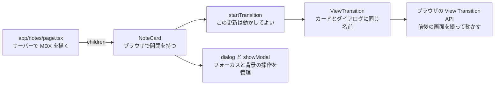
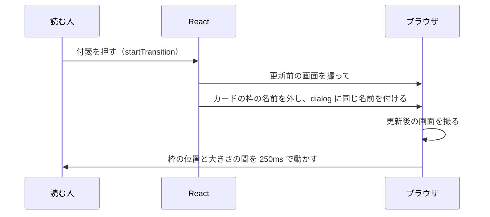

# 3-3b: 付箋の高さをそろえ、選ぶと付箋がダイアログに広がって全文を読めるようにする

- 起票日: 2026-11-21
- 学習計画: ADR `20261115-2117-publishable-home-before-storybook.md`。設計の全体像は `docs/design/20260925-blog-design-proposal.md`
- ADR: `docs/adr/20261121-1804-notes-dialog-view-transition.md`（この回で決めたこと。状態は「提案」）
- 前提: 3-3 が完了していること（`/notes` に付箋が並び、`theme/tokens.ts` に `sizes.256` がある）
- ステータス: 完了

## 全体のどこか

「公開できる見た目」の段（3-0〜3-7）の途中。3-3 で付箋を並べたところ、`grid-lanes` に対応していないブラウザでは、長い付箋に合わせて行が伸びて見づらいと分かった。この回はその続きを直す。

| Step | 内容                                                                         | 進捗           |
| ---- | ---------------------------------------------------------------------------- | -------------- |
| 3-2  | パンくずリストを作る                                                         | ■■■ 完了       |
| 3-3  | 付箋の原稿の置き場所を決め、弁当レイアウトで一覧にする                       | ■■■ 完了       |
| 3-3b | 付箋の高さを制限し、選ぶと全文がダイアログで開くようにする（ViewTransition） | □□□ ← いまここ |
| 3-4  | 付箋を日付とタグで並べ替える                                                 | □□□            |
| 3-5  | トップ画面を作る（自己紹介、最新の記事と付箋）                               | □□□            |

この回で扱わないもの: 付箋ごとの URL、閉じるボタンの見た目の作り込み、並べ替えとタグの表示（3-4）。

## なぜこれをやるか

付箋の高さに上限を付けると、一覧は読みやすくなる。ただし本文の続きが隠れるので、続きを読む方法が必ず要る。そこで、付箋を選ぶとダイアログで全文が開くようにする。

ダイアログへの変化には、React 19.3 で安定版になった `<ViewTransition>` を使う。カードがその場から広がると、「今読んでいるのは、さっき押した付箋だ」と目で追える。

## 周辺知識

### 全体の地図



図から分かること:

- 本文の MDX はサーバーで描いたまま `children` で渡すので、MDX の処理はブラウザに送られない
- 動きを担当するのは React とブラウザ、操作のしやすさを担当するのは `<dialog>`
- どちらかが動かなくても、もう一方は働く。動きに対応していないブラウザでも、ダイアログは開く

### 用語

| 用語                     | たとえ                                       | 正確な意味                                                               | この回での出番 |
| ------------------------ | -------------------------------------------- | ------------------------------------------------------------------------ | -------------- |
| View Transition API      | 変わる前後の写真を撮り、パラパラ漫画でつなぐ | DOM の更新前後を撮影し、その間をブラウザがアニメーションする機能         | 手順 4         |
| `<ViewTransition>`       | 「この部品を撮影してね」という札             | 中の要素に `view-transition-name` を付ける React の部品                  | 手順 4         |
| `startTransition`        | 「急がない更新です」という印                 | 更新を Transition にする React の関数。`<ViewTransition>` はこの中で動く | 手順 4         |
| `<dialog>`               | 部屋の中に出す衝立。衝立の外には手が届かない | HTML 標準のダイアログ。`showModal()` で開くと背景を操作できなくなる      | 手順 3         |
| `inert`                  | 「見本。触れません」の札                     | クリック・フォーカス・読み上げの対象から外す HTML の属性                 | 手順 3         |
| `mask-image`             | 紙の下側を少しずつ透明にする                 | 画像やグラデーションの濃さで、要素の見える度合いを決める CSS             | 手順 2         |
| `prefers-reduced-motion` | 「動きは控えめに」という本人からの注文       | OS の動きを減らす設定を CSS で受け取る条件                               | 手順 6         |

### 設計の考え方

**動かすのは「枠」だけにする。** 同じ名前の `<ViewTransition>` が片方は消え、片方は現れると、React はそれを「同じものの移動」として動かす。ただ、カード全体を出し入れすると中のボタンも作り直され、ダイアログを閉じたときにフォーカスの戻り先がなくなる。そこでカードの枠だけを別の `div` にして、枠を出し入れする。ボタンは残り続ける。

**Esc は `close` ではなく `cancel` で受ける。** `close` イベントが届く時点では、ダイアログはもう閉じている。これでは「閉じる前の写真」が撮れない。先に届く `cancel` で閉じるのを止め、`startTransition` の中で閉じ直す。ダイアログの外を押したときも、同じ `cancel` が届く。

### ベストプラクティス

- モーダルには `<dialog>` の `showModal()` を使う。フォーカスを閉じ込める処理を自作せずに済む（出典: [MDN `<dialog>`](https://developer.mozilla.org/en-US/docs/Web/HTML/Element/dialog)）
- `<ViewTransition>` は Transition の中の更新だけを動かす（出典: [React 19.3](https://react.dev/blog/2026/09/09/react-19-3)）
- 同じ名前を同時に2つ置かない。この回の手順 5 で、実際に失敗させる

### 比較（動きの付け方）

| 案                       | 得意なこと                     | 引き換えにするもの               | この回で採るか |
| ------------------------ | ------------------------------ | -------------------------------- | -------------- |
| `<ViewTransition>`       | カードからダイアログへの変化   | 枠を分ける工夫が要る             | 採る           |
| `startViewTransition`    | React に依存しない             | React の更新との同期を自分で書く | 採らない       |
| CSS の `@starting-style` | 開くときのフェードや拡大が簡単 | カードの位置からは広げられない   | 採らない       |
| アニメーションライブラリ | 細かい制御                     | 依存が増える                     | 採らない       |

### a11y の解説

| 入れるもの                       | 入れると                                                | 入れないと                                            | 困る人                   | 根拠              |
| -------------------------------- | ------------------------------------------------------- | ----------------------------------------------------- | ------------------------ | ----------------- |
| 題を `<button>` にする           | Tab で止まり、Enter で開き、「ボタン」と伝わる          | `div` の `onClick` では、キーボードで開けない         | キーボードや読み上げの人 | WCAG 2.1.1・4.1.2 |
| `showModal()`                    | フォーカスがダイアログに入り、背景へ Tab で出ていかない | 見えない背景のリンクにフォーカスが移る                | キーボードや読み上げの人 | WCAG 2.4.3        |
| `aria-labelledby`                | 開いたときに付箋の題が名前として伝わる                  | 何のダイアログか分からない                            | 読み上げの人             | WCAG 4.1.2        |
| 閉じたらボタンにフォーカスを戻す | 続きの付箋から読み進められる                            | ページの先頭に戻され、位置を見失う                    | キーボードや読み上げの人 | WCAG 2.4.3        |
| 一覧の本文に `inert`             | 切れて見えないリンクにフォーカスが止まらない            | 隠れた部分に Tab が入り、今どこにいるか分からなくなる | キーボードの人           | WCAG 2.4.7        |
| 動きを減らす設定で止める         | 拡大や移動が起きない                                    | 大きな動きでめまいや吐き気が出ることがある            | 前庭障害のある人         | WCAG 2.3.3（AAA） |

### 現時点のバージョン（2026-11-20 確認）

| パッケージ / ブラウザ | バージョン                                       | この回での扱い                                          |
| --------------------- | ------------------------------------------------ | ------------------------------------------------------- |
| react / react-dom     | 19.2.9 → 19.3.1                                  | 上げる。`ViewTransition` は 19.3 で安定版               |
| @types/react          | 19.3.0                                           | そのまま                                                |
| next                  | 16.4.6                                           | そのまま。App Router は同梱の React 19.3 canary で動く  |
| `<ViewTransition>`    | Safari 18.2 / Firefox 144 / Chromium 125 以降    | 同じページ内の遷移。未対応なら動かずに開く              |
| `<dialog closedby>`   | Chromium 134 / Firefox 141 以降。Safari は未対応 | 未対応なら外を押しても閉じず、「閉じる」と Esc で閉じる |

## 作業手順（全体の地図）

1. React を 19.3.1 に上げる
2. 本文の高さに上限を付ける
3. 付箋を押すと、全文がダイアログで開くようにする
4. **本題:** `<ViewTransition>` でカードをダイアログに広げる
5. わざと壊して、動く条件を確かめる
6. 動きを減らす設定で止める
7. markuplint の警告を整理する
8. キーボードと VoiceOver で確かめる

## 確認事項

- [ ] **1. React の版。** 推奨「`react` と `react-dom` を 19.3.1 に上げる」で作成。理由は `ViewTransition` が 19.3 で安定版になり、アプリ・Storybook・型の版がそろうため。欠点は依存の更新がこの回に混ざること
- [ ] **2. 高さの上限。** 推奨「本文だけ 12rem（`sizes.192`）で切り、下の 48 をぼかす」で作成。理由は題と日付を必ず見せるため。欠点は高さが 9〜12rem の短い本文でも、切れていないのに下が少し薄くなること
- [ ] **3. 一覧の本文の扱い。** 推奨「`inert` にする」で作成。理由は切れて見えないリンクにフォーカスが止まらないようにするため。欠点は読み上げの人には一覧で本文が読まれず、付箋を開く必要があること
- [ ] **4. 開くきっかけ。** 推奨「題を `<button>` にし、`::after` でカード全体を押せるようにする」で作成。理由は押せる範囲が広く、Tab はカードごとに1回で済むため。欠点はカードの中の文字を選択してコピーできないこと
- [ ] **5. ダイアログの部品。** 推奨「HTML 標準の `<dialog>` と `showModal()`」で作成。理由はフォーカスの管理と Esc をブラウザに任せられるため。欠点は見た目を自分で整える必要があること
- [ ] **6. 動かす範囲。** 推奨「カードの枠だけを分けて動かす」で作成。理由はボタンを作り直さず、フォーカスの戻り先を保つため。欠点は枠用の `div` と `z-index` が増えること
- [ ] **7. 背景を押して閉じるか。** 「`closedby="any"` で入れる。Safari 向けの代替処理は足さない」に決定。理由は JavaScript を足さずに済み、内側からのドラッグでも誤って閉じないため。欠点は Safari（iPhone を含む）では外を押しても閉じず、「閉じる」ボタンを使う必要があること
- [ ] **8. 動きを減らす設定。** 推奨「View Transition のアニメーションをすべて止める」で作成。理由は拡大と移動が WCAG 2.3.3 の対象になるため。欠点はフェードのような穏やかな動きも止まること
- [ ] **9. 背景の暗さ。** 推奨「ブラウザの既定のまま」で作成。理由は色のトークンを増やさずに済むため。欠点は暗い表示では背景との差が小さいこと
- [ ] **10. 付箋ごとの URL。** 推奨「この回では作らない」で作成。理由は 3-3 の決定を保ち、範囲を広げないため。欠点は1枚だけを共有できず、ブラウザの「戻る」でもダイアログは閉じないこと
- [ ] **11. トークンとエスケープハッチ。** 推奨「`sizes.192` を足す。`z-index` の `[-1]` と、トークンだけの計算 `[min(...)]` は角かっこで書く」で作成。理由は ADR `20261120-0914-escape-hatch-rule.md` の決まりに沿うため。欠点はトークンが1つ増えること
- [ ] **12. markuplint の規則。** 推奨「`security/no-event-handler-attr` を全体で切る」で作成。理由は React の `onClick` は関数で、この規則が防ぎたい文字列の埋め込みではないため。`overrides` で `.tsx` だけ切ると、`.tsx` が1件も検査されなくなった（実測: 38件 → 16件）。欠点は MDX に生の `onclick` を書いても止まらないこと

## ハンズオン

コードは複製のリポジトリで動かして確かめた（2026-11-20、Chromium、next 16.4.6、react 19.3.1、bun 1.4.4）。`theme/tokens.ts` は私から読めないので、複製では `panda.config.ts` 側で同じトークンを足して確かめた。Safari・Firefox での動きと VoiceOver の読み上げは未確認。

---

### 準備：この回で何をするのか

一覧のカードは高さをそろえ、押すとカードがその場から広がって全文のダイアログになるようにする。まず動きなしで完成させ、最後に動きを足す。動きがなくても使える状態を先に作るのが狙いになる。

#### 用意するもの

3-3 が完了した状態。開発サーバーを `bun run d` で起動し、`http://localhost:3000/notes` を開いておく。

---

### 手順 1：React を 19.3.1 に上げる

```bash
bun add react@19.3.1 react-dom@19.3.1 --exact
```

期待される出力（抜粋）:

```
installed react@19.3.1
installed react-dom@19.3.1
```

開発サーバーを一度止めて、`bun run d` で起動し直す。

**なぜ** — アプリの画面は Next.js 同梱の React で動くので、上げなくても `ViewTransition` は動く。ただ Storybook は `package.json` の React で動くため、19.2.9 のままだと同じ部品を表示できない。

---

### 手順 2：本文の高さに上限を付ける

`theme/tokens.ts` の `sizes` に、既にある `640` や `256` と同じ形で1行足す。

```ts
192: { value: "12rem" },
```

`app/_components/note-card.tsx` を次の形にする。

```tsx
import type { ReactNode } from "react";
import { css } from "../../styled-system/css";

type NoteCardProps = { title: string; date: string; children: ReactNode };

export function NoteCard({ title, date, children }: NoteCardProps) {
  return (
    <article
      className={css({
        display: "flex",
        flexDirection: "column",
        gap: "8",
        padding: "16",
        borderWidth: "1",
        borderColor: "border.default",
        borderRadius: "8",
      })}
    >
      <h2 className={css({ fontSize: "18", fontWeight: "bold" })}>{title}</h2>
      <time dateTime={date} className={css({ color: "fg.muted", fontSize: "14" })}>
        {date}
      </time>
      <div
        className={css({
          maxHeight: "192",
          overflow: "hidden",
          maskImage:
            "linear-gradient(to bottom, black calc({sizes.192} - {spacing.48}), transparent {sizes.192})",
          "& > * + *": { marginTop: "8" },
          "& ul": { listStyleType: "disc", paddingInlineStart: "24" },
          "& a": { color: "fg.link", textDecoration: "underline" },
          "& pre": { padding: "16", overflowX: "auto" },
        })}
      >
        {children}
      </div>
    </article>
  );
}
```

`/notes` を見る。長い付箋の本文が途中で切れ、下が薄くなる。

**なぜ** — `maxHeight` で切るだけだと、文字が途中でぶつりと切れて「続きがある」と分かりにくい。`maskImage` で下の 48 を透明にしていくと、続きがあることが見た目で伝わる。

今は続きを読む方法がない。次の手順で作る。

---

### 手順 3：付箋を押すと、全文がダイアログで開くようにする

`app/_components/note-card.tsx` を次の形にする。

```tsx
"use client";

import { useId, useState, type ReactNode } from "react";
import { css, cx } from "../../styled-system/css";

type NoteCardProps = { title: string; date: string; children: ReactNode };

const bodyStyle = css({
  "& > * + *": { marginTop: "8" },
  "& ul": { listStyleType: "disc", paddingInlineStart: "24" },
  "& a": { color: "fg.link", textDecoration: "underline" },
  "& pre": { padding: "16", overflowX: "auto" },
});

export function NoteCard({ title, date, children }: NoteCardProps) {
  const [open, setOpen] = useState(false);
  const titleId = useId();

  return (
    <article
      className={css({
        position: "relative",
        display: "flex",
        flexDirection: "column",
        gap: "8",
        padding: "16",
        borderWidth: "1",
        borderColor: "border.default",
        borderRadius: "8",
      })}
    >
      <h2 className={css({ fontSize: "18", fontWeight: "bold" })}>
        <button
          type="button"
          onClick={() => setOpen(true)}
          className={css({
            textAlign: "start",
            cursor: "pointer",
            _after: { content: '""', position: "absolute", inset: "0" },
          })}
        >
          {title}
        </button>
      </h2>
      <time dateTime={date} className={css({ color: "fg.muted", fontSize: "14" })}>
        {date}
      </time>
      <div
        inert
        className={cx(
          bodyStyle,
          css({
            maxHeight: "192",
            overflow: "hidden",
            maskImage:
              "linear-gradient(to bottom, black calc({sizes.192} - {spacing.48}), transparent {sizes.192})",
          }),
        )}
      >
        {children}
      </div>
      {open && (
        <dialog
          closedby="any"
          ref={(el) => {
            el?.showModal();
            return () => el?.close();
          }}
          aria-labelledby={titleId}
          onClose={(event) => {
            // 無条件に閉じない。開発時は React が ref を付け直すため、開き直したあとに古い close が届く
            if (!event.currentTarget.open) setOpen(false);
          }}
          className={css({
            width: "full",
            // 狭い画面でも左右に 16 ずつ余白を残す。角かっこの中はトークンと割合だけで、新しい値は足していない
            maxWidth: "[min({sizes.640}, 100% - {spacing.32})]",
            margin: "auto",
            padding: "24",
            borderWidth: "1",
            borderColor: "border.default",
            borderRadius: "8",
            bg: "bg.default",
            color: "fg.default",
            "& > * + *": { marginTop: "8" },
          })}
        >
          <button type="button" onClick={() => setOpen(false)}>
            閉じる
          </button>
          <h2 id={titleId} className={css({ fontSize: "18", fontWeight: "bold" })}>
            {title}
          </h2>
          <time dateTime={date} className={css({ color: "fg.muted", fontSize: "14" })}>
            {date}
          </time>
          <div className={bodyStyle}>{children}</div>
        </dialog>
      )}
    </article>
  );
}
```

付箋を押す。全文のダイアログが開く。Esc、「閉じる」、ダイアログの外のクリックで閉じる（Safari は外のクリックに未対応）。

**なぜ** — 大事な行を順に見る。

- `"use client"`: 開いているかどうかをブラウザで覚えるために要る。`children` はサーバーで描いたものを受け取るだけなので、MDX の処理はブラウザに送られない
- `<h2><button>`: `<button>` の中に見出しは入れられないので、見出しの中にボタンを置く
- `_after`: ボタンの透明な分身をカード全体に広げ、どこを押しても開くようにする
- `inert`: 切れて見えない本文のリンクに、Tab が止まらないようにする
- `closedby="any"`: Esc に加えて、ダイアログの外を押しても閉じるようにする HTML の属性
- `ref` の関数: `<dialog>` が画面に入ったら `showModal()` を呼び、消えるときに `close()` を呼ぶ。`close()` がフォーカスを元のボタンへ戻す
- `onClose`: Esc でブラウザが閉じたことを、React の `open` に伝える。開発時は React が `ref` を一度外して付け直し、開き直したあとに古い `close` イベントが届くので、本当に閉じているときだけ `open` を変える

---

### 手順 4：この回の本題。`<ViewTransition>` でカードをダイアログに広げる

動きの流れは次のとおり。



図から分かること:

- 動かす前に、更新前と更新後の2枚の写真が要る
- 同じ名前の要素が、前後で1つずつあるから「移動」として動く

`app/_components/note-card.tsx` を次の形にする。

```tsx
"use client";

import { startTransition, useId, useState, ViewTransition, type ReactNode } from "react";
import { css, cx } from "../../styled-system/css";

type NoteCardProps = { slug: string; title: string; date: string; children: ReactNode };

const bodyStyle = css({
  "& > * + *": { marginTop: "8" },
  "& ul": { listStyleType: "disc", paddingInlineStart: "24" },
  "& a": { color: "fg.link", textDecoration: "underline" },
  "& pre": { padding: "16", overflowX: "auto" },
});

const surfaceStyle = css({
  position: "absolute",
  inset: "0",
  // 枠を文字の後ろに回す。トークンにしないのは、重なり順を指定するのがここ1か所だけのため
  zIndex: "[-1]",
  borderWidth: "1",
  borderColor: "border.default",
  borderRadius: "8",
  bg: "bg.default",
});

export function NoteCard({ slug, title, date, children }: NoteCardProps) {
  const [open, setOpen] = useState(false);
  const titleId = useId();
  const name = `note-${slug}`;

  const openDialog = () => startTransition(() => setOpen(true));
  const closeDialog = () => startTransition(() => setOpen(false));

  return (
    <article
      className={css({
        position: "relative",
        isolation: "isolate",
        display: "flex",
        flexDirection: "column",
        gap: "8",
        padding: "16",
      })}
    >
      {open ? (
        <div className={surfaceStyle} />
      ) : (
        <ViewTransition name={name} share="auto" default="none">
          <div className={surfaceStyle} />
        </ViewTransition>
      )}
      <h2 className={css({ fontSize: "18", fontWeight: "bold" })}>
        <button
          type="button"
          onClick={openDialog}
          className={css({
            textAlign: "start",
            cursor: "pointer",
            _after: { content: '""', position: "absolute", inset: "0" },
          })}
        >
          {title}
        </button>
      </h2>
      <time dateTime={date} className={css({ color: "fg.muted", fontSize: "14" })}>
        {date}
      </time>
      <div
        inert
        className={cx(
          bodyStyle,
          css({
            maxHeight: "192",
            overflow: "hidden",
            maskImage:
              "linear-gradient(to bottom, black calc({sizes.192} - {spacing.48}), transparent {sizes.192})",
          }),
        )}
      >
        {children}
      </div>
      {open && (
        <ViewTransition name={name} share="auto" default="none">
          <dialog
            closedby="any"
            ref={(el) => {
              el?.showModal();
              return () => el?.close();
            }}
            aria-labelledby={titleId}
            onCancel={(event) => {
              event.preventDefault();
              closeDialog();
            }}
            onClose={(event) => {
              // 無条件に閉じない。開発時は React が ref を付け直すため、開き直したあとに古い close が届く
              if (!event.currentTarget.open) setOpen(false);
            }}
            className={css({
              width: "full",
              // 狭い画面でも左右に 16 ずつ余白を残す。角かっこの中はトークンと割合だけで、新しい値は足していない
              maxWidth: "[min({sizes.640}, 100% - {spacing.32})]",
              margin: "auto",
              padding: "24",
              borderWidth: "1",
              borderColor: "border.default",
              borderRadius: "8",
              bg: "bg.default",
              color: "fg.default",
              "& > * + *": { marginTop: "8" },
            })}
          >
            <button type="button" onClick={closeDialog}>
              閉じる
            </button>
            <h2 id={titleId} className={css({ fontSize: "18", fontWeight: "bold" })}>
              {title}
            </h2>
            <time dateTime={date} className={css({ color: "fg.muted", fontSize: "14" })}>
              {date}
            </time>
            <div className={bodyStyle}>{children}</div>
          </dialog>
        </ViewTransition>
      )}
    </article>
  );
}
```

`app/notes/page.tsx` の `NoteCard` に `slug` を渡す。

```tsx
<NoteCard slug={slug} title={note.frontmatter.title} date={note.frontmatter.date}>
```

付箋を押す。カードがその場から広がってダイアログになり、閉じると元の位置へ縮む（Chromium で実測）。

**なぜ** — 手順 3 から変わったのは次の5点。

- `startTransition`: これで包んだ更新だけが動く
- `name`: カードの枠とダイアログに同じ名前を付ける。`slug` を使うのは、付箋ごとに名前を変えるため
- `share="auto"` と `default="none"`: 枠とダイアログが入れ替わるときだけ動かし、ほかの更新では動かさない。`default="none"` だけだと、入れ替わりの動きも止まる
- 枠の `div`: `open` のときだけ `<ViewTransition>` を外し、同じ名前が同時に2つにならないようにする
- `onCancel`: Esc と外のクリックで閉じる動きも付けるため、閉じる前に止めて `startTransition` で閉じ直す

ここで分かった「更新を Transition にする → 前後を撮る → 同じ名前をつなぐ」は、ページをまたぐ遷移でも同じ形で使える。

---

### 手順 5：わざと壊して、動く条件を確かめる

#### 5-a：`startTransition` を外す

`openDialog` を次の形に変える。

```tsx
const openDialog = () => setOpen(true);
```

付箋を押すと、ダイアログは開くが広がらない。閉じるときは `closeDialog` が `startTransition` のままなので動く（実測）。確かめたら元に戻す。

#### 5-b：同じ名前を2つ同時に置く

枠の部分を、`open` で分けない形に変える。

```tsx
<ViewTransition name={name} share="auto" default="none">
  <div className={surfaceStyle} />
</ViewTransition>
```

付箋を押してブラウザのコンソールを見る。ダイアログは開くが動かず、次のエラーが出る（実測。本番ビルド）。

```
Unexpected duplicate view-transition-name: note-voiceover-basics
InvalidStateError: Transition was aborted because of invalid state. Animation start failed
```

確かめたら、手順 4 の形に戻す。

**なぜ** — どちらも、動きが失敗してもダイアログは開く。動きは飾りで、機能を止めない作りになっていることが分かる。

---

### 手順 6：動きを減らす設定で止める

`panda.config.ts` の `globalCss` で、`body` の直前に次を足す。

```ts
// 動きを減らす設定の人には、付箋がダイアログに変わる拡大・移動の動きを見せない
"@media (prefers-reduced-motion: reduce)": {
  "::view-transition-group(*), ::view-transition-old(*), ::view-transition-new(*)": {
    animation: "none",
  },
},
```

Chrome の DevTools で Command + Shift + P を押し、`Emulate CSS prefers-reduced-motion: reduce` を選ぶ。付箋を押すと、動かずにすぐ開く。

**なぜ** — 3-1b の点滅は不透明度の変化なので止めなかった。今回は位置と大きさが変わるので止める。

---

### 手順 7：markuplint の警告を整理する

```bash
bun run l
```

`The "onClick" attribute is disallowed` という警告が出る。`.markuplintrc.json` の `"nodeRules"` の直前に次を足す。

```json
"rules": {
  "security/no-event-handler-attr": false
},
```

もう一度 `bun run l` を実行する。期待される出力:

```
✔ 38 files checked, 0 problems
```

ファイル数は、3-3 の原稿が3枚ある状態の値。

**なぜ** — この規則は HTML に文字列で書く `onclick="..."` を防ぐためのもの。React の `onClick` は関数を渡している。`overrides` で `.tsx` だけ切る形は使わない。`.tsx` が黙って検査から外れた。

---

### 手順 8：キーボードと VoiceOver で確かめる

キーボード:

1. Tab で付箋の題へ進む。カードごとに1回だけ止まる
2. Enter で開く。フォーカスが「閉じる」に移る
3. Tab を押しても、背景のリンクへ出ていかない
4. Esc で閉じる。押した付箋の題にフォーカスが戻る

VoiceOver（⌘ + F5 で起動。Control + Option + 右矢印で次へ）:

1. 付箋の題が、見出しの中のボタンとして読まれる
2. 開くと、付箋の題が付いたダイアログとして読まれる
3. 閉じると、押した付箋のボタンに戻る

読み上げの文言は未確認なので、自分の耳で確かめてほしい。

---

実装は以上です。静的検証、テストがオールグリーンならcommitしてpushしてください。

---

### うまくいかないとき

| 症状                                        | 原因と対処                                                                       |
| ------------------------------------------- | -------------------------------------------------------------------------------- |
| `Unexpected duplicate view-transition-name` | 同じ名前が同時に2つある。枠を `open` で分けているか、`slug` を渡しているかを見る |
| 開くが動かない                              | `startTransition` で包んでいない、または OS の動きを減らす設定がオン             |
| Esc のときだけ動かない                      | `onCancel` の `event.preventDefault()` が抜けている                              |
| 外を押しても閉じない                        | `closedby="any"` が抜けている。Safari は未対応なので、閉じないのが正しい動き     |
| 閉じたあと、もう一度開けない                | `onClose` が抜けて `open` が `true` のまま                                       |
| 開発時に、開いた直後に閉じる                | 古い `close` イベントで閉じている。`onClose` で `open` を確かめる                |
| `192` が型エラーになる                      | `theme/tokens.ts` に足していない。足したら `bun run pg` を実行する               |
| `bun run l` のファイル数が減った            | `.markuplintrc.json` に `overrides` を使っている。手順 7 の `rules` に直す       |

ここに載っていないエラーが出たら、そのまま貼って聞いてほしい。

---

## 受け入れ条件

- [x] `react` と `react-dom` が 19.3.1 になっている
- [x] `theme/tokens.ts` に `sizes.192` があり、付箋の本文に生の長さを書いていない
- [ ] 長い付箋の本文が 12rem で切れ、下が薄くなる（目視）（未確認のままコミットを本人が了承。2026-11-22）
- [ ] 付箋のどこを押しても全文のダイアログが開く（目視）（未確認のままコミットを本人が了承。2026-11-22）
- [ ] カードがその場から広がって開き、閉じると元の位置へ縮む（Chrome と Safari で目視）（未確認のままコミットを本人が了承。2026-11-22）
- [ ] Esc と「閉じる」の両方で閉じ、押した付箋の題にフォーカスが戻る（キーボード）（未確認のままコミットを本人が了承。2026-11-22）
- [ ] Chrome と Firefox で、ダイアログの外を押すと閉じ、内側を押しても閉じない（目視）（未確認のままコミットを本人が了承。2026-11-22）
- [ ] Safari では外を押しても閉じず、「閉じる」で閉じられる（目視）（未確認のままコミットを本人が了承。2026-11-22）
- [ ] ダイアログを開いている間、Tab が背景へ出ていかない（キーボード）（未確認のままコミットを本人が了承。2026-11-22）
- [ ] 本文が画面より長いとき、ダイアログの中をスクロールして最後まで読める（目視）（未確認のままコミットを本人が了承。2026-11-22）
- [ ] 375px の幅でダイアログの左右に余白があり、横スクロールが出ない（目視）（未確認のままコミットを本人が了承。2026-11-22）
- [ ] 動きを減らす設定で、動かずに開閉する（DevTools）（未確認のままコミットを本人が了承。2026-11-22）
- [ ] VoiceOver で、開いたダイアログの名前として付箋の題が読まれる（聞く）（未確認のままコミットを本人が了承。2026-11-22）
- [x] `bun run l` が 38 files checked で問題 0 件（原稿の数が同じ場合）
- [x] `bun run tc`、`bun run b`、`bun run ay` が通る

## この回で理解したこと

- [ ] `<ViewTransition>` が動くために `startTransition` が要る理由を説明できる
- [ ] カード全体ではなく枠だけを動かす理由を、フォーカスの戻り先から説明できる
- [ ] Esc を `close` ではなく `cancel` で受ける理由を説明できる
- [ ] `showModal()` がブラウザに任せてくれることを3つ挙げられる
- [ ] 一覧の本文を `inert` にする利点と欠点を説明できる

## 参考

- [React 19.3](https://react.dev/blog/2026/09/09/react-19-3)
- [Same-document view transitions](https://developer.chrome.com/docs/web-platform/view-transitions/same-document)
- [View transitions（web-features explorer）](https://web-platform-dx.github.io/web-features-explorer/features/view-transitions)
- [MDN `<dialog>`](https://developer.mozilla.org/en-US/docs/Web/HTML/Element/dialog)
- [MDN `closedBy`](https://developer.mozilla.org/docs/Web/API/HTMLDialogElement/closedBy)
- [`<dialog closedby>` の対応状況](https://web-platform-dx.github.io/web-features-explorer/features/dialog-closedby)
- [WCAG 2.3.3 Animation from Interactions](https://www.w3.org/WAI/WCAG22/Understanding/animation-from-interactions.html)
- Next.js 同梱ガイド: `node_modules/next/dist/docs/01-app/02-guides/view-transitions.md`
