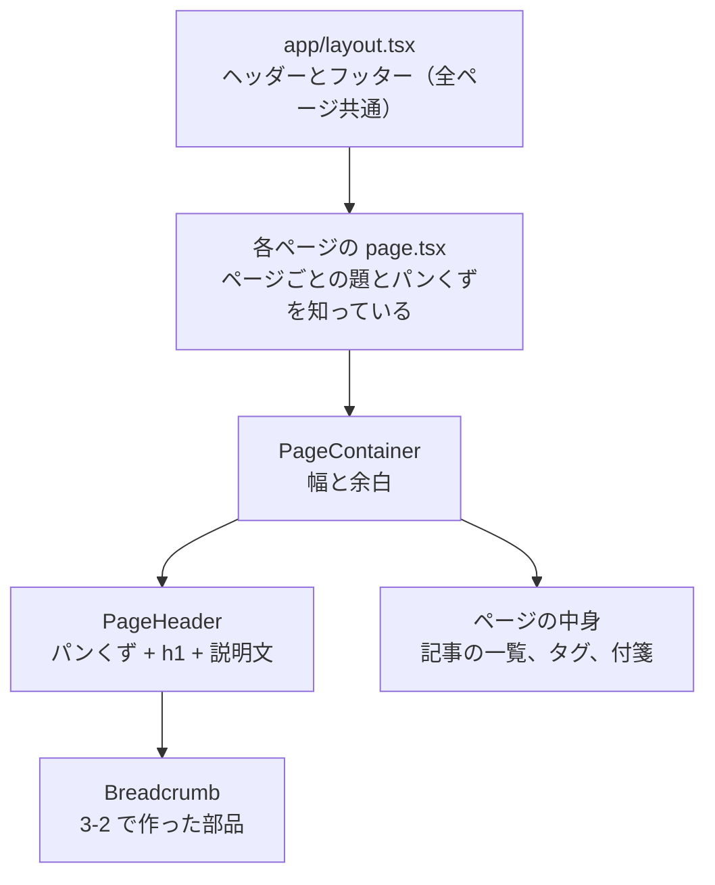

# 3-3c: 一覧ページのパンくず・見出し・幅を2つの部品にまとめ、どのページも同じ形で始まるようにする

- 起票日: 2026-11-22
- 学習計画: ADR `20261115-2117-publishable-home-before-storybook.md`。設計の全体像は `docs/design/20260925-blog-design-proposal.md`
- ADR: `docs/adr/20261122-0024-page-container-and-header.md`（この回で決めたこと。状態は「提案」）
- 前提: 3-3b が完了していること（`/notes` に付箋が並び、ダイアログが開く）
- ステータス: 完了

## 全体のどこか

「公開できる見た目」の段（3-0〜3-7）の途中。3-3 で付箋ページを足したことで、パンくずと見出しを持つページが5つになり、書き方の違いが目立ってきた。3-4 でページを増やす前に、ここでそろえる。

| Step | 内容                                                                         | 進捗           |
| ---- | ---------------------------------------------------------------------------- | -------------- |
| 3-3  | 付箋の原稿の置き場所を決め、弁当レイアウトで一覧にする                       | ■■■ 完了       |
| 3-3b | 付箋の高さを制限し、選ぶと全文がダイアログで開くようにする（ViewTransition） | ■■■ 完了       |
| 3-3c | 一覧ページのパンくず・見出し・幅を共通の部品にする                           | □□□ ← いまここ |
| 3-4  | 付箋を日付とタグで並べ替える                                                 | □□□            |
| 3-5  | トップ画面を作る（自己紹介、最新の記事と付箋）                               | □□□            |
| 3-7  | 記事一覧・タグ一覧・about を整える（幅をそろえる作業はこの回に前倒し）       | □□□            |

この回で扱わないもの: トップ画面（3-5）、about（3-7）、展示室の `/design-system`、記事本文の見た目、付箋ページを広い幅にすること。

## なぜこれをやるか

今の5ページは同じ役割のコードを別々の形で書いている。

| ページ          | 幅と余白 | パンくず | 見出しの見た目      |
| --------------- | -------- | -------- | ------------------- |
| `/posts`        | なし     | あり     | スタイルなし        |
| `/tags`         | なし     | あり     | スタイルなし        |
| `/tags/[tag]`   | なし     | あり     | スタイルなし        |
| `/notes`        | あり     | あり     | スタイルなし        |
| `/posts/[slug]` | あり     | あり     | `heading.1`（32px） |

そのため、ページを移動すると見出しの位置と大きさが変わる。`/posts` と `/tags` は余白がなく、文字が画面の左端に張り付いている。ここで部品にしておけば、余白や見出しを変えたいときに直す場所が1か所で済む。

## 周辺知識

### 全体の地図



図から分かること:

- 全ページ共通の外枠は `layout.tsx`、ページごとに中身が変わる部分は `page.tsx` が受け持つ
- 新しい2つの部品は `page.tsx` から呼ばれるので、ページごとの題をそのまま受け取れる
- `Breadcrumb` は作り直さず、`PageHeader` の中で使う

### 用語

| 用語                     | たとえ                                      | 正確な意味                                                                | この回での出番 |
| ------------------------ | ------------------------------------------- | ------------------------------------------------------------------------- | -------------- |
| `layout.tsx`             | 建物の廊下。部屋を移っても同じものが残る    | 複数のページで共有する Next.js の外枠。ページを移動しても描き直されない   | 比較           |
| Route Group              | 名札を付けた仕切り。住所（URL）は変わらない | `(site)` のように丸かっこで囲むフォルダ。URL を変えずにページを分類できる | 比較           |
| コンポジション           | レゴを組み合わせる。1つの巨大な部品にしない | 小さな部品を組み合わせて画面を作る React の基本の考え方                   | 手順 1・2      |
| `ComponentProps`         | 他の部品の注文票をそのまま写す              | ある部品が受け取る props の型を取り出す React の型                        | 手順 2         |
| 既定値（デフォルト引数） | 「指定がなければいつもの席」                | 値が渡されなかったときに使う値。`current = title` のように書く            | 手順 2         |

### 設計の考え方

**見出しを `layout.tsx` に置かない。** 見出しの文字はページごとに違うのに、Next.js の `layout.tsx` はページを移動しても描き直されない。同梱ガイドにも「Layouts do not rerender」とある（出典: `node_modules/next/dist/docs/01-app/03-api-reference/03-file-conventions/layout.md`）。外枠から題を知ろうとすると URL を読む Client Component が要り、題の対応表も別に持つことになる。題を一番よく知っている `page.tsx` から渡すほうが素直になる。

**幅と見出しを別の部品にする。** 記事の詳細ページは、`<h1>` が `<article>` の中にある。記事の題は記事の一部なので、この形を保ちたい。1つの部品に幅と見出しをまとめると、詳細ページだけ例外の指定が要る。2つに分ければ、詳細ページは `PageContainer` だけを使える。

### ベストプラクティス

- 共通の外枠は `layout.tsx`、ページ固有の中身は `page.tsx` に置く（出典: 同梱ガイド `layout.md`）。このリポジトリでも、ヘッダーとフッターは `layout.tsx` に置いたまま変えない
- 繰り返すナビゲーションは、どのページでも同じ順序に置く（出典: [WCAG 3.2.3 Consistent Navigation](https://www.w3.org/WAI/WCAG22/Understanding/consistent-navigation.html)）

### 比較（共通化する方法）

| 案                               | 得意なこと                       | 引き換えにするもの                                 | この回で採るか |
| -------------------------------- | -------------------------------- | -------------------------------------------------- | -------------- |
| 部品を2つ作る                    | 題を素直に渡せる。例外に強い     | 各ページで部品を呼ぶ必要がある                     | 採る           |
| 部品を1つ（幅 + 見出し）にする   | 呼ぶのが1回で済む                | 記事の詳細ページが例外になる                       | 採らない       |
| Route Group の `layout.tsx` で幅 | ページ側に幅の指定が一切いらない | ページのフォルダを移動する。見出しは結局共通化不可 | 採らない       |
| ルートの `layout.tsx` で幅       | 変更が1か所                      | 見た目が自由な展示室にも幅がかかる                 | 採らない       |

### a11y の解説

| 実装                       | 入れたとき、どう伝わるか                                                       | 入れないと、どうなるか                                                           | 誰が困るか                       | 根拠               |
| -------------------------- | ------------------------------------------------------------------------------ | -------------------------------------------------------------------------------- | -------------------------------- | ------------------ |
| どのページも同じ順序で置く | パンくず、見出しの順に必ず並ぶので、次に何が来るかを予測できる                 | ページごとに順番が変わると、毎回読み直して現在地を探すことになる                 | 読み上げやキーボードで操作する人 | WCAG 3.2.3         |
| `<h1>` を1ページに1つ置く  | 見出しの一覧から、今どのページにいるかをすぐ確かめられる                       | 題が見出しとして伝わらないと、ページの内容を先頭から順に聞いて探すことになる     | 読み上げを使う人                 | WCAG 1.3.1・2.4.6  |
| `<main>` の中の `<header>` | ページの導入のまとまりになる。サイト全体のヘッダー（banner）としては扱われない | `<main>` の外に置くと、サイトのヘッダーがページに2つあるように伝わるおそれがある | ランドマークで移動する人         | HTML-AAM           |
| 左右の余白                 | 画面の端に文字が張り付かず、スマホでも読みやすい                               | 拡大したときや画面の狭い機器で、文字が端に接して読みにくい                       | 拡大して読む人、スマホで読む人   | 読みやすさ。基準外 |

VoiceOver の実際の読み上げは未確認なので、手順 5 で自分の耳で確かめる。

### 現時点のバージョン（2026-11-22 確認）

| パッケージ | バージョン | この回での扱い |
| ---------- | ---------- | -------------- |
| next       | 16.4.6     | そのまま       |
| react      | 19.3.1     | そのまま       |

新しく入れるパッケージはない。

## 作業手順（全体の地図）

1. 幅と余白を `PageContainer` にまとめ、`/posts` で試す
2. パンくずと見出しを `PageHeader` にまとめ、`/posts` で試す
3. **本題:** 残りの4ページを同じ部品に置き換える
4. わざと壊して、部品の型が書き忘れを止めることを確かめる
5. キーボードと VoiceOver で確かめる

## 確認事項

- [ ] **1. チケットの位置。** 推奨「3-3c として 3-4 の前に置き、3-7 の『幅をそろえる』を前倒しする」で作成。理由は 3-4 でページを触る前に共通の部分をそろえるため。欠点は学習計画の順番が少し変わり、3-7 の作業が減ること
- [ ] **2. 共通化の方法。** 推奨「`PageContainer` と `PageHeader` の2部品にする」で作成。理由は題を `page.tsx` から渡せて、記事の詳細ページも無理なく使えるため。欠点は各ページで2つの部品を呼ぶこと
- [ ] **3. `layout.tsx` を使うか。** 推奨「使わない」で作成。理由は見出しがページごとに違い、Route Group にするとフォルダの移動も要るため。欠点は新しいページを作るたびに、部品を呼び忘れるおそれがあること
- [ ] **4. 対象のページ。** 推奨「`/posts`・`/tags`・`/tags/[tag]`・`/notes` は両方、`/posts/[slug]` は `PageContainer` だけ」で作成。理由は記事の題を `<article>` の中に残すため。欠点は詳細ページだけパンくずを直接呼ぶ形が残ること
- [ ] **5. 全ページの幅。** 推奨「今の記事ページと同じ 640」で作成。理由は新しいトークンが要らないため。欠点は付箋が2列までしか並ばないこと。広げたくなったら `PageContainer` に幅の指定を足す
- [ ] **6. 見出しの見た目。** 推奨「すべて `heading.1`（32px）」で作成。理由は記事ページと同じ大きさにそろうため。欠点は一覧ページの見出しの見た目が変わること
- [ ] **7. パンくずの現在地の文言。** 推奨「指定がなければ見出しと同じにする」で作成。理由は多くのページで同じ文字を2回書かずに済むため。欠点は `/tags/[tag]` だけ `current` の指定が要ること
- [ ] **8. 説明文。** 推奨「`description` として任意で渡す」で作成。理由は今は `/notes` だけが持ち、今後のページでも同じ形で書けるため。欠点は `PageHeader` の役割が少し増えること
- [ ] **9. 展示室。** 推奨「`/design-system` は変えない」で作成。理由は ADR `20260925-1702-two-layer-site-structure.md` で、展示室は見た目を自由にすると決めているため。欠点は同じ幅の指定が `/design-system` に残ること

## ハンズオン

出力は作業中の 3-3b を含むリポジトリの複製で実際に動かして写した（2026-11-22、next 16.4.6、react 19.3.1、bun 1.4.4）。VoiceOver の読み上げと、ブラウザでの見た目は未確認。

---

### 準備：この回で何をするのか

同じ形のコードを2つの部品に移し、まず `/posts` だけで試す。動いたら残りのページへ広げる。1ページで確かめてから広げると、問題が起きたときに原因を探す範囲が狭く済む。

#### 用意するもの

3-3b が完了した状態。開発サーバーを `bun run d` で起動し、`http://localhost:3000/posts` を開いておく。

---

### 手順 1：幅と余白を `PageContainer` にまとめる

`app/_components/page-container.tsx` を新しく作る。

```tsx
import type { ReactNode } from "react";
import { css } from "../../styled-system/css";

export function PageContainer({ children }: { children: ReactNode }) {
  return (
    <div
      className={css({
        width: "full",
        maxWidth: "640",
        marginX: "auto",
        paddingX: "16",
        paddingY: "48",
      })}
    >
      {children}
    </div>
  );
}
```

`app/posts/page.tsx` の import に1行足す。

```tsx
import { PageContainer } from "../_components/page-container";
```

同じファイルの `return` を次の形にする。

```tsx
return (
  <PageContainer>
    <Breadcrumb parents={[{ href: "/", label: "ホーム" }]} current="記事一覧" />
    <h1>記事一覧</h1>
    <ul className={css({ display: "flex", flexDirection: "column", gap: "16" })}>
      {posts.map(({ slug, frontmatter }) => (
        <li key={slug}>
          <PostCard slug={slug} title={frontmatter.title} date={frontmatter.date} />
        </li>
      ))}
    </ul>
  </PageContainer>
);
```

`/posts` を見る。左端に張り付いていた内容が、中央の 640 の幅に収まる。

**なぜ** — `children` は部品のタグで挟んだ中身を受け取る props。中身を知らなくても枠だけを提供できるので、どのページでも同じ部品を使える。

---

### 手順 2：パンくずと見出しを `PageHeader` にまとめる

`app/_components/page-header.tsx` を新しく作る。

```tsx
import type { ComponentProps } from "react";
import { css } from "../../styled-system/css";
import { Breadcrumb } from "./breadcrumb";

type PageHeaderProps = {
  parents: ComponentProps<typeof Breadcrumb>["parents"];
  title: string;
  // パンくずの文言が見出しと違うページだけ渡す
  current?: string;
  description?: string;
};

export function PageHeader({ parents, title, current = title, description }: PageHeaderProps) {
  return (
    <header className={css({ marginBlockEnd: "24" })}>
      <Breadcrumb parents={parents} current={current} />
      <h1 className={css({ textStyle: "heading.1" })}>{title}</h1>
      {description && <p className={css({ color: "fg.muted" })}>{description}</p>}
    </header>
  );
}
```

`app/posts/page.tsx` の `Breadcrumb` の import を消し、次の1行に置き換える。

```tsx
import { PageHeader } from "../_components/page-header";
```

同じファイルの `return` を次の形にする。

```tsx
return (
  <PageContainer>
    <PageHeader parents={[{ href: "/", label: "ホーム" }]} title="記事一覧" />
    <ul className={css({ display: "flex", flexDirection: "column", gap: "16" })}>
      {posts.map(({ slug, frontmatter }) => (
        <li key={slug}>
          <PostCard slug={slug} title={frontmatter.title} date={frontmatter.date} />
        </li>
      ))}
    </ul>
  </PageContainer>
);
```

`/posts` を見る。見出しが記事ページと同じ大きさになり、パンくずの現在地には「記事一覧」と出る。

**なぜ** — 大事な行を順に見る。

- `ComponentProps<typeof Breadcrumb>["parents"]`: `Breadcrumb` の型を写す。`Breadcrumb` の形が変わっても、ここを書き直さずに済む
- `current = title`: 渡されなければ見出しと同じ文字を使う。多くのページは題を1回書くだけで済む
- `<header>`: `<main>` の中に置くので、サイト全体のヘッダーとは別の「このページの導入」になる

---

### 手順 3：この回の本題。残りの4ページを同じ部品に置き換える

`/posts` と同じ置き換えを広げる。終わると、5ページの先頭が同じ形でそろう。

#### 3-a：`app/tags/page.tsx`

`Breadcrumb` の import を消し、次の2行に置き換える。

```tsx
import { PageContainer } from "../_components/page-container";
import { PageHeader } from "../_components/page-header";
```

`return` を次の形にする。

```tsx
return (
  <PageContainer>
    <PageHeader parents={[{ href: "/", label: "ホーム" }]} title="タグ一覧" />
    <ul className={css({ display: "flex", flexWrap: "wrap", gap: "8" })}>
      {tags.map((tag) => (
        <li key={tag}>
          <TagLink tag={tag} />
        </li>
      ))}
    </ul>
  </PageContainer>
);
```

#### 3-b：`app/tags/[tag]/page.tsx`

`Breadcrumb` の import を消し、次の2行に置き換える。階層が1つ深いので `../../` になる。

```tsx
import { PageContainer } from "../../_components/page-container";
import { PageHeader } from "../../_components/page-header";
```

`return` を次の形にする。

```tsx
return (
  <PageContainer>
    <PageHeader
      parents={[
        { href: "/", label: "ホーム" },
        { href: "/tags", label: "タグ一覧" },
      ]}
      title={`タグ: ${tag}`}
      current={tag}
    />
    <ul className={css({ display: "flex", flexDirection: "column", gap: "16" })}>
      {posts.map(({ slug, frontmatter }) => (
        <li key={slug}>
          <PostCard slug={slug} title={frontmatter.title} date={frontmatter.date} />
        </li>
      ))}
    </ul>
  </PageContainer>
);
```

このページだけ、見出しは「タグ: React」、パンくずは「React」と文言が違うので `current` を渡す。

#### 3-c：`app/notes/page.tsx`

`Breadcrumb` の import を消し、次の2行に置き換える。

```tsx
import { PageContainer } from "../_components/page-container";
import { PageHeader } from "../_components/page-header";
```

`return` を次の形にする。

```tsx
return (
  <PageContainer>
    <PageHeader
      parents={[{ href: "/", label: "ホーム" }]}
      title="付箋"
      description="記事になる前の、書きかけの短いメモです。"
    />
    <ul
      className={css({
        display: "grid",
        gridTemplateColumns: "repeat(auto-fill, minmax(min(100%, 16rem), 1fr))",
        gap: "16",
        "@supports (display: grid-lanes)": {
          display: "grid-lanes",
        },
      })}
    >
      {notes.map(({ slug, note }) =>
        note ? (
          <li key={slug}>
            <NoteCard slug={slug} title={note.frontmatter.title} date={note.frontmatter.date}>
              <note.Content />
            </NoteCard>
          </li>
        ) : null,
      )}
    </ul>
  </PageContainer>
);
```

#### 3-d：`app/posts/[slug]/page.tsx`

このページは `Breadcrumb` を残し、次の1行を足す。

```tsx
import { PageContainer } from "../../_components/page-container";
```

`return` の一番外の `<div className={css({ width: "full", ... })}>` を `<PageContainer>` に、対応する閉じタグ `</div>` を `</PageContainer>` に変える。中身は変えない。

```tsx
return (
  <PageContainer>
    <Breadcrumb
      parents={[
        { href: "/", label: "ホーム" },
        { href: "/posts", label: "記事一覧" },
      ]}
      current={frontmatter.title}
    />
    <article>{/* ここは今のまま */}</article>
  </PageContainer>
);
```

#### 確かめる

`/posts`、`/tags`、`/tags/` のあとに実在するタグ名、`/notes`、記事のページを順に開く。パンくずと見出しの位置が動かないことを見る。

幅の指定が残っていないかも確かめる。

```bash
grep -rn 'maxWidth: "640"' app --include='page*.tsx'
```

期待される出力:

```
app/_components/page-container.tsx:9:        maxWidth: "640",
app/design-system/page.tsx:37:        maxWidth: "640",
```

**なぜ** — 幅の指定がページから消え、残るのは部品と、見た目を自由にする展示室だけになった。余白を変えたくなったら、これからは `page-container.tsx` を1か所直せば全ページに届く。3-4 以降で作るページも、この2つの部品を呼ぶだけで同じ形で始まる。

---

### 手順 4：わざと壊して、型が書き忘れを止めることを確かめる

`app/posts/page.tsx` の `title` を消す。

```tsx
<PageHeader parents={[{ href: "/", label: "ホーム" }]} />
```

型検査を実行する。

```bash
bun run tc
```

期待される出力（抜粋。実測）:

```
app/posts/page.tsx(37,8): error TS2741: Property 'title' is missing in type '{ parents: { href: string; label: string; }[]; }' but required in type 'PageHeaderProps'.
```

**なぜ** — 見出しのないページは、読み上げを使う人が題を見つけにくくなる。`title` を必須にしておくと、そのページを公開する前に型検査が止めてくれる。一方、`current` や `description` は `?` が付いているので省略できる。

確かめたら、`title="記事一覧"` を元に戻す。

---

### 手順 5：キーボードと VoiceOver で確かめる

キーボード:

1. `/tags` を開き、Tab を押して「本文へスキップ」に止まることを見る
2. Enter を押し、続けて Tab を押す。パンくずの「ホーム」にフォーカスが移る
3. `/posts`、`/notes` でも同じ順番になることを見る

VoiceOver（⌘ + F5 で起動。Control + Option + 右矢印で次へ）:

1. Control + Option + U でローターを開き、左右の矢印で「見出し」を選ぶ
2. `/posts`、`/tags`、`/notes` で、一番上のレベル1の見出しがそのページの題になっていることを聞く
3. ローターの「ランドマーク」で、サイトのヘッダーが1つだけ読まれることを聞く

読み上げの文言は未確認なので、自分の耳で確かめてほしい。

---

実装は以上です。静的検証、テストがオールグリーンならcommitしてpushしてください。

---

### うまくいかないとき

| 症状                                                         | 原因と対処                                                                           |
| ------------------------------------------------------------ | ------------------------------------------------------------------------------------ |
| `Property 'title' is missing`                                | `PageHeader` に `title` を渡していない                                               |
| `Cannot find name 'Breadcrumb'`                              | `/posts/[slug]` の `Breadcrumb` の import まで消している。詳細ページでは残す         |
| `Cannot find module '../_components/page-container'`         | `app/tags/[tag]/` と `app/posts/[slug]/` は1階層深いので `../../_components/` にする |
| 見出しが2つ出る                                              | `PageHeader` を足したあと、元の `<h1>` を消していない                                |
| `/notes` の説明文が2回出る                                   | `description` を足したあと、元の `<p>` を消していない                                |
| `Expected corresponding JSX closing tag for 'PageContainer'` | `<div>` を `<PageContainer>` に変えたが、閉じタグを `</div>` のままにしている        |

ここに載っていないエラーが出たら、そのまま貼って聞いてほしい。

---

## 受け入れ条件

- [x] `app/_components/page-container.tsx` と `app/_components/page-header.tsx` がある
- [x] `/posts`・`/tags`・`/tags/[tag]`・`/notes` が `PageContainer` と `PageHeader` を使っている
- [x] `/posts/[slug]` が `PageContainer` を使い、`<h1>` は `<article>` の中にある
- [x] 手順 3 の `grep` で、幅の指定が `page-container.tsx` と `design-system/page.tsx` だけになっている
- [x] 5ページを行き来しても、パンくずと見出しの左端の位置が変わらない（目視）
- [x] 375px の幅で左右に余白があり、横スクロールが出ない（目視）
- [x] `/tags/[tag]` の見出しが「タグ: 名前」、パンくずの現在地が「名前」になっている（目視）
- [x] `/notes` の説明文が見出しの下に1回だけ出る（目視）
- [ ] 各ページでレベル1の見出しが1つで、ページの題になっている（VoiceOver）。h1 が1つであることは実測済み。読み上げは未確認のまま、本人の了承でコミット
- [x] `title` を消すと `bun run tc` が失敗する
- [x] `bun run l`、`bun run tc`、`bun run b`、`bun run ay` が通る

## この回で理解したこと

未記入のまま、本人の了承でコミットした（2026-11-22）。

- [ ] 見出しを `layout.tsx` ではなく `page.tsx` から渡す理由を説明できる
- [ ] 幅と見出しを1つの部品にしなかった理由を、記事の詳細ページから説明できる
- [ ] `children` を受け取る部品の利点を説明できる
- [ ] `current = title` のような既定値が役に立つ場面を説明できる
- [ ] `<main>` の中の `<header>` が、サイト全体のヘッダーと別物になる理由を説明できる

## 参考

- Next.js 同梱ガイド: `node_modules/next/dist/docs/01-app/03-api-reference/03-file-conventions/layout.md`
- Next.js 同梱ガイド: `node_modules/next/dist/docs/01-app/03-api-reference/03-file-conventions/route-groups.md`
- [WCAG 3.2.3 Consistent Navigation](https://www.w3.org/WAI/WCAG22/Understanding/consistent-navigation.html)
- [WCAG 2.4.6 Headings and Labels](https://www.w3.org/WAI/WCAG22/Understanding/headings-and-labels.html)
- [HTML-AAM](https://www.w3.org/TR/html-aam-1.0/)
