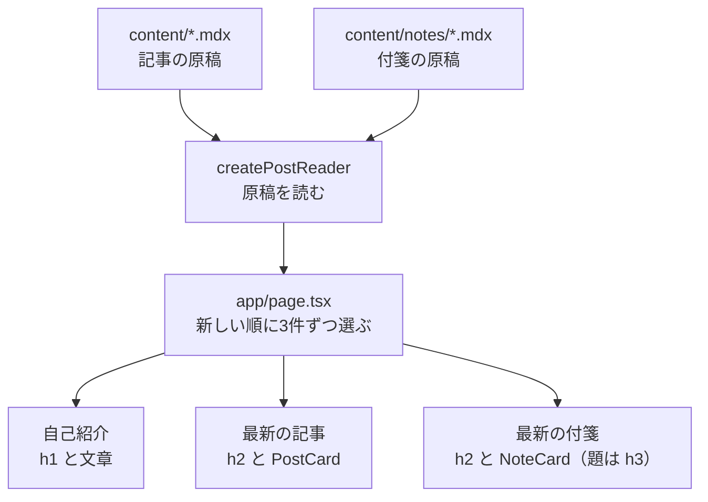

# 3-5: トップ画面で自己紹介と最新の記事・付箋が分かるようにする

- 起票日: 2026-11-22
- 学習計画: ADR `20261122-1821-publish-first-path.md`（公開までの5回）
- ADR: `docs/adr/20261122-2332-top-page.md`（この回で決めたこと。状態は「提案」）
- 前提: 3-3c が完了していること（`PageContainer` がある）
- ステータス: 完了

## 全体のどこか

最初の公開までの5回のうち、2回目。

| Step     | 内容                                           | 進捗           |
| -------- | ---------------------------------------------- | -------------- |
| 3-3c     | 一覧ページの幅と見出しを部品でそろえる         | ■■■ 完了       |
| 3-5      | トップ画面を作る（自己紹介、最新の記事と付箋） | □□□ ← いまここ |
| 3-11     | 404 ページとファビコンを作る                   | □□□            |
| 3-8・3-9 | RSS、sitemap、robots を作り、軽い CSP を入れる | □□□            |
| 4-0      | 記事を仕分け、`main` に反映して公開する        | □□□            |

この回で扱わないもの: 独立した `/about` ページ、X のツイート表示（3-6）、OGP 画像のデザイン（3-5b）、付箋の並べ替え（3-4）。

## なぜこれをやるか

いまのトップ画面はリンクが3つ並ぶだけで、誰のどんなサイトなのかが分からない。SNS や検索から来た人が最初に見る場所なので、公開前に「誰が書いているか」と「何が読めるか」を置く。ナビの「ノート」もページの題の「付箋」にそろえる。

## 周辺知識

### 全体の地図



図から分かること:

- 記事と付箋は、置き場所が違うだけで同じ `createPostReader` で読める
- `getAllPosts` は新しい順に返すので、先頭の3件が最新になる
- トップ画面では付箋の題が `h2` の下に入るので、`h3` に変える

### 用語

| 用語              | たとえ                                 | 正確な意味                                                 | この回での出番 |
| ----------------- | -------------------------------------- | ---------------------------------------------------------- | -------------- |
| 見出しの階層      | 本の章と節。節だけが章の外に出ると迷う | `h1` から `h6` の数字で、内容の親子関係を表す決まり        | 手順 4         |
| `section`         | 本の中の1つの章                        | 見出しを持つ内容のまとまりを表す HTML の要素               | 手順 3         |
| `aria-labelledby` | 箱に、中の見出しを名札として貼る       | 別の要素の文字を、その要素の名前として支援技術に伝える属性 | 手順 3         |
| `slice(0, 3)`     | 列の先頭から3人だけ呼ぶ                | 配列の先頭から指定した数だけを取り出す。元の配列は変えない | 手順 3         |

### 設計の考え方

**`/about` を作らず、自己紹介をトップ画面に置く。** 記事がまだ少ない時期に自己紹介だけのページを分けると、読者の移動が1回増える。詳しい経歴を書きたくなったら、公開のあとに `/about` へ移せる。

**付箋の題の階層は `NoteCard` の props で変える。** `/notes` では題が `h2`、トップ画面では `h3` が正しい。使う場所で階層が変わるので、部品の中で固定せず、呼ぶ側から渡す。既定値を `h2` にしたので、`/notes` のコードは変えなくてよい。

### ベストプラクティス

- 見出しはページの構造に沿って階層を付ける（出典: [WAI Headings Tutorial](https://www.w3.org/WAI/tutorials/page-structure/headings/)）
- 同じ働きのものには同じ名前を付ける（出典: [WCAG 3.2.4 Consistent Identification](https://www.w3.org/WAI/WCAG22/Understanding/consistent-identification.html)）
- リンクの文字だけで行き先が分かるようにする（出典: [WCAG 2.4.4 Link Purpose](https://www.w3.org/WAI/WCAG22/Understanding/link-purpose-in-context.html)）。「もっと見る」ではなく「記事をすべて見る」と書く

### 比較（自己紹介を置く場所）

| 案                    | 得意なこと                          | 引き換えにするもの               | この回で採るか |
| --------------------- | ----------------------------------- | -------------------------------- | -------------- |
| トップ画面に短く置く  | 来た人がすぐ読める。作るページが1つ | 長い経歴は書きにくい             | 採る           |
| `/about` に分ける     | 経歴や技術を詳しく書ける            | ページが増え、公開が遅れる       | 公開のあと     |
| フッターに1行だけ置く | 場所を取らない                      | 誰のサイトかが最初に伝わりにくい | 採らない       |

### a11y の解説

| 実装                           | 入れたとき、どう伝わるか                                         | 入れないと、どうなるか                                                   | 誰が困るか               | 根拠              |
| ------------------------------ | ---------------------------------------------------------------- | ------------------------------------------------------------------------ | ------------------------ | ----------------- |
| `h1` → `h2` → `h3`             | 見出しの一覧で「最新の付箋」の下に各付箋が並ぶ                   | 付箋が「最新の付箋」と同じ階層に並び、どこまでがそのまとまりか分からない | 見出しで移動する人       | WCAG 1.3.1        |
| `section` と `aria-labelledby` | ランドマークの一覧に「最新の記事」「最新の付箋」が名前付きで出る | まとまりに名前がなく、ランドマークで目的の場所へ移動しにくい             | ランドマークで移動する人 | WCAG 1.3.1・2.4.1 |
| 行き先が分かるリンク文字       | リンクの一覧だけでも「記事をすべて見る」と分かる                 | 「もっと見る」が2つ並び、どちらの一覧か分からない                        | リンクの一覧で移動する人 | WCAG 2.4.4        |

`aria-labelledby` の `id` を打ち間違えても `bun run ay` は通った（実測）。自動検査だけでは見つからないので、手順 7 の VoiceOver で確かめる。読み上げの文言は未確認。

### 現時点のバージョン（2026-11-22 確認）

| パッケージ | バージョン | この回での扱い |
| ---------- | ---------- | -------------- |
| next       | 16.4.6     | そのまま       |
| react      | 19.3.1     | そのまま       |

新しく入れるパッケージはない。

## 作業手順（全体の地図）

1. ナビの「ノート」を「付箋」に直す
2. トップ画面に自己紹介を置く
3. **本題:** 最新の記事を3件並べる
4. `NoteCard` の見出しの階層を変えられるようにする
5. 最新の付箋を3件並べる
6. わざと壊して、型検査が止めることを確かめる
7. スマートフォンの幅、キーボード、VoiceOver で確かめる

## 確認事項

- [ ] **1. 自己紹介の置き場所。** 推奨「トップ画面に短く置き、`/about` は作らない」で作成。理由は公開までの作業を減らせるため。欠点は長い経歴を書く場所がないこと
- [ ] **2. 自己紹介の文章。** 推奨「手順 2 で本人が書く」で作成。理由は経歴や関心を AI が作るわけにいかないため。欠点はこの回で文章を考える時間が要ること
- [ ] **3. 並べる件数。** 推奨「記事と付箋を3件ずつ」で作成。理由はスマートフォンでも長くなりすぎないため。欠点は4件目以降を読むには一覧へ移動すること
- [ ] **4. 並べる順番。** 推奨「自己紹介、記事、付箋」で作成。理由は読者が最初に知りたいのが書き手と記事だと考えたため。欠点は付箋がスマートフォンで下のほうになること
- [ ] **5. 付箋の見出し。** 推奨「`NoteCard` に `headingLevel` を足し、既定を `h2` にする」で作成。理由は `/notes` を変えずにトップ画面だけ `h3` にできるため。欠点は部品の props が1つ増えること
- [x] **6. ナビの名前。** 本人の変更で「ふせん」に決定（推奨は「付箋」）。ナビ、見出し、タブの題、トップ画面をそろえた。欠点は過去のチケットや ADR の「付箋」と表記が違うこと
- [ ] **7. デザインシステムへのリンク。** 推奨「トップ画面から外し、フッターだけに残す」で作成。理由は読者にとって最初に必要な情報ではないため。欠点はトップ画面からの導線が目立たなくなること

## ハンズオン

出力はリポジトリの複製で実際に動かして写した（2026-11-22、next 16.4.6、react 19.3.1、bun 1.4.4、Node.js 24.22.1）。VoiceOver の読み上げと実機の見た目は未確認。

---

### 準備：この回で何をするのか

`app/page.tsx` を、自己紹介、最新の記事、最新の付箋の3段に作り直す。1段ずつ足して、そのたびにブラウザで確かめる。

#### 用意するもの

開発サーバーを起動し、ブラウザで `http://localhost:3000/` を開いておく。

```bash
bun run d
```

---

### 手順 1：ナビの「ノート」を「付箋」に直す

`app/_components/site-header.tsx` の `navItems` を次の形にする。

```tsx
const navItems = [
  { href: "/posts", label: "記事" },
  { href: "/tags", label: "タグ" },
  { href: "/notes", label: "付箋" },
];
```

「ノート」が残っていないことを確かめる。

```bash
grep -rn 'ノート' app --include='*.tsx'
```

期待される出力: 何も出ない。

**なぜ** — ナビで「ノート」を選んで「付箋」のページが開くと、読者は別のページに来たのかと迷う。

---

### 手順 2：トップ画面に自己紹介を置く

`app/page.tsx` の全文を次の形に置き換える。

```tsx
import { Metadata } from "next";
import { SITE_NAME, siteOpenGraph } from "../lib/siteMetadata";
import { css } from "../styled-system/css";
import { PageContainer } from "./_components/page-container";

export const metadata: Metadata = {
  alternates: { canonical: "/" },
  openGraph: { ...siteOpenGraph, type: "website", url: "/" },
};

export default async function Home() {
  "use cache";

  return (
    <PageContainer>
      <header className={css({ marginBlockEnd: "48" })}>
        <h1 className={css({ textStyle: "heading.1" })}>{SITE_NAME}</h1>
        <p>自分の手で試した記録を残しています。</p>
      </header>
    </PageContainer>
  );
}
```

`<p>` の中の文章を、自分の言葉に書き換える。何をしている人か、このサイトに何を書くかを1〜3文で書くとよい。

**なぜ** — 検索や SNS から来た人は、まず誰のサイトかを確かめる。`h1` にサイト名を置くと、読み上げでも最初の見出しでそれが分かる。

---

### 手順 3：この回の本題。最新の記事を3件並べる

`app/page.tsx` の全文を次の形に置き換える。自己紹介の `<p>` は手順 2 で書いた文章に戻す。

```tsx
import path from "node:path";
import { Metadata } from "next";
import { createPostReader } from "../lib/createPostReader";
import { SITE_NAME, siteOpenGraph } from "../lib/siteMetadata";
import { css } from "../styled-system/css";
import { AppLink } from "./_components/app-link";
import { PageContainer } from "./_components/page-container";
import { PostCard } from "./_components/post-card";

const LATEST_COUNT = 3;
const postReader = createPostReader(path.join(process.cwd(), "content"));
const linkStyle = css({ color: "fg.link", textDecoration: "underline" });

export const metadata: Metadata = {
  alternates: { canonical: "/" },
  openGraph: { ...siteOpenGraph, type: "website", url: "/" },
};

export default async function Home() {
  "use cache";

  const posts = (await postReader.getAllPosts()).slice(0, LATEST_COUNT);

  return (
    <PageContainer>
      <header className={css({ marginBlockEnd: "48" })}>
        <h1 className={css({ textStyle: "heading.1" })}>{SITE_NAME}</h1>
        <p>自分の手で試した記録を残しています。</p>
      </header>
      <section aria-labelledby="latest-posts" className={css({ marginBlockEnd: "48" })}>
        <h2 id="latest-posts" className={css({ textStyle: "heading.2", marginBlockEnd: "16" })}>
          最新の記事
        </h2>
        <ul className={css({ display: "flex", flexDirection: "column", gap: "16" })}>
          {posts.map(({ slug, frontmatter }) => (
            <li key={slug}>
              <PostCard slug={slug} title={frontmatter.title} date={frontmatter.date} />
            </li>
          ))}
        </ul>
        <p className={css({ marginBlockStart: "16" })}>
          <AppLink href="/posts" className={linkStyle}>
            記事をすべて見る
          </AppLink>
        </p>
      </section>
    </PageContainer>
  );
}
```

ブラウザを見る。自己紹介の下に新しい順で記事が3件並び、「記事をすべて見る」で `/posts` に移動できる。

**なぜ** — `getAllPosts` が新しい順に返すので、`slice(0, LATEST_COUNT)` で先頭を取るだけで「最新」になる。件数を変えたくなったら `LATEST_COUNT` の1か所を直せばよい。

---

### 手順 4：`NoteCard` の見出しの階層を変えられるようにする

`app/_components/note-card.tsx` を4か所変える。

型に1行足す。

```tsx
type NoteCardProps = {
  slug: string;
  title: string;
  date: string;
  children: ReactNode;
  headingLevel?: "h2" | "h3";
};
```

関数の先頭を次の2行にする。

```tsx
export function NoteCard({ slug, title, date, children, headingLevel = "h2" }: NoteCardProps) {
  const Heading = headingLevel;
```

カードの題の `<h2>` と `</h2>` を `Heading` に置き換える。

```tsx
<Heading className={css({ fontSize: "18", fontWeight: "bold" })}>
  <button
    type="button"
    onClick={openDialog}
    className={css({
      textAlign: "start",
      cursor: "pointer",
      _after: { content: '""', position: "absolute", inset: "0" },
    })}
  >
    {title}
  </button>
</Heading>
```

ダイアログの中の題も同じように置き換える。

```tsx
<Heading id={titleId} className={css({ fontSize: "18", fontWeight: "bold" })}>
  {title}
</Heading>
```

`http://localhost:3000/notes` を開き、付箋がこれまでどおり開閉できることを見る。

**なぜ** — JSX では大文字で始まる変数をタグとして使える。`Heading` の中身が `"h3"` なら `<h3>` が出る。既定値が `h2` なので、`/notes` の呼び出しは変えなくてよい。

---

### 手順 5：最新の付箋を3件並べる

`app/page.tsx` の全文を次の形に置き換える。自己紹介の `<p>` は手順 2 で書いた文章に戻す。

```tsx
import path from "node:path";
import { Metadata } from "next";
import { createPostReader } from "../lib/createPostReader";
import { SITE_NAME, siteOpenGraph } from "../lib/siteMetadata";
import { css } from "../styled-system/css";
import { AppLink } from "./_components/app-link";
import { NoteCard } from "./_components/note-card";
import { PageContainer } from "./_components/page-container";
import { PostCard } from "./_components/post-card";

const LATEST_COUNT = 3;
const postReader = createPostReader(path.join(process.cwd(), "content"));
const noteReader = createPostReader(path.join(process.cwd(), "content", "notes"));
const linkStyle = css({ color: "fg.link", textDecoration: "underline" });

export const metadata: Metadata = {
  alternates: { canonical: "/" },
  openGraph: { ...siteOpenGraph, type: "website", url: "/" },
};

export default async function Home() {
  "use cache";

  const posts = (await postReader.getAllPosts()).slice(0, LATEST_COUNT);
  const latestNotes = (await noteReader.getAllPosts()).slice(0, LATEST_COUNT);
  const notes = await Promise.all(
    latestNotes.map(async ({ slug }) => ({ slug, note: await noteReader.getPost(slug) })),
  );

  return (
    <PageContainer>
      <header className={css({ marginBlockEnd: "48" })}>
        <h1 className={css({ textStyle: "heading.1" })}>{SITE_NAME}</h1>
        <p>自分の手で試した記録を残しています。</p>
      </header>
      <section aria-labelledby="latest-posts" className={css({ marginBlockEnd: "48" })}>
        <h2 id="latest-posts" className={css({ textStyle: "heading.2", marginBlockEnd: "16" })}>
          最新の記事
        </h2>
        <ul className={css({ display: "flex", flexDirection: "column", gap: "16" })}>
          {posts.map(({ slug, frontmatter }) => (
            <li key={slug}>
              <PostCard slug={slug} title={frontmatter.title} date={frontmatter.date} />
            </li>
          ))}
        </ul>
        <p className={css({ marginBlockStart: "16" })}>
          <AppLink href="/posts" className={linkStyle}>
            記事をすべて見る
          </AppLink>
        </p>
      </section>
      <section aria-labelledby="latest-notes">
        <h2 id="latest-notes" className={css({ textStyle: "heading.2", marginBlockEnd: "16" })}>
          最新の付箋
        </h2>
        <ul
          className={css({
            display: "grid",
            gridTemplateColumns: "repeat(auto-fill, minmax(min(100%, 16rem), 1fr))",
            gap: "16",
          })}
        >
          {notes.map(({ slug, note }) =>
            note ? (
              <li key={slug}>
                <NoteCard
                  slug={slug}
                  title={note.frontmatter.title}
                  date={note.frontmatter.date}
                  headingLevel="h3"
                >
                  <note.Content />
                </NoteCard>
              </li>
            ) : null,
          )}
        </ul>
        <p className={css({ marginBlockStart: "16" })}>
          <AppLink href="/notes" className={linkStyle}>
            付箋をすべて見る
          </AppLink>
        </p>
      </section>
    </PageContainer>
  );
}
```

ブラウザを見る。記事の下に付箋が3件並び、選ぶと全文のダイアログが開く。

**なぜ** — 付箋の一覧と同じ `NoteCard` を使うので、開閉の動きやキーボード操作を作り直さずに済む。`headingLevel="h3"` で、「最新の付箋」の `h2` の下に入る形にしている。

---

### 手順 6：わざと壊して、型検査が止めることを確かめる

`app/page.tsx` の `headingLevel` を、許していない値に変える。

```tsx
headingLevel = "h4";
```

型検査を実行する。

```bash
bun run tc
```

期待される出力（抜粋。実測）:

```
app/page.tsx(71,19): error TS2322: Type '"h4"' is not assignable to type '"h2" | "h3" | undefined'.
```

行番号は自己紹介の文章の長さによって変わることがある。確かめたら `headingLevel="h3"` に戻す。

**なぜ** — 見出しの階層は画面では見分けにくい。使える値を型で絞っておくと、飛び越えた階層を書いたときに公開前に止まる。

---

### 手順 7：スマートフォンの幅、キーボード、VoiceOver で確かめる

画面の幅:

1. Chrome の DevTools を開き、Toggle device toolbar（⌘ + Shift + M）を押す
2. 幅を `320` にして `/` を開く
3. 左右に余白があり、横スクロールが出ないことを見る

キーボード:

1. `/` を開き、Tab で最新の付箋の題まで進む
2. Enter を押してダイアログを開く
3. Esc を押して閉じ、フォーカスが同じ付箋の題に戻ることを見る

VoiceOver（⌘ + F5 で起動。Control + Option + 右矢印で次へ）:

1. `/` を開き、Control + Option + U でローターを開く
2. 「見出し」でサイト名、最新の記事、最新の付箋、各付箋の順に並ぶことを聞く
3. 「ランドマーク」に「最新の記事」と「最新の付箋」が出ることを聞く

読み上げの文言は未確認なので、自分の耳で確かめてほしい。

---

実装は以上です。静的検証、テストがオールグリーンならcommitしてpushしてください。

---

### うまくいかないとき

| 症状                            | 原因と対処                                                    |
| ------------------------------- | ------------------------------------------------------------- |
| `Type '"h4"' is not assignable` | 手順 6 の値を戻していない。`headingLevel="h3"` にする         |
| 付箋の題の見た目が変わった      | `Heading` の `className` を消している。手順 4 の形に戻す      |
| ランドマークに名前が出ない      | `aria-labelledby` の値と `h2` の `id` が一致していない        |
| 自己紹介が元の文章に戻った      | 手順 3 か手順 5 で全文を貼った。手順 2 で書いた文章を入れ直す |

ここに載っていないエラーが出たら、そのまま貼って聞いてほしい。

---

## 受け入れ条件

- [x] トップ画面にサイト名の `h1` と、自己紹介がある（目視）。文章はチケットの仮の文を本人が採用した
- [x] 最新の記事が新しい順に3件並び、「記事をすべて見る」で `/posts` に移動できる（目視）
- [x] 最新の付箋が新しい順に3件並び、「ふせんをすべて見る」で `/notes` に移動できる（目視）
- [x] 付箋を Enter で開き、Esc で閉じると、フォーカスが同じ付箋の題に戻る（キーボード）
- [x] `/notes` の付箋がこれまでどおり開閉できる（目視）
- [x] 幅 320px で左右に余白があり、横スクロールが出ない（目視）
- [ ] 見出しが `h1`、`h2`、`h3` の順に並び、ランドマークに2つのまとまりの名前が出る（VoiceOver）。見出しの順は実測済み。読み上げは未確認のまま、本人の了承でコミット
- [x] ヘッダーのナビに「ふせん」と表示され、`grep -rn 'ノート' app --include='*.tsx'` が何も出さない
- [x] `headingLevel="h4"` にすると `bun run tc` が失敗し、`"h3"` に戻すと通る
- [x] `bun run l`、`bun run tc`、`bun run b`、`bun run ay` が通る

## この回で理解したこと

未記入のまま、本人の了承でコミットした（2026-11-23）。

- [ ] トップ画面で付箋の題を `h3` にする理由を説明できる
- [ ] `const Heading = headingLevel` でタグを切り替えられる理由を説明できる
- [ ] `aria-labelledby` が何を支援技術に伝えるかを説明できる
- [ ] 自動検査では見つからない a11y の問題の例を1つ挙げられる

## 参考

- [WAI Headings Tutorial](https://www.w3.org/WAI/tutorials/page-structure/headings/)
- [WCAG 2.4.4 Link Purpose (In Context)](https://www.w3.org/WAI/WCAG22/Understanding/link-purpose-in-context.html)
- [WCAG 3.2.4 Consistent Identification](https://www.w3.org/WAI/WCAG22/Understanding/consistent-identification.html)
