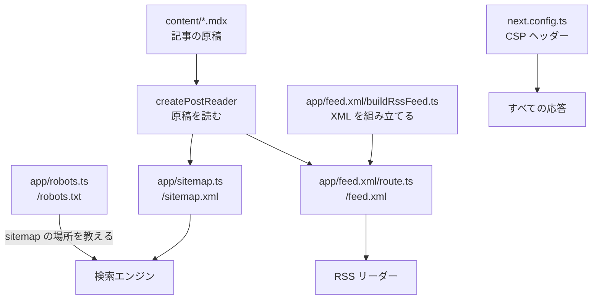
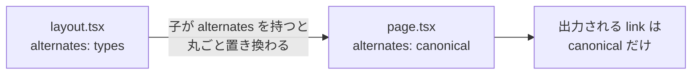

# 3-8・3-9: 検索エンジンと RSS リーダーに記事を届け、他サイトへの埋め込みを防ぐ

- 起票日: 2026-11-23
- 学習計画: ADR `20261122-1821-publish-first-path.md`（公開までの4回）
- ADR: `docs/adr/20261123-1304-feed-sitemap-robots-csp.md`（この回で決めたこと。状態は「採用」）
- 前提: 3-11 が完了していること（404 ページとアイコンがある）
- ステータス: 完了

## 全体のどこか

3-3c のあと、最初の公開までの4回のうち3回目。

| Step     | 内容                                             | 進捗           |
| -------- | ------------------------------------------------ | -------------- |
| 3-5      | トップ画面を作る（自己紹介、最新の記事とふせん） | ■■■ 完了       |
| 3-11     | ファビコン、ヒーロー、404 ページを作る           | ■■■ 完了       |
| 3-8・3-9 | RSS、sitemap、robots を作り、軽い CSP を入れる   | □□□ ← いまここ |
| 4-0      | 記事を仕分け、`main` に反映して公開する          | □□□            |

この回で扱わないもの: RSS への本文の配信、Search Console への登録、XSS まで防ぐ厳格な CSP、存在しない記事の URL を HTTP 404 で返す仕組み。

## なぜこれをやるか

公開しても、検索エンジンに記事の場所が伝わらず、読者が更新を受け取る手段もなければ、せっかく書いた記事が届きにくい。この回で `robots.txt`、`sitemap.xml`、`feed.xml` を用意し、機械が読むための入口を作る。

あわせて、他のサイトがこのサイトを iframe で埋め込めないようにする。埋め込まれたページの上に透明なボタンを重ねて、読者に別の操作をさせる攻撃を防ぐためだ。

## 周辺知識

### 全体の地図



図から分かること:

- `sitemap` と RSS は記事ページと同じ `createPostReader` から記事の一覧を受け取る
- XML を組み立てる処理は `route.ts` から分け、Next.js に依存させない
- CSP だけは記事の中身と関係がなく、すべての応答に付く

### 用語

| 用語              | たとえ                                 | 正確な意味                                                               | この回での出番 |
| ----------------- | -------------------------------------- | ------------------------------------------------------------------------ | -------------- |
| クローラー        | 町を歩いて店の一覧を作る調査員         | Web ページを自動で巡回して情報を集めるプログラム                         | 手順 2         |
| `robots.txt`      | 店の入口の「調査員の方へ」という貼り紙 | クローラーに、巡回してよい場所を伝えるテキストファイル                   | 手順 2         |
| sitemap           | 調査員に渡す店内の案内図               | サイトにある URL の一覧を XML で書いたファイル                           | 手順 3         |
| XML               | 中身に名札を付けて入れ子にした箱       | `<title>` のようなタグで、データの意味と構造を表す書式                   | 手順 3・4      |
| RSS               | 新刊のお知らせ便                       | サイトの更新情報を、決まった形の XML で配信する仕組み                    | 手順 4・5      |
| RSS リーダー      | お知らせ便をまとめて受け取る郵便受け   | 複数サイトの RSS を読み、新しい記事を一覧にするアプリ                    | 手順 5         |
| エスケープ        | 記号を「ただの文字です」と札で示す     | `&` を `&amp;` にするなど、特別な意味を持つ記号を文字として扱う置き換え  | 手順 4         |
| 自動検出          | 店先の「お知らせ便はこちら」の案内     | HTML の `<link rel="alternate">` で、リーダーに RSS の場所を教える仕組み | 手順 6         |
| CSP               | 建物の入館ルール                       | ページが読み込めるものや扱われ方をブラウザに指示する HTTP ヘッダー       | 手順 8         |
| `frame-ancestors` | 「この店を他の店の中に出店させない」   | このページを iframe で埋め込める親ページを制限する CSP の指定            | 手順 8         |

### 設計の考え方

**`robots.txt` は「隠す」道具ではない。** Google の資料は `robots.txt` を「ページを Google から除外する仕組みではない」と説明している。検索結果から外すには `noindex` を使う。このサイトの下書きは `content/draft/` にあり、ページ自体が作られないので、`robots.txt` で隠す必要がない。

**`alternates` は親から子へ丸ごと上書きされる。** `layout.tsx` に RSS の情報を書いても、ページ側に `alternates: { canonical }` があると、`alternates` 全体が置き換わる。



図から分かること:

- 親と子の `alternates` は、中身が混ざらない
- このサイトは全ページが `canonical` を持つので、`layout.tsx` だけに書くと RSS のリンクが全ページから消える（実測）
- `siteOpenGraph` を各ページに渡しているのも、同じ理由である

**`"use cache"` を付けないと、ビルド時に作られない。** Cache Components では、ファイルの読み込みのような処理は、キャッシュの指定がないとアクセスのたびに実行される。`sitemap` と RSS は記事を足してビルドしたときだけ変わるので、`"use cache"` を付けてビルド時に作る。

### ベストプラクティス

- sitemap の URL は完全な絶対 URL で書く（出典: [Build and Submit a Sitemap](https://developers.google.com/search/docs/crawling-indexing/sitemaps/build-sitemap)）
- Google は `<priority>` と `<changefreq>` を無視し、`<lastmod>` は正確な場合だけ使う（出典: 同上）。このサイトの原稿には更新日がないので `lastmod` を入れない
- RSS の `channel` には `title`、`link`、`description` が必須で、`item` には `title` か `description` のどちらかが必須（出典: [RSS 2.0 Specification](https://www.rssboard.org/rss-specification)）
- RSS の自動検出は `<link rel="alternate" type="application/rss+xml">` を使い、`href` は完全な URL にする（出典: [RSS Autodiscovery](https://www.rssboard.org/rss-autodiscovery)）
- `frame-ancestors` は `<meta>` では効かないので、HTTP ヘッダーで送る（出典: [MDN frame-ancestors](https://developer.mozilla.org/en-US/docs/Web/HTTP/Reference/Headers/Content-Security-Policy/frame-ancestors)）

### 比較（RSS の作り方）

| 案                      | 得意なこと                       | 引き換えにするもの                   | この回で採るか |
| ----------------------- | -------------------------------- | ------------------------------------ | -------------- |
| 自分で XML を組み立てる | 依存が増えず、中身が全部見える   | エスケープを自分で保守する           | 採る           |
| `feed` パッケージを使う | RSS と Atom を同じ書き方で作れる | 依存が増え、供給網の確認対象も増える | 採らない       |
| 全文を入れて配信する    | リーダーの中で記事を読み切れる   | MDX を HTML に変える処理が別に要る   | 採らない       |

### a11y の解説

| 実装                               | 入れたとき、どう伝わるか                     | 入れないと、どうなるか                                           | 誰が困るか             | 根拠       |
| ---------------------------------- | -------------------------------------------- | ---------------------------------------------------------------- | ---------------------- | ---------- |
| フッターのリンク名「RSS フィード」 | リンクの一覧を聞いても、何のリンクかが分かる | アイコンだけだと名前がなく、「リンク」としか伝わらないことがある | 読み上げを使う人       | WCAG 2.4.4 |
| 本物の `<a>`                       | Tab で移動でき、Enter で開ける               | `div` にクリック処理を付けると、キーボードで届かない             | キーボードで操作する人 | WCAG 2.1.1 |

VoiceOver の読み上げは未確認なので、手順 9 で自分の耳で確かめる。

### 現時点のバージョン（2026-11-23 確認）

| パッケージ | バージョン | この回での扱い |
| ---------- | ---------- | -------------- |
| next       | 16.4.6     | そのまま       |
| react      | 19.3.1     | そのまま       |

新しく入れるパッケージはない。

## 作業手順（全体の地図）

1. サイトの URL と説明を1か所にまとめる
2. `robots.txt` を作る
3. `sitemap.xml` を作り、ビルド時に生成させる
4. **本題:** RSS の XML を組み立て、エスケープの意味を確かめる
5. `/feed.xml` で RSS を配信する
6. RSS の自動検出リンクを全ページに出す
7. フッターに RSS のリンクを置く
8. CSP で他サイトへの埋め込みを防ぐ
9. 本番ビルドで応答を確かめ、キーボードと VoiceOver で操作する

## 確認事項

- [x] **1. RSS の作り方。** 本人の変更で「依存を足さず `app/feed.xml/buildRssFeed.ts` で組み立てる」に決定（推奨は `lib/buildRssFeed.ts`）。依存を足さない理由は項目が4種類だけで、依存を増やすほどの量がないため。欠点はエスケープを自分で保守することと、`app/` の中にあるので、ほかのフレームワークへ移るときは置き場所を変えること
- [ ] **2. RSS の中身。** 推奨「題、URL、公開日、タグ」で作成。理由は MDX を HTML に変える処理を増やさずに済むため。欠点はリーダーだけでは記事を読めず、サイトへ移動すること
- [ ] **3. RSS の件数。** 推奨「最新20件」で作成。理由は記事が増えてもファイルが大きくなりすぎないため。欠点はそれより古い記事が、購読を始めた人のリーダーに出ないこと
- [ ] **4. ふせんの扱い。** 推奨「RSS に載せない」で作成。理由はふせんに個別の URL がないため。欠点はふせんの更新が購読者に届かないこと
- [ ] **5. sitemap の範囲。** 推奨「固定の5ページ、全記事、全タグ」で作成。理由は公開しているページをそのまま伝えるため。欠点は記事が少ないタグの一覧も検索エンジンに知らせること
- [ ] **6. 【一般的な例からの逸脱】sitemap の `lastmod`。** 推奨「入れない」で作成。Next.js の例には `lastModified` があるが、原稿には更新日がなく、公開日を入れると正確な値にならないため。欠点は記事を更新しても sitemap からは更新を伝えられないこと
- [ ] **7. クローラーの許可。** 推奨「すべて許可し、AI のクローラーを分ける判断は 3-10 に回す」で作成。理由は公開の時点で検索に載ることを優先するため。欠点は AI の学習用クローラーも記事を読めること
- [ ] **8. 自動検出リンクの置き方。** 推奨「各ページの `alternates` に `types` を渡す」で作成。理由は Next.js のメタデータの仕組みのままで、markuplint も通るため。欠点は新しいページで書き忘れるとリンクが消えること
- [ ] **9. フッターのリンク。** 推奨「`<a>` で『RSS フィード』と書き、lint の指摘を理由つきで無効にする」で作成。理由は XML は画面ではなく、`Link` の画面遷移に乗せないため。欠点はコメントが1行増えること
- [ ] **10. 【一般的な推奨からの逸脱】CSP の範囲。** 推奨「スクリプトを制限しない4つの指定」で作成（ADR `20261122-1821-publish-first-path.md` の決定）。XSS を止めるなら `script-src` の制限が望ましい。それでも外す理由は、解析スクリプトを止める危険があり、nonce は全ページの動的描画が要るため。欠点は XSS を止められないこと
- [ ] **11. CSP を付ける範囲。** 推奨「`/(.*)` ですべての応答に付ける」で作成。理由は設定が1行で、付け忘れが起きないため。欠点は画像やスクリプトの応答にも不要なヘッダーが付くこと

## ハンズオン

コードと出力はリポジトリの複製で動かして写した（2026-11-23、next 16.4.6、react 19.3.1、bun 1.4.4、Node.js 24.22.1）。手順 9 の HTTP 応答、iframe の表示、VoiceOver の読み上げは未確認なので、自分の画面で確かめる。

---

### 準備：この回で何をするのか

人が読むページの横に、機械が読むファイルを3つ足す。`robots.txt` が sitemap の場所を教え、`sitemap.xml` が記事の URL を並べ、`feed.xml` が新しい記事を RSS リーダーに届ける。最後に、HTTP ヘッダーで iframe への埋め込みを禁止する。

#### 用意するもの

開発サーバーは使わず、手順ごとに本番ビルドで確かめる。開発サーバーを起動していたら止めておく。

---

### 手順 1：サイトの URL と説明を1か所にまとめる

`lib/siteMetadata.ts` を次の内容に置き換える。

```ts
export const SITE_NAME = "65banseki の技術ブログ";
export const SITE_URL = "https://www.65banseki.dev";
export const SITE_DESCRIPTION = "65banseki の技術ブログ。自分の手で試した記録を残しています。";

export const siteOpenGraph = {
  siteName: SITE_NAME,
  locale: "ja_JP",
};
```

`app/layout.tsx` の import を次の行に置き換える。

```tsx
import { SITE_DESCRIPTION, SITE_NAME, SITE_URL, siteOpenGraph } from "../lib/siteMetadata";
```

同じファイルの `metadata` で、`metadataBase` と `description` を次の形にする。

```tsx
metadataBase: new URL(SITE_URL), // 全ページのメタデータで継承される以降相対パスで書くことができる（/postsはhttps://www.65banseki.dev/postsになる）
```

```tsx
description: SITE_DESCRIPTION,
```

型検査を実行する。

```bash
bun run tc
```

エラーが出なければ進む。

**なぜ** — sitemap と RSS には `/posts` のような相対パスではなく完全な URL を書く。同じ URL を何か所にも書くと、ドメインを変えるときに直し漏れが起きる。

---

### 手順 2：`robots.txt` を作る

`app/robots.ts` を新しく作る。

```ts
import type { MetadataRoute } from "next";
import { SITE_URL } from "../lib/siteMetadata";

export default function robots(): MetadataRoute.Robots {
  return {
    rules: { userAgent: "*", allow: "/" },
    sitemap: `${SITE_URL}/sitemap.xml`,
  };
}
```

ビルドして、できたファイルを見る。

```bash
bun run b
cat .next/server/app/robots.txt.body
```

期待される出力（実測）:

```
User-Agent: *
Allow: /

Sitemap: https://www.65banseki.dev/sitemap.xml
```

**なぜ** — `User-Agent: *` は「すべてのクローラーへ」、`Allow: /` は「全ページを見てよい」という意味になる。最後の行で sitemap の場所も伝えられる。

---

### 手順 3：`sitemap.xml` を作り、ビルド時に生成させる

#### 3-a：まず普通の関数で作る

`app/sitemap.ts` を新しく作る。

```ts
import path from "node:path";
import type { MetadataRoute } from "next";
import { createPostReader } from "../lib/createPostReader";
import { SITE_URL } from "../lib/siteMetadata";

const FIXED_PATHS = ["", "/posts", "/notes", "/tags", "/design-system"];
const postReader = createPostReader(path.join(process.cwd(), "content"));

export default async function sitemap(): Promise<MetadataRoute.Sitemap> {
  const [slugs, tags] = await Promise.all([postReader.getAllSlugs(), postReader.getAllTags()]);
  const paths = [
    ...FIXED_PATHS,
    ...slugs.map((slug) => `/posts/${slug}`),
    ...tags.map((tag) => `/tags/${tag}`),
  ];

  return paths.map((pathname) => ({ url: `${SITE_URL}${pathname}` }));
}
```

ビルドの一覧で、`/sitemap.xml` の印を見る。

```bash
bun run b | grep sitemap
```

期待される出力（実測）:

```
├ ƒ /sitemap.xml
```

`ƒ` は「アクセスのたびにサーバーで作る」という印である。

#### 3-b：`"use cache"` を足す

`sitemap` 関数の先頭に `"use cache";` を足す。ファイル全体は次の形になる。

```ts
import path from "node:path";
import type { MetadataRoute } from "next";
import { createPostReader } from "../lib/createPostReader";
import { SITE_URL } from "../lib/siteMetadata";

const FIXED_PATHS = ["", "/posts", "/notes", "/tags", "/design-system"];
const postReader = createPostReader(path.join(process.cwd(), "content"));

export default async function sitemap(): Promise<MetadataRoute.Sitemap> {
  "use cache";

  const [slugs, tags] = await Promise.all([postReader.getAllSlugs(), postReader.getAllTags()]);
  const paths = [
    ...FIXED_PATHS,
    ...slugs.map((slug) => `/posts/${slug}`),
    ...tags.map((tag) => `/tags/${tag}`),
  ];

  return paths.map((pathname) => ({ url: `${SITE_URL}${pathname}` }));
}
```

もう一度ビルドする。

```bash
bun run b | grep sitemap
```

期待される出力（実測）:

```
├ ○ /sitemap.xml                                              15m      1y
```

できたファイルの先頭を見る。

```bash
head -n 8 .next/server/app/sitemap.xml.body
```

期待される出力（実測）:

```xml
<?xml version="1.0" encoding="UTF-8"?>
<urlset xmlns="http://www.sitemaps.org/schemas/sitemap/0.9">
<url>
<loc>https://www.65banseki.dev</loc>
</url>
<url>
<loc>https://www.65banseki.dev/posts</loc>
</url>
```

**なぜ** — sitemap の中身が変わるのは、記事を足してビルドしたときだけである。`○` にすると、アクセスのたびにファイルを読み直さずに済む。トップの URL を `""` にしたのは、`canonical` の `https://www.65banseki.dev` と同じ形にするためだ。

---

### 手順 4：この回の本題。RSS の XML を組み立て、エスケープの意味を確かめる

#### 4-a：わざとエスケープなしで作る

`app/` の中に `feed.xml` という名前の**フォルダ**を作る。名前は `.xml` で終わるが、ファイルではない。

```bash
mkdir -p app/feed.xml
```

できたフォルダの中に `buildRssFeed.ts` を作る。保存先は `app/feed.xml/buildRssFeed.ts` になる。`escapeXml` は、まだ受け取った文字をそのまま返す。

```ts
type FeedItem = { title: string; url: string; date: string; tags: string[] };

type FeedInput = {
  title: string;
  siteUrl: string;
  feedUrl: string;
  description: string;
  items: FeedItem[];
};

function escapeXml(text: string) {
  return text;
}

function toItemXml({ title, url, date, tags }: FeedItem) {
  const escapedUrl = escapeXml(url);
  const categories = tags.map((tag) => `<category>${escapeXml(tag)}</category>`).join("");

  return `<item><title>${escapeXml(title)}</title><link>${escapedUrl}</link><guid isPermaLink="true">${escapedUrl}</guid><pubDate>${new Date(date).toUTCString()}</pubDate>${categories}</item>`;
}

export function buildRssFeed({ title, siteUrl, feedUrl, description, items }: FeedInput) {
  return `<?xml version="1.0" encoding="UTF-8"?>
<rss version="2.0" xmlns:atom="http://www.w3.org/2005/Atom">
<channel>
<title>${escapeXml(title)}</title>
<link>${escapeXml(siteUrl)}</link>
<description>${escapeXml(description)}</description>
<language>ja</language>
<atom:link href="${escapeXml(feedUrl)}" rel="self" type="application/rss+xml"/>
${items.map(toItemXml).join("\n")}
</channel>
</rss>
`;
}
```

題に `&` がある記事を渡して、XML の検査にかける。`xmllint` は Mac に最初から入っている、XML の文法を確かめるコマンドである。

```bash
bun -e 'import { buildRssFeed } from "./app/feed.xml/buildRssFeed"; console.log(buildRssFeed({ title: "テスト", siteUrl: "https://example.com", feedUrl: "https://example.com/feed.xml", description: "説明", items: [{ title: "A & B", url: "https://example.com/a", date: "2026-11-23", tags: ["test"] }] }))' | xmllint --noout -
```

期待される出力（実測）:

```
-:9: parser error : xmlParseEntityRef: no name
<item><title>A & B</title><link>https://example.com/a</link><guid isPermaLink="t
                ^
```

XML では `&` が特別な記号なので、1文字あるだけでファイル全体が読めなくなる。RSS リーダーによっては、すべての記事が取得できなくなる。

#### 4-b：エスケープを入れる

`app/feed.xml/buildRssFeed.ts` を次の内容に置き換える。変わるのは `escapeXml` だけである。

```ts
type FeedItem = { title: string; url: string; date: string; tags: string[] };

type FeedInput = {
  title: string;
  siteUrl: string;
  feedUrl: string;
  description: string;
  items: FeedItem[];
};

// & を最後に置換すると、先に作った &lt; の & まで &amp; に変わってしまう
function escapeXml(text: string) {
  return text
    .replaceAll("&", "&amp;")
    .replaceAll("<", "&lt;")
    .replaceAll(">", "&gt;")
    .replaceAll('"', "&quot;")
    .replaceAll("'", "&apos;");
}

function toItemXml({ title, url, date, tags }: FeedItem) {
  const escapedUrl = escapeXml(url);
  const categories = tags.map((tag) => `<category>${escapeXml(tag)}</category>`).join("");

  return `<item><title>${escapeXml(title)}</title><link>${escapedUrl}</link><guid isPermaLink="true">${escapedUrl}</guid><pubDate>${new Date(date).toUTCString()}</pubDate>${categories}</item>`;
}

export function buildRssFeed({ title, siteUrl, feedUrl, description, items }: FeedInput) {
  return `<?xml version="1.0" encoding="UTF-8"?>
<rss version="2.0" xmlns:atom="http://www.w3.org/2005/Atom">
<channel>
<title>${escapeXml(title)}</title>
<link>${escapeXml(siteUrl)}</link>
<description>${escapeXml(description)}</description>
<language>ja</language>
<atom:link href="${escapeXml(feedUrl)}" rel="self" type="application/rss+xml"/>
${items.map(toItemXml).join("\n")}
</channel>
</rss>
`;
}
```

同じ検査をもう一度実行する。

```bash
bun -e 'import { buildRssFeed } from "./app/feed.xml/buildRssFeed"; console.log(buildRssFeed({ title: "テスト", siteUrl: "https://example.com", feedUrl: "https://example.com/feed.xml", description: "説明", items: [{ title: "A & B", url: "https://example.com/a", date: "2026-11-23", tags: ["test"] }] }))' | xmllint --noout -
echo "xmllint exit=$?"
```

期待される出力（実測）:

```
xmllint exit=0
```

**なぜ** — 記事の題は「ただの文字」だが、XML の中に置くと記号が文法として読まれる。これは HTML に利用者の文字を埋め込むときの XSS と同じ種類の問題で、「データを別の言語の中に置くときは、その言語に合わせて変換する」という考え方はこの先も繰り返し出てくる。React の JSX が `{title}` を自動でエスケープしているので、ふだんは意識せずに済んでいる。

---

### 手順 5：`/feed.xml` で RSS を配信する

手順 4 で作った `app/feed.xml` フォルダの中に `route.ts` を作り、次の内容を書く。保存先は `app/feed.xml/route.ts` になる。

```ts
import path from "node:path";
import { buildRssFeed } from "./buildRssFeed";
import { createPostReader } from "../../lib/createPostReader";
import { SITE_DESCRIPTION, SITE_NAME, SITE_URL } from "../../lib/siteMetadata";

const FEED_ITEM_LIMIT = 20;
const postReader = createPostReader(path.join(process.cwd(), "content"));

async function getFeedXml() {
  "use cache";

  const posts = await postReader.getAllPosts();

  return buildRssFeed({
    title: SITE_NAME,
    siteUrl: SITE_URL,
    feedUrl: `${SITE_URL}/feed.xml`,
    description: SITE_DESCRIPTION,
    items: posts.slice(0, FEED_ITEM_LIMIT).map(({ slug, frontmatter }) => ({
      title: frontmatter.title,
      url: `${SITE_URL}/posts/${slug}`,
      date: frontmatter.date,
      tags: frontmatter.tags,
    })),
  });
}

export async function GET() {
  return new Response(await getFeedXml(), {
    headers: { "Content-Type": "application/rss+xml; charset=utf-8" },
  });
}
```

ビルドして、できた XML を検査する。

```bash
bun run b
xmllint --noout .next/server/app/feed.xml.body && echo valid
grep -c "<item>" .next/server/app/feed.xml.body
```

期待される出力（実測。2行目は公開している記事の数）:

```
valid
11
```

**なぜ** — フォルダ名を `feed.xml` にすると、URL も `/feed.xml` になる。`route.ts` は画面ではなくデータを返す入口で、`Content-Type` で「これは RSS です」と相手に伝える。XML を組み立てる処理を `route.ts` から分けたのは、Next.js に依存させず、将来ほかのフレームワークへ移っても使えるようにするためだ。

---

### 手順 6：RSS の自動検出リンクを全ページに出す

#### 6-a：`layout.tsx` だけに書いて、消えるのを見る

`app/layout.tsx` の `metadata` で、`description` の下に次を足す。

```tsx
alternates: {
  types: { "application/rss+xml": [{ url: "/feed.xml", title: SITE_NAME }] },
},
```

ビルドして、ページの HTML に RSS のリンクが何個あるかを数える。

```bash
bun run b
for f in index posts tags notes; do printf "%s: " $f; grep -o "application/rss+xml" .next/server/app/$f.html | wc -l; done
```

期待される出力（実測）:

```
index:        0
posts:        0
tags:        0
notes:        0
```

`layout.tsx` に書いたのに、どのページにも出ない。各ページの `alternates: { canonical }` が親の `alternates` を丸ごと置き換えたからだ（周辺知識の2枚目の図）。

#### 6-b：全ページに同じ値を渡す

`lib/siteMetadata.ts` を次の内容に置き換える。

```ts
export const SITE_NAME = "65banseki の技術ブログ";
export const SITE_URL = "https://www.65banseki.dev";
export const SITE_DESCRIPTION = "65banseki の技術ブログ。自分の手で試した記録を残しています。";

export const siteOpenGraph = {
  siteName: SITE_NAME,
  locale: "ja_JP",
};

// alternates は親から子へ丸ごと上書きされるので、canonical を持つページでも同じ値を渡す
export const feedAlternateTypes = {
  "application/rss+xml": [{ url: "/feed.xml", title: SITE_NAME }],
};
```

`app/layout.tsx` の import を次の形にする。

```tsx
import {
  feedAlternateTypes,
  SITE_DESCRIPTION,
  SITE_NAME,
  SITE_URL,
  siteOpenGraph,
} from "../lib/siteMetadata";
```

6-a で足した `alternates` を次の1行に置き換える。

```tsx
alternates: { types: feedAlternateTypes },
```

次の7つのファイルで、`siteMetadata` の import に `feedAlternateTypes` を足し、`alternates` の行を置き換える。

| ファイル                     | 置き換えたあとの `alternates`                                               |
| ---------------------------- | --------------------------------------------------------------------------- |
| `app/page.tsx`               | `alternates: { canonical: "/", types: feedAlternateTypes },`                |
| `app/posts/page.tsx`         | `alternates: { canonical: "/posts", types: feedAlternateTypes },`           |
| `app/posts/[slug]/page.tsx`  | ``alternates: { canonical: `/posts/${slug}`, types: feedAlternateTypes },`` |
| `app/tags/page.tsx`          | `alternates: { canonical: "/tags", types: feedAlternateTypes },`            |
| `app/tags/[tag]/page.tsx`    | ``alternates: { canonical: `/tags/${tag}`, types: feedAlternateTypes },``   |
| `app/notes/page.tsx`         | `alternates: { canonical: "/notes", types: feedAlternateTypes },`           |
| `app/design-system/page.tsx` | `alternates: { canonical: "/design-system", types: feedAlternateTypes },`   |

たとえば `app/posts/page.tsx` の import は次の形になる。

```tsx
import { feedAlternateTypes, siteOpenGraph } from "../../lib/siteMetadata";
```

`app/page.tsx` は `SITE_NAME` も使っているので、次の形になる。

```tsx
import { feedAlternateTypes, SITE_NAME, siteOpenGraph } from "../lib/siteMetadata";
```

もう一度ビルドして確かめる。

```bash
bun run b
for f in index posts tags notes; do printf "%s: " $f; grep -o '<link rel="alternate"[^>]*>' .next/server/app/$f.html | head -n 1; done
```

期待される出力（実測）:

```
index: <link rel="alternate" type="application/rss+xml" href="https://www.65banseki.dev/feed.xml" title="65banseki の技術ブログ"/>
posts: <link rel="alternate" type="application/rss+xml" href="https://www.65banseki.dev/feed.xml" title="65banseki の技術ブログ"/>
tags: <link rel="alternate" type="application/rss+xml" href="https://www.65banseki.dev/feed.xml" title="65banseki の技術ブログ"/>
notes: <link rel="alternate" type="application/rss+xml" href="https://www.65banseki.dev/feed.xml" title="65banseki の技術ブログ"/>
```

**なぜ** — RSS リーダーにサイトの URL を入れると、リーダーはこの `<link>` を探して RSS の場所を見つける。`layout.tsx` の値も残すのは、`canonical` を持たない 404 ページにもリンクを出すためだ。

---

### 手順 7：フッターに RSS のリンクを置く

`app/_components/site-footer.tsx` の GitHub の `<li>` の下に次を足す。

```tsx
<li>
  {/* oxlint-disable-next-line next/no-html-link-for-pages -- XML は画面ではないので、Link の画面遷移に乗せない */}
  <a href="/feed.xml">RSS フィード</a>
</li>
```

**なぜ** — `Link` はページの間を移動するための部品なので、XML には普通の `<a>` を使う。oxlint はサイト内のリンクを見ると `Link` を勧めるので、理由を書いて、この1行だけ指摘を止める。

---

### 手順 8：CSP で他サイトへの埋め込みを防ぐ

`next.config.ts` の `const nextConfig` の上に次を足す。

```ts
const CONTENT_SECURITY_POLICY =
  "frame-ancestors 'none'; base-uri 'self'; object-src 'none'; form-action 'self'";
```

同じファイルの `async redirects()` の上に次を足す。

```ts
async headers() {
  return [
    {
      source: "/(.*)",
      headers: [{ key: "Content-Security-Policy", value: CONTENT_SECURITY_POLICY }],
    },
  ];
},
```

**なぜ** — 4つの指定の意味は ADR `20261122-1821-publish-first-path.md` の表にある。`script-src` を書いていないので、Cloudflare と Umami の解析スクリプトは制限されない。`frame-ancestors` は `<meta>` では効かないので、HTTP ヘッダーで送る。

---

### 手順 9：本番ビルドで応答を確かめ、キーボードと VoiceOver で操作する

本番ビルドを起動する。

```bash
bun run b
bun run s -p 3100
```

別のターミナルで、応答を確かめる。

```bash
curl -s http://localhost:3100/robots.txt
curl -s http://localhost:3100/sitemap.xml | grep -c '<loc>'
curl -s http://localhost:3100/sitemap.xml | grep -cE '/posts/(memo|usePathname)'
curl -s http://localhost:3100/feed.xml | xmllint --noout - && echo valid
curl -sI http://localhost:3100/feed.xml | grep -i content-type
curl -sI http://localhost:3100/ | grep -i content-security-policy
```

期待される出力（ビルド結果から写した値。HTTP の応答そのものは未確認）:

```
User-Agent: *
Allow: /

Sitemap: https://www.65banseki.dev/sitemap.xml
27
0
valid
content-type: application/rss+xml; charset=utf-8
content-security-policy: frame-ancestors 'none'; base-uri 'self'; object-src 'none'; form-action 'self'
```

2つ目の `27` は固定の5ページ、記事11本、タグ11個の合計である。3つ目の `0` は下書きが載っていないことを示す。

iframe の埋め込みが止まることを見る:

1. Chrome で `http://localhost:3100/` を開き、DevTools の Console を開く
2. 次を貼って Enter を押す

```js
const frame = document.createElement("iframe");
frame.src = location.href;
document.body.append(frame);
```

3. ページの下に空の枠が出て、Console に `frame-ancestors` に関するエラーが出ることを見る（文言は未確認）
4. ページを再読み込みして、足した枠を消す

キーボード:

1. `/` を開き、Tab でフッターの「RSS フィード」まで進む
2. Enter で `/feed.xml` が開くことを見る

VoiceOver（⌘ + F5 で起動。Control + Option + 右矢印で次へ）:

1. `/` のフッターまで進み、「RSS フィード」がリンクとして読まれることを聞く

読み上げの文言は未確認なので、自分の耳で確かめてほしい。確かめたら、サーバーを Control + C で止める。

---

実装は以上です。静的検証、テストがオールグリーンならcommitしてpushしてください。

---

### うまくいかないとき

| 症状                                       | 原因と対処                                                            |
| ------------------------------------------ | --------------------------------------------------------------------- |
| `/sitemap.xml` の印が `ƒ` のまま           | `sitemap` 関数の先頭に `"use cache";` がない                          |
| `xmlParseEntityRef: no name`               | `escapeXml` が文字をそのまま返している。手順 4-b の形にする           |
| HTML に RSS のリンクが出ない               | そのページの `alternates` に `types: feedAlternateTypes` がない       |
| `Require an element. (Need "title")`       | `layout.tsx` に `<head>` を直接書いている。`alternates` を使う        |
| `The "alternate" keyword is not allowed`   | `<body>` の中に `<link>` を書いている。`alternates` を使う            |
| `next(no-html-link-for-pages)`             | 手順 7 の無効化コメントが `<a>` の直前にない                          |
| `.next/server/app/sitemap.xml.body` がない | 手順 3-b の前で、まだ `ƒ` になっている                                |
| `/feed.xml` を開くと 404 ページになる      | `app/feed.xml` がファイルになっている。`app/feed.xml/route.ts` に移す |

ここに載っていないエラーが出たら、そのまま貼って聞いてほしい。

---

## 受け入れ条件

- [x] `/robots.txt` に全ページの許可と sitemap の URL が出る
- [x] `/sitemap.xml` に27件の URL が出て、下書きが出ない
- [x] ビルドの一覧で `/sitemap.xml` と `/feed.xml` が `○` になっている
- [x] `/feed.xml` が `xmllint` を通り、`Content-Type` が `application/rss+xml` になっている
- [x] `escapeXml` を外すと、題に `&` がある XML が `xmllint` で失敗し、戻すと通る
- [x] `/`、`/posts`、`/tags`、`/notes` の HTML に RSS の自動検出リンクが出る
- [ ] フッターの「RSS フィード」に Tab で届き、Enter で開ける（キーボード）（未確認のまま本人了承）
- [ ] 「RSS フィード」がリンクとして読まれる（VoiceOver）（未確認のまま本人了承）
- [ ] `/` と `/feed.xml` の応答に CSP のヘッダーが付いている（未確認のまま本人了承。ビルドの設定には登録済み）
- [ ] Console から足した iframe の中身が表示されない（目視）（未確認のまま本人了承）
- [x] `bun run l`、`bun run tc`、`bun run b`、`bun run ay` が通る

## この回で理解したこと

着手後に埋める。

- [ ] `robots.txt` で検索結果からページを隠せない理由を説明できる
- [ ] RSS の XML で `&` をエスケープしないと何が起きるかを説明できる
- [ ] `layout.tsx` の `alternates` が子ページで消える理由を説明できる
- [ ] `"use cache"` で `/sitemap.xml` が `ƒ` から `○` に変わる理由を説明できる
- [ ] 今回の CSP で防げることと、防げないことを1つずつ挙げられる

## 参考

- Next.js 同梱ガイド: `node_modules/next/dist/docs/01-app/03-api-reference/03-file-conventions/01-metadata/sitemap.md`
- Next.js 同梱ガイド: `node_modules/next/dist/docs/01-app/03-api-reference/03-file-conventions/01-metadata/robots.md`
- Next.js 同梱ガイド: `node_modules/next/dist/docs/01-app/01-getting-started/15-route-handlers.md`
- Next.js 同梱ガイド: `node_modules/next/dist/docs/01-app/02-guides/content-security-policy.md`
- [Build and Submit a Sitemap（Google）](https://developers.google.com/search/docs/crawling-indexing/sitemaps/build-sitemap)
- [Introduction to robots.txt（Google）](https://developers.google.com/search/docs/crawling-indexing/robots/intro)
- [RSS 2.0 Specification](https://www.rssboard.org/rss-specification)
- [RSS Autodiscovery](https://www.rssboard.org/rss-autodiscovery)
- [CSP: frame-ancestors（MDN）](https://developer.mozilla.org/en-US/docs/Web/HTTP/Reference/Headers/Content-Security-Policy/frame-ancestors)
