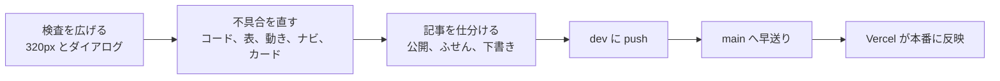

# 4-0: a11y の不具合を直し、記事を仕分けて最初の公開をする

- 起票日: 2026-11-23
- 学習計画: ADR `20261122-1821-publish-first-path.md`（公開までの4回）
- ADR: `docs/adr/20261123-1413-first-publish-a11y-and-articles.md`（この回で決めたこと。状態は「採用」）
- 前提: 3-8・3-9 が完了していること（RSS、sitemap、robots、CSP がある）
- ステータス: 完了（公開する手順 10 は未実施）

## 全体のどこか

3-3c のあと、最初の公開までの4回のうち最後の回。

| Step     | 内容                                             | 進捗           |
| -------- | ------------------------------------------------ | -------------- |
| 3-5      | トップ画面を作る（自己紹介、最新の記事とふせん） | ■■■ 完了       |
| 3-11     | ファビコン、ヒーロー、404 ページを作る           | ■■■ 完了       |
| 3-8・3-9 | RSS、sitemap、robots を作り、軽い CSP を入れる   | ■■■ 完了       |
| 4-0      | a11y を直し、記事を仕分け、`main` に反映して公開 | □□□ ← いまここ |

この回で扱わないもの: 共有画像のデザインと `alt`（3-5b）、新しい記事の執筆、Search Console への登録、存在しない記事の URL を HTTP 404 で返す仕組み。

## なぜこれをやるか

公開すると、知らない人が初めてこのサイトを読む。キーボードで読めないコード、崩れた表、書きかけの記事が残ったままだと、最初の印象で離れてしまう。a11y を最優先にするという方針どおり、公開の前に、見つかっている不具合を直す。

自動検査の範囲も先に広げる。先に検査を落としてから直すと、直ったことを機械で確かめられ、公開のあとに同じ不具合が戻るのも防げる。

## 周辺知識

### 全体の地図



図から分かること:

- 直す前に検査を広げるので、どの不具合が検査で捕まるかを先に見られる
- 記事の仕分けは RSS と sitemap の中身も変える
- `main` に届いた時点で本番に出るので、`main` への push がこの回の最後の操作になる

### 用語

| 用語                   | たとえ                                 | 正確な意味                                                            | この回での出番 |
| ---------------------- | -------------------------------------- | --------------------------------------------------------------------- | -------------- |
| GFM                    | Markdown の方言                        | GitHub が広めた Markdown の拡張で、表や打ち消し線などの書き方を足す   | 手順 3         |
| `remark-gfm`           | 方言の通訳                             | Markdown を読む処理に GFM の文法を教えるプラグイン                    | 手順 3         |
| `aria-current`         | 館内図の「現在地」の印                 | 一覧の中でいまの場所にあたる項目を、支援技術に伝える属性              | 手順 5         |
| `role="group"`         | 中身をまとめる名札つきの箱             | 関連する要素を1つのまとまりとして支援技術に伝える役割                 | 手順 2         |
| ランドマーク           | 建物の階の案内板                       | `main` や `nav` のように、読み上げソフトで飛べるページの大きな区画    | 手順 2         |
| ターゲットサイズ       | ボタンの押しやすい大きさ               | 指やマウスで押せる範囲の大きさ。WCAG 2.5.8 は原則24×24px以上を求める  | 手順 6         |
| 早送り（fast-forward） | 遅れている人が先の人の位置まで進むだけ | 枝分かれがないとき、ブランチの先頭を新しいコミットへ動かす Git の操作 | 公開           |

### 設計の考え方

**`article` は「それだけで読める作品」に使う。** 一覧カードは本文を持たず、題と日付だけの案内である。`article` のままだと VoiceOver が「記事」を繰り返し読むので、カードは `div` にして、`li` と見出しで構造を伝える。記事の詳細ページの `article` は残す。

**子ページのナビは `page` ではなく `true` にする。** `aria-current="page"` は「このリンクの先が、いま開いているページ」という意味になる。記事を読んでいるときに「記事」のリンクが `page` だと、記事一覧にいると誤解させる。`true` なら「いまいる区画」とだけ伝えられる。

**`tabindex="0"` だけでは足りず、名前も要る。** 横に長いコードは、キーボードでスクロールするためにフォーカスできる必要がある。ただ、フォーカスしたときに名前がないと、読み上げを使う人には何の場所か分からない。

### ベストプラクティス

- 横にスクロールする領域はキーボードで操作できるようにする（出典: [WCAG 2.1.1 Keyboard](https://www.w3.org/WAI/WCAG22/Understanding/keyboard.html)）
- フォーカスできる要素には名前と役割を持たせる（出典: [WCAG 4.1.2 Name, Role, Value](https://www.w3.org/WAI/WCAG22/Understanding/name-role-value.html)）
- 押せる範囲は原則24×24px以上にする（出典: [WCAG 2.5.8 Target Size (Minimum)](https://www.w3.org/WAI/WCAG22/Understanding/target-size-minimum.html)）
- 幅 320px で横スクロールなしに読めるようにする（出典: [WCAG 1.4.10 Reflow](https://www.w3.org/WAI/WCAG22/Understanding/reflow.html)）

### 比較（コードブロックの役割）

| 案              | 得意なこと                         | 引き換えにするもの                     | この回で採るか |
| --------------- | ---------------------------------- | -------------------------------------- | -------------- |
| `role="group"`  | 名前を付けても区画の一覧が増えない | ランドマークでは飛べない               | 採る           |
| `role="region"` | ランドマークとして直接飛べる       | コードの多い記事で区画の一覧が長くなる | 採らない       |
| 役割を付けない  | 実装が最も少ない                   | フォーカスしても何の場所か伝わらない   | 採らない       |

### a11y の解説

| 実装                     | 入れたとき、どう伝わるか                         | 入れないと、どうなるか                    | 誰が困るか                       | 根拠              |
| ------------------------ | ------------------------------------------------ | ----------------------------------------- | -------------------------------- | ----------------- |
| コードブロックの名前     | フォーカスしたときに「tsx のコード例」と分かる   | 何の領域に入ったのか分からない            | 読み上げを使う人                 | WCAG 4.1.2        |
| キーボードでのスクロール | 矢印キーで長いコードの右側まで読める             | 画面の外のコードを読む手段がない          | キーボードで操作する人           | WCAG 2.1.1        |
| 本物の `<table>`         | 行と列の見出しとの対応をたどれる                 | `\|` の並んだ文字として読まれる           | 読み上げを使う人を含む全員       | WCAG 1.3.1        |
| 動きを減らす設定         | OS の設定に合わせて画面の動きが止まる            | 設定していても拡大の動きが再生される      | 動きで気分が悪くなることがある人 | WCAG 2.3.3（AAA） |
| `aria-current`           | 一覧にいるのか、その中の記事にいるのか区別できる | 記事を開いていても一覧にいると伝わる      | 読み上げを使う人                 | WAI-ARIA 1.2      |
| カードの見出し           | 見出しの移動で記事の題を順に聞ける               | 「記事」が繰り返され、題へ飛べない        | 読み上げを使う人                 | WCAG 1.3.1、2.4.6 |
| 24px の押せる範囲        | 小さいリンクも押し間違えにくい                   | フッターの X は 8×18px で、隣を押しやすい | 手が震える人、スマートフォンの人 | WCAG 2.5.8        |

VoiceOver の読み上げは未確認なので、手順 9 で自分の耳で確かめる。

### 現時点のバージョン（2026-11-23 確認）

| パッケージ      | バージョン | この回での扱い                  |
| --------------- | ---------- | ------------------------------- |
| next            | 16.4.6     | そのまま                        |
| react           | 19.3.1     | そのまま                        |
| @shikijs/rehype | 4.5.0      | そのまま                        |
| remark-gfm      | 4.0.1      | 新しく入れる（2025-02-10 公開） |

## 作業手順（全体の地図）

1. axe の検査を広げ、いまの不具合で落ちることを見る
2. **本題:** コードブロックをキーボードと読み上げで使えるようにする
3. Markdown の表を本物の表にする
4. 動きを減らす設定を効かせる
5. ナビで「いまいる場所」を正しく伝える
6. フッターのリンクを押しやすくする
7. 一覧カードの構造を直し、見本のタグを実在するものにする
8. 記事を仕分ける
9. 全体を検査し、スマートフォンの幅と VoiceOver で確かめる
10. コミットと push のあと、`main` に反映して公開する

## 確認事項

- [ ] **1. 公開する記事。** 推奨「`blog`、`canonical`、`cloudflare-web-analytics`、`dns`、`pandacss`、`rem`、`umami` の7本」で作成。`hello` は動作確認用、`uiux` は答えが未記入、`lib-or-util` は表が見本のままなので `content/draft/` に移す。欠点は外した記事の URL が公開後に開けなくなること
- [ ] **2. `ogp` の扱い。** 推奨「ふせんに移し、題を『og:type を記事とそれ以外で使い分ける』にする」で作成。理由は本文が短いメモで、題が `dns` と重複しているため。欠点は `/posts/ogp` の URL がなくなること
- [ ] **3. 検査の範囲。** 推奨「幅 320px、ダイアログを開いた状態、横スクロールを足す」で作成。理由はスマートフォンの読者が多い前提で、PC 幅だけでは不具合を逃したため。欠点は `bun run ay` が約15秒から約20秒に増えること
- [ ] **4. コードブロックの名前。** 推奨「`role="group"` と `tsx のコード例` のような `aria-label`」で作成。理由はランドマークの一覧を増やさないため。欠点は言語名をそのまま読むこと
- [ ] **5. 表の対応。** 推奨「`remark-gfm` 4.0.1 を入れる」で作成。理由は Markdown の表の文法を自分で保守せずに済むため。欠点は依存が1つ増えること
- [ ] **6. ナビの現在地。** 推奨「一覧は `page`、子ページは `true`」で作成。理由は一覧と子ページを区別して伝えられるため。欠点は `true` の読まれ方が読み上げソフトによって違うこと
- [ ] **7. カードの見出し。** 推奨「`article` を `div` にし、`PostCard` に `headingLevel` を足す」で作成。理由はふせんと同じ形で見出しの階層を保てるため。欠点は props が1つ増えること
- [ ] **8. 押せる範囲。** 推奨「ナビとフッターを24px以上にする」で作成。理由は axe は隙間があれば通すが、X のリンクが 8×18px と小さいため。欠点はトークンが1つ増え、ナビとフッターが少し高くなること
- [ ] **9. 見本のタグ。** 推奨「`/design-system` の見本を実在する `blog` と `css` にする」で作成。理由はリンク先が 404 にならないため。欠点はそのタグの記事がなくなると、また 404 になること
- [ ] **10. 【監査項目からの除外】共有画像の `alt`。** 推奨「3-5b に回す」で作成。記事ごとの `alt` には `generateImageMetadata` への書き換えが要り、画像のデザインと一緒に直すほうが手戻りが少ないため。欠点は公開の時点で、内容ではなく画像の種類を説明する文のままであること
- [ ] **11. 【未確認】カードの `ul`。** 推奨「手順 9 で Safari の VoiceOver を聞き、一覧と読まれなければ次の回で直す」で作成。理由は Safari の読み上げを自動検査で再現できないため。欠点は読まれない場合、公開の時点で不具合が残ること
- [ ] **12. 【いつもの手順からの逸脱】公開のコマンド。** 推奨「`git push origin dev:main`」で作成。いつもは `git switch main && git merge --ff-only dev && git push` だが、未コミットの変更があると切り替えが止まるおそれがあるため。欠点は手元の `main` を別に更新する必要があること
- [x] **13. 未コミットのふせん。** 本人の変更で「`line-clamp` と `preload` も今回の公開に含める」に決定（推奨は含めない）。欠点は短いメモのまま公開されること

## ハンズオン

コードと出力はリポジトリの複製で動かして写した（2026-11-23、next 16.4.6、react 19.3.1、remark-gfm 4.0.1、bun 1.4.4、Node.js 24.22.1）。VoiceOver の読み上げ、Safari での読まれ方、本番環境の結果は未確認なので、自分で確かめる。

---

### 準備：この回で何をするのか

先に検査を広げて不具合を機械に見つけさせ、1つずつ直す。そのあと記事を仕分け、`dev` を `main` に進めて公開する。

#### 用意するもの

開発サーバーや本番サーバーを起動していたら止めておく。`bun run ay` がポート 3100 を使い、ビルドが `.next` を書き換えるためだ。

---

### 手順 1：axe の検査を広げ、いまの不具合で落ちることを見る

`playwright.config.ts` の `projects` で、`dark` の項目の下に次の2つを足す。

```ts
{
  name: "mobile-light",
  use: {
    ...devices["Desktop Chrome"],
    viewport: { width: 320, height: 700 },
    colorScheme: "light",
  },
},
{
  name: "mobile-dark",
  use: {
    ...devices["Desktop Chrome"],
    viewport: { width: 320, height: 700 },
    colorScheme: "dark",
  },
},
```

`e2e/a11y.spec.ts` の一番下にあるテストを、次の形に置き換える。

```ts
test("サイト内のページに WCAG 2.2 AA の違反がない", async ({ page }) => {
  const paths = await collectPaths(page);
  for (const path of paths) {
    await test.step(path, async () => {
      await page.goto(path);
      expect.soft(await findViolations(page), path).toEqual([]);
      const hasOverflow = await page.evaluate(
        () => document.documentElement.scrollWidth > document.documentElement.clientWidth,
      );
      expect.soft(hasOverflow, `${path} に横スクロールがある`).toBe(false);
    });
  }
});

test("ふせんのダイアログを開いた状態に WCAG 2.2 AA の違反がない", async ({ page }) => {
  await page.goto("/notes");
  await page.getByRole("main").getByRole("button").first().click();
  await expect(page.getByRole("dialog")).toBeVisible();
  expect(await findViolations(page)).toEqual([]);
});
```

検査を実行する。

```bash
bun run ay
```

期待される出力（抜粋。実測）:

```
  1) [mobile-light] › e2e/a11y.spec.ts:36:1 › サイト内のページに WCAG 2.2 AA の違反がない › /posts/cloudflare-web-analytics
    +     "id": "scrollable-region-focusable",
  2) [mobile-dark] › e2e/a11y.spec.ts:36:1 › サイト内のページに WCAG 2.2 AA の違反がない › /posts/cloudflare-web-analytics
  2 failed
  6 passed (22.4s)
```

**なぜ** — いまの検査は PC の幅だけなので、スマートフォンで横にはみ出すコードを見逃していた。`scrollable-region-focusable` は「スクロールできる場所にキーボードで入れない」という違反である。

---

### 手順 2：この回の本題。コードブロックをキーボードと読み上げで使えるようにする

`lib/createPostReader.ts` の `@shikijs/rehype` の import を次の行に置き換える。

```ts
import rehypeShiki, { type RehypeShikiOptions } from "@shikijs/rehype";
```

`TAG_PATTERN` の下に次を足す。

```ts
type ShikiTransformer = NonNullable<RehypeShikiOptions["transformers"]>[number];

const nameCodeBlock: ShikiTransformer = {
  pre(node) {
    const { lang } = this.options;
    node.properties.role = "group";
    node.properties["aria-label"] = lang === "text" ? "コード例" : `${lang} のコード例`;
  },
};
```

`rehypeShiki` の設定で、`defaultColor` の下に次を足す。

```ts
// 言語の指定がないコードブロックも Shiki に通し、キーボードで横にスクロールできるようにする
defaultLanguage: "text",
transformers: [nameCodeBlock],
```

もう一度検査する。

```bash
bun run ay
```

期待される出力（抜粋。実測）:

```
  8 passed (22.7s)
```

**なぜ** — Shiki は処理したコードブロックに `tabindex="0"` を付ける。言語を書いていないブロックは Shiki を通らないので、そこだけキーボードで入れなかった。`defaultLanguage` で全部を通し、`transformers` で名前を付ける。自動検査は `tabindex` の有無を見つけられるが、名前の良し悪しまでは判断しない。ここが「検査が通る」と「使える」の違いで、手順 9 で耳で確かめる理由になる。

---

### 手順 3：Markdown の表を本物の表にする

パッケージを入れる。

```bash
bun add remark-gfm@4.0.1
```

`lib/createPostReader.ts` の `@shikijs/rehype` の import の下に次を足す。

```ts
import remarkGfm from "remark-gfm";
```

同じファイルの `evaluate` の設定で、`...runtime,` の下に次を足す。

```ts
remarkPlugins: [remarkGfm],
```

`app/posts/[slug]/prose.ts` を次の内容に置き換える。

```ts
import { css } from "../../../styled-system/css";
import { linkStyleRaw } from "../../_components/style/link";

export const prose = css({
  textStyle: "body",
  "& h2": { textStyle: "heading.2", marginTop: "48", marginBottom: "16" },
  "& p": { marginBottom: "16" },
  "& a": linkStyleRaw,
  "& pre": { padding: "16", overflowX: "auto", marginBottom: "16" },
  "& code": { letterSpacing: "0" },
  "& table": { width: "full", borderCollapse: "collapse", marginBottom: "16" },
  "& th, & td": {
    borderWidth: "1",
    borderColor: "border.default",
    padding: "8",
    textAlign: "start",
  },
});
```

ビルドして、`/posts/dns` に表があることを確かめる。

```bash
bun run b
grep -o "<table" .next/server/app/posts/dns.html | wc -l
```

期待される出力（実測）:

```
       1
```

**なぜ** — Markdown の元の仕様に表はなく、GitHub が広めた拡張（GFM）で使えるようになった。MDX は標準では GFM を読まないので、`|` がただの文字として表示されていた。

---

### 手順 4：動きを減らす設定を効かせる

`panda.config.ts` の一番外にある `"@media (prefers-reduced-motion: reduce)"` のかたまりを消す。

`globalCss` の中で、`body` の直前に次を足す。

```ts
"@media (prefers-reduced-motion: reduce)": {
  "::view-transition-group(*), ::view-transition-old(*), ::view-transition-new(*)": {
    animation: "none",
  },
},
```

ビルドして、CSS に出たことを確かめる。

```bash
bun run b
cat .next/static/chunks/*.css | grep -o "prefers-reduced-motion:reduce){[^}]*view-transition[^}]*}" | head -n 1
```

期待される出力（実測）:

```
prefers-reduced-motion:reduce){::view-transition-group(*){animation:none}
```

**なぜ** — `defineConfig` の一番外に CSS を書いても、Panda はそれを CSS として出力しない。エラーにもならないので、設定したつもりのまま動いていなかった。`globalCss` の中に入れて初めて CSS になる。

---

### 手順 5：ナビで「いまいる場所」を正しく伝える

`theme/tokens.ts` の `sizes` に、`8` の下の行として次を足す。

```ts
24: { value: "1.5rem" },
```

`app/_components/nav-link.tsx` を次の内容に置き換える。

```tsx
"use client";

import { usePathname } from "next/navigation";
import type { ReactNode } from "react";
import { css } from "../../styled-system/css";
import { AppLink } from "./app-link";

type NavLinkProps = { href: string; children: ReactNode };

export function NavLink({ href, children }: NavLinkProps) {
  const pathname = usePathname();
  const isCurrentPage = pathname === href;
  const isInSection = pathname.startsWith(`${href}/`);

  return (
    <AppLink
      href={href}
      // 子ページを page にすると、記事を開いていても一覧にいると読み上げられる
      aria-current={isCurrentPage ? "page" : isInSection ? "true" : undefined}
      className={css({
        display: "inline-flex",
        alignItems: "center",
        minHeight: "24",
        _hover: { textDecoration: "underline" },
        "&[aria-current]": { fontWeight: "bold", textDecoration: "underline" },
      })}
    >
      {children}
    </AppLink>
  );
}
```

**なぜ** — 一覧と子ページで `aria-current` の値を分ける（周辺知識の「設計の考え方」）。見た目の太字は `&[aria-current]` で両方に当てるので、画面の見え方は変わらない。

---

### 手順 6：フッターのリンクを押しやすくする

`app/_components/site-footer.tsx` を次の内容に置き換える。

```tsx
import { css } from "../../styled-system/css";
import { AppLink } from "./app-link";

const footerLink = css({
  display: "inline-flex",
  alignItems: "center",
  justifyContent: "center",
  minWidth: "24",
  minHeight: "24",
});

export function SiteFooter() {
  return (
    <footer className={css({ borderTopWidth: "1", borderColor: "border.default" })}>
      <div
        className={css({
          display: "flex",
          flexDirection: "column",
          gap: "8",
          maxWidth: "640",
          marginX: "auto",
          paddingX: "16",
          paddingY: "16",
          fontSize: "14",
          color: "fg.muted",
        })}
      >
        <ul className={css({ display: "flex", flexWrap: "wrap", gap: "16" })}>
          <li>
            <a href="https://x.com/65banseki" className={footerLink}>
              X
            </a>
          </li>
          <li>
            <a href="https://github.com/hi-lee-mon" className={footerLink}>
              GitHub
            </a>
          </li>
          <li>
            <AppLink href="/design-system" className={footerLink}>
              デザインシステム
            </AppLink>
          </li>
          <li>
            {/* oxlint-disable-next-line next/no-html-link-for-pages -- XML は画面ではないので、Linkコンポーネントを使った画面遷移は不要 */}
            <a href="/feed.xml" className={footerLink}>
              RSS フィード
            </a>
          </li>
        </ul>
        <p>
          <small>© 2026 65banseki</small>
        </p>
      </div>
    </footer>
  );
}
```

**なぜ** — フッターの X は 8×18px で、指で押すには小さい（実測）。文字の大きさを変えずに、押せる範囲だけを24px以上に広げる。

---

### 手順 7：一覧カードの構造を直し、見本のタグを実在するものにする

`app/_components/post-card.tsx` を次の内容に置き換える。

```tsx
import { css, cx } from "../../styled-system/css";
import { AppLink } from "./app-link";
import { linkStyle } from "./style/link";

type PostCardProps = {
  slug: string;
  title: string;
  date: string;
  headingLevel?: "h2" | "h3";
};

export function PostCard({ slug, title, date, headingLevel = "h2" }: PostCardProps) {
  const Heading = headingLevel;

  return (
    <div
      className={css({
        display: "flex",
        flexDirection: "column",
        gap: "4",
        padding: "16",
        borderWidth: "1",
        borderColor: "border.default",
        borderRadius: "8",
      })}
    >
      <time dateTime={date} className={css({ color: "fg.muted", fontSize: "14" })}>
        {date}
      </time>
      <Heading>
        <AppLink href={`/posts/${slug}`} className={cx(linkStyle, css({ fontWeight: "bold" }))}>
          {title}
        </AppLink>
      </Heading>
    </div>
  );
}
```

`app/_components/note-card.tsx` は、一番外の `<article` を `<div` に、最後の `</article>` を `</div>` に変える。

`app/page.tsx` の `PostCard` を次の形にする。

```tsx
<PostCard slug={slug} title={frontmatter.title} date={frontmatter.date} headingLevel="h3" />
```

`app/design-system/page.tsx` の見本を次の形にする。

```tsx
<Tag tag="blog" size="sm" />
<Tag tag="css" size="md" />
```

```tsx
<PostCard slug="blog" title="65banseki.devを作ってみた" date="2026-11-06" headingLevel="h3" />
```

型検査を実行する。

```bash
bun run tc
```

エラーが出なければ進む。

**なぜ** — トップ画面と `/design-system` では、カードの上に `h2` があるので題を `h3` にする。`/posts` とタグのページは `h1` の直下なので、既定の `h2` のままでよい。

---

### 手順 8：記事を仕分ける

```bash
git mv content/hello.mdx content/draft/hello.mdx
git mv content/uiux.mdx content/draft/uiux.mdx
git mv content/lib-or-util.mdx content/draft/lib-or-util.mdx
git mv content/ogp.mdx content/notes/ogp-type.mdx
```

`content/notes/ogp-type.mdx` の `title` を次の行に置き換える。`:` を含むので、引用符で囲む。

```yaml
title: "og:type を記事とそれ以外で使い分ける"
```

ビルドして、RSS と sitemap の件数を見る。

```bash
bun run b
grep -c "<item>" .next/server/app/feed.xml.body
grep -c "<loc>" .next/server/app/sitemap.xml.body
grep -cE "/posts/(hello|uiux|lib-or-util|ogp)" .next/server/app/sitemap.xml.body
```

期待される出力（実測）:

```
7
19
0
```

**なぜ** — `content/draft/` は記事の読み込みの対象外なので、ファイルを残したままサイトから外せる。sitemap の19件は固定の5ページ、記事7本、タグ7個の合計である。

---

### 手順 9：全体を検査し、スマートフォンの幅と VoiceOver で確かめる

```bash
bun run ay
```

期待される出力（抜粋。実測）:

```
  8 passed (16.9s)
```

本番ビルドを起動する。

```bash
bun run s -p 3100
```

画面の幅:

1. Chrome の DevTools で Toggle device toolbar（⌘ + Shift + M）を押し、幅を `320` にする
2. `/posts/dns` で表が幅に収まることを見る
3. `/posts/blog` のコードで、Tab でフォーカスしてから左右の矢印キーで横に動くことを見る

動きを減らす設定:

1. DevTools の Rendering で `prefers-reduced-motion: reduce` を選ぶ
2. `/notes` でふせんを開き、広がる動きが出ないことを見る

VoiceOver（⌘ + F5 で起動。Control + Option + 右矢印で次へ）:

1. `/posts/blog` で、コードブロックに「tsx のコード例」という名前が付いていることを聞く
2. 同じページで、ナビの「記事」が「現在のページ」と読まれないことを聞く
3. `/posts` で、カードの題が見出しとして読まれることを聞く
4. **Safari で** `/posts` を開き、カードの一覧が「リスト」と読まれるかを聞く

読み上げの文言は未確認なので、自分の耳で確かめてほしい。4 で「リスト」と読まれなければ、確認事項 11 のとおり次の回で直す。確かめたら、サーバーを Control + C で止める。

---

実装は以上です。静的検証、テストがオールグリーンならcommitしてpushしてください。

---

### 手順 10：`dev` の push のあと、`main` に反映して公開する

`main` が `dev` の過去の位置にあることを確かめる。

```bash
git fetch origin
git merge-base --is-ancestor origin/main dev && echo "早送りできます"
```

期待される出力（2026-11-23 の時点の実測）:

```
早送りできます
```

本番に出す。**このコマンドで公開される。**

```bash
git push origin dev:main
git fetch origin main:main
```

Vercel のデプロイが終わったら、本番の応答を確かめる。

```bash
curl -s -o /dev/null -w '%{http_code}\n' https://www.65banseki.dev/
curl -s -o /dev/null -w '%{http_code}\n' https://www.65banseki.dev/feed.xml
curl -s -o /dev/null -w '%{http_code}\n' https://www.65banseki.dev/sitemap.xml
curl -sI https://www.65banseki.dev/ | grep -i content-security-policy
```

期待される出力（本番は未確認）:

```
200
200
200
content-security-policy: frame-ancestors 'none'; base-uri 'self'; object-src 'none'; form-action 'self'
```

最後にブラウザで `https://www.65banseki.dev/` を開き、DevTools の Network で `beacon.min.js` と `script.js` が読み込まれることを見る。Cloudflare と Umami の解析が CSP で止まっていないことの確認になる。

**なぜ** — `git push origin dev:main` は「手元の `dev` の位置まで、リモートの `main` を進める」という指定で、早送りできないときは Git が拒否する。ブランチを切り替えないので、未コミットの変更に影響されない。

---

### うまくいかないとき

| 症状                                       | 原因と対処                                                           |
| ------------------------------------------ | -------------------------------------------------------------------- |
| `scrollable-region-focusable`              | 手順 2 の `defaultLanguage: "text"` がない                           |
| `Property 'options' does not exist`        | `nameCodeBlock` に `ShikiTransformer` の型が付いていない             |
| `Parameter 'node' implicitly has an 'any'` | 同上。手順 2 の形で定数に分ける                                      |
| `/posts/dns` の表が `\|` のまま            | `remarkPlugins: [remarkGfm]` がない                                  |
| `/design-system` のタグが 404              | 記事を仕分けると `nextjs` などのタグは消える。`blog` と `css` を使う |
| `git push origin dev:main` が拒否される    | `main` に `dev` にないコミットがある。push せず、そのまま貼って聞く  |

ここに載っていないエラーが出たら、そのまま貼って聞いてほしい。

---

## 受け入れ条件

- [x] 手順 1 の時点で `bun run ay` が `scrollable-region-focusable` で失敗する（同じ手順の複製で確認）
- [ ] すべてのコードブロックに名前があり、Tab と矢印キーで横に動かせる（キーボード）（未確認のまま本人了承。15個すべてに名前があることは確認済み）
- [x] `/posts/dns` に表が出て、幅 320px に収まる（HTML と横スクロールの検査で確認）
- [ ] `prefers-reduced-motion: reduce` で、ふせんの広がる動きが出ない（目視）（未確認のまま本人了承。ビルド後の CSS には出ている）
- [x] 記事ページでナビの「記事」が `aria-current="true"`、`/posts` で `aria-current="page"` になる
- [x] 一覧カードに `article` がなく、題が見出しになっている
- [x] ナビとフッターのリンクの高さがすべて24px以上になっている
- [x] `/design-system` の見本のタグが 404 にならない
- [x] RSS が7件、sitemap が19件で、外した記事が出ない
- [ ] コードブロックの名前、ナビの現在地、カードの見出しが読み上げで分かる（VoiceOver）（未確認のまま本人了承）
- [ ] Safari の VoiceOver で、カードの一覧が「リスト」と読まれるかを確かめた（未確認のまま本人了承）
- [x] `bun run l`、`bun run tc`、`bun run b`、`bun run ay` が通る
- [ ] 本番のトップ、`/feed.xml`、`/sitemap.xml` が 200 を返し、CSP のヘッダーが付いている（未確認のまま本人了承。公開後に確かめる）
- [ ] 本番で Cloudflare と Umami のスクリプトが読み込まれる（目視）（未確認のまま本人了承。公開後に確かめる）

## この回で理解したこと

着手後に埋める。

- [ ] 自動検査が通っても a11y の問題が残る例を1つ挙げられる
- [ ] `aria-current` の `page` と `true` の違いを説明できる
- [ ] 一覧カードで `article` を使わない理由を説明できる
- [ ] GFM とは何か、なぜ `remark-gfm` が要るのかを説明できる
- [ ] `git push origin dev:main` が何をするコマンドかを説明できる

## 参考

- ADR `20261122-1821-publish-first-path.md` の「4-0 に一覧カードの a11y 修正を含める」
- [WCAG 2.2 Understanding Docs](https://www.w3.org/WAI/WCAG22/Understanding/)
- [WAI-ARIA 1.2 aria-current](https://www.w3.org/TR/wai-aria-1.2/#aria-current)
- [remark-gfm](https://github.com/remarkjs/remark-gfm)
- [Shiki Transformers](https://shiki.style/guide/transformers)
